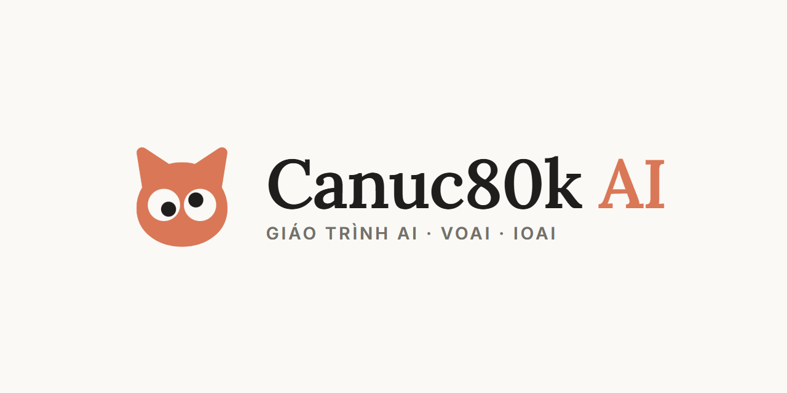

<h3 align="center">Từ dòng Python đầu tiên tới đề thi IOAI.</h3>

Giáo trình AI cho học sinh lập trình thi đấu, hướng tới VOAI và IOAI. 
<a href="https://ai-canuc80k.ai-web-deploy-20261010.workers.dev/"><b>Mở website</b></a> · <a href="https://canuc80k.github.io/ai-canuc80k/">Bản GitHub Pages</a> · <a href="docs/giao_trinh/notebook">Notebook</a>

---

## Có gì ở đây

- **63 bài học + 4 bài kiểm tra.** Mỗi bài đi từ một câu hỏi thật, tính tay trước, rồi chạy code thấy kết quả (nút **Chạy** trên web).
- **2700+ câu hỏi.** Câu hỏi nhanh giữa bài, 10 câu cuối bài và sáu bộ trắc nghiệm Light → Ultra phỏng theo đề NOAI, USAAIO, CMU, MIT. Sai câu nào, bấm “Ôn lại” để mở đúng đoạn lý thuyết.
- **Bài tập tự chấm** cho từng bài (nộp trên LQDOJ) và **71 đề thi thật** (ROAI, OJIA, AIIS, IOAI…) xếp theo mức và theo chương.
- **Slide, PDF, notebook** cho mọi bài. Notebook mở thẳng trên Colab hoặc Kaggle.

## Lộ trình

| Khóa | Phase | Số bài | Nội dung |
|---|---|---|---|
| Học máy | 0 · Python và dữ liệu | 3 | Công cụ làm việc với dữ liệu. |
| Học máy | 1 · Nền tảng học máy | 7 | Đặt bài toán, chia dữ liệu và chấm điểm cho đúng. |
| Học máy | 2 · Học máy cổ điển | 11 | Các mô hình kinh điển cho dữ liệu bảng. |
| Học sâu | 3 · Mạng neural | 10 | Tự xây và huấn luyện mạng neural. |
| Học sâu | 4 · Model pretrained | 5 | Dùng lại model lớn đã huấn luyện sẵn. |
| Ảnh, chữ và âm thanh | 5 · Thị giác máy tính | 9 | Các bài toán về ảnh. |
| Ảnh, chữ và âm thanh | 6 · Xử lý ngôn ngữ | 6 | Các bài toán về văn bản. |
| Ảnh, chữ và âm thanh | 7 · Âm thanh và đa phương thức | 4 | Âm thanh, giọng nói và đa phương thức. |
| Luyện thi | 8 · Luyện thi | 5 | Chiến lược làm bài và thi thử. |
| Luyện thi | 9 · Mở rộng | 3 | Các chủ đề ngoài phần thi chính. |

## Chạy notebook

Mỗi bài có một notebook ở [`docs/giao_trinh/notebook`](docs/giao_trinh/notebook). Mở trên Colab bằng đường dẫn
`https://colab.research.google.com/github/Canuc80k/ai-canuc80k/blob/main/docs/giao_trinh/notebook/<mã bài>.ipynb`, ví dụ
[Bài 0.1](https://colab.research.google.com/github/Canuc80k/ai-canuc80k/blob/main/docs/giao_trinh/notebook/0.1.ipynb) · [Bài 2.7](https://colab.research.google.com/github/Canuc80k/ai-canuc80k/blob/main/docs/giao_trinh/notebook/2.7.ipynb) · [Bài 6.3](https://colab.research.google.com/github/Canuc80k/ai-canuc80k/blob/main/docs/giao_trinh/notebook/6.3.ipynb). Trên website, nút **Mở trên Colab** / **Mở trên Kaggle** nằm ngay dưới tên bài.

## Cấu trúc

| Thư mục | Nội dung |
|---|---|
| `docs/` | Website tĩnh (mở `docs/index.html`). Bật GitHub Pages: *Settings → Pages → Deploy from branch → main / docs*. |
| `docs/giao_trinh/` | Slide, PDF, notebook, code mẫu, đề bài tập. |
| `course/content/` | Nguồn bài học (`phase-N/<mã>.md`), slide, hình SVG, hình động, bài tập, trắc nghiệm. |
| `course/tools/` | Công cụ dựng từng bài, kiểm code, QA trình duyệt, xuất PDF, dựng web (`split_site.py`), đẩy repo (`publish_repo.py`). |
| `course/figures-recipe/` | Script vẽ lại hình và hình động. |

Xem web ở máy: `python -m http.server -d docs 8000` rồi mở `http://localhost:8000`.

## Nguồn và giấy phép

Câu hỏi phỏng theo đề thi ghi nguồn ngay dưới câu. Phông chữ Lora, Inter, JetBrains Mono theo SIL Open Font License (`docs/ui/fonts/OFL.txt`).
Ảnh mẫu lấy từ scikit-learn, scikit-image (ghi ở cuối mỗi bài). Nội dung giáo trình © Canuc80k.
