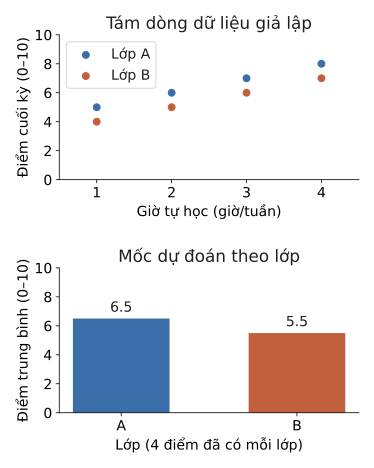

# Code mẫu — Pandas và Matplotlib

Thao tác trên bảng chỉ có ích khi ta biết mình đang trả lời câu hỏi gì: ô thiếu nghĩa là gì, khóa dùng để ghép có duy nhất không, biểu đồ đang so đại lượng nào. Ví dụ cuối dựng một mốc dự đoán từ dữ liệu giả lập, ghi CSV đúng theo file mẫu, rồi đọc lại để kiểm.

## Ví dụ 1: Phân biệt điểm bị thiếu với điểm bị ghi sai

File CSV có sáu học sinh, và ID cần giữ số 0 ở đầu. Ký hiệu `?` được quy ước là thiếu điểm. Còn chữ `bảy` là một lỗi nhập liệu, cần xem lại. Hai trường hợp này khác nhau, không nên lặng lẽ gộp làm một.

```python
from io import StringIO
import pandas as pd

csv_text = """id,lop,diem
001,A,6
002,A,8
003,A,bảy
004,B,5
005,B,?
006,B,9
"""
table = pd.read_csv(StringIO(csv_text), na_values=["?"],
                    dtype={"id": "string", "lop": "string"})
numeric = pd.to_numeric(table["diem"], errors="coerce")
invalid = table["diem"].notna() & numeric.isna()
print("shape:", table.shape)
print("thiếu đã khai báo:", int(table["diem"].isna().sum()))
print("giá trị nhập sai:", table.loc[invalid, ["id", "diem"]].to_dict("records"))

table["diem"] = numeric
# Giả sử đã đối chiếu phiếu điểm gốc và biết điểm của ID 003 là 7.
table.loc[table["id"] == "003", "diem"] = 7.0
selected = table.loc[(table["lop"] == "A") & (table["diem"] >= 7),
                     ["id", "diem"]]
print("A có điểm từ 7:", selected.to_dict("records"))
print("ô còn thiếu:", int(table["diem"].isna().sum()))
```

```output
shape: (6, 3)
thiếu đã khai báo: 1
giá trị nhập sai: [{'id': '003', 'diem': 'bảy'}]
A có điểm từ 7: [{'id': '002', 'diem': 8.0}, {'id': '003', 'diem': 7.0}]
ô còn thiếu: 1
```

Trước khi đổi kiểu, bảng có một ô thiếu đã khai báo, và một ô sai định dạng ở ID `003`. Mẹo ở đây là so hai lần đếm: ô nào lúc đầu có chữ, nhưng sau `to_numeric` lại thành rỗng, thì đó là ô ghi sai chứ không phải ô thiếu. Sửa đúng ô ấy bằng `loc`, ta lọc được `002` và `003`, còn ô của ID `005` vẫn thiếu như cũ. `errors="coerce"` giúp phát hiện lỗi, nhưng sửa thành bao nhiêu thì phải dựa vào dữ liệu gốc, không được đoán.

## Ví dụ 2: Cùng một bảng, hai mẫu số khác nhau

Lớp A có điểm `6, 8, 7`. Lớp B có `5`, một điểm thiếu, và `9`. Ta cần báo trung bình từng lớp, và tỉ lệ học sinh đạt từ 7 điểm. Câu hỏi là tỉ lệ ấy tính trên cả danh sách, hay chỉ trên những dòng đã có điểm?

```python
import numpy as np
import pandas as pd

table = pd.DataFrame({
    "lop": ["A", "A", "A", "B", "B", "B"],
    "diem": pd.Series([6, 8, 7, 5, np.nan, 9], dtype="float64"),
})
summary = table.groupby("lop")["diem"].agg(["mean", "count", "size"])
print(summary.to_string())
print("tỉ lệ trên mọi dòng:", round(float((table["diem"] >= 7).mean()), 3))
known = table["diem"].dropna()
print("tỉ lệ trên điểm đã có:", round(float((known >= 7).mean()), 3))

# transform trả về một giá trị cho mỗi dòng gốc, khác với agg chỉ trả hai dòng, mỗi lớp một dòng.
table["max_lop"] = table.groupby("lop")["diem"].transform("max")
print("max theo từng dòng:", table["max_lop"].tolist())

zero_filled = table.assign(diem=table["diem"].fillna(0))
print("trung bình nếu điền 0:",
      zero_filled.groupby("lop")["diem"].mean().round(3).to_dict())
```

```output
     mean  count  size
lop                   
A     7.0      3     3
B     7.0      2     3
tỉ lệ trên mọi dòng: 0.5
tỉ lệ trên điểm đã có: 0.6
max theo từng dòng: [8.0, 8.0, 8.0, 9.0, 9.0, 9.0]
trung bình nếu điền 0: {'A': 7.0, 'B': 4.667}
```

Hai lớp cùng trung bình 7, nhưng lớp B chỉ có hai điểm để tính (`count=2`), trong khi danh sách có ba dòng (`size=3`). Có ba điểm từ 7 trở lên, nên tỉ lệ là `3/6 = 0.5` nếu chia cho cả danh sách, và `3/5 = 0.6` nếu chỉ chia cho những điểm đã có. Cả hai cách đều có thể đúng, miễn là báo rõ mình dùng mẫu số nào. Còn điền 0 thì làm trung bình B tụt xuống `14/3 ≈ 4.667`, tức là đổi luôn ý nghĩa dữ liệu, như thể học sinh vắng đã thi được 0 điểm.

## Ví dụ 3: Ghép bảng theo đúng khóa, và bắt bảng phụ có dòng trùng

Ba học sinh thuộc lớp `A, A, B`, và bảng sĩ số phải có đúng một dòng cho mỗi lớp. Sau đó, ba dự đoán phải được xếp theo đúng thứ tự ID của file mẫu, dù bảng dự đoán đang có thứ tự khác.

```python
import pandas as pd

students = pd.DataFrame({"id": [101, 102, 103], "lop": ["A", "A", "B"]})
class_info_bad = pd.DataFrame({"lop": ["A", "A", "B"], "si_so": [38, 38, 40]})
unchecked = students.merge(class_info_bad, on="lop", how="left")
print("không kiểm khóa:", len(students), "->", len(unchecked), "dòng")
try:
    students.merge(class_info_bad, on="lop", how="left", validate="many_to_one")
except pd.errors.MergeError:
    print("MergeError: bảng lớp không có khóa duy nhất")

# Trong tình huống này, hai dòng A đúng là một bản ghi bị chép lặp.
class_info = class_info_bad.drop_duplicates()
joined = students.merge(class_info, on="lop", how="left", validate="many_to_one")
assert len(joined) == len(students) and joined["si_so"].notna().all()
print("sĩ số đúng:", joined["si_so"].tolist())

sample = pd.DataFrame({"id": [103, 101, 102]})
predictions = pd.DataFrame({"id": [102, 101, 103], "diem": [8.0, 6.0, 7.0]})
print("gán theo vị trí sẽ ra:", predictions["diem"].tolist())
submission = sample.merge(predictions, on="id", how="left", validate="one_to_one")
assert submission["id"].equals(sample["id"])
assert submission["diem"].notna().all()
print("ghép theo ID:", submission.to_dict("records"))
```

```output
không kiểm khóa: 3 -> 5 dòng
MergeError: bảng lớp không có khóa duy nhất
sĩ số đúng: [38, 38, 40]
gán theo vị trí sẽ ra: [8.0, 6.0, 7.0]
ghép theo ID: [{'id': 103, 'diem': 7.0}, {'id': 101, 'diem': 6.0}, {'id': 102, 'diem': 8.0}]
```

Khóa A bị trùng nên mỗi học sinh lớp A xuất hiện hai lần, tổng cộng `2 × 2 + 1 = 5` dòng. Bảng phình ra mà không có lỗi nào được báo, nên tham số `validate` rất đáng dùng. Chỉ được bỏ dòng trùng khi đã biết chắc chúng là bản ghi lặp. Nếu hai dòng có giá trị mâu thuẫn, phải quay lại nguồn để đối chiếu. Ở phần sau, ID `103` phải nhận 7.0, chứ không phải 8.0 là giá trị đứng đầu bảng dự đoán. `merge` gắn đúng điểm cho từng ID rồi giữ thứ tự của file mẫu.

## Ví dụ 4: Từ ba file CSV tới mốc dự đoán và biểu đồ kiểm dữ liệu

Bộ dữ liệu giả lập có tám học sinh thuộc hai lớp A và B, với số giờ tự học mỗi tuần và điểm cuối kỳ trên thang 10. Mốc dự đoán là điểm trung bình của lớp trong train. Lớp C chưa từng xuất hiện trong train thì dùng trung bình chung. File mẫu cố ý đảo thứ tự ID để kiểm bước ghép.

```python
from pathlib import Path
from tempfile import TemporaryDirectory
import numpy as np
import pandas as pd

train_source = pd.DataFrame({
    "id": [f"{i:03d}" for i in range(1, 9)],
    "lop": ["A"] * 4 + ["B"] * 4,
    "gio_tu_hoc": [1, 2, 3, 4, 1, 2, 3, 4],
    "diem": [5, 6, 7, 8, 4, 5, 6, 7],
})
test_source = pd.DataFrame({"id": ["201", "202", "203"], "lop": ["B", "A", "C"]})
sample_source = pd.DataFrame({"id": ["203", "201", "202"], "diem": [0.0] * 3})

with TemporaryDirectory(prefix="pandas-csv-", dir=".") as directory:
    data_dir = Path(directory)
    for name, table in [("train", train_source), ("test", test_source),
                        ("sample", sample_source)]:
        table.to_csv(data_dir / f"{name}.csv", index=False, encoding="utf-8")
    train = pd.read_csv(data_dir / "train.csv", dtype={"id": "string"})
    test = pd.read_csv(data_dir / "test.csv", dtype={"id": "string"})
    sample = pd.read_csv(data_dir / "sample.csv", dtype={"id": "string"})
    assert train["id"].is_unique and test["id"].is_unique
    assert train["diem"].notna().all() and train["diem"].between(0, 10).all()

    means = train.groupby("lop")["diem"].mean()
    overall = train["diem"].mean()
    predictions = test.copy()
    predictions["diem"] = predictions["lop"].map(means).fillna(overall)
    submission = sample[["id"]].merge(predictions[["id", "diem"]],
                                     on="id", how="left", validate="one_to_one")
    assert submission["id"].equals(sample["id"])
    assert submission.shape == sample.shape
    assert submission.columns.tolist() == sample.columns.tolist()
    assert np.isfinite(submission["diem"]).all() and submission["diem"].between(0, 10).all()
    submission.to_csv(data_dir / "submission.csv", index=False, encoding="utf-8")
    restored = pd.read_csv(data_dir / "submission.csv", dtype={"id": "string"})
    pd.testing.assert_frame_equal(restored, submission)
    print("mốc từng lớp:", means.to_dict(), "mốc chung:", float(overall))
    print(restored.to_string(index=False))
    print("CSV đọc lại: đúng cột, ID, giá trị")
```

```output
mốc từng lớp: {'A': 6.5, 'B': 5.5} mốc chung: 6.0
 id  diem
203   6.0
201   5.5
202   6.5
CSV đọc lại: đúng cột, ID, giá trị
```

Lớp A có trung bình `(5 + 6 + 7 + 8) / 4 = 6.5`, lớp B có 5.5, cả train có 6.0. Vì vậy ID `203` thuộc lớp C nhận 6.0 ở dòng đầu của file nộp, còn hai ID kia nhận 5.5 và 6.5. Chuỗi assert ở cuối là danh sách việc nên làm trước mọi lần nộp: đúng số dòng, đúng tên cột, đúng thứ tự ID, không có giá trị lạ, và đọc lại file vẫn ra như cũ. Đây mới là một mốc để thử quy trình và định dạng. Chưa có bước chấm trên validation, nên chưa nói được gì về chất lượng dự đoán.

Biểu đồ dưới đây dùng chính tám dòng train vừa đọc. Hình trên cho thấy giờ tự học và điểm cùng thay đổi thế nào trong dữ liệu giả lập. Hình dưới là hai giá trị đang được dùng làm mốc dự đoán.

```python
from pathlib import Path
import matplotlib.pyplot as plt

colors = {"A": "#3b6ea8", "B": "#c2603e"}
with plt.rc_context({"svg.hashsalt": "canuc80k-code-0.3",
                     "svg.fonttype": "none", "font.family": "DejaVu Sans",
                     "font.size": 14, "text.color": "#1f1e1c",
                     "axes.spines.top": False, "axes.spines.right": False}):
    fig, (scatter_ax, bar_ax) = plt.subplots(2, 1, figsize=(5.2, 6.5))
    for group, part in train.groupby("lop"):
        scatter_ax.scatter(part["gio_tu_hoc"], part["diem"], s=48,
                           color=colors[group], label=f"Lớp {group}")
    scatter_ax.set(xlabel="Giờ tự học (giờ/tuần)", ylabel="Điểm cuối kỳ (0–10)",
                   title="Tám dòng dữ liệu giả lập", xlim=(0.5, 4.5), ylim=(0, 10))
    scatter_ax.set_xticks([1, 2, 3, 4])
    scatter_ax.legend()

    bars = bar_ax.bar(means.index, means.to_numpy(),
                      color=[colors[group] for group in means.index], width=0.55)
    bar_ax.bar_label(bars, fmt="%.1f", padding=4)
    bar_ax.set(xlabel="Lớp (4 điểm đã có mỗi lớp)", ylabel="Điểm trung bình (0–10)",
               title="Mốc dự đoán theo lớp", ylim=(0, 10))
    fig.tight_layout(h_pad=2)
    figure_dir = Path("fig")
    figure_dir.mkdir(exist_ok=True)
    figure_path = figure_dir / "0.3-code-baseline.svg"
    fig.savefig(figure_path, format="svg", metadata={"Date": None})
    plt.show()
    plt.close(fig)
print("đã lưu:", figure_path.as_posix())
```

```output
đã lưu: fig/0.3-code-baseline.svg
```



Các điểm đi lên là do quan hệ ấy được đưa sẵn vào dữ liệu giả lập, không phải bằng chứng rằng tự học nhiều thì điểm cao ở học sinh thật. Hai cột bắt đầu từ 0 và có ghi số 6.5, 5.5, nên khoảng chênh một điểm được đọc đúng tỉ lệ. Biểu đồ giúp kiểm dữ liệu và mốc dự đoán, chứ không biến mốc trung bình lớp thành một model đã được kiểm chứng.
