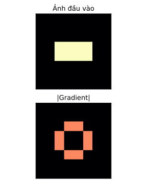

# Code mẫu — Phân tích hành vi model

Điểm số tổng có thể che giấu việc model dựa vào một dấu hiệu phụ, chẳng hạn một chấm ở góc ảnh, thay vì nội dung thật. Các bộ phân loại ở đây được dựng bằng tay, có chủ đích, để ta biết trước model dựa vào đâu. Nhờ vậy ta kiểm được ba kỹ thuật phân tích: thay đổi có kiểm soát, che một vùng, và saliency.

## Ví dụ 1: Accuracy bằng nhau mà dựa vào hai thứ khác nhau

Mỗi ảnh 8×8 có một nét đứng, nhãn 0, hoặc một nét ngang, nhãn 1. Trong tập nguồn, góc trên trái được tô sáng đúng bằng nhãn, nên góc vô tình “tiết lộ” đáp án. Tập thay đổi giữ nguyên nét, nhưng đảo màu góc. Model A chỉ nhìn góc. Model B chỉ nhìn hướng nét, qua một bộ lọc đặt bằng tay. Cả hai đều không phải CNN được train.

```python
import numpy as np

vertical = np.zeros((8, 8))
horizontal = np.zeros((8, 8))
vertical[2:6, 3:5] = 1
horizontal[3:5, 2:6] = 1
orientation_filter = (horizontal - vertical) / 4
labels = np.array([0, 1, 0, 1])
images = np.stack([vertical if label == 0 else horizontal for label in labels])
images[:, :2, :2] = labels[:, None, None]
changed = images.copy()
changed[:, :2, :2] = 1 - labels[:, None, None]

def predict_pair(batch):
    corner = batch[:, :2, :2].mean((1, 2))
    orientation = (batch * orientation_filter).sum((1, 2))
    return (corner >= 0.5).astype(int), (orientation > 0).astype(int)

assert np.array_equal(images[:, 2:, 2:], changed[:, 2:, 2:])
for name, batch in [("Nguồn", images), ("Đảo dấu góc", changed)]:
    a, b = predict_pair(batch)
    print(name, "A/B accuracy:", float((a == labels).mean()), float((b == labels).mean()))
    print("A/B prediction:", a.tolist(), b.tolist())
print("Shape score đứng/ngang:",
      float((vertical * orientation_filter).sum()), float((horizontal * orientation_filter).sum()))
assert predict_pair(changed)[0].tolist() == [1, 0, 1, 0]
assert predict_pair(changed)[1].tolist() == labels.tolist()
```
```output
Nguồn A/B accuracy: 1.0 1.0
A/B prediction: [0, 1, 0, 1] [0, 1, 0, 1]
Đảo dấu góc A/B accuracy: 0.0 1.0
A/B prediction: [1, 0, 1, 0] [0, 1, 0, 1]
Shape score đứng/ngang: -1.0 1.0
```

Trên tập nguồn, hai model đều đạt accuracy 1. Chỉ nhìn con số này, ta không phân biệt được chúng. Khi đảo màu góc, A sai hết, còn B vẫn đúng hết, vì bộ lọc của B nằm ở giữa ảnh, không đọc góc. Dòng assert đầu kiểm rằng phép thay đổi chỉ chạm vào góc, phần còn lại giữ nguyên.

Điểm hướng của B là −1 cho nét đứng và +1 cho nét ngang. Bộ lọc lấy nét ngang trừ nét đứng, nên bốn ô chung của hai nét triệt tiêu nhau, chỉ còn bốn ô riêng của mỗi nét. Phép thử này chỉ kiểm sự phụ thuộc vào góc. Nó chưa kiểm khi nét bị dịch chỗ, hay khi ảnh chụp từ một máy khác.

## Ví dụ 2: Che từng vùng, rồi so điểm của cùng một lớp

Lấy một ảnh nét ngang có góc sáng. Ta luôn đọc xác suất của lớp 1, tức lớp “ngang”. Lần lượt che góc, rồi che vùng nét, và xem xác suất đổi ra sao ở hai model. Ảnh bị che hết nét chỉ dùng để phân tích điểm. Nó không còn là một ảnh có nhãn hướng hợp lệ.

```python
import numpy as np

vertical = np.zeros((8, 8)); vertical[2:6, 3:5] = 1
horizontal = np.zeros((8, 8)); horizontal[3:5, 2:6] = 1
orientation_filter = (horizontal - vertical) / 4
original = horizontal.copy(); original[:2, :2] = 1
cover_corner = original.copy(); cover_corner[:2, :2] = 0
cover_shape = original.copy(); cover_shape[2:6, 2:6] = 0
batch = np.stack([original, cover_corner, cover_shape])
corner_logit = 8 * (batch[:, :2, :2].mean((1, 2)) - 0.5)
shape_logit = 6 * (batch * orientation_filter).sum((1, 2))
sigmoid = lambda z: 1 / (1 + np.exp(-z))
print("Thứ tự: gốc, che góc, che nét")
print("A, P(lớp 1):", sigmoid(corner_logit).round(4).tolist())
print("B, P(lớp 1):", sigmoid(shape_logit).round(4).tolist())
assert sigmoid(corner_logit)[0] == sigmoid(corner_logit)[2]
assert sigmoid(shape_logit)[0] == sigmoid(shape_logit)[1]
assert sigmoid(shape_logit)[2] == 0.5
```
```output
Thứ tự: gốc, che góc, che nét
A, P(lớp 1): [0.982, 0.018, 0.982]
B, P(lớp 1): [0.9975, 0.9975, 0.5]
```

Che góc, xác suất của A rơi từ 0.982 xuống 0.018, còn B không đổi. Che nét, A không đổi, còn B về 0.5, tức không còn biết gì. Vùng nào khi bị che làm điểm tụt mạnh, đó là vùng model đang dựa vào.

Ta cố định lớp 1 trong cả ba lần đọc, để luôn so cùng một đại lượng, kể cả khi lớp được dự đoán thay đổi. Tô vùng che bằng màu gì, và che vùng to cỡ nào, đều là một phần của phép thử. Khi làm với ảnh thật, phải ghi rõ hai lựa chọn đó.

## Ví dụ 3: Saliency có khớp với việc thay một pixel thật không?

Điểm của lớp “ngang” bằng ba lần điểm hướng. Ta tính gradient của điểm này theo từng pixel ảnh. Đó là saliency: pixel nào có gradient lớn thì thay đổi nó làm điểm đổi nhiều. Ta kiểm lại gradient ở một pixel bằng cách nhích pixel đó một chút và đo điểm đổi bao nhiêu, rồi vẽ ra bản đồ. Đây là saliency của một hàm điểm đặt tay, dùng để kiểm kỹ thuật. Một bản đồ nhiệt như vậy không tự đủ để giải thích mọi model.

```python
from pathlib import Path
import torch
import matplotlib.pyplot as plt

torch.set_num_threads(1)
plt.rcParams["svg.hashsalt"] = "vision-5.9-saliency"
vertical = torch.zeros(8, 8); vertical[2:6, 3:5] = 1
horizontal = torch.zeros(8, 8); horizontal[3:5, 2:6] = 1
orientation_filter = (horizontal - vertical) / 4
image = horizontal.clone().requires_grad_(True)
score = 3 * (image * orientation_filter).sum()
score.backward()
saliency = image.grad.abs()
epsilon = 0.001
changed = image.detach().clone(); changed[3, 2] += epsilon
finite_difference = (3 * (changed * orientation_filter).sum() - score.detach()) / epsilon
print("Score lớp ngang:", score.item())
print("Gradient tại (3,2):", image.grad[3, 2].item())
print("Sai phân hữu hạn:", round(finite_difference.item(), 4))
print("Tổng |gradient| vùng góc:", saliency[:2, :2].sum().item())
print("Số pixel gradient khác 0:", int((saliency > 0).sum()))
assert torch.isclose(finite_difference, image.grad[3, 2], atol=1e-3)
assert saliency[:2, :2].sum() == 0

fig, axes = plt.subplots(2, 1, figsize=(4, 5))
for axis, values, title in [(axes[0], image.detach().numpy(), "Ảnh đầu vào"),
                             (axes[1], saliency.numpy(), "|Gradient|")]:
    axis.imshow(values, cmap="magma", vmin=0, vmax=1)
    axis.set_title(title, fontsize=13)
    axis.set_xticks([]); axis.set_yticks([])
fig.tight_layout()
Path("fig").mkdir(exist_ok=True)
fig.savefig("fig/5.9-saliency-code.svg", metadata={"Date": None})
plt.show()
plt.close(fig)
print("Hình:", "fig/5.9-saliency-code.svg")
```
```output
Score lớp ngang: 3.0
Gradient tại (3,2): 0.75
Sai phân hữu hạn: 0.7501
Tổng |gradient| vùng góc: 0.0
Số pixel gradient khác 0: 8
Hình: fig/5.9-saliency-code.svg
```

Gradient tại pixel `(3, 2)` là 0.75. Nhích pixel đó lên 0.001, điểm tăng đúng khoảng 0.75 lần mức nhích. Hai cách đo khớp nhau. Vùng góc có gradient bằng 0, đúng như thiết kế.

Có đúng tám pixel nhạy. Bốn pixel chỉ thuộc nét ngang có gradient dương, bốn pixel chỉ thuộc nét đứng có gradient âm, còn vùng chung của hai nét có gradient 0. Bản đồ lấy trị tuyệt đối, nên mất dấu. Nhìn bản đồ, ta không biết làm sáng một pixel sẽ tăng hay giảm điểm. Muốn biết chiều tác động, phải xem cả gradient có dấu.


