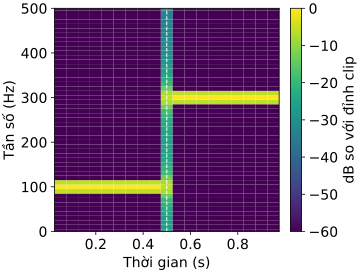

# Code mẫu — Dữ liệu âm thanh

Một dãy mẫu âm thanh chỉ có nghĩa khi đi kèm sample rate, tức số mẫu lấy trong mỗi giây. Các ví dụ dưới đây đi từ tám mẫu tính tay được, tới phổ theo thời gian và log-mel. Ở mỗi bước, ta kiểm cả trục thời gian lẫn thang đo, trước khi đưa âm thanh vào model.

## Ví dụ 1: Hai cao độ khác nhau, cùng tám mẫu

Thiết bị lấy 8 mẫu mỗi giây. Ta lấy mẫu hai sóng cosine, một sóng 2 Hz và một sóng 6 Hz. Kết quả là hai dãy số giống hệt nhau. Hiện tượng này gọi là aliasing, và ở đây ta thấy được ngay trên mảng số.

```python
import numpy as np

sample_rate = 8
indices = np.arange(8)
times = indices / sample_rate
low = np.cos(2 * np.pi * 2 * times)
high = np.cos(2 * np.pi * 6 * times)

assert np.allclose(low, high)
print("mau:", np.round(low).astype(int))
print(f"thoi luong = {len(low) / sample_rate:.3f} s")
print(f"mau cuoi o = {times[-1]:.3f} s")
print("hai day giong nhau:", np.allclose(low, high))

# Cùng một mảng, gắn sample rate khác thì cách hiểu thời gian cũng khác.
wrong_rate = 16
print(f"gan nhan 16 Hz: {len(low) / wrong_rate:.3f} s")
```

```output
mau: [ 1  0 -1  0  1  0 -1  0]
thoi luong = 1.000 s
mau cuoi o = 0.875 s
hai day giong nhau: True
gan nhan 16 Hz: 0.500 s
```

Tám mẫu ứng với 1 giây âm thanh, dù mẫu cuối nằm ở 0.875 giây. Mỗi mẫu đại diện cho một khoảng 1/8 giây, chứ không phải một điểm.

Với 8 mẫu mỗi giây, tần số cao nhất còn phân biệt được là 4 Hz, gọi là tần số Nyquist. Sóng 6 Hz vượt ngưỡng này, nên khi lấy mẫu nó trùng khít với sóng 2 Hz. Thông tin đã mất ngay lúc lấy mẫu, và không cách xử lý nào sau đó lấy lại được. Dòng cuối cho thấy một lỗi khác: gắn nhầm sample rate 16 Hz cho cùng mảng thì máy hiểu clip chỉ dài 0.5 giây. Đổi nhãn sample rate không phải là resample, vì không có mẫu nào được tạo thêm.

## Ví dụ 2: Tìm lúc tín hiệu chuyển từ 100 Hz sang 300 Hz

Một tín hiệu tổng hợp dài 1 giây, lấy mẫu 1000 lần mỗi giây. Nửa giây đầu là sóng 100 Hz, nửa sau là sóng 300 Hz. Ta cắt tín hiệu thành các đoạn ngắn, gọi là frame, mỗi frame 100 mẫu, frame sau cách frame trước 50 mẫu. Mỗi frame được tính phổ bằng FFT. Cách làm này gọi là STFT. Ta kiểm xem đỉnh phổ ở frame đầu và frame cuối có đúng tần số đã sinh không.

```python
import numpy as np
import matplotlib.pyplot as plt
from pathlib import Path
from numpy.lib.stride_tricks import sliding_window_view

sample_rate = 1000
time = np.arange(1000) / sample_rate
waveform = np.where(
    time < 0.5,
    np.sin(2 * np.pi * 100 * time),
    np.sin(2 * np.pi * 300 * time),
)
window_size, hop = 100, 50
frames = sliding_window_view(waveform, window_size)[::hop]
# Cửa sổ Hann: hai mép giảm dần về 0, để mép frame không bị gãy đột ngột khi tính FFT.
window = 0.5 - 0.5 * np.cos(2 * np.pi * np.arange(window_size) / window_size)
spectrum = np.fft.rfft(frames * window, axis=1)
power = (np.abs(spectrum) / window.sum()) ** 2
frequencies = np.fft.rfftfreq(window_size, d=1 / sample_rate)
centers = (np.arange(len(frames)) * hop + window_size / 2) / sample_rate
peak_hz = frequencies[power.argmax(axis=1)]

assert power.shape == (19, 51)
assert np.array_equal(peak_hz[[0, -1]], [100, 300])
print("shape (frame, bin):", power.shape)
print("tam frame dau/cuoi:", centers[[0, -1]].round(2))
print("dinh dau/cuoi, Hz:", peak_hz[[0, -1]].astype(int))
print(f"buoc bin = {frequencies[1] - frequencies[0]:.1f} Hz")

plt.rcParams["svg.hashsalt"] = "7.1-stft-code"
plt.rcParams["font.size"] = 14
fig, ax = plt.subplots(figsize=(5.0, 3.8), layout="constrained")
db = 10 * np.log10(np.maximum(power, 1e-8) / power.max())
image = ax.pcolormesh(centers, frequencies, db.T, shading="auto", vmin=-60, vmax=0)
ax.axvline(0.5, color="white", linestyle="--", linewidth=1)
ax.set(xlabel="Thời gian (s)", ylabel="Tần số (Hz)", ylim=(0, 500))
fig.colorbar(image, ax=ax, label="dB so với đỉnh clip")
Path("fig").mkdir(exist_ok=True)
fig.savefig("fig/7.1-stft-code.svg", metadata={"Date": None})
plt.show()
plt.close(fig)
```

```output
shape (frame, bin): (19, 51)
tam frame dau/cuoi: [0.05 0.95]
dinh dau/cuoi, Hz: [100 300]
buoc bin = 10.0 Hz
```

Số frame là $1+(1000-100)/50=19$. Mỗi frame 100 mẫu cho 51 mức tần số không âm, từ 0 tới 500 Hz, cách nhau 10 Hz. Vì vậy bảng phổ có shape `(19, 51)`. Frame đầu có đỉnh ở 100 Hz, frame cuối ở 300 Hz, đúng như tín hiệu đã sinh.

Mỗi frame được đặt trên trục thời gian tại tâm của nó, frame đầu ở 0.05 giây. Những frame nằm quanh 0.5 giây chứa cả hai đoạn sóng, nên trên hình, chỗ chuyển tiếp trông nhòe ra. Độ nhòe ấy đến từ độ rộng của frame, chứ tín hiệu thật thì đổi cao độ đột ngột.



## Ví dụ 3: Gộp phổ thành log-mel, và kiểm clip im lặng

Một clip 512 mẫu, lấy mẫu 1024 lần mỗi giây, chứa một âm 128 Hz. Ta gộp 33 mức tần số của phổ thành 12 dải mel, bằng 12 bộ lọc hình tam giác theo công thức HTK. Thang mel dày ở tần số thấp và thưa ở tần số cao, gần với cách tai người nghe. Sau đó ta lấy log để nén thang đo. Mốc so sánh cố định là 1, nên các con số là công suất tương đối của tín hiệu tổng hợp, không phải độ ồn đo ngoài đời.

```python
import numpy as np
from numpy.lib.stride_tricks import sliding_window_view

sample_rate, window_size, hop = 1024, 64, 32
frequencies = np.fft.rfftfreq(window_size, d=1 / sample_rate)
max_mel = 2595 * np.log10(1 + frequencies[-1] / 700)
mel_edges = np.linspace(0, max_mel, 14)  # 12 tam giác cần 14 mép.
hz_edges = 700 * (10 ** (mel_edges / 2595) - 1)
filters = []
for left, middle, right in zip(hz_edges, hz_edges[1:], hz_edges[2:]):
    rising = (frequencies - left) / (middle - left)
    falling = (right - frequencies) / (right - middle)
    filters.append(np.maximum(0, np.minimum(rising, falling)))
filters = np.array(filters)
window = 0.5 - 0.5 * np.cos(2 * np.pi * np.arange(window_size) / window_size)

def log_mel(signal):
    if signal.ndim != 1 or len(signal) < window_size:
        raise ValueError("can waveform mono du dai cho mot frame")
    frames = sliding_window_view(signal, window_size)[::hop]
    spectrum = np.fft.rfft(frames * window, axis=1)
    power = (np.abs(spectrum) / window.sum()) ** 2
    mel_power = filters @ power.T  # (dải mel, mức tần số) @ (mức tần số, frame).
    return 10 * np.log10(np.maximum(mel_power, 1e-8))

time = np.arange(512) / sample_rate
waveform = np.sin(2 * np.pi * 128 * time)
features = log_mel(waveform)
quiet = log_mel(np.zeros(512))
half_amplitude = log_mel(waveform * 0.5)
strongest_band = features[:, 0].argmax()
drop_db = half_amplitude[strongest_band, 0] - features[strongest_band, 0]

# Kiểm bằng tay: 0.5 * 1 + 1 * 4 + 0.5 * 1 = 5.
assert np.dot([0.5, 1, 0.5], [1, 4, 1]) == 5
assert np.isfinite(quiet).all()
assert np.allclose(drop_db, 10 * np.log10(0.25))
print("filter/log-mel:", filters.shape, features.shape)
print("clip im lang, dB:", np.unique(quiet))
print(f"giam bien do mot nua: {drop_db:.2f} dB")
try:
    log_mel(np.zeros(10))
except ValueError as error:
    print("clip qua ngan:", error)
```

```output
filter/log-mel: (12, 33) (12, 15)
clip im lang, dB: [-80.]
giam bien do mot nua: -6.02 dB
clip qua ngan: can waveform mono du dai cho mot frame
```

Ma trận bộ lọc có shape `(12, 33)`: 12 dải mel, mỗi dải là một tổ hợp có trọng số của 33 mức tần số. Dòng assert tính tay một ví dụ: ba mức có công suất 1, 4, 1, đi qua tam giác trọng số 0.5, 1, 0.5, cho 5. Kết quả log-mel có shape `(12, 15)`, hàng là dải mel, cột là frame.

Clip im lặng có công suất 0, mà log của 0 là âm vô cùng. Ta chặn công suất ở mức tối thiểu $10^{-8}$, nên clip im lặng cho −80 dB, một con số hữu hạn. Giảm biên độ còn một nửa thì công suất còn một phần tư, tức giảm khoảng 6.02 dB ở dải mạnh nhất. Nếu mỗi clip được so với đỉnh của chính nó, như hình ở ví dụ 2, thì thay đổi về độ to giữa các clip sẽ bị xóa mất. Chọn mốc nào phải tùy bài cần giữ thông tin gì.
