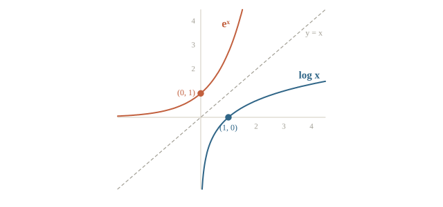
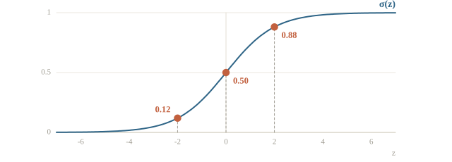
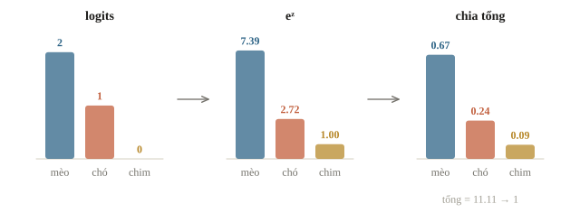
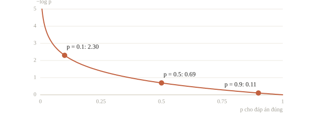

# Hàm số, mũ và log

Một model nhận ảnh chữ số viết tay và trả về mười con số, mỗi số cho một chữ số từ 0 đến 9, chẳng hạn `[1.2, -0.4, 6.3, 0.8, …]`. Mười số này chưa phải xác suất: có số âm, và tổng không bằng 1. Để đổi chúng thành xác suất, model lấy hàm mũ của từng số rồi chia cho tổng. Khi chấm model, ta lấy log của xác suất mà model dành cho đáp án đúng. Bài này học hai hàm đó, hàm mũ và log, cùng hai hàm dựng từ chúng là sigmoid và softmax.

Bài chỉ cần toán THCS: lũy thừa, phân số và đọc đồ thị. Mọi công thức đều có một đoạn NumPy in ra số để đối chiếu với phép tính tay.

::: goal Mục tiêu
- Đọc hàm số qua bảng giá trị và đồ thị.
- Tính $e^x$, $\log x$; dùng $\log(ab) = \log a + \log b$.
- Tính sigmoid và softmax.
- Tính log-loss; biết vì sao đoán sai mà tự tin bị phạt nặng.
:::

## Hàm số: đưa vào một số, nhận ra một số

Một hàm số là một quy tắc: mỗi giá trị đầu vào cho đúng một giá trị đầu ra. Đổi nhiệt độ từ độ C sang độ F là một hàm: $F = 1.8C + 32$. Trong Python, một `def` nhận số và trả về số cũng là một hàm theo đúng nghĩa ấy.

Dạng đơn giản nhất mà học máy dùng là hàm bậc nhất

$$y = wx + b.$$

$w$ là **hệ số góc** (slope): $x$ tăng 1 thì $y$ tăng đúng $w$. $b$ là giá trị của $y$ khi $x = 0$. Đồ thị là một đường thẳng. Bài linear regression ở chương 2 học đúng hai số $w$ và $b$ này từ dữ liệu.

Cách kiểm nhanh một hàm có phải bậc nhất không là chia độ tăng của $y$ cho độ tăng của $x$ giữa các điểm liên tiếp. Với hàm bậc nhất, tỉ số này luôn bằng $w$. `np.diff` trả về hiệu của hai phần tử liền nhau trong mảng.

```python
import numpy as np

def to_f(c):
    return 1.8 * c + 32

c = np.array([-10, 0, 10, 20, 30])
f = to_f(c)
print(f)
print(np.diff(f) / np.diff(c))
```

```output
[14. 32. 50. 68. 86.]
[1.8 1.8 1.8 1.8]
```

Bốn tỉ số đều bằng 1.8, đúng hệ số góc. $0$ độ C cho $32$ độ F, đúng hệ số tự do. Hàm cong như $y = x^2$ thì tỉ số này đổi theo từng đoạn; phần sau của bài gặp nhiều hàm như thế.

::: quiz
Hàm $y = 3x - 2$. Khi $x$ tăng từ 4 lên 6, $y$ tăng bao nhiêu?
- [ ] 2
- [ ] 3
- [x] 6
- [ ] 16
$x$ tăng 2 đơn vị, mỗi đơn vị làm $y$ tăng 3, nên $y$ tăng 6: từ 10 lên 16. Số 2 là độ tăng của $x$, số 3 là hệ số góc, còn 16 là giá trị của $y$ tại $x = 6$, không phải độ tăng.
:::

## Lũy thừa và hàm mũ

$2^{10}$ là 2 nhân với chính nó 10 lần, bằng 1024. Ba quy tắc đủ dùng cho cả bài:

$$a^m \cdot a^n = a^{m+n}, \qquad a^0 = 1, \qquad a^{-n} = \frac{1}{a^n}.$$

Học máy hay dùng cơ số $e \approx 2.71828$. Đây là một hằng số như $\pi$. Lý do chọn nó sẽ rõ ở bài 0.6: hàm $e^x$ có đạo hàm bằng chính nó, nên các phép tính về sau rất gọn. Hàm $e^x$ có ký hiệu khác là $\exp(x)$, trong NumPy là `np.exp`.

Ba điều cần nhớ về $e^x$. Nó **luôn dương**, kể cả khi $x$ âm. $e^0 = 1$. $x$ âm càng nhiều thì $e^x$ càng sát 0; $x$ dương thì $e^x$ tăng rất nhanh, mỗi khi $x$ tăng 1 thì giá trị nhân thêm khoảng 2.7 lần.

```python
x = np.array([-5, -1, 0, 1, 2, 5, 10])
print([round(float(v), 4) for v in np.exp(x)])
print(np.exp(2 + 3), np.exp(2) * np.exp(3))
```

```output
[0.0067, 0.3679, 1.0, 2.7183, 7.3891, 148.4132, 22026.4658]
148.4131591025766 148.4131591025766
```

Dòng đầu cho thấy $e^{-5} \approx 0.0067$ đã rất nhỏ, còn $e^{10}$ đã hơn hai vạn. Dòng thứ hai kiểm quy tắc $e^{2+3} = e^2 \cdot e^3$: hai cách tính cho cùng một số.

Hàm mũ tăng nhanh đến mức máy tính không chứa nổi. Số thực `float64` lớn nhất khoảng $1.8 \cdot 10^{308}$, nên $e^{710}$ đã vượt quá và thành `inf` (vô cùng). Phần softmax ở dưới sẽ gặp lại chuyện này.

```python
with np.errstate(over="ignore"):
    print(np.exp(np.array([700.0, 710.0])))
```

```output
[1.01423205e+304             inf]
```

::: quiz
$e^{3} \cdot e^{-3}$ bằng bao nhiêu?
- [ ] $0$
- [x] $1$
- [ ] $e^{9}$
- [ ] $e^{-9}$
Nhân hai lũy thừa cùng cơ số thì cộng số mũ: $e^{3 + (-3)} = e^0 = 1$. Ra $0$ là nhầm số mũ $0$ với giá trị $0$. Ra $e^{9}$ hay $e^{-9}$ là nhân số mũ thay vì cộng.
:::

## Log: hỏi ngược lại phép mũ

$2^3 = 8$, nên “2 mũ mấy thì bằng 8?” có câu trả lời là 3. Ta viết $\log_2 8 = 3$. Log là phép hỏi ngược của phép mũ: $\log_a x$ là số mũ cần đặt lên $a$ để được $x$.

Cơ số $e$ cho **log tự nhiên**, viết $\ln x$. Trong sách học máy và trong NumPy, `log` không ghi cơ số nghĩa là cơ số $e$: `np.log` là $\ln$, còn `np.log2` và `np.log10` cho cơ số 2 và 10. Bài này cũng viết $\log$ cho log tự nhiên.

Đồ thị của $\log x$ là đồ thị của $e^x$ lật qua đường chéo $y = x$, vì hai hàm làm ngược việc của nhau.



Từ hình đọc được ba điều. $\log x$ chỉ có nghĩa khi $x > 0$. $\log 1 = 0$. Với $0 < x < 1$, như một xác suất, $\log x$ là số âm, và $x$ càng sát 0 thì $\log x$ càng âm nhiều.

Quy tắc quan trọng nhất của log đến từ quy tắc nhân lũy thừa:

$$\log(ab) = \log a + \log b, \qquad \log\frac{a}{b} = \log a - \log b, \qquad \log a^k = k \log a.$$

**Log biến phép nhân thành phép cộng.** Học máy cần điều này vì xác suất hay được nhân với nhau. Giả sử model chấm 1000 câu, mỗi câu nó cho đáp án đúng xác suất 0.5. Xác suất model đoán đúng cả 1000 câu là $0.5^{1000}$, một số cỡ $10^{-302}$. Thêm 100 câu nữa thì máy làm tròn thành đúng 0, gọi là tràn dưới (underflow). Cộng log thì không có vấn đề gì.

```python
print(np.log2(8), np.log10(1000), np.log(np.e))
print(np.log(3 * 7), np.log(3) + np.log(7))
p = np.full(1100, 0.5)
print(np.prod(p[:1000]), np.prod(p))
print(np.sum(np.log(p[:1000])), np.sum(np.log(p)))
```

```output
3.0 3.0 1.0
3.044522437723423 3.044522437723423
9.332636185032189e-302 0.0
-693.1471805599454 -762.4618986159398
```

Tích của 1100 xác suất đã thành 0.0, nên mọi so sánh dựa trên nó đều mất. Tổng log của chúng là $-762.46$, một số bình thường, và vẫn so sánh được: tổng log lớn hơn nghĩa là tích lớn hơn, vì log là hàm tăng.

::: quiz
Biết $\log 2 \approx 0.693$ và $\log 5 \approx 1.609$. $\log 10$ xấp xỉ bao nhiêu?
- [ ] $0.916$
- [ ] $1.115$
- [x] $2.302$
- [ ] $3.218$
$10 = 2 \cdot 5$, nên $\log 10 = \log 2 + \log 5 \approx 2.302$. $0.916$ là $\log 5 - \log 2 = \log 2.5$. $1.115$ là tích $0.693 \cdot 1.609$, nhầm log của tích với tích của log. $3.218$ là $2 \log 5 = \log 25$.
:::

## Sigmoid: ép một số bất kỳ vào khoảng (0, 1)

Một bộ lọc thư rác tính cho mỗi thư một điểm $z$ bằng hàm bậc nhất của vài con số mô tả thư, như số đường link hay số chữ in hoa. $z$ có thể là bất kỳ số thực nào, còn điều ta muốn là xác suất thư là rác, một số nằm giữa 0 và 1. Hàm **sigmoid** làm việc ấy:

$$\sigma(z) = \frac{1}{1 + e^{-z}}.$$

Đọc công thức bằng ba trường hợp. $z = 0$ thì $e^0 = 1$, nên $\sigma(0) = 1/2$. $z$ dương lớn thì $e^{-z}$ sát 0, nên $\sigma(z)$ sát 1. $z$ âm nhiều thì $e^{-z}$ rất lớn, nên $\sigma(z)$ sát 0. Đồ thị là một đường chữ S, không bao giờ chạm 0 hay 1.



Hình chữ S đối xứng qua điểm $(0, 0.5)$, tức là $\sigma(-z) = 1 - \sigma(z)$. Điểm $z = 2$ cho xác suất thư rác 0.88 thì $z = -2$ cho 0.12.

Hỏi ngược lại: xác suất $p$ ứng với điểm $z$ nào? Giải $\sigma(z) = p$ ra

$$z = \log\frac{p}{1 - p}.$$

Tỉ số $p/(1-p)$ gọi là **odds**: $p = 0.8$ cho odds bằng 4, nghĩa là “khả năng xảy ra gấp 4 lần không xảy ra”. Vì vậy $z$ còn được gọi là log-odds, hay **logit**. Từ logit sẽ gặp lại ở mọi bài phân loại.

```python
def sigmoid(z):
    return 1 / (1 + np.exp(-z))

z = np.array([-6, -2, 0, 2, 6])
print(np.round(sigmoid(z), 4))
print(np.round(sigmoid(z) + sigmoid(-z), 4))
logit = np.log(0.8 / 0.2)
print(round(logit, 4), sigmoid(logit))
```

```output
[0.0025 0.1192 0.5    0.8808 0.9975]
[1. 1. 1. 1. 1.]
1.3863 0.8
```

Dòng thứ hai kiểm $\sigma(z) + \sigma(-z) = 1$ ở cả năm điểm. Dòng thứ ba đi một vòng: từ $p = 0.8$ sang logit $1.3863$, rồi sigmoid trả lại đúng $0.8$.

::: quiz
Model cho một thư điểm $z$ và $\sigma(z) = 0.8$. Với một thư khác có điểm $-z$, sigmoid bằng bao nhiêu?
- [ ] $-0.8$
- [x] $0.2$
- [ ] $0.8$
- [ ] $1.25$
$\sigma(-z) = 1 - \sigma(z) = 0.2$. Sigmoid không bao giờ âm, nên $-0.8$ không thể là kết quả. $0.8$ là quên rằng đổi dấu $z$ thì đổi phía. $1.25 = 1/0.8$ lớn hơn 1, cũng không thể là một xác suất.
:::

## Softmax: từ nhiều điểm thành một phân phối

Với mười chữ số, model cho mười điểm $z_1, \dots, z_{10}$, gọi là **logits**. Softmax đổi chúng thành mười xác suất:

$$p_k = \frac{e^{z_k}}{\sum_j e^{z_j}}.$$

Hai bước: lấy mũ để mọi số thành dương, rồi chia cho tổng để các số cộng lại bằng 1. Logit lớn hơn vẫn cho xác suất lớn hơn, vì $e^x$ là hàm tăng.

Cộng cùng một số $c$ vào mọi logit thì softmax **không đổi**: $e^{z_k + c} = e^c \cdot e^{z_k}$, và thừa số $e^c$ xuất hiện ở cả tử lẫn mẫu nên triệt tiêu. Tính chất này cứu ta khỏi chuyện tràn số. Logits như `[1000, 999, 998]` làm `np.exp` thành `inf`, và `inf / inf` cho `nan`. Trừ đi logit lớn nhất trước khi lấy mũ thì số lớn nhất thành $e^0 = 1$, không còn gì tràn, mà kết quả vẫn y như cũ.

```python
def softmax(z):
    e = np.exp(z - z.max())
    return e / e.sum()

z = np.array([2.0, 1.0, 0.0])
print(np.round(softmax(z), 4), round(softmax(z).sum(), 6))
print(np.round(softmax(z + 100), 4))
big = np.array([1000.0, 999.0, 998.0])
print(np.round(softmax(big), 4))
with np.errstate(over="ignore", invalid="ignore"):
    print(np.exp(big) / np.exp(big).sum())
```

```output
[0.6652 0.2447 0.09  ] 1.0
[0.6652 0.2447 0.09  ]
[0.6652 0.2447 0.09  ]
[nan nan nan]
```

Ba dòng đầu cho cùng một phân phối, vì ba bộ logits chỉ khác nhau một hằng số cộng. Dòng cuối là cách viết thẳng theo công thức, không trừ max: kết quả hỏng hoàn toàn.



Với hai lớp, softmax của logits $[z, 0]$ cho lớp đầu xác suất $e^z / (e^z + 1)$. Chia cả tử và mẫu cho $e^z$ được $1/(1 + e^{-z}) = \sigma(z)$. Sigmoid là softmax hai lớp.

::: quiz
Model cho ba logits `[3, 3, 3]`. Softmax trả về gì?
- [ ] `[1, 1, 1]`
- [x] `[1/3, 1/3, 1/3]`
- [ ] `[0.95, 0.95, 0.95]`
- [ ] `[3/9, 3/9, 3/9]` nhưng chỉ khi logits dương
Ba logit bằng nhau thì $e^3$ bằng nhau, chia cho tổng $3e^3$ được $1/3$ mỗi lớp. Softmax luôn có tổng bằng 1, nên `[1, 1, 1]` và `[0.95, 0.95, 0.95]` đều sai; $0.95$ là $\sigma(3)$, nhầm softmax với sigmoid. Dấu của logits không quan trọng: `[-3, -3, -3]` cũng cho $1/3$ mỗi lớp.
:::

::: quiz
Cộng 5 vào cả ba logits `[2, 1, 0]`, thành `[7, 6, 5]`. Xác suất của lớp đầu thay đổi thế nào?
- [x] Không đổi, vẫn khoảng 0.665
- [ ] Tăng lên, vì logit của nó lớn hơn
- [ ] Giảm xuống, vì các lớp kia cũng tăng
- [ ] Không tính được nếu không biết nhãn thật
Cộng cùng một số vào mọi logit thì $e^5$ xuất hiện ở cả tử và mẫu rồi triệt tiêu. Softmax chỉ phụ thuộc vào khoảng cách giữa các logit, mà khoảng cách không đổi. Nhãn thật chỉ cần khi tính loss, không cần khi tính xác suất.
:::

## Vì sao loss có log

Model đã cho xác suất. Để chấm, ta nhìn xác suất $p$ mà model dành cho **đáp án đúng** và tính

$$\text{loss} = -\log p.$$

Dấu trừ để loss không âm, vì $\log p \le 0$ khi $p \le 1$. Đoán đúng chắc chắn, $p = 1$, cho loss 0. $p$ càng nhỏ thì loss càng lớn, và lớn không giới hạn khi $p$ tiến về 0. Ta gọi đây là **log-loss**, hay **cross-entropy** khi có nhiều lớp.

```python
p_true = np.array([0.99, 0.9, 0.5, 0.1, 0.01])
print(np.round(-np.log(p_true), 3))
```

```output
[0.01  0.105 0.693 2.303 4.605]
```

Từ 0.99 xuống 0.9, loss chỉ tăng thêm chưa tới 0.1. Từ 0.1 xuống 0.01, loss tăng thêm 2.3. Giảm $p$ đi một nửa thì loss luôn tăng thêm đúng $\log 2 \approx 0.693$, vì $-\log(p/2) = -\log p + \log 2$. Model nói “chắc 99% là mèo” mà ảnh là chó thì bị phạt rất nặng.



Lấy trung bình log-loss trên cả tập dữ liệu:

$$-\frac{1}{n}\sum_{i=1}^{n} \log p_i = -\frac{1}{n}\log\prod_{i=1}^{n} p_i.$$

Vế phải là log của tích các xác suất, tức xác suất model gán cho **toàn bộ** đáp án đúng của tập, nếu coi các mẫu độc lập. Làm loss trung bình nhỏ nhất cũng chính là làm tích ấy lớn nhất. Ta tính bằng tổng log thay vì tích vì lý do đã thấy ở trên: tích của nghìn xác suất tràn dưới thành 0.

Với hai lớp, nhãn $y \in \{0, 1\}$ và model cho $p = P(y = 1)$, xác suất của đáp án đúng là $p$ khi $y = 1$ và $1 - p$ khi $y = 0$. Viết gộp lại:

$$\text{loss} = -\big[\,y \log p + (1 - y)\log(1 - p)\,\big].$$

Với mỗi mẫu, chỉ một trong hai số hạng khác 0. Đây là binary cross-entropy của các bài phân loại chương 1 và 2.

Log-loss nhìn thấy điều accuracy không thấy. Hai model dưới đây cùng đúng 3 trên 4 câu khi lấy ngưỡng 0.5, nhưng model B sai một câu với độ tự tin rất cao.

```python
A = np.array([0.9, 0.8, 0.6, 0.4])    # xác suất model A dành cho đáp án đúng
B = np.array([0.6, 0.6, 0.6, 0.05])
for name, p in [("A", A), ("B", B)]:
    print(name, "accuracy", (p > 0.5).mean(), "log-loss", round(-np.log(p).mean(), 3))
```

```output
A accuracy 0.75 log-loss 0.439
B accuracy 0.75 log-loss 1.132
```

Cùng accuracy 0.75, nhưng log-loss của B gấp hơn hai lần A. Câu B cho đáp án đúng chỉ 0.05 đóng góp $-\log 0.05 \approx 3.0$ vào tổng. Nếu đề chấm bằng log-loss, model B thua xa.

::: quiz
Model dành cho đáp án đúng xác suất 0.8. Sau một lần sửa, xác suất ấy còn 0.4. Log-loss của mẫu này thay đổi thế nào?
- [ ] Tăng gấp đôi
- [ ] Tăng thêm 0.4
- [ ] Không đổi, vì đáp án vẫn là lớp có xác suất cao nhất
- [x] Tăng thêm khoảng 0.693
Giảm $p$ đi một nửa thì loss tăng thêm $\log 2 \approx 0.693$: từ $0.223$ lên $0.916$. Loss không tăng gấp đôi, vì $0.223 \cdot 2 = 0.446$. $0.4$ là độ giảm của $p$, không phải của loss. Log-loss phụ thuộc vào xác suất, không chỉ vào lớp được chọn, nên kể cả khi model vẫn chọn đúng thì loss vẫn đổi.
:::

## Ví dụ tính tay

Model phân loại ảnh thành ba lớp mèo, chó, chim, cho logits $[2, 1, 0]$. Ảnh thật là chó.

Lấy mũ: $e^2 \approx 7.389$, $e^1 \approx 2.718$, $e^0 = 1$. Tổng là $11.107$. Chia ra được xác suất $0.665$, $0.245$, $0.090$. Model dành cho chó $0.245$, nên loss bằng $-\log 0.245 \approx 1.408$.

Nếu ảnh là mèo, loss là $-\log 0.665 \approx 0.408$; là chim thì $-\log 0.090 \approx 2.408$. Ba số cách nhau đúng 1, bằng khoảng cách giữa các logit. Đó không phải trùng hợp. Lấy log của công thức softmax:

$$-\log p_k = \log\sum_j e^{z_j} - z_k.$$

Số hạng đầu chung cho mọi lớp, nên loss của lớp $k$ chỉ còn phụ thuộc $z_k$: logit đúng lớn hơn 1 thì loss nhỏ hơn 1.

Giờ model sửa logit của chó từ 1 lên 2, thành $[2, 2, 0]$. Tổng mới là $7.389 + 7.389 + 1 = 15.778$, chó được $0.468$, loss còn $-\log 0.468 \approx 0.759$. Quá trình huấn luyện ở các chương sau làm đúng việc này hàng triệu lần: chỉnh logits sao cho loss trên đáp án đúng giảm dần.

```python
z = np.array([2.0, 1.0, 0.0])
p = softmax(z)
print(np.round(p, 3), np.round(-np.log(p), 3))
z2 = np.array([2.0, 2.0, 0.0])
print(np.round(softmax(z2), 3), round(-np.log(softmax(z2)[1]), 3))
```

```output
[0.665 0.245 0.09 ] [0.408 1.408 2.408]
[0.468 0.468 0.063] 0.759
```

::: quiz
Logits ba lớp là $[0, \log 3, 0]$. Xác suất của lớp giữa là bao nhiêu?
- [ ] $1/3$
- [ ] $3/4$
- [x] $3/5$
- [ ] $\log 3 / 3$
Lấy mũ được $1, 3, 1$, tổng là 5, nên lớp giữa có $3/5$. $1/3$ là trường hợp ba logit bằng nhau. $3/4$ là quên một lớp khi cộng mẫu số. $\log 3 / 3$ là chia logit cho tổng mà bỏ qua bước lấy mũ.
:::

## Khi đi thi

- **Đọc đầu ra model là gì**: logits (số thực bất kỳ) hay xác suất (không âm, tổng bằng 1)? In vài dòng và kiểm tổng trước khi dùng.
- **Dùng hàm gộp sẵn của thư viện**: `torch.nn.functional.cross_entropy` nhận thẳng logits; không tự lấy `log(softmax(...))` khi đã có hàm gộp, vì hàm gộp tính ổn định hơn.
- **Tự tính softmax thì trừ max trước khi lấy mũ.**
- **Tự tính log-loss thì kẹp xác suất** bằng `np.clip(p, 1e-15, 1 - 1e-15)`, tránh `log(0)`.
- **Nhân nhiều xác suất thì cộng log** thay vì nhân.
- **Đọc đề xem chấm bằng metric nào**: accuracy và log-loss có thể xếp hạng hai model ngược nhau.

## Tóm tắt

- Hàm bậc nhất $y = wx + b$: $w$ là độ tăng của $y$ khi $x$ tăng 1, $b$ là giá trị tại $x = 0$.
- $e^x$ luôn dương, $e^0 = 1$, tăng rất nhanh; $e^{a+b} = e^a e^b$.
- $\log$ là phép hỏi ngược của mũ, chỉ có nghĩa khi $x > 0$, âm khi $x < 1$; $\log(ab) = \log a + \log b$ biến tích thành tổng.
- Sigmoid $\sigma(z) = 1/(1 + e^{-z})$ đưa một số bất kỳ vào $(0, 1)$; $\sigma(-z) = 1 - \sigma(z)$; ngược lại là logit $\log\frac{p}{1-p}$.
- Softmax lấy mũ rồi chia tổng; cộng cùng hằng số vào mọi logit không đổi kết quả, nên trừ max để tránh tràn số.
- Log-loss $-\log p$ của đáp án đúng: 0 khi chắc chắn đúng, rất lớn khi tự tin mà sai; trung bình log-loss nhỏ nhất tương đương xác suất của cả tập lớn nhất.

## Kiểm tra cuối bài

Mười câu dưới đây bao quát cả bài. Làm hết rồi xem điểm; câu nào sai thì đọc lại mục tương ứng.

::: quiz Câu 1
Hàm sigmoid trả về giá trị nằm trong khoảng nào?
- [ ] $(-1, 1)$
- [ ] $(-\infty, \infty)$
- [x] $(0, 1)$
- [ ] $[0, \infty)$
$e^{-z}$ luôn dương nên mẫu $1 + e^{-z}$ luôn lớn hơn 1, do đó $\sigma(z)$ nằm giữa 0 và 1 và không bao giờ chạm hai đầu. $(-1, 1)$ là miền giá trị của tanh, một hàm hình chữ S khác. $[0, \infty)$ là của ReLU, còn $(-\infty, \infty)$ là miền của logit đầu vào.
Đề thi: [NOAI 2026 Singapore · Vòng sơ loại · Câu 175](https://aisingapore.org/wp-content/uploads/2026/04/NOAI-2026-Preliminary-Round-Assessment-300-MCQs-Google-Forms.pdf#page=65)
:::
::: quiz Câu 2
Lớp cuối của một mạng neural dùng softmax. Mạng này nhiều khả năng làm bài toán gì?
- [ ] Dự đoán một số thực, như giá nhà
- [x] Phân loại nhiều lớp, đổi logits thành xác suất
- [ ] Chỉ phân loại hai lớp
- [ ] Không dự đoán gì, softmax chỉ dùng ở lớp ẩn
Softmax cho một vector không âm có tổng bằng 1, đúng dạng phân phối trên các lớp. Dự đoán giá nhà cần một số thực bất kỳ, nên lớp cuối để nguyên. Hai lớp thì softmax vẫn dùng được, vì nó chính là sigmoid, nhưng softmax không giới hạn ở hai lớp. Lớp ẩn thường dùng ReLU, không dùng softmax.
Đề thi: [NOAI 2026 Singapore · Vòng sơ loại · Câu 193](https://aisingapore.org/wp-content/uploads/2026/04/NOAI-2026-Preliminary-Round-Assessment-300-MCQs-Google-Forms.pdf#page=71)
:::
::: quiz Câu 3
Cross-entropy dùng để chấm model phân loại. Nó đo điều gì?
- [ ] Bình phương khoảng cách giữa nhãn và lớp được chọn
- [ ] Trị tuyệt đối của hiệu hai nhãn
- [ ] Góc giữa vector dự đoán và vector nhãn one-hot
- [x] Độ lệch giữa phân phối dự đoán và phân phối của nhãn
Với nhãn one-hot, cross-entropy bằng $-\log$ của xác suất model dành cho lớp đúng. Model càng dồn xác suất vào đúng lớp thì loss càng nhỏ. Bình phương và trị tuyệt đối là MSE và MAE, thường dùng cho hồi quy. Góc giữa hai vector là cosine similarity, một đại lượng khác.
Đề thi: [NOAI 2026 Singapore · Vòng sơ loại · Câu 194](https://aisingapore.org/wp-content/uploads/2026/04/NOAI-2026-Preliminary-Round-Assessment-300-MCQs-Google-Forms.pdf#page=71)
:::
::: quiz Câu 4
Biết $\log a = 1.2$ và $\log b = 0.5$. $\log(a^2 b)$ bằng bao nhiêu?
- [x] $2.9$
- [ ] $1.7$
- [ ] $0.72$
- [ ] $1.94$
$\log(a^2 b) = 2\log a + \log b = 2.4 + 0.5 = 2.9$. $1.7$ là quên số mũ 2 của $a$. $0.72 = 1.2^2 \cdot 0.5$ là nhân log thay vì cộng. $1.94 = 1.2^2 + 0.5$ là bình phương log thay vì nhân log với 2.
:::
::: quiz Câu 5
Một model trả về vector `[0.7, 0.5, -0.2]` cho ba lớp. Vector này là gì?
- [x] Logits, cần qua softmax mới thành xác suất
- [ ] Xác suất của ba lớp, vì giá trị lớn nhất nhỏ hơn 1
- [ ] Xác suất, nhưng cần làm tròn số âm lên 0
- [ ] Log-loss của ba lớp
Vector xác suất phải không âm và có tổng bằng 1. Vector này có số $-0.2$ nên không phải xác suất; tổng của nó bằng 1.0 chỉ là tình cờ. Đổi số âm thành 0 cũng không cho ra xác suất đúng của model, phải đưa qua softmax. Log-loss thì là một số cho mỗi mẫu, tính khi đã có nhãn thật.
:::
::: quiz Câu 6
Nhãn thật là $y = 0$, model cho $P(y = 1) = 0.9$. Binary cross-entropy của mẫu này xấp xỉ bao nhiêu?
- [ ] $0.105$
- [ ] $0.9$
- [ ] $0$, vì nhãn bằng 0
- [x] $2.303$
Với $y = 0$, loss là $-\log(1 - p) = -\log 0.1 \approx 2.303$. $0.105 = -\log 0.9$ là tính như thể nhãn bằng 1. Số hạng $y\log p$ bằng 0 khi $y = 0$, nhưng số hạng còn lại thì không, nên loss không bằng 0.
:::
::: quiz Câu 7
Một học sinh nhân xác suất của 2000 mẫu, mỗi xác suất khoảng 0.6, và máy in ra `0.0`. Vì sao, và nên sửa thế nào?
- [ ] Code sai; tích của các số dương không thể bằng 0
- [x] Tích quá nhỏ nên tràn dưới thành 0; cộng log thay vì nhân
- [ ] Do 0.6 không biểu diễn chính xác được; đổi sang 0.5
- [ ] Do NumPy giới hạn 1000 phần tử; chia thành hai lần nhân
$0.6^{2000}$ cỡ $10^{-444}$, nhỏ hơn số dương nhỏ nhất mà `float64` biểu diễn được, nên máy làm tròn thành 0. Tổng log là $2000 \log 0.6 \approx -1021.7$, một số bình thường. Về toán học tích không bằng 0, nhưng máy tính có giới hạn. Đổi sang 0.5 hay chia đôi phép nhân đều vẫn tràn.
:::
::: quiz Câu 8
`np.exp(np.array([800.0, 801.0]))` cho `[inf, inf]`. Muốn tính softmax của hai logits này mà không bị `nan` thì làm thế nào?
- [ ] Chia cả hai logits cho 800 trước khi lấy mũ
- [ ] Dùng `np.exp2` thay cho `np.exp`
- [ ] Làm tròn logits về số nguyên rồi lấy mũ
- [x] Trừ cả hai cho 801 trước khi lấy mũ
Trừ cùng một số vào mọi logit không đổi softmax, và trừ cho số lớn nhất thì logit lớn nhất thành 0, $e^0 = 1$, không còn tràn. Chia cho 800 làm đổi khoảng cách giữa hai logits nên đổi luôn kết quả. `np.exp2` tính $2^x$, vẫn tràn ở $2^{1024}$ và còn đổi sang một phép tính khác. Làm tròn không giải quyết gì vì logits đã là số nguyên.
:::
::: quiz Câu 9
Model A và model B cùng có accuracy 0.80 trên tập validation. Log-loss của A là 0.45, của B là 0.95. Vì sao có chênh lệch ấy?
- [ ] B có lỗi trong code vì cùng accuracy thì log-loss phải bằng nhau
- [ ] A đoán đúng nhiều câu hơn B nên loss thấp hơn
- [ ] Log-loss lớn hơn nghĩa là model B tốt hơn
- [x] B gán xác suất rất thấp cho đáp án đúng ở vài câu
Accuracy chỉ nhìn lớp được chọn, còn log-loss nhìn xác suất dành cho đáp án đúng. Vài câu tự tin sai, chẳng hạn cho đáp án đúng 0.01, đóng góp mỗi câu hơn 4.6 vào tổng. Cùng accuracy thì số câu đúng bằng nhau. Log-loss là loss, nhỏ hơn mới tốt hơn.
:::
::: quiz Câu 10
Với logits $[z_1, \dots, z_K]$, log-loss khi lớp đúng là $k$ bằng $\log\sum_j e^{z_j} - z_k$. Tăng riêng $z_k$ lên một chút thì log-loss thay đổi thế nào?
- [x] Giảm, vì $z_k$ tăng nhanh hơn số hạng log
- [ ] Tăng, vì tổng $\sum_j e^{z_j}$ tăng
- [ ] Không đổi, vì softmax không đổi khi cộng hằng số
- [ ] Giảm về đúng 0 sau một lần tăng
Tăng $z_k$ thêm một lượng nhỏ làm số hạng đầu tăng ít hơn lượng ấy, vì $e^{z_k}$ chỉ là một phần của tổng, nên hiệu giảm. Tổng có tăng thật, nhưng chậm hơn $z_k$. Tính bất biến khi cộng hằng số chỉ đúng khi cộng vào **mọi** logit, không phải một logit. Loss chỉ tiến về 0 khi xác suất của lớp đúng tiến về 1.
:::

## Đọc thêm

- Khan Academy — [*Exponential and logarithmic functions*](https://www.khanacademy.org/math/algebra2/x2ec2f6f830c9fb89:exp). Ôn lũy thừa và log từ đầu, nhiều bài tập ngắn có lời giải.
- 3Blue1Brown — [*What's so special about Euler's number e?*](https://www.youtube.com/watch?v=m2MIpDrF7Es). Video giải thích vì sao $e^x$ là hàm có đạo hàm bằng chính nó, chuẩn bị cho bài 0.6.
- Google — [*Machine Learning Crash Course: Logistic regression*](https://developers.google.com/machine-learning/crash-course/logistic-regression). Sigmoid, log-odds và log-loss trong một bài phân loại thật.
- Goodfellow, Bengio, Courville — [*Deep Learning*](https://www.deeplearningbook.org/), chương 4.1. Đọc phần tràn số và cách tính softmax ổn định.
