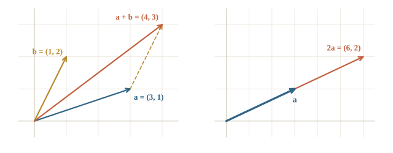
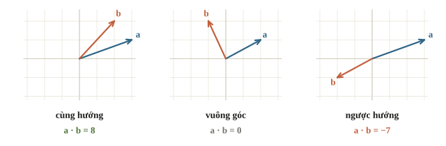
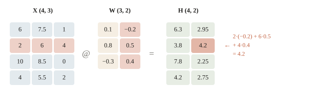
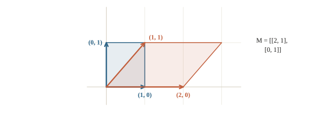

# Vector và ma trận

Mỗi học sinh trong bảng điểm được mô tả bằng ba con số: giờ tự học mỗi tuần, điểm học kỳ 1 và số buổi vắng. Bốn trăm học sinh là một bảng 400 dòng, 3 cột. Một model tuyến tính dự đoán điểm cuối kỳ cho cả 400 học sinh bằng một phép nhân, viết trong NumPy là `X @ w`; một lớp của mạng neural cũng là một phép nhân như thế. Bài 0.2 đã dùng `@`; bài này giải thích nó tính gì: vector là gì, tích vô hướng đo gì, và vì sao số cột của ma trận bên trái phải bằng số hàng của ma trận bên phải.

::: goal Mục tiêu
- Cộng vector, nhân vector với số, tính độ dài và khoảng cách.
- Tính tích vô hướng và cosine similarity.
- Viết dự đoán của model tuyến tính bằng `X @ w + b`.
- Đoán shape của phép nhân ma trận và phép chuyển vị.
:::

## Vector: một dãy số có thứ tự

Một **vector** là một dãy số có thứ tự. Học sinh A tự học 6 giờ, điểm học kỳ 1 là 7.5, vắng 1 buổi, nên được mô tả bằng vector $\mathbf{a} = (6, 7.5, 1)$. Thứ tự quan trọng: $(7.5, 6, 1)$ là một học sinh khác. Số phần tử của vector gọi là **số chiều**; mỗi đặc trưng của dữ liệu là một chiều.

Vector hai chiều vẽ được thành một mũi tên từ gốc tọa độ tới điểm $(x, y)$. Hai phép tính cơ bản đều làm **từng phần tử**:

$$\mathbf{a} + \mathbf{b} = (a_1 + b_1,\ a_2 + b_2), \qquad c\,\mathbf{a} = (c a_1,\ c a_2).$$

Cộng hai vector là nối mũi tên này vào đầu mũi tên kia. Nhân với số $c$ là kéo dài mũi tên $c$ lần, hoặc đảo chiều khi $c < 0$.



```python
import numpy as np

a = np.array([3.0, 1.0])
b = np.array([1.0, 2.0])
print(a + b, 2 * a, a - b)
```

```output
[4. 3.] [6. 2.] [ 2. -1.]
```

Phép trừ $\mathbf{a} - \mathbf{b}$ cho mũi tên đi từ đầu $\mathbf{b}$ tới đầu $\mathbf{a}$. Mục sau dùng nó để đo khoảng cách.

::: quiz
$\mathbf{a} = (2, -1)$ và $\mathbf{b} = (0, 3)$. $2\mathbf{a} + \mathbf{b}$ bằng bao nhiêu?
- [ ] $(2, 2)$
- [x] $(4, 1)$
- [ ] $(4, 5)$
- [ ] $(4, -3)$
$2\mathbf{a} = (4, -2)$, cộng $\mathbf{b}$ được $(4, 1)$. $(2, 2)$ là quên nhân 2. $(4, 5)$ là nhân 2 rồi bỏ dấu trừ. $(4, -3)$ là trừ $\mathbf{b}$ thay vì cộng.
:::

## Độ dài và khoảng cách

Độ dài của vector $(3, 4)$ là cạnh huyền của tam giác vuông có hai cạnh 3 và 4, bằng 5 theo định lý Pythagoras. Tổng quát cho $d$ chiều, độ dài, hay **chuẩn L2** (L2 norm), là

$$\lVert \mathbf{a} \rVert = \sqrt{a_1^2 + a_2^2 + \dots + a_d^2}.$$

Khoảng cách giữa hai điểm là độ dài của hiệu: $\lVert \mathbf{a} - \mathbf{b} \rVert$. Đây là khoảng cách Euclid, cách đo mà kNN ở bài 2.4 dùng để tìm hàng xóm gần nhất.

Còn một cách đo khác: cộng trị tuyệt đối từng thành phần, $|a_1| + |a_2| + \dots$, gọi là **chuẩn L1**. Trên bàn cờ, xe đi theo hàng và cột, nên quãng đường của nó là khoảng cách L1, còn quãng đường chim bay là khoảng cách L2.

```python
p = np.array([1.0, 2.0])
q = np.array([4.0, 6.0])
d = q - p
print(d, np.linalg.norm(d), np.sqrt((d ** 2).sum()), np.abs(d).sum())
```

```output
[3. 4.] 5.0 5.0 7.0
```

Từ $p$ tới $q$ phải đi 3 theo trục ngang và 4 theo trục dọc. Đường thẳng dài 5, đường đi theo ô dài 7. `np.linalg.norm` mặc định tính chuẩn L2, đúng bằng công thức viết tay.

::: quiz
Vector $(1, 2, 2)$ có độ dài L2 bằng bao nhiêu?
- [ ] $5$
- [x] $3$
- [ ] $9$
- [ ] $\sqrt{5}$
$\sqrt{1 + 4 + 4} = \sqrt{9} = 3$. $5$ là tổng trị tuyệt đối, tức chuẩn L1. $9$ là quên lấy căn. $\sqrt{5}$ là chỉ tính hai thành phần đầu.
:::

## Tích vô hướng

**Tích vô hướng** (dot product) của hai vector cùng số chiều là tổng các tích từng cặp:

$$\mathbf{a} \cdot \mathbf{b} = a_1 b_1 + a_2 b_2 + \dots + a_d b_d.$$

Kết quả là **một số**, không phải vector. Ý nghĩa đầu tiên là **tổng có trọng số**. Ở bài 0.4, hàm bậc nhất $y = wx + b$ chỉ có một đầu vào. Với ba đặc trưng, model tuyến tính tính

$$\hat{y} = w_1 x_1 + w_2 x_2 + w_3 x_3 + b = \mathbf{w} \cdot \mathbf{x} + b.$$

Mỗi trọng số $w_j$ nói đặc trưng thứ $j$ đóng góp bao nhiêu. Trọng số âm cho số buổi vắng nghĩa là vắng càng nhiều thì điểm dự đoán càng thấp.

Ý nghĩa thứ hai là hình học. Gọi $\theta$ là góc giữa hai mũi tên, khi đó

$$\mathbf{a} \cdot \mathbf{b} = \lVert \mathbf{a} \rVert\, \lVert \mathbf{b} \rVert \cos\theta.$$

Không cần nhớ lượng giác để đọc công thức này. $\cos\theta$ bằng 1 khi hai mũi tên cùng hướng, bằng 0 khi chúng vuông góc, bằng $-1$ khi ngược hướng. Vì vậy dấu của tích vô hướng cho biết hai vector “cùng phía” hay “ngược phía”.



Chia tích vô hướng cho hai độ dài, ta còn lại đúng $\cos\theta$, gọi là **cosine similarity**. Nó chỉ đo hướng, không đo độ dài, nên nằm trong khoảng từ $-1$ đến 1. Các chương sau biểu diễn một từ hay một ảnh bằng vector, gọi là embedding, rồi dùng cosine similarity để tìm từ hay ảnh giống nhau.

```python
w = np.array([0.1, 0.8, -0.3])          # giờ tự học, điểm HK1, số buổi vắng
x = np.array([6.0, 7.5, 1.0])           # học sinh A
print(w @ x, (w * x).sum(), w @ x + 1.0)

def cosine(u, v):
    return u @ v / (np.linalg.norm(u) * np.linalg.norm(v))

meo = np.array([0.9, 0.8, 0.1])
cho = np.array([0.8, 0.9, 0.2])
oto = np.array([0.1, 0.2, 0.9])
print(round(cosine(meo, cho), 3), round(cosine(meo, oto), 3))
```

```output
6.3 6.3 7.3
0.99 0.303
```

Dòng đầu: tích vô hướng bằng tổng các tích từng cặp, $0.6 + 6.0 - 0.3 = 6.3$; cộng thêm $b = 1$ được điểm dự đoán 7.3. Dòng hai dùng ba vector đồ chơi cho ba từ: “mèo” và “chó” gần cùng hướng nên cosine gần 1, “mèo” và “ô tô” lệch hướng nhiều nên cosine chỉ 0.3.

::: quiz
$\mathbf{a} = (2, 1)$ và $\mathbf{b} = (-1, 2)$. Tích vô hướng $\mathbf{a} \cdot \mathbf{b}$ bằng bao nhiêu, và hai vector nằm thế nào với nhau?
- [ ] $(-2, 2)$; cùng hướng
- [ ] $4$; cùng hướng
- [ ] $-4$; ngược hướng
- [x] $0$; vuông góc
$2 \cdot (-1) + 1 \cdot 2 = 0$, nên $\cos\theta = 0$, hai vector vuông góc. $(-2, 2)$ là nhân từng phần tử mà quên cộng lại; tích vô hướng là một số. $4$ và $-4$ là cộng nhầm dấu một trong hai tích.
:::

## Ma trận: một bảng số

Xếp vector của bốn học sinh thành bốn hàng, ta được một **ma trận** 4 hàng, 3 cột, viết là ma trận $4 \times 3$ hay shape `(4, 3)`. Quy ước của học máy: **mỗi hàng là một mẫu, mỗi cột là một đặc trưng**. Ma trận dữ liệu thường ký hiệu $X$, shape $(n, d)$ với $n$ mẫu và $d$ đặc trưng.

Nhân ma trận $X$ với vector trọng số $\mathbf{w}$ là làm tích vô hướng của **từng hàng** với $\mathbf{w}$:

$$X\mathbf{w} = \begin{pmatrix} \mathbf{x}_1 \cdot \mathbf{w} \\ \mathbf{x}_2 \cdot \mathbf{w} \\ \vdots \\ \mathbf{x}_n \cdot \mathbf{w} \end{pmatrix}.$$

Một phép nhân cho dự đoán của cả $n$ học sinh. Mỗi hàng có 3 số và $\mathbf{w}$ có 3 số, nên số cột của $X$ phải bằng độ dài của $\mathbf{w}$. Kết quả có $n$ số, một số cho mỗi hàng.

```python
X = np.array([[6.0, 7.5, 1.0],
              [2.0, 6.0, 4.0],
              [10.0, 8.5, 0.0],
              [4.0, 5.5, 2.0]])
b = 1.0
print(X.shape, w.shape, (X @ w).shape)
print(X @ w + b)
print([round(float(row @ w + b), 1) for row in X])
```

```output
(4, 3) (3,) (4,)
[7.3 4.8 8.8 5.2]
[7.3, 4.8, 8.8, 5.2]
```

Dòng cuối tính lại bằng vòng lặp qua từng hàng và ra đúng bốn số. Phép `X @ w` làm cùng việc ấy, chỉ nhanh hơn nhiều khi bảng có hàng triệu dòng. Số `b` được cộng vào cả bốn dự đoán nhờ broadcasting của bài 0.2.

::: quiz
Bảng dữ liệu có 500 học sinh, mỗi học sinh 8 đặc trưng. Vector trọng số $\mathbf{w}$ phải có shape gì, và `X @ w` có shape gì?
- [ ] `w` là `(500,)`, kết quả là `(8,)`
- [ ] `w` là `(8,)`, kết quả là `(8,)`
- [x] `w` là `(8,)`, kết quả là `(500,)`
- [ ] `w` là `(500, 8)`, kết quả là `(500,)`
Mỗi hàng của `X` có 8 số, nên `w` cần 8 trọng số, mỗi đặc trưng một trọng số. Kết quả có một dự đoán cho mỗi học sinh, tức 500 số. `w` dài 500 là nhầm trọng số theo mẫu với trọng số theo đặc trưng. `w` shape `(500, 8)` là một ma trận chứ không phải vector, và `(500, 8) @ (500, 8)` không nhân được.
:::

## Nhân hai ma trận

Giờ muốn hai dự đoán cho mỗi học sinh, chẳng hạn điểm Toán và điểm Văn. Mỗi môn có một vector trọng số riêng. Xếp hai vector ấy thành **hai cột** của ma trận $W$ shape $(3, 2)$. Khi đó $XW$ có shape $(4, 2)$: ô ở hàng $i$, cột $j$ là tích vô hướng của **hàng $i$ của $X$** với **cột $j$ của $W$**.

Quy tắc shape:

$$(m, k) \,@\, (k, n) \to (m, n).$$

Hai số $k$ ở giữa phải bằng nhau, vì đó là độ dài của hai vector đem nhân vô hướng. Hai số ở ngoài cho shape kết quả. Một lớp của mạng neural làm đúng phép này: $X$ là $(n, d)$, $W$ là $(d, h)$, kết quả $(n, h)$ là $h$ đặc trưng mới cho mỗi mẫu. Mỗi cột của $W$ là một nơ-ron.



**Chuyển vị** $X^\top$ (trong NumPy là `X.T`) đổi hàng thành cột, nên shape $(m, n)$ thành $(n, m)$. Thứ tự nhân quan trọng: $AB$ và $BA$ nói chung khác nhau, và nhiều khi một trong hai còn không nhân được vì shape không khớp. **Ma trận đơn vị** $I$ có 1 trên đường chéo, 0 ở mọi ô khác; nhân với $I$ không đổi gì, như nhân một số với 1.

```python
W = np.array([[0.1, -0.2],
              [0.8, 0.5],
              [-0.3, 0.4]])
H = X @ W
print(H.shape)
print(np.round(H, 2))
print(X.T.shape, W.T.shape)
try:
    W @ X
except ValueError as e:
    print("W @ X lỗi:", e)
I = np.eye(3)
print(np.allclose(X @ I, X))
```

```output
(4, 2)
[[6.3  2.95]
 [3.8  4.2 ]
 [7.8  2.25]
 [4.2  2.75]]
(3, 4) (2, 3)
W @ X lỗi: matmul: Input operand 1 has a mismatch in its core dimension 0, with gufunc signature (n?,k),(k,m?)->(n?,m?) (size 4 is different from 2)
True
```

Cột đầu của `H` là `X @ w` ở mục trước, chưa cộng $b$, vì cột đầu của `W` chính là `w`. `W @ X` là $(3, 2) @ (4, 3)$: số 2 và số 4 ở giữa không bằng nhau, nên NumPy báo lỗi. Thông báo lỗi dài nhưng đọc được ý chính ở cuối: kích thước 4 khác 2.

::: quiz
Nhân ma trận $3 \times 2$ với ma trận $2 \times 4$ cho kết quả gì?
- [ ] Ma trận $2 \times 2$
- [ ] Ma trận $3 \times 2$
- [x] Ma trận $3 \times 4$
- [ ] Không nhân được vì hai ma trận khác shape
Số cột bên trái bằng số hàng bên phải, cùng là 2, nên nhân được; kết quả lấy số hàng bên trái và số cột bên phải. $2 \times 2$ là lấy hai số ở giữa, đúng những số bị “triệt tiêu”. Hai ma trận không cần cùng shape, chỉ cần khớp số ở giữa.
Đề thi: [NOAI 2026 Singapore · Vòng sơ loại · Câu 12](https://aisingapore.org/wp-content/uploads/2026/04/NOAI-2026-Preliminary-Round-Assessment-300-MCQs-Google-Forms.pdf#page=8)
:::

## Ma trận như một phép biến đổi

Một ma trận $2 \times 2$ nhân với mọi điểm của mặt phẳng là một cách **biến đổi** mặt phẳng. $\begin{pmatrix} 2 & 0 \\ 0 & 1 \end{pmatrix}$ kéo giãn trục ngang gấp đôi. $\begin{pmatrix} 0 & -1 \\ 1 & 0 \end{pmatrix}$ xoay mọi điểm 90 độ ngược chiều kim đồng hồ. Cột đầu của ma trận là nơi điểm $(1, 0)$ đi tới, cột sau là nơi điểm $(0, 1)$ đi tới.



Cách nhìn này giải thích việc của một lớp mạng neural: nó biến đổi dữ liệu sang một hệ tọa độ mới, nơi các lớp dễ tách nhau hơn. Ở đây quy ước là vector cột nhân bên phải ma trận, $M\mathbf{v}$. Với ma trận dữ liệu mỗi hàng một điểm, ta viết $X M^\top$; cùng một phép biến đổi, chỉ khác cách xếp.

```python
square = np.array([[0, 0], [1, 0], [1, 1], [0, 1]], dtype=float)   # mỗi hàng một đỉnh
M = np.array([[2.0, 1.0],
              [0.0, 1.0]])
print(square @ M.T)
```

```output
[[0. 0.]
 [2. 0.]
 [3. 1.]
 [1. 1.]]
```

Đỉnh $(1, 0)$ đi tới $(2, 0)$, đúng cột đầu của $M$; đỉnh $(0, 1)$ đi tới $(1, 1)$, đúng cột sau. Hình vuông thành hình bình hành.

::: quiz
Ma trận $M = \begin{pmatrix} 0 & -1 \\ 1 & 0 \end{pmatrix}$ xoay điểm 90 độ. Điểm $(1, 0)$ đi tới đâu?
- [x] $(0, 1)$
- [ ] $(0, -1)$
- [ ] $(-1, 0)$
- [ ] $(1, 0)$, vì điểm nằm trên trục
$M\mathbf{v}$ với $\mathbf{v} = (1, 0)$ lấy đúng cột đầu của $M$, tức $(0, 1)$. $(0, -1)$ là đọc hàng đầu thay vì cột đầu. $(-1, 0)$ là xoay 180 độ. Điểm trên trục vẫn bị xoay như mọi điểm khác.
:::

## Ví dụ tính tay

Hai học sinh, ba đặc trưng (giờ tự học, điểm HK1, số buổi vắng):

$$X = \begin{pmatrix} 2 & 6 & 4 \\ 4 & 5.5 & 2 \end{pmatrix}, \qquad \mathbf{w} = (0.1,\ 0.8,\ -0.3), \qquad b = 1.$$

$X$ có shape $(2, 3)$, $\mathbf{w}$ có 3 số, nên $X\mathbf{w}$ có 2 số. Hàng đầu: $0.2 + 4.8 - 1.2 = 3.8$, cộng $b$ được $4.8$. Hàng sau: $0.4 + 4.4 - 0.6 = 4.2$, cộng $b$ được $5.2$. Hai số khớp hàng thứ hai và thứ tư của mục ma trận.

Khoảng cách giữa hai học sinh: hiệu là $(-2,\ 0.5,\ 2)$, bình phương rồi cộng được $4 + 0.25 + 4 = 8.25$, lấy căn được khoảng $2.87$. Cosine của hai vector: tích vô hướng $8 + 33 + 8 = 49$, hai độ dài là $\sqrt{56} \approx 7.48$ và $\sqrt{50.25} \approx 7.09$, nên cosine khoảng $49 / 53.05 \approx 0.92$. Hai học sinh khá giống nhau về hướng, dù khác nhau về độ lớn.

```python
x1, x2 = X[1], X[3]
print(round(np.linalg.norm(x1 - x2), 2), round(cosine(x1, x2), 2))
```

```output
2.87 0.92
```

## Khi đi thi

- **Viết shape cạnh mỗi biến** trước khi nhân: `X (n, d)`, `w (d,)`, `W (d, h)`. Nhân không được thì đọc hai số ở giữa.
- **Phân biệt `@` và `*`**: `@` là tích vô hướng và nhân ma trận, `*` là nhân từng phần tử.
- **Đo giống nhau theo hướng thì dùng cosine**, theo vị trí thì dùng khoảng cách; với embedding, thường chuẩn hóa độ dài trước.
- **Đặc trưng khác thang đo** (giờ và điểm) làm khoảng cách bị chi phối bởi cột lớn; chuẩn hóa trước khi dùng kNN (bài 1.4).
- **Kiểm phép nhân bằng một hàng**: tính tay `X[0] @ w` rồi so với phần tử đầu của `X @ w`.

## Tóm tắt

- Vector là dãy số có thứ tự; cộng và nhân với số làm từng phần tử.
- Độ dài L2 $\sqrt{\sum a_i^2}$, L1 $\sum |a_i|$; khoảng cách là độ dài của hiệu.
- Tích vô hướng $\sum a_i b_i$ là một số: tổng có trọng số, và $\lVert \mathbf{a} \rVert \lVert \mathbf{b} \rVert \cos\theta$; cosine similarity chỉ đo hướng.
- Ma trận dữ liệu $(n, d)$: hàng là mẫu, cột là đặc trưng; $X\mathbf{w}$ là tích vô hướng từng hàng với $\mathbf{w}$.
- $(m, k) @ (k, n) \to (m, n)$; chuyển vị đổi $(m, n)$ thành $(n, m)$; $AB \ne BA$ nói chung; nhân với $I$ không đổi gì.
- Ma trận $2 \times 2$ biến đổi mặt phẳng; cột của nó là ảnh của hai vector đơn vị.

## Kiểm tra cuối bài

Mười câu dưới đây bao quát cả bài. Làm hết rồi xem điểm; câu nào sai thì đọc lại mục tương ứng.

::: quiz Câu 1
Vector $\mathbf{v} = (3, 4)$ có độ dài Euclid (chuẩn L2) bằng bao nhiêu?
- [ ] $7$
- [x] $5$
- [ ] $25$
- [ ] $12$
$\sqrt{9 + 16} = \sqrt{25} = 5$. $7$ là chuẩn L1, cộng trị tuyệt đối. $25$ là quên lấy căn. $12$ là tích hai thành phần, không phải một độ dài.
Đề thi: [NOAI 2026 Singapore · Vòng sơ loại · Câu 13](https://aisingapore.org/wp-content/uploads/2026/04/NOAI-2026-Preliminary-Round-Assessment-300-MCQs-Google-Forms.pdf#page=9)
:::
::: quiz Câu 2
$A$ và $B$ là hai ma trận $3 \times 3$. Phép nào **không** phải phép toán ma trận thông thường?
- [ ] $A + B$
- [ ] $AB$
- [x] $A \div B$
- [ ] $A - B$
Cộng, trừ làm từng ô, nhân ma trận làm tích vô hướng hàng–cột; cả ba đều định nghĩa cho hai ma trận $3 \times 3$. Không có phép “chia ma trận”. Gần nhất là nhân với ma trận nghịch đảo $AB^{-1}$, và phép này chỉ làm được khi $B$ khả nghịch.
Đề thi: [NOAI 2026 Singapore · Vòng sơ loại · Câu 14](https://aisingapore.org/wp-content/uploads/2026/04/NOAI-2026-Preliminary-Round-Assessment-300-MCQs-Google-Forms.pdf#page=9)
:::
::: quiz Câu 3
Ma trận đơn vị $I$ có đặc điểm gì?
- [ ] Mọi ô bằng 1
- [ ] Mọi ô bằng 0
- [ ] Đường chéo bằng 0, mọi ô khác bằng 1
- [x] Đường chéo bằng 1, mọi ô khác bằng 0
Nhờ đường chéo bằng 1 và phần còn lại bằng 0, $AI = A$ với mọi $A$ nhân được. Ma trận toàn số 1 nhân vào sẽ cộng dồn các cột. Ma trận toàn 0 cho kết quả 0. Đảo vị trí số 0 và số 1 thì nhân vào sẽ làm trộn lẫn các cột với nhau.
Phỏng theo: [NOAI 2026 Singapore · Vòng sơ loại · Câu 15](https://aisingapore.org/wp-content/uploads/2026/04/NOAI-2026-Preliminary-Round-Assessment-300-MCQs-Google-Forms.pdf#page=9)
:::
::: quiz Câu 4
Ma trận $A$ có shape $2 \times 3$. $A^\top$ có shape gì?
- [x] $3 \times 2$
- [ ] $2 \times 3$
- [ ] $3 \times 3$
- [ ] $2 \times 2$
Chuyển vị đổi hàng thành cột, nên 2 hàng 3 cột thành 3 hàng 2 cột. $3 \times 3$ và $2 \times 2$ là shape của $A^\top A$ và $AA^\top$, không phải của $A^\top$.
Đề thi: [NOAI 2026 Singapore · Vòng sơ loại · Câu 16](https://aisingapore.org/wp-content/uploads/2026/04/NOAI-2026-Preliminary-Round-Assessment-300-MCQs-Google-Forms.pdf#page=10)
:::
::: quiz Câu 5
Trong phép nhân ma trận $AB$, kích thước nào phải bằng nhau?
- [ ] Số hàng của $A$ và số hàng của $B$
- [ ] Số hàng của $A$ và số cột của $B$
- [ ] Mọi kích thước phải bằng nhau
- [x] Số cột của $A$ và số hàng của $B$
Mỗi ô của $AB$ là tích vô hướng của một hàng $A$ với một cột $B$; hàng $A$ dài bằng số cột của $A$, cột $B$ dài bằng số hàng của $B$. Số hàng của $A$ và số cột của $B$ là shape của kết quả, không cần bằng nhau.
Đề thi: [NOAI 2026 Singapore · Vòng sơ loại · Câu 20](https://aisingapore.org/wp-content/uploads/2026/04/NOAI-2026-Preliminary-Round-Assessment-300-MCQs-Google-Forms.pdf#page=11)
:::
::: quiz Câu 6
Ma trận nào dưới đây đối xứng, tức là bằng chuyển vị của chính nó?
- [ ] $\begin{pmatrix} 1 & 2 \\ 3 & 4 \end{pmatrix}$
- [ ] $\begin{pmatrix} 1 & 0 \\ 1 & 0 \end{pmatrix}$
- [x] $\begin{pmatrix} 1 & 2 \\ 2 & 3 \end{pmatrix}$
- [ ] $\begin{pmatrix} 0 & 1 \\ 0 & 0 \end{pmatrix}$
Đối xứng nghĩa là ô hàng $i$ cột $j$ bằng ô hàng $j$ cột $i$; ở ma trận $2 \times 2$, chỉ cần hai ô ngoài đường chéo bằng nhau. Ba ma trận còn lại có hai ô ấy là 2 và 3, 0 và 1, 1 và 0.
Đề thi: [NOAI 2026 Singapore · Vòng sơ loại · Câu 18](https://aisingapore.org/wp-content/uploads/2026/04/NOAI-2026-Preliminary-Round-Assessment-300-MCQs-Google-Forms.pdf#page=10)
:::
::: quiz Câu 7
Một lớp của mạng neural nhận batch `X` shape `(32, 784)` và cho ra `(32, 128)`. Ma trận trọng số `W` trong `X @ W` có shape gì?
- [ ] `(32, 128)`
- [ ] `(128, 784)`
- [x] `(784, 128)`
- [ ] `(32, 784)`
$(32, 784) @ (k, n) \to (32, 128)$ đòi $k = 784$ và $n = 128$. `(128, 784)` là đúng số nhưng ngược thứ tự; PyTorch lưu trọng số theo shape này rồi nhân với chuyển vị của nó. Hai shape có số 32 là nhầm kích thước batch vào trọng số; trọng số không phụ thuộc số mẫu trong batch.
:::
::: quiz Câu 8
Hai embedding $\mathbf{u}$ và $\mathbf{v}$ có cosine similarity bằng $-0.9$. Nhân đôi $\mathbf{u}$ thì cosine similarity bằng bao nhiêu?
- [x] Vẫn $-0.9$
- [ ] $-1.8$
- [ ] $-0.45$
- [ ] $0.9$
Nhân đôi $\mathbf{u}$ làm tích vô hướng và độ dài của $\mathbf{u}$ cùng gấp đôi, nên tỉ số không đổi. Cosine chỉ đo hướng, và nhân với số dương không đổi hướng. $-1.8$ vượt khoảng từ $-1$ đến 1. $0.9$ chỉ đúng nếu nhân với một số âm.
:::
::: quiz Câu 9
Bảng có hai cột: tuổi (từ 10 đến 18) và thu nhập gia đình (từ 5 triệu đến 80 triệu đồng mỗi tháng). Dùng khoảng cách Euclid trên dữ liệu thô để tìm học sinh giống nhau thì chuyện gì xảy ra?
- [ ] Hai cột đóng góp ngang nhau vào khoảng cách
- [x] Cột thu nhập gần như quyết định cả khoảng cách
- [ ] Cột tuổi quyết định vì nó ít biến động hơn
- [ ] Không tính được vì hai cột khác đơn vị đo
Chênh lệch thu nhập có thể tới hàng chục triệu, chênh lệch tuổi chỉ vài năm; bình phương lên càng cách xa. Khoảng cách vẫn tính được, chỉ là bị cột lớn chi phối. Cách sửa là chuẩn hóa từng cột về cùng thang trước khi đo.
:::
::: quiz Câu 10
`A` shape `(5, 3)` và `B` shape `(5, 3)`. Lệnh nào chạy được?
- [ ] `A @ B`
- [ ] `A @ B.T.T`
- [ ] `B @ A`
- [x] `A.T @ B`
`A.T @ B` là $(3, 5) @ (5, 3) \to (3, 3)$, hai số giữa khớp. `A @ B` và `B @ A` đều là $(5, 3) @ (5, 3)$, số giữa 3 và 5 không khớp. `B.T.T` chuyển vị hai lần thì quay lại `B`, nên vẫn là `A @ B`.
:::

## Đọc thêm

- 3Blue1Brown — [*Essence of linear algebra*](https://www.3blue1brown.com/topics/linear-algebra), tập 1–4 và 9. Vector, tổ hợp tuyến tính, ma trận như phép biến đổi, tích vô hướng, bằng hình động.
- Khan Academy — [*Vectors and spaces*](https://www.khanacademy.org/math/linear-algebra/vectors-and-spaces). Bài giảng và bài tập ngắn về vector, độ dài, tích vô hướng.
- Deisenroth, Faisal, Ong — [*Mathematics for Machine Learning*](https://mml-book.github.io/), chương 2 và 3. Sách miễn phí; đọc phần ma trận, chuẩn và tích vô hướng khi muốn chặt chẽ hơn.
- NumPy — [*Linear algebra (numpy.linalg)*](https://numpy.org/doc/stable/reference/routines.linalg.html). Danh sách hàm `norm`, `matmul`, `eye` và các phép khác dùng trong bài.
