<!-- title -->
# Python

Những chỗ Python khác C++

Chương 0 · Bài 0.1

---
<!-- split -->
## Python trong khóa học

Từ bài sau, mọi code đều là Python: pandas, NumPy, scikit-learn, PyTorch.

Vòng lặp, hàm, thuật toán từ C++ vẫn dùng như cũ.

|||

Bài này học những chỗ dễ làm sai:

- chia, lấy dư với số âm;
- hai biến dùng chung một list;
- notebook nhớ biến cũ.

---
## Mục tiêu

- Tính đúng phép chia `//`, `%` với số âm; so sánh số thực.
- Biết khi nào hai biến dùng chung một list, và cách sao chép list.
- Chọn list, set hay dict theo độ phức tạp; đo thời gian chạy.
- Đọc, ghi file CSV; đọc thông báo lỗi để sửa code.

---
<!-- split -->
## Thụt lề thay cho dấu ngoặc

```python
def passed_scores(values, threshold=5.0):
    result = []
    for value in values:
        if value >= threshold:
            result.append(value)
    return result
```

|||

- Dấu `:` mở một khối.
- Các dòng trong cùng khối thụt lề như nhau.
- `return` ngang hàng `for`: chạy sau khi lặp xong.
- `range(1, 5)` lấy 1, 2, 3, 4.

---
<!-- figure -->
## Notebook nhớ lần chạy gần nhất

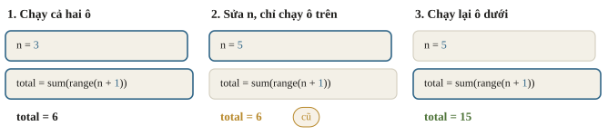

Trước khi nộp: *Restart & Run all*.

---
<!-- split -->
## Chạy trên Colab và Kaggle

- Colab: *Runtime → Change runtime type → T4 GPU*.
- Kaggle: *Session options → Accelerator*; cần xác minh số điện thoại.
- Chương 0–4 chạy được trên CPU; từ chương 5 nên bật GPU.

|||

```python
import torch

device = 'cuda' if torch.cuda.is_available() else 'cpu'
print('device:', device)
```

Bật GPU đúng thì in `cuda`.

---
<!-- quiz -->
::: quiz
Trên Kaggle, mục *Accelerator* chỉ chọn được *None*. Lý do thường gặp nhất là gì?
- [ ] Notebook có lỗi cú pháp
- [x] Tài khoản chưa xác minh số điện thoại
- [ ] Kaggle chỉ mở GPU vào cuối tuần
- [ ] Chưa cài `torch` bằng `pip`
Kaggle khóa GPU và Internet với tài khoản chưa xác minh số điện thoại. Code trong notebook không ảnh hưởng tới mục này.
:::

---
<!-- quiz -->
::: quiz
Notebook có hai ô: trên là `n = 3`, dưới là `total = sum(range(n + 1))`. Hôm qua đã chạy cả hai. Hôm nay mở lại (kernel mới), chạy ô dưới trước. Ô dưới cho ra gì?
- [ ] `total` bằng 0, vì `n` chưa gán thì coi là 0
- [ ] `total` bằng 6, vì Python đọc hết notebook trước
- [x] Lỗi `NameError`, vì chưa có biến `n`
- [ ] `total` bằng 6, vì dùng lại `n` của hôm qua
Kernel mới chưa có biến nào, kể cả `n` của hôm qua, và Python không tự coi biến chưa gán là 0. *Restart & Run all* trước khi nộp sẽ lộ đúng loại lỗi này.
:::

---
<!-- split -->
## Chia số âm: khác C++

```python
print(7 / 2, 6 / 2)
print(7 // 2, -7 // 2)
print(7 % 3, -7 % 3)
```

```output
3.5 3.0
3 -4
1 2
```

|||

`//` làm tròn xuống. Với $b\ne0$:

$$a=(a//b)\cdot b+(a\%b).$$

Số chia âm thì `%` không dương: `10 % -3` là $-2$.

`int` tăng độ chính xác theo nhu cầu; vẫn tốn thời gian và bộ nhớ khi số rất lớn.

---
<!-- figure -->
## Làm tròn xuống, không phải về 0

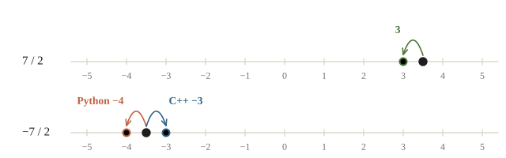

---
<!-- quiz -->
::: quiz
`print(-7 // 2, -7 % 2)` in ra gì?
- [ ] `-3 -1`
- [x] `-4 1`
- [ ] `-3 1`
- [ ] `-3.5 1`
`//` của Python làm tròn xuống, nên $-3.5$ thành $-4$. Số dư là $-7 - (-4)\cdot 2 = 1$. Ra `-3 -1` là tính theo kiểu C++.
:::

---
<!-- split -->
## Số thực cần kiểm sai số

```python
import math
```

```python
print(0.1 + 0.2, 0.1 + 0.2 == 0.3)
print(math.isclose(0.1 + 0.2, 0.3,
                   rel_tol=1e-9, abs_tol=1e-12))
print(round(2.5), round(3.5), round(0.125, 2))
```

```output
0.30000000000000004 False
True
2 4 0.12
```

|||

- 0.1 không lưu chính xác được trong nhị phân.
- So số thực bằng `math.isclose`, không dùng `==`.
- `round` chọn mốc chẵn khi số nằm đúng giữa.

---
<!-- figure -->
## 0.1 + 0.2 và 0.3 là hai số máy khác nhau

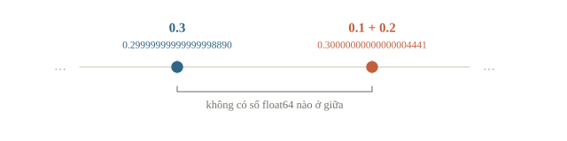

---
<!-- figure -->
## Gán tên khác với sao chép

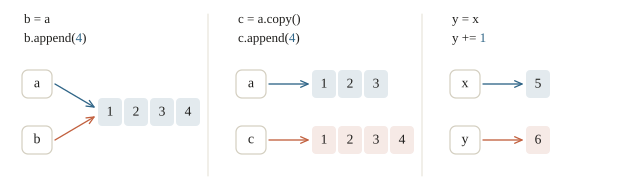

---
<!-- split -->
## Sửa list, hay gán lại tên?

```python
a = [1, 2, 3]
b = a
b.append(4)
print(a, b, a is b)
```

```output
[1, 2, 3, 4] [1, 2, 3, 4] True
```

|||

- `append`, `a += [5]`: sửa list chung.
- `a = a + [5]`: tạo list mới, gán lại tên `a`.
- `is`: cùng đối tượng? `==`: giá trị bằng nhau?

---
<!-- quiz -->
::: quiz
```py
def reset(scores):
    scores.append(0)
    scores = []
marks = [7, 8]
reset(marks)
print(marks)
```
Đoạn code in ra gì?
- [ ] `[]`
- [ ] `[7, 8]`
- [ ] `[0]`
- [x] `[7, 8, 0]`
`scores` và `marks` cùng dán lên một list, nên `append(0)` sửa list của người gọi. `scores = []` chỉ bóc nhãn `scores` sang list mới, `marks` vẫn ở list cũ.
Phỏng theo: [NOAI 2026 Singapore · Vòng sơ loại · Câu 94](https://aisingapore.org/wp-content/uploads/2026/04/NOAI-2026-Preliminary-Round-Assessment-300-MCQs-Google-Forms.pdf#page=38)
:::

---
<!-- split -->
## List lồng nhau: một hàng hay ba hàng?

```python
grid = [[0] * 3] * 3
grid[0][0] = 9
print(grid)

grid = [[0] * 3 for _ in range(3)]
grid[0][0] = 9
print(grid)
```

```output
[[9, 0, 0], [9, 0, 0], [9, 0, 0]]
[[9, 0, 0], [0, 0, 0], [0, 0, 0]]
```

|||

`* 3` lặp lại tên của cùng một hàng, không tạo hàng mới.

Comprehension tạo một hàng mới ở mỗi lượt lặp.

`copy()` chỉ chép một tầng; `deepcopy()` chép mọi tầng.

---
<!-- figure -->
## Ba tên, một hàng

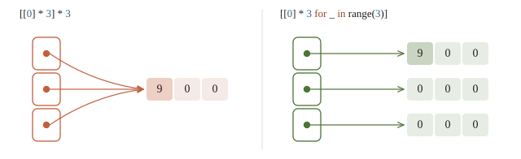

---
<!-- quiz -->
::: quiz
Chạy `a = [[1, 2], [3, 4]]`, `b = a.copy()`, `b[0].append(9)`. Lúc này `a` là gì?
- [ ] `[[1, 2], [3, 4]]`
- [x] `[[1, 2, 9], [3, 4]]`
- [ ] `[[1, 2], [3, 4], 9]`
- [ ] Báo lỗi
`copy()` chỉ tạo list ngoài mới. Các list con vẫn dùng chung, nên thêm 9 vào `b[0]` cũng là thêm vào `a[0]`. Muốn chép riêng cả list con thì dùng `copy.deepcopy`.
:::

---
<!-- split -->
## Chọn cấu trúc như khi thi lập trình

| Công việc | Cấu trúc |
|---|---|
| Giữ thứ tự, lấy bằng vị trí | `list` |
| Một bộ giá trị cố định | `tuple` |
| Tra cứu theo khóa | `dict` |
| Kiểm thuộc tập nhiều lần | `set` |

|||

`x in list`: $O(n)$ ở trường hợp xấu.

`x in set`: trung bình $O(1)$, nhưng dựng set cũng tốn $O(n)$.

Khóa của dict, phần tử của set phải **hashable**. `(3, 4)` được; list, hay tuple chứa list, thì không.

---

<!-- figure -->
## Đếm bằng dict

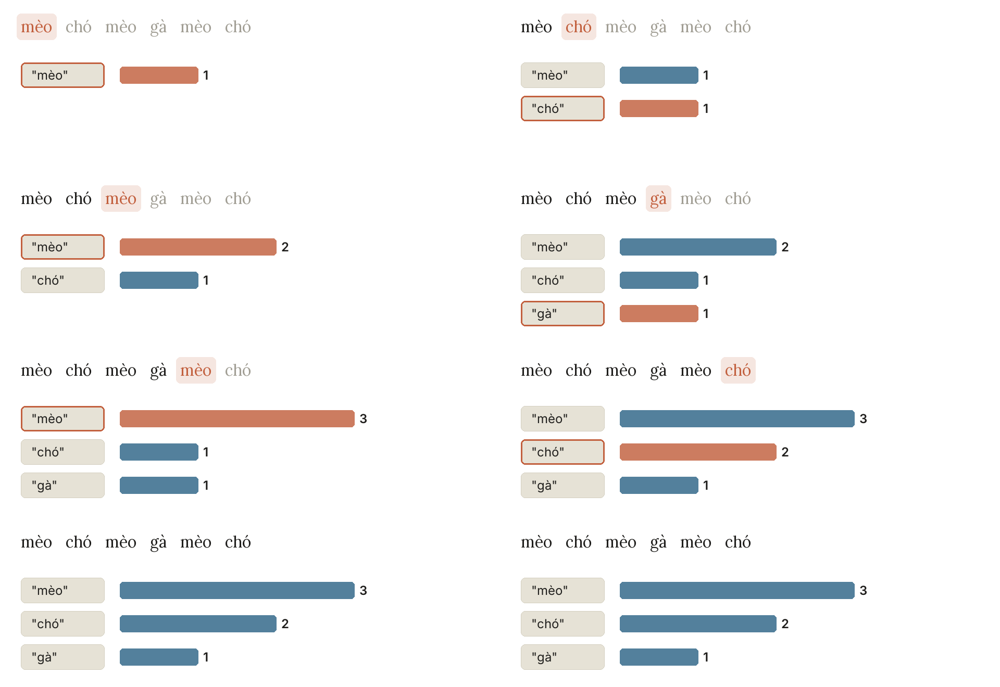

---
<!-- figure -->
## Vì sao `in` trên set nhanh

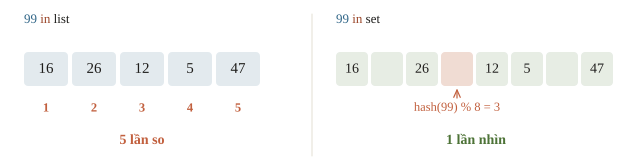

---
<!-- quiz -->
::: quiz
Có 50 000 mã đã nộp bài. Cần kiểm 10 000 mã khác xem đã nộp chưa. Nên làm thế nào?
- [x] Đổi danh sách thành `set` rồi dùng `in`
- [ ] Cứ dùng `in` trên list, 50 000 chưa nhiều
- [ ] Sắp xếp list trước cho `in` nhanh hơn
- [ ] Viết hai vòng `for` lồng nhau
Với list, mỗi lần `in` dò từ đầu đến cuối, tổng cộng cỡ $5\cdot 10^8$ phép so sánh. Set tra bằng bảng băm, mỗi lần trung bình $O(1)$. Sắp xếp không giúp, vì `in` vẫn dò lần lượt.
:::

---
<!-- split -->
## Slicing, comprehension và vài hàm quen tay

```python
a = [5, 3, 8, 1, 9, 2]
print(a[1:4], a[-1], a[-2:], a[::-1])
print([x * x for x in a if x % 2 == 1])
```

```output
[3, 8, 1] 2 [9, 2] [2, 9, 1, 8, 3, 5]
[25, 9, 1, 81]
```

|||

- `enumerate`: vị trí và phần tử.
- `zip`: phần tử cùng vị trí của nhiều dãy.
- `sorted(..., key=...)`: sắp theo một giá trị.
- `d.get(key, default)`: xử lý khóa chưa có.

---
<!-- split -->
## Tham số mặc định được tạo một lần

```python
def add_score(x, history=[]):
    history.append(x)
    return history

print(add_score(1), add_score(2))
```

```output
[1, 2] [1, 2]
```

|||

Hai lần gọi dùng chung list mặc định.

```python
def add_score(x, history=None):
    if history is None:
        history = []
    history.append(x)
    return history
```

---
<!-- figure -->
## Một list mặc định cho mọi lần gọi

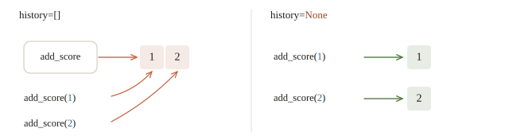

---
<!-- quiz -->
::: quiz
`add_score(score, history=[])` gọi lần sau vẫn thấy điểm của lần trước. Sửa thế nào để mỗi lần gọi bắt đầu từ list rỗng?
- [ ] Giữ `history=[]`, gọi `clear()` ở cuối hàm
- [ ] Giữ nguyên, vì Python tạo lại list mỗi lần
- [x] Đặt `history=None`, tạo list mới trong hàm
- [ ] Dùng list toàn cục, gán `[]` trước mỗi lần
Giá trị mặc định chỉ tạo một lần, lúc Python đọc dòng `def`, nên mọi lần gọi dùng chung một list. Mặc định `None` rồi tạo list trong hàm thì mỗi lần gọi có list riêng.
:::

---
<!-- split -->
## Kiểm đáp án trước khi đo

Tổng $0+1+\cdots+(n-1)$:

$$S=\frac{n(n-1)}{2}.$$

Với $n=500\,000$: **124 999 750 000**.

|||

Ba cách: vòng `for`, `sum(range(n))`, NumPy. Cả ba phải ra đúng số này.

Rồi mới đo bằng `timeit.repeat`, mỗi cách chạy nhiều lần.

---
<!-- figure -->
## Vòng `for` chậm nhất

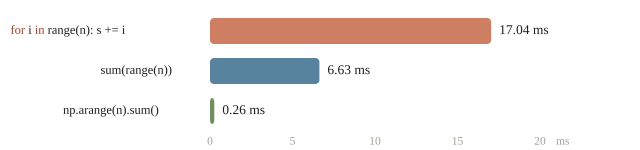

`sum` và NumPy lặp bên trong code C nên nhanh hơn. Công thức $n(n-1)/2$ còn nhanh hơn cả ba.

---
<!-- quiz -->
::: quiz
Hai cách đều tính đúng. Cách A chạy 8 ms nhưng phải chuẩn bị dữ liệu thêm 5 ms. Cách B chạy 11 ms, không cần chuẩn bị. Chỉ chạy một lần thì cách nào nhanh hơn?
- [x] B, vì 11 ms ít hơn 13 ms
- [ ] Như nhau, vì cùng độ phức tạp
- [ ] Chưa so được, vì số đo dao động
- [ ] A, vì 8 ms ít hơn 11 ms
Phải cộng cả thời gian chuẩn bị: A tốn $5 + 8 = 13$ ms, B tốn 11 ms. Cùng độ phức tạp chưa chắc chạy nhanh như nhau.
:::

---
<!-- split -->
## Ghi CSV rồi đọc lại

`preds` là dict ID → dự đoán.

```python
with path.open(
    "w", newline="", encoding="utf-8"
) as file:
    writer = csv.writer(file)
    writer.writerow(["id", "prediction"])
    for student_id, prediction in preds.items():
        writer.writerow(
            [student_id, prediction]
        )
```

|||

- `with` đóng file khi ra khỏi khối.
- Ghi rõ `encoding="utf-8"`.
- Đọc lại bằng `csv.reader`: mọi ô là chuỗi, đổi kiểu trước khi tính.

---
<!-- quiz -->
::: quiz
Đọc cột điểm bằng `csv`, ta được `["9", "10", "2"]`. `sorted` trả về gì?
- [ ] `['2', '9', '10']`
- [x] `['10', '2', '9']`
- [ ] `['9', '10', '2']`
- [ ] `TypeError`
Các phần tử vẫn là chuỗi, được so từng ký tự từ trái sang. Vì `'1' < '2' < '9'` nên `"10"` đứng đầu. Muốn sắp theo số thì dùng `key=float`.
:::

---
<!-- figure -->
## Đọc traceback từ dưới lên

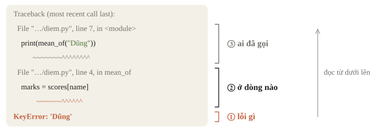

---
## Bốn lỗi hay gặp

Bốn thông báo cuối của bốn traceback riêng:

```output
TypeError: can only concatenate str (not "int") to str
KeyError: 'Dũng'
IndexError: list index out of range
ValueError: invalid literal for int() with base 10: '7.5'
```

- Dòng cuối: loại lỗi và nguyên nhân.
- Các dòng `File ..., line ...`: vị trí cần mở code.
- Không báo lỗi: kiểm kiểu, độ dài, vài giá trị.

---
<!-- quiz -->
::: quiz
`marks` có 3 phần tử. Vòng `for i in range(1, len(marks) + 1): print(marks[i])` chạy ra sao?
- [ ] In đủ ba phần tử như vòng 1 đến n của C++
- [ ] Báo `IndexError` ngay ở vòng đầu
- [ ] In `marks[1]`, `marks[2]` rồi dừng
- [x] In `marks[1]`, `marks[2]`, rồi `IndexError`
Chỉ số hợp lệ là 0, 1, 2. Vòng lặp bỏ qua phần tử đầu, rồi đến `i = 3` thì vượt ra ngoài list. Duyệt thẳng phần tử hoặc dùng `enumerate` thì không mắc lỗi này.
Phỏng theo: [NOAI 2026 Singapore · Vòng sơ loại · Câu 137](https://aisingapore.org/wp-content/uploads/2026/04/NOAI-2026-Preliminary-Round-Assessment-300-MCQs-Google-Forms.pdf#page=52)
:::

---
<!-- split -->
## Class: dữ liệu đi cùng hàm

```python
class ScoreBook:
    def __init__(self, names, marks):
        self.names = list(names)
        self.marks = list(marks)

    def __len__(self):
        return len(self.marks)

    def __getitem__(self, i):
        return self.names[i], self.marks[i]
```

|||

- `__init__` chạy khi tạo đối tượng; `self` là chính đối tượng.
- `len(book)` gọi `__len__`, `book[1]` gọi `__getitem__`.
- Class con gọi `super().__init__(...)` để chạy phần khởi tạo của cha.
- `Dataset` và `nn.Module` ở chương 3 dùng đúng các hàm này.

---
<!-- figure -->
## Cú pháp và hàm đặc biệt

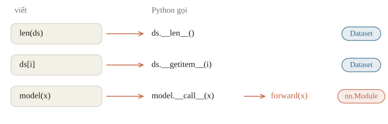

---
<!-- quiz -->
::: quiz
Xóa dòng `super().__init__(factor)` trong `ShiftScaler.__init__`, rồi gọi `ShiftScaler(2, 1)([1, 2, 3])`. Điều gì xảy ra?
- [ ] Vẫn ra `[3, 5, 7]`, vì Python tự gọi `__init__` của class cha
- [ ] Ra `[2, 3, 4]`, vì thiếu `factor` thì Python coi là 1
- [x] Báo `AttributeError`, vì đối tượng chưa có thuộc tính `factor`
- [ ] Báo lỗi ngay ở dòng tạo đối tượng, trước khi gọi
Python chỉ chạy `__init__` của class con. Dòng gán `self.factor` nằm trong `__init__` của cha nên không chạy; tạo đối tượng vẫn được, nhưng `forward` của cha đọc `self.factor` thì báo `AttributeError`.
:::

---
## Khi đi thi

- *Restart & Run all* trước khi nộp.
- Nhiều số thì dùng `sum` hoặc NumPy.
- `encoding="utf-8"`, đọc lại file nộp.

---
<!-- section 2 -->
# Luyện đề

---
<!-- quiz -->
::: quiz Luyện đề 1
Sau `a = [1, 2]`, `b = [1, 2]`, `c = a`, lệnh `print(a == b, a is b, a is c)` in ra gì?
- [ ] `True True True`
- [x] `True False True`
- [ ] `False False True`
- [ ] `True False False`
`==` so nội dung, nên `a == b` đúng. `is` hỏi hai tên có cùng dán trên một đối tượng không. `a` và `b` là hai list riêng, còn `c` chỉ là tên thứ hai của `a`.
Phỏng theo: [NOAI 2026 Singapore · Vòng sơ loại · Câu 95](https://aisingapore.org/wp-content/uploads/2026/04/NOAI-2026-Preliminary-Round-Assessment-300-MCQs-Google-Forms.pdf#page=38)
:::

---
<!-- quiz -->
::: quiz Luyện đề 2
Quen C++, một bạn viết `[1, 2] + [3, 4]` để cộng từng phần tử. Python cho kết quả gì?
- [ ] `[4, 6]`
- [ ] `[[1, 2], [3, 4]]`
- [ ] Báo lỗi
- [x] `[1, 2, 3, 4]`
Với list, `+` là phép nối, giống cộng hai chuỗi. Cộng từng cặp phần tử là việc của mảng NumPy ở bài 0.2.
Đề thi: [NOAI 2026 Singapore · Vòng sơ loại · Câu 91](https://aisingapore.org/wp-content/uploads/2026/04/NOAI-2026-Preliminary-Round-Assessment-300-MCQs-Google-Forms.pdf#page=37)
:::

---
<!-- quiz -->
::: quiz Luyện đề 3
Có `words = ["mèo", "chó", "mèo"]`. Cần gán cho mỗi từ khác nhau một số 0, 1,… Chạy lại lần nào cũng phải ra đúng một bảng. Viết thế nào?
- [x] `{w: i for i, w in enumerate(sorted(set(words)))}`
- [ ] `{w: i for i, w in enumerate(list(set(words)))}`
- [ ] `{w: i for i, w in enumerate(sorted(words))}`
- [ ] `{w: words.index(w) for w in words}`
Với chuỗi, mỗi lần chạy Python có thể duyệt `set` theo một thứ tự khác. Sắp xếp rồi mới đánh số thì lần nào cũng ra cùng một bảng. `sorted(words)` không bỏ trùng, nên các số không liền nhau.
Phỏng theo: [USA-NA-AIO 2026 · Vòng 1 · Part 5.1–5.2](https://www.usaaio.org/attachments/past-problems/2026/usaaio-2026-round-1-problems.pdf#page=11)
:::

---
<!-- center -->
## Chốt ý

`//`, `%` làm tròn xuống, khác C++ với số âm.

Gán không sao chép; cần list riêng thì `copy()`.

Tính trên nhiều số thì dùng `sum` hoặc NumPy.

---
<!-- center -->
## Sau giờ học

Làm **10 câu kiểm tra cuối bài** trên trang bài học.

Chạy notebook: *Restart & Run all*, rồi thử đổi `n` mà không chạy lại ô dưới.
