<!-- title -->
# NumPy

Tính trên cả mảng thay cho vòng lặp

Chương 0 · Bài 0.2

---
<!-- split -->
## NumPy để làm gì

Một phép tính cho cả mảng, không cần vòng lặp, nhanh hơn Python nhiều lần.

Ba khái niệm cần nắm: **shape**, **axis**, **broadcasting**.

|||

Bảng điểm 5 học sinh × 3 môn, shape `(5, 3)`:

- `axis=0`: 3 số, trung bình từng môn.
- `axis=1`: 5 số, trung bình từng học sinh.

---
## Mục tiêu

- Thay vòng lặp bằng phép tính trên cả mảng.
- Đoán shape kết quả khi tính theo axis và khi broadcasting.
- Phân biệt view và copy.
- Tránh các lỗi hay gặp: trừ mảng $(n,)$ với $(n, 1)$, tràn số `uint8`.

---
<!-- split -->
## Mỗi thuộc tính trả lời một câu hỏi

```python
import numpy as np

a = np.array([[1, 2, 3], [4, 5, 6]],
             dtype=np.int64)
print(a.shape, a.ndim, a.size, a.dtype)
print(np.arange(12).reshape(3, -1).shape)
```

```output
(2, 3) 2 6 int64
(3, 4)
```

|||

- `shape`: độ dài mỗi trục.
- `ndim`: số trục.
- `size`: tổng số ô.
- `dtype`: kiểu mỗi ô.

`reshape` giữ số ô; chỉ một trục được để `-1`.

---
<!-- figure -->
## Một ảnh là một mảng số

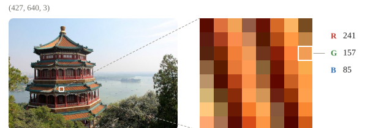

---

<!-- figure -->
## Mười dòng NumPy trên một ảnh


---
<!-- figure -->
## reshape chỉ đổi cách đọc

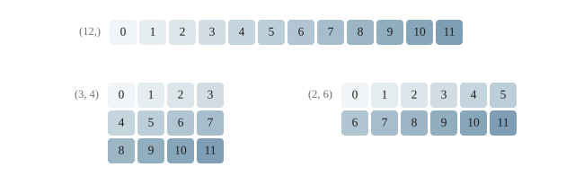

---
<!-- split -->
## Số nguyên NumPy có độ rộng cố định

```python
pixels = np.array([200, 100], dtype=np.uint8)
print(pixels + 100)
```

```output
[ 44 200]
```

|||

$300$ vượt miền 0–255, quay vòng thành 44.

Đổi sang `float32` **trước khi tính**, rồi `np.clip` về 0–255.

| Dtype | Byte mỗi ô |
|---|---|
| `uint8` | 1 |
| `float32` | 4 |
| `float64` | 8 |

---
<!-- figure -->
## uint8 chạy trên một vòng

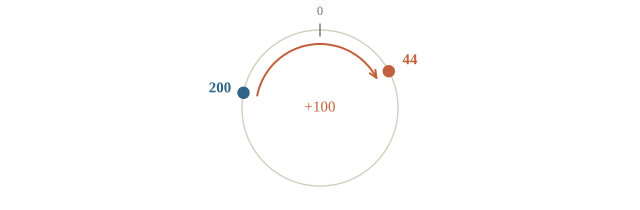

---
<!-- quiz -->
::: quiz
`np.array([250, 10], dtype=np.uint8) + 10` cho ra gì?
- [ ] `[260, 20]`
- [x] `[4, 20]`
- [ ] `[255, 20]`
- [ ] Báo lỗi tràn số
`uint8` chỉ chứa từ 0 đến 255. 260 vượt quá nên quay vòng về $260 - 256 = 4$, và NumPy không báo gì. Giá trị không dừng ở 255 như nhiều bạn tưởng.
:::

---
<!-- split -->
## Phép so sánh cũng cho một mảng

```python
z = np.array([-2.0, 0.0, 1.0, 3.0])
print(z > 0, (z > 0).sum(), (z > 0).mean())
print(np.where(z > 0, z, 0.0))
```

```output
[False False  True  True] 2 0.5
[0. 0. 1. 3.]
```

|||

`True` tính như 1 khi gộp.

- `sum`: số phần tử thỏa điều kiện.
- `mean`: tỉ lệ thỏa điều kiện.
- Accuracy: `(pred == y).mean()` khi hai shape trùng nhau.

---
<!-- quiz -->
::: quiz
Với `z = np.array([-2.0, 0.0, 1.0, 3.0])`, dòng `if z > 0: print("dương")` làm gì?
- [ ] In “dương”: có phần tử dương
- [ ] Không in: không phải mọi phần tử dương
- [x] `ValueError`: không rõ `any` hay `all`
- [ ] In “dương” hai lần, mỗi số dương một lần
`z > 0` là cả một mảng `bool`, còn `if` chỉ nhận một giá trị, và NumPy không đoán thay ta. Phải nói rõ `(z > 0).any()` hay `(z > 0).all()`.
:::

---
<!-- figure -->
## Cùng công thức, hai cách thực hiện

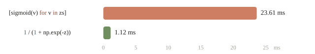

Kiểm hai cách ra cùng kết quả rồi mới đo.

---
<!-- figure -->
## Bốn cách lấy dữ liệu

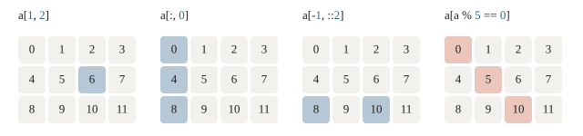

---
<!-- figure -->
## View và copy

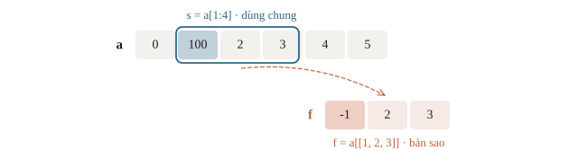

Lấy ra `b = a[a > 5]`: bản sao. Gán thẳng `a[a > 5] = 0`: sửa `a`.

---
<!-- quiz -->
::: quiz
Chạy `a = np.zeros(5)`, `b = a[2:]`, `b += 1`. Lúc này `a` là gì?
- [ ] `[0, 0, 0, 0, 0]`
- [ ] `[1, 1, 1, 1, 1]`
- [ ] `[0, 0, 1]`
- [x] `[0, 0, 1, 1, 1]`
Lát cắt của NumPy là view: `b` nhìn thẳng vào ba ô cuối của `a`, nên `b += 1` sửa luôn `a`. Muốn `b` là bản riêng thì viết `a[2:].copy()`.
:::

---
<!-- figure -->
## Trục nào được gộp, trục đó biến mất

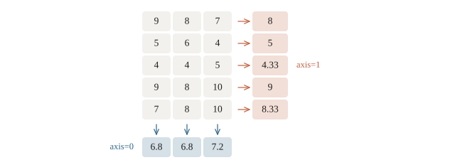

---
<!-- figure -->
## Gộp theo axis trên ảnh thật

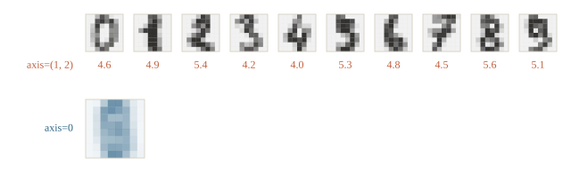

---
<!-- split -->
## Keepdims giữ ý nghĩa trục

Giả sử `imgs` là batch ảnh xám có shape `(100, 28, 28)`.

```python
print(imgs.mean(axis=0).shape)
print(imgs.mean(axis=(1, 2)).shape)
print(imgs.mean(axis=(1, 2),
                keepdims=True).shape)
```

```output
(28, 28)
(100,)
(100, 1, 1)
```

|||

- Gộp ảnh: một ảnh trung bình.
- Gộp không gian: một độ sáng mỗi ảnh.
- `keepdims=True`: các trục gộp thành độ dài 1.

---
<!-- quiz -->
::: quiz
`X` có shape `(32, 3, 64, 64)`, tức 32 ảnh màu, 3 kênh, 64 × 64 điểm ảnh. `X.mean(axis=(0, 2, 3))` có shape gì?
- [x] `(3,)`
- [ ] `(32,)`
- [ ] `(64, 64)`
- [ ] `(32, 3)`
Trục nào bị gộp thì biến mất, ở đây chỉ còn trục kênh. Kết quả là ba số, mỗi số là độ sáng trung bình của một kênh màu.
:::

---
<!-- split -->
## Nối trục cũ, hay tạo trục mới?

Tiếp từ bảng `scores` có shape `(5, 3)` ở phần `axis`.

```python
joined = np.concatenate(
    [scores[:2], scores[2:]], axis=0)
two_sessions = np.stack(
    [scores, scores], axis=0)
print(joined.shape,
      np.array_equal(joined, scores))
print(two_sessions.shape)
```

```output
(5, 3) True
(2, 5, 3)
```

|||

`concatenate`: nối trên trục đã có.

`stack`: thêm trục buổi đo.

Mỗi trục có ý nghĩa riêng: `(buổi, học sinh, môn)`.

---
<!-- figure -->
## concatenate và stack

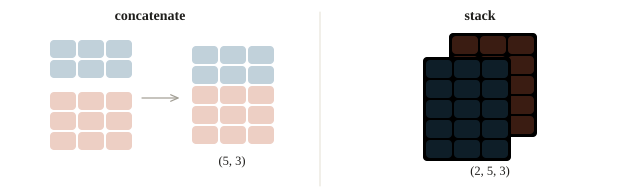

---
<!-- split -->
## Xếp từ phải, so từng trục

1. Thiếu trục thì coi như thêm độ dài 1 bên trái.
2. Mỗi trục: bằng nhau hoặc một bên bằng 1.

|||

| A | B | Kết quả |
|---|---|---|
| `(5, 3)` | `(3,)` | `(5, 3)` |
| `(5, 3)` | `(5, 1)` | `(5, 3)` |
| `(5, 3)` | `(5,)` | Lỗi |

Mảng nhỏ không bị chép thật, nhưng kết quả vẫn đủ kích thước.

---
<!-- figure -->
## Một cột cộng một hàng

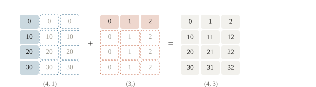

---
<!-- split -->
## Chuẩn hóa theo từng môn

Tiếp từ `scores.shape == (5, 3)`; mỗi cột là một môn.

$$z_{ij}=\frac{x_{ij}-\mu_j}{\sigma_j}.$$

```python
mu = scores.mean(axis=0)
sigma = scores.std(axis=0)
sigma_safe = np.where(sigma == 0, 1.0, sigma)
Z = (scores - mu) / sigma_safe
```

|||

- `mu`, `sigma`: `(3,)`, một số mỗi môn.
- Cột hằng: mẫu số thay bằng 1, kết quả toàn 0.
- Khi làm model: tính `mu`, `sigma` trên train, dùng lại cho test (bài 1.4).

---
<!-- split -->
## Khoảng cách bốn cặp: tính tay được

$A=[(0,0),(3,4)]$, $B=[(0,4),(3,0)]$.

```python
A = np.array([[0.0, 0.0], [3.0, 4.0]])
B = np.array([[0.0, 4.0], [3.0, 0.0]])
diff = A[:, None, :] - B[None, :, :]
D = np.sqrt((diff ** 2).sum(axis=-1))
print(D)
```

```output
[[4. 3.]
 [3. 4.]]
```

|||

`diff`: `(2, 2, 2)`; gộp trục tọa độ để còn `(2, 2)`.

Mỗi ô là một cặp, không phải một tọa độ.

Mảng lớn cần $nmd$ ô: $10^4\times10^4\times64$ số float64 dùng **51.2 GB**, chưa gồm mảng tạm khác.

---
<!-- figure -->
## Bốn độ dài trên hình, bốn ô trong D

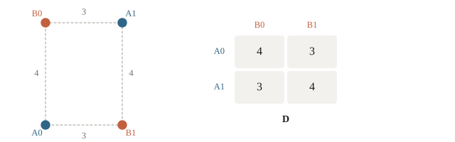

---
<!-- quiz -->
::: quiz
`A` có shape `(8, 1, 6)`, `B` có shape `(7, 1)`. `A + B` có shape gì?
- [ ] Báo lỗi, vì khác số trục
- [ ] `(8, 7, 1)`
- [ ] `(8, 1, 6)`
- [x] `(8, 7, 6)`
Xếp hai shape thẳng từ bên phải, coi `B` là `(1, 7, 1)`. Trục nào có một bên dài 1 thì kéo dãn theo bên kia, nên ra `(8, 7, 6)`. Khác số trục vẫn cộng được.
:::

---
<!-- split -->
## Dự đoán đúng hết, MSE vẫn sai?

```python
y = np.array([1.0, 2.0, 3.0])
y_hat = np.array([[1.0], [2.0], [3.0]])
print((y_hat - y).shape)
print(np.mean((y_hat - y) ** 2))
```

```output
(3, 3)
1.3333333333333333
```

|||


Broadcasting tạo mọi hiệu $\hat y_i-y_j$.

Sửa: đưa `y_hat` về `(n,)` bằng `.ravel()`.

Phòng: `assert y_hat.shape == y.shape` trong hàm tính loss.

---
<!-- figure -->
## Chín hiệu thay vì ba phần dư

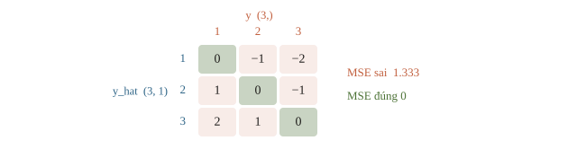

---
<!-- quiz -->
::: quiz
`y_hat` có shape `(1000, 1)`, `y` có shape `(1000,)`. Ta tính `np.mean((y_hat - y) ** 2)`. Kết quả ra sao?
- [x] Ra một số sai, không báo lỗi
- [ ] Báo lỗi, vì hai shape khác nhau
- [ ] Ra đúng MSE, vì NumPy tự khớp shape
- [ ] Chỉ tính trên mẫu đầu tiên
Broadcasting tạo ma trận $1000 \times 1000$ chứa mọi hiệu $\hat y_i - y_j$, rồi lấy trung bình cả ma trận. Ta nhận một con số sai mà không thấy lỗi nào. Phải đưa `y_hat` về `(1000,)` bằng `.ravel()` rồi mới trừ.
:::

---
<!-- split -->
## Nhân ma trận: `@`, không phải `*`

Với `M.shape == (2, 2)` và `v.shape == (2,)`:

```python
M = np.array([[2.0, 1.0], [1.0, 3.0]])
v = np.array([1.0, 2.0])
print(M @ v, M * v)
```

```output
[4. 7.] [[2. 2.]
 [1. 6.]]
```

|||

`@`: mỗi hàng nhân vô hướng với v.

`*`: từng ô nhân theo broadcasting.

`np.linalg.solve(M, v)`: giải hệ $M\mathbf{x} = \mathbf{v}$.

---
<!-- figure -->
## Hàng nhân vector, hay nhân từng ô?

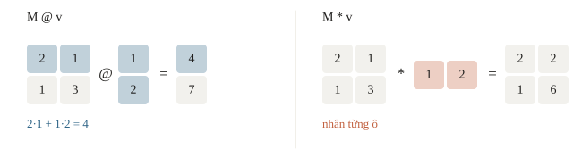

---
<!-- quiz -->
::: quiz
Ma trận $A$ có 3 hàng, 4 cột. Với mọi $\mathbf{x} = (x_0, x_1, x_2, x_3)$, ta có $A\mathbf{x} = (x_2 - x_3,\ x_3,\ x_0 + 2x_1)$. Hàng đầu của $A$ là gì?
- [ ] `[1, -1, 0, 0]`
- [ ] `[0, 0, 1, 0]`
- [x] `[0, 0, 1, -1]`
- [ ] `[1, 2, 0, 0]`
Mỗi phần tử của $A\mathbf{x}$ là tích vô hướng của một hàng với $\mathbf{x}$. Vì vậy hàng $i$ là dãy hệ số trong phần tử thứ $i$. Phần tử đầu là $x_2 - x_3$, nên hàng đầu là `[0, 0, 1, -1]`.
Phỏng theo: [USA-NA-AIO 2026 · Vòng 1 · Problem 3.1](https://www.usaaio.org/attachments/past-problems/2026/usaaio-2026-round-1-problems.pdf#page=7)
:::

---
<!-- quiz -->
::: quiz
Tạo `rng = np.random.default_rng(42)`, rồi lấy `a = rng.integers(0, 10, size=5)` và `b = rng.integers(0, 10, size=5)`. `a` có bằng `b` không? Chạy lại cả đoạn thì có ra đúng số cũ không?
- [ ] `a` bằng `b`, và chạy lại ra đúng số cũ
- [x] `a` khác `b`, và chạy lại ra đúng số cũ
- [ ] `a` bằng `b`, và chạy lại ra số mới
- [ ] `a` khác `b`, và chạy lại ra số mới
Seed cố định cả một dãy số, mỗi lần gọi lấy tiếp phần sau, nên `b` nối tiếp `a` chứ không lặp lại `a`. Chạy lại cả đoạn thì `rng` được tạo lại với cùng seed, nên cả dãy lặp lại y như cũ.
:::

---
<!-- figure -->
## Seed cố định cả một dãy

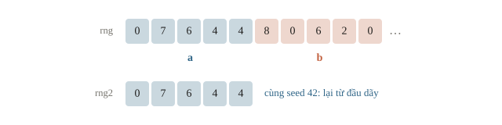

---
## Khi đi thi

- **In shape ở mọi bước** khi viết code mới.
- **Kiểm `dtype`** khi đọc ảnh hay dữ liệu.
- **Một `rng` có seed** cho cả notebook.
- **Ước lượng bộ nhớ** của mảng trung gian trước khi broadcast.

---
<!-- section 2 -->
# Luyện đề

---
<!-- quiz -->
::: quiz Luyện đề 1
Cho `A = [[1, 2], [3, 4]]` và `B = [[0, 1], [1, 0]]` là hai mảng NumPy. `A * B` và `A @ B` lần lượt bằng gì?
- [ ] Cả hai đều bằng `[[2, 1], [4, 3]]`
- [x] `[[0, 2], [3, 0]]` và `[[2, 1], [4, 3]]`
- [ ] `[[2, 1], [4, 3]]` và `[[0, 2], [3, 0]]`
- [ ] `[[0, 2], [3, 0]]` và `[[3, 4], [1, 2]]`
`*` nhân từng ô với ô cùng vị trí, chỉ còn hai ô mà `B` bằng 1. `@` là nhân ma trận, nhân bên phải với `B` thì đổi chỗ hai cột của `A`. Phương án cuối là `B @ A`.
Phỏng theo: [NOAI 2026 Singapore · Vòng sơ loại · Câu 113](https://aisingapore.org/wp-content/uploads/2026/04/NOAI-2026-Preliminary-Round-Assessment-300-MCQs-Google-Forms.pdf#page=44)
:::

---
<!-- quiz -->
::: quiz Luyện đề 2
`X` có shape `(1000, 20)`: 1000 mẫu, 20 đặc trưng. Muốn chuẩn hóa riêng từng đặc trưng, ta viết thế nào?
- [ ] `(X - X.mean(axis=1)) / X.std(axis=1)`
- [x] `(X - X.mean(axis=0)) / X.std(axis=0)`
- [ ] `(X - X.mean()) / X.std()`
- [ ] `X / X.max()`
Gộp theo trục mẫu, tức axis 0, thì mỗi đặc trưng có trung bình và độ lệch chuẩn riêng, shape `(20,)`. Gộp axis 1 rồi trừ thẳng sẽ lỗi shape. Không ghi axis thì cả 20 cột dùng chung một trung bình.
:::

---
<!-- quiz -->
::: quiz Luyện đề 3
`A` và `B` đều có shape `(20000, 128)`, kiểu `float64`. Tính `A[:, None, :] - B[None, :, :]` thì mảng trung gian tốn khoảng bao nhiêu bộ nhớ?
- [x] 400 GB
- [ ] 20 MB
- [ ] 400 MB
- [ ] 4 TB
Mảng trung gian có khoảng $5\cdot10^{10}$ số, mỗi số 8 byte, tổng cỡ $4\cdot10^{11}$ byte, tức 400 GB. Phải chia `A` thành từng khối nhỏ, hoặc đổi công thức để quy về nhân ma trận.
:::

---
## Chốt buổi học

- Trục ghi trong `axis` thì biến mất; `keepdims=True` giữ lại độ dài 1.
- Broadcasting xếp shape từ phải; cẩn thận `(n,)` với `(n, 1)`.
- Lát cắt là view; mặt nạ và list chỉ số cho bản sao.
- `@` nhân ma trận, `*` nhân từng ô.

Làm **10 câu cuối bài**.
