<!-- title -->
# Pandas và Matplotlib

Từ bảng dữ liệu đến file dự đoán đúng ID

Phase 0 · Bài 0.3

---
<!-- split -->
## Ba file, nhiều cách ghép sai

- `train.csv` có đặc trưng và điểm cuối kỳ.
- `test.csv` có học sinh cần dự đoán.
- `sample_submission.csv` quy định ID và cột của file nộp.

Bảng lớp nằm riêng; giờ tự học có ô trống.

|||

::: note Câu hỏi xuyên suốt
Làm sao tạo file dự đoán đúng học sinh, đúng định dạng và đọc lại kiểm được?
:::

---
## Mục tiêu buổi này

- Kiểm bảng ngay sau khi đọc CSV.
- Lọc, sửa, gộp và ghép mà giữ đúng ý nghĩa dòng.
- Vẽ biểu đồ trả lời một câu hỏi cụ thể.
- Ghép file nộp theo ID, kiểm hữu hạn và đọc lại CSV.

---
<!-- figure -->
## Bốn file, hai khóa

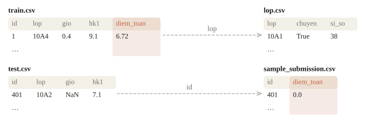

---
<!-- figure -->
## Một DataFrame gồm những gì

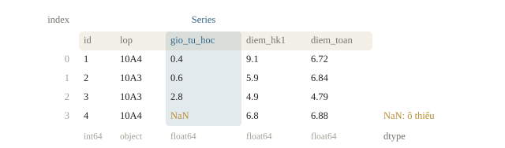

---
<!-- split -->
## Năm việc trước khi tính

Giả sử ô tạo dữ liệu đã chạy; `data_dir` chứa `train.csv` và `test.csv`.

```python
train = pd.read_csv(
    data_dir / "train.csv", encoding="utf-8"
)
print(train.shape)
print(train.head(3))
print(train.dtypes)
print(train.isna().sum())
print(train.describe())
```

|||

Ở bài: train **400 × 5**, test **100 × 4**.

- Nhãn: `diem_toan`.
- Khóa ghép: `id`.
- 23 giá trị giờ tự học bị thiếu.
- Miền nhãn theo đề: 0–10.

---
<!-- figure -->
## Mean lớn hơn median

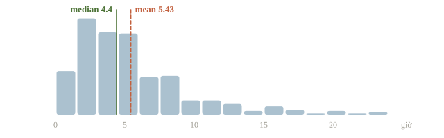

---
<!-- quiz -->
::: quiz
Bảng `describe` của cột `gio_tu_hoc` cho mean 5.43, median 4.40 và max 23.0. Phân bố giờ tự học nhiều khả năng có dạng nào?
- [x] Lệch phải, đuôi dài phía giá trị lớn kéo mean lên
- [ ] Lệch trái, đuôi dài phía giá trị nhỏ kéo mean xuống
- [ ] Gần đối xứng, vì mean và median chỉ chênh một giờ
- [ ] Chưa nói được gì nếu chưa vẽ histogram
Vài giá trị rất lớn đủ kéo mean lên, còn median gần như đứng yên. Mean lớn hơn median, và max 23 nằm rất xa phân vị 75% là 6.8. Đó là dấu hiệu của một đuôi dài bên phải.
Phỏng theo: [NOAI 2026 Singapore · Vòng sơ loại · Câu 69](https://aisingapore.org/wp-content/uploads/2026/04/NOAI-2026-Preliminary-Round-Assessment-300-MCQs-Google-Forms.pdf#page=27)
:::

---
<!-- split -->
## Một cột và một bảng khác shape

`train["diem_toan"]`: Series `(400,)`.

`train[["diem_toan"]]`: DataFrame `(400, 1)`.

|||

- ID cần duy nhất, không thiếu.
- Nếu ID là `"001"`, yêu cầu dtype chữ khi đọc.
- Test phải có đúng đặc trưng đề cung cấp.
- Index là nhãn dòng, chưa chắc là ID.

---
<!-- quiz -->
::: quiz
Cột điểm có vài ô ghi `"không rõ"`, nên pandas đọc cả cột thành chữ. Ta nên làm gì?
- [ ] Điền mọi ô lạ bằng 0 rồi đổi sang số
- [x] Xem các ô lạ, đổi kiểu, rồi đếm số ô thành `NaN`
- [ ] Đổi tên cột để pandas đọc lại thành số
- [ ] Bỏ qua, vì giá trị nhìn vẫn giống số
Xem trước các ô không phải số, rồi đổi bằng `to_numeric(errors="coerce")`: ô nào không đổi được thì thành thiếu. Đếm số ô bị đổi để chắc đó chỉ là vài ô lạ. Điền 0 thì “không rõ” bỗng thành điểm 0.
:::

---
<!-- split -->
## Sửa bằng một lần `loc`

Giả sử `demo = train.copy()`: sửa trên bản sao để giữ nhãn thật.

```python
demo.loc[demo["lop"] == "10A1", "diem_toan"] = 0
print((demo["diem_toan"] == 0).sum())
```

```output
98
```

|||

- Mỗi điều kiện có ngoặc, nối bằng `&` hoặc `|`.
- `loc`: nhãn và tên cột.
- `iloc`: vị trí.
- `df[mask]["col"] = value`: gán vào bảng tạm, bảng gốc không đổi.

---
<!-- figure -->
## Bảng tạm và bảng gốc

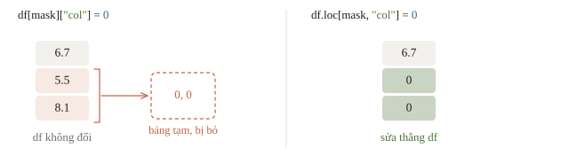

---
<!-- quiz -->
::: quiz
Cần lọc các học sinh lớp 10A1 có điểm HK1 dưới 5. Viết thế nào cho đúng?
- [ ] `train[train["lop"] == "10A1" and train["diem_hk1"] < 5]`
- [ ] `train[train["lop"] == "10A1" & train["diem_hk1"] < 5]`
- [ ] `train.loc["10A1", "diem_hk1" < 5]`
- [x] `train[(train["lop"] == "10A1") & (train["diem_hk1"] < 5)]`
`and` cần mỗi vế là một giá trị đúng hoặc sai, mà ở đây mỗi vế là cả một cột, nên báo lỗi. Thiếu ngoặc thì `&` được tính trước `==` và `<`, cũng lỗi. Mỗi điều kiện phải có cặp ngoặc riêng.
:::

---
<!-- split -->
## Thiếu dữ liệu khác với số 0

Điền giờ tự học bằng trung vị cùng lớp; lớp mới dùng trung vị chung của train.

Giả sử `med_lop`, `med_all` đã tính từ train và `result` là bản sao cần biến đổi.

```python
group_value = result["lop"].map(med_lop)
result["gio_tu_hoc"] = (
    result["gio_tu_hoc"].fillna(group_value)
    .fillna(med_all)
)
```

|||

- Trung vị chung: **4.4 giờ**.
- Train và test sau điền: **0 ô thiếu**.
- Lớp mới 10A5 cũng nhận 4.4 khi chưa có dữ liệu.

Fit thống kê trên phần train dùng học; validation/test dùng lại thống kê đó.

---
<!-- figure -->
## Mỗi lớp một median

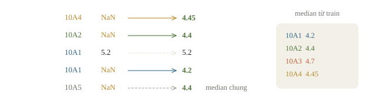

---
<!-- quiz -->
::: quiz
Test có lớp 10A5, lớp này chưa từng có trong train. `map(med_lop)` trả về gì ở các dòng ấy, và code của bài xử lý ra sao?
- [ ] Báo `KeyError`, phải thêm 10A5 vào train rồi chạy lại
- [x] Trả `NaN`, rồi `fillna(med_all)` điền median của train
- [ ] Tự tính median của 10A5 từ giờ học trong test
- [ ] Trả 0, nên lớp mới mang giờ học bằng 0
`map` gặp khóa không có trong bảng thì trả `NaN`, không báo lỗi và không tự đoán. Bài dùng `fillna(med_all)` để dự phòng: điền median chung tính từ train, không lấy gì từ test.
:::

---
<!-- figure -->
## `agg` và `transform` trả lời khác nhau

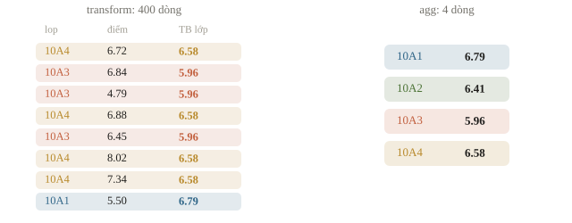

---

<!-- figure -->
## Tách, tính, gộp

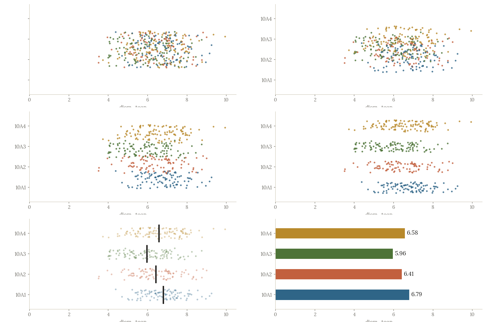

---
<!-- split -->
## Đọc kết quả theo nhóm

| Cách gọi | Kết quả |
|---|---|
| `agg("mean")` | Một giá trị mỗi lớp: `(4,)` |
| `transform("mean")` | Một giá trị mỗi học sinh: `(400,)` |

Trong dữ liệu của bài, trung bình 10A1 là 6.79, 10A3 là 5.96.

|||

`count`: số giá trị không thiếu.

`size`: số dòng của nhóm.

Chênh trung bình gợi giả thuyết, chưa chứng minh nhân quả.

Trung bình nhóm tính từ nhãn chỉ để đọc bảng; chưa đưa vào đặc trưng model.

---
<!-- quiz -->
::: quiz
`train` có 400 dòng, chia thành 4 lớp. `train.groupby("lop")["diem_toan"].transform("max")` có bao nhiêu phần tử?
- [ ] 4
- [ ] 1
- [ ] 1600
- [x] 400
`transform` trả về một giá trị cho mỗi dòng gốc: dòng nào cũng nhận điểm cao nhất của lớp mình, nên vẫn đủ 400. Muốn mỗi lớp gộp thành một số, ra 4 giá trị, thì dùng `agg("max")`.
:::

---
<!-- split -->
## Gán Series ghép theo nhãn index

```python
tiny = pd.DataFrame(
    {"id": [101, 102, 103]},
    index=[10, 20, 30],
)
values = pd.Series(
    [6.0, 7.0, 8.0], index=[30, 10, 20]
)
tiny["score"] = values
print(tiny["score"].tolist())
```

```output
[7.0, 8.0, 6.0]
```

|||

Index 10 nhận 7.0, không nhận phần tử đầu 6.0.

Với ID bài thi, ghép rõ theo khóa bằng `merge`.

---
<!-- figure -->
## Ghép theo nhãn, không theo vị trí

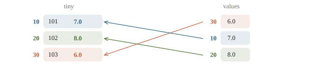

---
<!-- figure -->
## `left` vẫn có thể tăng số dòng

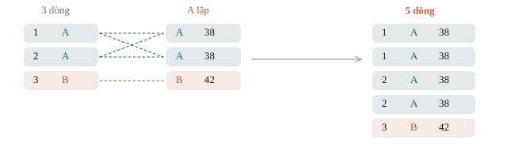

---
<!-- split -->
## Kiểm quan hệ ghép

Giả sử `lop_info` có một dòng cho mỗi giá trị `lop`.

```python
merged = train.merge(
    lop_info, on="lop", how="left",
    validate="many_to_one",
)
assert len(merged) == len(train)
```

|||

- Nhiều học sinh → một dòng lớp.
- `validate` bắt khóa phải bị trùng.
- `left` giữ khóa trái, không hứa giữ số dòng.
- `inner` có thể mất học sinh không khớp.
- Kiểm thêm các cột mới có giá trị thiếu không.

---
<!-- quiz -->
::: quiz
Bảng trái có ba học sinh lớp A, A, B. Bảng phải có ba dòng thông tin lớp, cũng là A, A, B. Ghép bằng `merge` với `how="left"` theo lớp thì được mấy dòng?
- [ ] 3
- [ ] 4
- [x] 5
- [ ] 9
Mỗi học sinh lớp A khớp cả hai dòng A bên phải, học sinh lớp B khớp một dòng, nên có $2\cdot 2 + 1 = 5$ dòng. `how="left"` giữ mọi dòng bên trái, nhưng không hứa giữ nguyên số dòng.
:::

---
<!-- split -->
## Chọn hình theo điều cần biết

| Câu hỏi | Biểu đồ |
|---|---|
| Một biến phân bố thế nào? | Histogram |
| Hai biến số liên quan thế nào? | Scatter |
| Nhóm nào có giá trị cao hơn? | Bar |
| Thay đổi theo thời gian? | Line |

|||

```python
fig, (ax1, ax2) = plt.subplots(
    1, 2, figsize=(10, 4)
)
ax2.scatter(
    train["gio_tu_hoc"], train["diem_toan"],
    s=10, alpha=0.6,
)
ax2.set_xlabel("giờ tự học mỗi tuần")
ax2.set_ylabel("điểm Toán cuối kỳ")
```

Cần nhãn, đơn vị và ý nghĩa của thứ tự trục.

Đoạn code giả sử `import matplotlib.pyplot as plt`, `train` đã đọc và cột `gio_tu_hoc` đã xử lý ô thiếu.

---
<!-- figure -->
## Phân bố và quan hệ

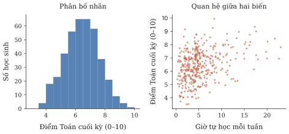

Tương quan trong dữ liệu của bài: HK1 với Toán **0.56**, giờ tự học với Toán **0.36**. Đó không phải độ dốc hay bằng chứng nhân quả.

---
<!-- figure -->
## Chiều cao cột cần một mốc đúng

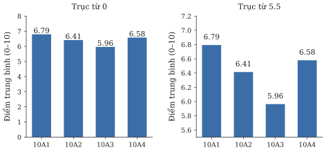

Muốn xem chênh nhỏ chi tiết, có thể dùng biểu đồ điểm có trục ghi rõ.

---
<!-- quiz -->
::: quiz
Muốn xem điểm HK1 và điểm cuối kỳ có đi cùng nhau không, ta nên vẽ gì?
- [ ] Histogram của điểm cuối kỳ
- [x] Scatter, mỗi học sinh là một điểm
- [ ] Đường nối các học sinh theo ID
- [ ] Biểu đồ cột số học sinh từng lớp
Scatter giữ nguyên cặp (HK1, cuối kỳ) của từng học sinh, nên thấy được hai điểm số đi cùng nhau ra sao. Histogram chỉ cho thấy một biến. ID không phải thời gian, nên nối theo ID chẳng có ý nghĩa gì.
:::

---
<!-- figure -->
## Ghép theo khóa, không gán theo vị trí

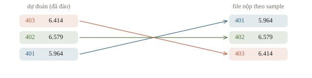

Trong code của bài, bảng dự đoán bị đảo ngược để kiểm điều này.

---
<!-- quiz -->
::: quiz
`pred_table` xếp ID từ 500 về 401, còn `sample` xếp từ 401 tới 500. `sample[["id"]].merge(pred_table, on="id", how="left")` cho ID theo thứ tự nào?
- [ ] Từ 500 về 401, theo bảng dự đoán
- [x] Từ 401 tới 500, theo bảng bên trái
- [ ] Tăng dần, vì `merge` luôn sắp theo khóa
- [ ] Không biết trước, phải tự sắp lại
Với `how="left"`, pandas giữ thứ tự dòng của bảng bên trái. Đặt `sample` bên trái thì file nộp tự theo đúng khung của đề, dù bảng dự đoán bị xáo thế nào.
:::

---
<!-- split -->
## Kiểm bảng trước khi ghi

Giả sử `sub` đã ghép dự đoán vào `sample`; `sample` giữ đúng ID và cột mà đề yêu cầu.

```python
assert sub["id"].equals(sample["id"])
assert np.isfinite(
    sub["diem_toan"].to_numpy()
).all()
assert sub["diem_toan"].between(0, 10).all()
sub.to_csv(
    data_dir / "submission.csv", index=False,
    encoding="utf-8",
)
```

|||

- Đúng số dòng, tên và thứ tự cột.
- Đúng ID và thứ tự mẫu.
- Không NaN, không vô cùng.
- Miền nhãn theo đề.

---
<!-- split -->
## Đọc lại tệp đã ghi

```python
read_back = pd.read_csv(
    data_dir / "submission.csv",
    encoding="utf-8"
)
assert (
    read_back.columns.tolist()
    == sample.columns.tolist()
)
assert read_back["id"].equals(sample["id"])
assert np.isfinite(read_back["diem_toan"]).all()
```

|||

Đọc lại kiểm tệp thật sau `to_csv`, không chỉ bảng còn trong bộ nhớ.

Kết quả: **100 dòng × 2 cột**, đọc lại khớp mẫu.

---
<!-- split -->
## Tính tay: phải nói rõ mẫu số

Lớp A: $6,8,7$. Lớp B: $5,\text{NaN},9$, cột float64.

- Trung bình A = 7, B = 7.
- `transform("max")`: $8,8,8,9,9,9$.

|||

Tỉ lệ điểm ≥ 7 trên mọi dòng: $3/6=0.5$.

Tỉ lệ trong các dòng đã có điểm: $3/5=0.6$.

`count` lớp B = 2; `size` lớp B = 3.

Không để mặc định của thư viện quyết định câu hỏi thống kê.

---
## Khi đi thi

- **Năm lệnh đầu tiên**: `shape`, `head`, `dtypes`, `isna().sum()`, `describe()`, cho cả train lẫn test.
- **Vẽ phân bố nhãn** trước khi chọn metric.
- **Ghép có `validate`**, in shape trước và sau.
- **File nộp từ `sample_submission`**, ghép theo `id`, `index=False`, đọc lại.

---
<!-- section 2 -->
# Luyện đề

---
<!-- quiz -->
::: quiz Luyện đề 1
Bảng `df` có một cột tên `"diem toan"`, có dấu cách ở giữa. Ta chọn cột này thế nào?
- [ ] `df.diem toan`
- [ ] `df("diem toan")`
- [ ] `df.loc["diem toan"]`
- [x] `df["diem toan"]`
`df.ten_cot` chỉ dùng được khi tên cột là tên biến Python hợp lệ, mà tên có dấu cách thì không. `df(...)` gọi bảng như gọi hàm nên lỗi. `df.loc["diem toan"]` lại đi tìm một **dòng**. Ngoặc vuông với chuỗi thì luôn chọn được cột.
Đề thi: [NOAI 2026 Singapore · Vòng sơ loại · Câu 110](https://aisingapore.org/wp-content/uploads/2026/04/NOAI-2026-Preliminary-Round-Assessment-300-MCQs-Google-Forms.pdf#page=43)
:::

---
<!-- quiz -->
::: quiz Luyện đề 2
Cột giờ học trên train là `[1, 3, 5]`, trên test là `[2, NaN, 100]`. Ta điền ô thiếu bằng median của train. Ô `NaN` ở test được điền số mấy?
- [ ] 51
- [x] 3
- [ ] 2
- [ ] 5
Median của train là 3, nên ô thiếu ở test được điền 3. 51 là median của hai giá trị đã biết trên test, tức là lấy số liệu của test để xử lý chính test, việc ta không được làm.
:::

---
<!-- quiz -->
::: quiz Luyện đề 3
`train` có 400 dòng. Ghép thêm thông tin lớp bằng `train.merge(info, on="lop", how="left")` thì thành 437 dòng. Nhiều khả năng là do đâu?
- [x] Một số lớp xuất hiện nhiều lần trong `info`
- [ ] `how="left"` luôn thêm dòng cho khớp đủ hai bảng
- [ ] Có học sinh không khớp lớp nào nên sinh dòng `NaN`
- [ ] `merge` tạo thêm dòng khi sắp xếp lại theo khóa
Lớp nào bị lặp trong `info` thì mỗi học sinh lớp ấy khớp với nhiều dòng, nên bảng dài ra. Học sinh không khớp chỉ nhận `NaN`, không sinh thêm dòng. Thêm `validate="many_to_one"` thì pandas báo lỗi ngay.
:::

---
<!-- center -->
## Chốt buổi học

Đọc hợp đồng · nhìn dữ liệu · ghép đúng khóa · kiểm file đã ghi

Một file hợp lệ chưa chứng minh model tốt. Chương tiếp theo sẽ chia dữ liệu và chấm một baseline đúng cách.

Làm **10 câu cuối bài**, chạy lại notebook từ đầu và đối chiếu các bảng nhỏ.
