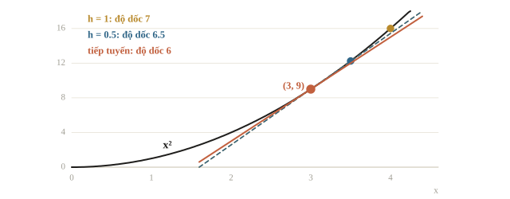
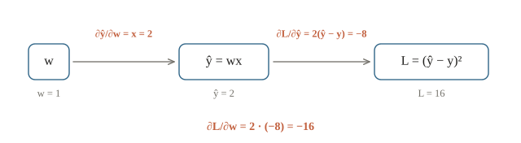
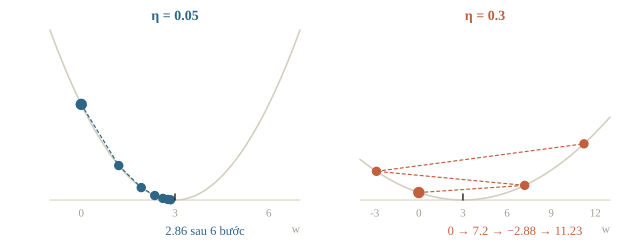

<!-- title -->
# Đạo hàm và gradient

Đổi tham số theo hướng nào thì loss giảm

Chương 0 · Bài 0.6

---
<!-- split -->
## Tăng hay giảm $w$?

- Model $\hat{y} = wx$, đặt $w = 0$ thì sai nhiều.
- Một trọng số thì thử được từng giá trị.
- Hàng triệu trọng số thì không.
- Cần biết: nhích $w$ một chút, loss đổi bao nhiêu?

|||

Đạo hàm trả lời câu đó.

Bài này học:

- đạo hàm và quy tắc chuỗi;
- gradient của hàm nhiều biến;
- gradient descent, thuật toán huấn luyện model.

---
## Mục tiêu

- Hiểu đạo hàm là độ dốc; tính xấp xỉ bằng sai phân.
- Tính đạo hàm của đa thức, $e^x$, $\log x$ và hàm hợp.
- Tính gradient của hàm nhiều biến.
- Chạy gradient descent bằng tay và bằng code; chọn learning rate.

---
<!-- section 1 -->
# Đạo hàm

---
<!-- figure -->
## Độ dốc tại một điểm



---
<!-- split -->
## Cho $h$ nhỏ dần

$$f'(x) = \lim_{h \to 0} \frac{f(x + h) - f(x)}{h}$$

$x$ nhích $\Delta$ thì $f$ nhích khoảng $f'(x)\,\Delta$.

Dương: đang lên. Âm: đang xuống. Bằng 0: nằm ngang.

|||

$f(x) = x^2$ tại $x = 3$:

```output
1 7.0
0.1 6.1
0.01 6.01
0.001 6.001
```

Tay: $\frac{(3 + h)^2 - 9}{h} = 6 + h \to 6$.

---
<!-- quiz -->
::: quiz
$f'(2) = -3$. Tăng $x$ từ 2 lên 2.01 thì $f$ thay đổi khoảng bao nhiêu?
- [ ] Tăng khoảng 0.03
- [x] Giảm khoảng 0.03
- [ ] Giảm khoảng 3
- [ ] Không đổi, vì 0.01 quá nhỏ
$f'(2) \cdot 0.01 = -0.03$. Giảm 3 là quên nhân với độ tăng 0.01.
:::

---
<!-- split -->
## Quy tắc tính đạo hàm

| Hàm | Đạo hàm |
|---|---|
| hằng số $c$ | $0$ |
| $x^n$ | $n x^{n-1}$ |
| $e^x$ | $e^x$ |
| $\log x$ | $1/x$ |
| $c f + g$ | $c f' + g'$ |

|||

Kiểm tại $x = 2$ bằng sai phân trung tâm:

$$\frac{f(x + h) - f(x - h)}{2h}$$

| Hàm | Công thức | Sai phân |
|---|---|---|
| $x^3$ | 12.000000 | 12.000000 |
| $e^x$ | 7.389056 | 7.389056 |
| $\log x$ | 0.500000 | 0.500000 |

---
<!-- quiz -->
::: quiz
$g(x) = 4x^3 - 2x$. $g'(1)$ bằng bao nhiêu?
- [ ] $2$
- [ ] $12$
- [ ] $14$
- [x] $10$
$g'(x) = 12x^2 - 2$. $2$ là $g(1)$; $12$ là quên đạo hàm của $-2x$.
:::

---
<!-- section 2 -->
# Quy tắc chuỗi

---
<!-- split -->
## Tích các tốc độ đổi

$$\frac{d}{dx} f(g(x)) = f'(g(x))\, g'(x)$$

$(2x + 1)^2$: $2(2x + 1) \cdot 2$.

Backpropagation ở chương 3 là quy tắc chuỗi làm có hệ thống.

|||

Sigmoid:

$$\sigma'(z) = \sigma(z)\big(1 - \sigma(z)\big) \le 0.25$$

```output
0.0 0.25 0.25
2.0 0.105 0.105
5.0 0.0066 0.0066
```

Nhân nhiều thừa số $\le 0.25$: gradient lớp đầu nhỏ dần.

---
<!-- figure -->
## Từ $w$ tới loss



---
<!-- quiz -->
::: quiz
$L = (wx - y)^2$ với $x = 3$, $y = 3$ và $w = 2$. $\partial L / \partial w$ bằng bao nhiêu, và nên đổi $w$ theo hướng nào?
- [ ] $6$; tăng $w$
- [ ] $9$; giảm $w$
- [x] $18$; giảm $w$
- [ ] $-18$; tăng $w$
Sai số $6 - 3 = 3$, đạo hàm $2 \cdot 3 \cdot 3 = 18$ dương: giảm $w$. $9$ là loss.
:::

---
<!-- section 3 -->
# Gradient

---
<!-- split -->
## Đạo hàm riêng

$f(x, y) = x^2 y + 3x$:

$$\frac{\partial f}{\partial x} = 2xy + 3, \qquad \frac{\partial f}{\partial y} = x^2$$

Coi biến kia là hằng số.

|||

$$\nabla f = \left(\frac{\partial f}{\partial x},\ \frac{\partial f}{\partial y}\right)$$

- $\nabla f$: hướng tăng nhanh nhất.
- $-\nabla f$: hướng giảm nhanh nhất.

---
<!-- figure -->
## Gradient trên cái bát $x^2 + y^2$



---
<!-- quiz -->
::: quiz
$f(x, y) = 3x + y^2$. Gradient tại $(5, 1)$ là gì?
- [ ] $(3, 1)$
- [x] $(3, 2)$
- [ ] $(15, 1)$
- [ ] $5$
$\partial f / \partial x = 3$, $\partial f / \partial y = 2y = 2$. Gradient là vector, không phải một số.
:::

---
<!-- section 4 -->
# Gradient descent

---
<!-- center -->
## Đi một bước ngược gradient

$$\mathbf{w} \leftarrow \mathbf{w} - \eta\, \nabla L(\mathbf{w})$$

$\eta$ là learning rate: độ dài mỗi bước.

---
<!-- figure -->
## $\eta$ vừa và $\eta$ quá lớn



---
<!-- quiz -->
::: quiz
Huấn luyện bằng gradient descent, loss sau mỗi lượt chạy hết dữ liệu (một epoch) là 2.1, 5.8, 31.4, 260.0, rồi `nan`. Nên thử gì trước?
- [x] Giảm learning rate
- [ ] Tăng learning rate cho nhanh tới đáy
- [ ] Huấn luyện thêm nhiều epoch
- [ ] Bỏ bớt dữ liệu train
Loss tăng theo cấp số rồi tràn: bước quá dài, nhảy qua đáy và văng ra xa dần.
:::

---
<!-- split -->
## Kiểm gradient bằng sai phân

MSE tuyến tính:

$$\nabla L = \frac{2}{n} X^\top (X\mathbf{w} - \mathbf{y})$$

Shape: $(3, 5) @ (5,) \to (3,)$, mỗi trọng số một số.

|||

```output
[ 1.753666  1.112768 -0.48581 ]
[ 1.753666  1.112768 -0.48581 ]
đúng: 3.1e-11   quên số 2: 3.3e-01
```

Công thức sai lộ ngay. PyTorch: `gradcheck`.

---
<!-- quiz -->
::: quiz
Kiểm gradient tự viết bằng sai phân, sai số tương đối ra $0.5$. Nhiều khả năng do đâu?
- [ ] Bình thường, vì sai phân luôn chỉ là xấp xỉ
- [ ] Phải giảm $h$ xuống $10^{-15}$ cho chính xác hơn
- [x] Công thức gradient tự viết nhiều khả năng sai
- [ ] Learning rate đang đặt quá lớn
Sai phân với $h \approx 10^{-6}$ sai cỡ $10^{-8}$; lệch một nửa là công thức sai, như thiếu hệ số hay sai dấu.
:::

---
<!-- split -->
## Tính tay một bước

$\hat{y} = wx$, mẫu $(1, 2)$ và $(2, 5)$, $w = 0$, $\eta = 0.1$.

- Sai số $-2$, $-5$; loss $14.5$.
- Gradient: trung bình của $-4$ và $-20$ là $-12$.
- $w = 0 - 0.1 \cdot (-12) = 1.2$; loss còn $3.7$.

|||

```output
0 0.0 14.5 -12.0
1 1.2 3.7 -6.0
2 1.8 1.0 -3.0
```

Đáp án tốt nhất $w = 2.4$, nơi đạo hàm bằng 0.

---
## Khi đi thi

- **Cập nhật ngược dấu gradient.**
- **Viết chuỗi ra trước** rồi nhân đạo hàm từng bước.
- **Gradient có đúng shape của tham số.**
- **Tự viết gradient thì kiểm sai phân**, $h \approx 10^{-6}$.
- **Loss tăng vọt hay `nan`**: giảm learning rate trước.

---
<!-- section 5 -->
# Luyện đề

---
<!-- quiz -->
::: quiz Luyện đề 1
Quy tắc chuỗi nói $\frac{d}{dx} f(g(x))$ bằng gì?
- [ ] $f'(x) \cdot g'(x)$
- [ ] $f'(x) + g'(x)$
- [ ] $f(x) \cdot g'(x)$
- [x] $f'(g(x)) \cdot g'(x)$
Đạo hàm hàm ngoài tính **tại** $g(x)$, nhân đạo hàm hàm trong.
Đề thi: [NOAI 2026 Singapore · Vòng sơ loại · Câu 39](https://aisingapore.org/wp-content/uploads/2026/04/NOAI-2026-Preliminary-Round-Assessment-300-MCQs-Google-Forms.pdf#page=17)
:::

---
<!-- quiz -->
::: quiz Luyện đề 2
Trong gradient descent, vector âm của gradient, $-\nabla L$, chỉ về đâu?
- [x] Hướng làm loss giảm nhanh nhất
- [ ] Hướng làm loss tăng nhanh nhất
- [ ] Thẳng tới điểm cực tiểu của loss
- [ ] Một điểm yên ngựa của loss
Giảm nhanh nhất **tại chỗ đang đứng**; không nhất thiết chỉ thẳng tới cực tiểu.
Đề thi: [NOAI 2026 Singapore · Vòng sơ loại · Câu 44](https://aisingapore.org/wp-content/uploads/2026/04/NOAI-2026-Preliminary-Round-Assessment-300-MCQs-Google-Forms.pdf#page=19)
:::

---
<!-- quiz -->
::: quiz Luyện đề 3
Với $L = (\hat{y} - y)^2$ và $\hat{y} = wx$, $\partial L / \partial w$ bằng gì?
- [ ] $2(\hat{y} - y)$
- [ ] $(\hat{y} - y)\, x$
- [x] $2(\hat{y} - y)\, x$
- [ ] $2w$
Chuỗi $w \to \hat{y} \to L$: $2(\hat{y} - y) \cdot x$. Dừng ở $2(\hat{y} - y)$ là mới đi nửa chuỗi.
Đề thi: [NOAI 2026 Singapore · Vòng sơ loại · Câu 46](https://aisingapore.org/wp-content/uploads/2026/04/NOAI-2026-Preliminary-Round-Assessment-300-MCQs-Google-Forms.pdf#page=20)
:::

---
<!-- center -->
## Chốt buổi học

Đạo hàm là độ dốc · chuỗi thì nhân · gradient chỉ hướng lên · bước ngược gradient

Bài 0.7 hỏi: dữ liệu ngẫu nhiên thì điểm số dao động bao nhiêu?

Làm **10 câu cuối bài**.
