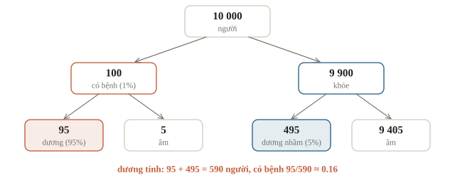
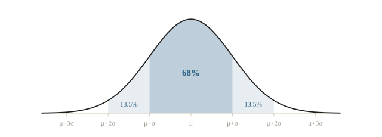
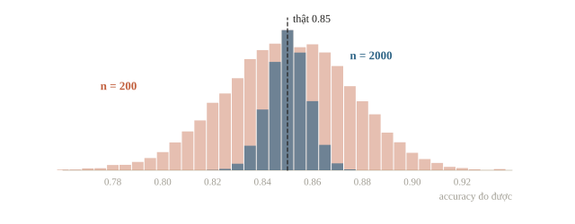

<!-- title -->
# Xác suất và thống kê

Khi nào một chênh lệch là thật

Chương 0 · Bài 0.7

---
<!-- split -->
## 84% hay 86%?

- Hai model chấm trên cùng 200 ảnh validation.
- A đúng 84%, B đúng 86%; nhóm chọn B.
- Trên test kín, A lại cao hơn.
- 200 ảnh là một mẫu ngẫu nhiên: con số đo được dao động.

|||

::: note Câu hỏi xuyên suốt
Một con số đo trên dữ liệu dao động cỡ nào, và khi nào một chênh lệch là thật?
:::

---
## Mục tiêu buổi này

- Tính xác suất, xác suất có điều kiện; kiểm độc lập.
- Dùng Bayes đảo chiều điều kiện.
- Tính trung bình, median, phương sai, độ lệch chuẩn, z-score.
- Ước lượng sai số chuẩn của accuracy trên $n$ mẫu.

---
<!-- section 1 -->
# Xác suất

---
<!-- split -->
## Đếm, hoặc lặp lại thật nhiều lần

- Kết quả khả năng như nhau: thuận lợi chia tổng.
- Xúc xắc ra 5 hoặc 6: $2/6 = 1/3$.
- Không xảy ra: $1 - P$.

|||

Tung 100 000 lần:

```output
0.3326 0.3333
3.498
```

`(rolls >= 5).mean()` là tỉ lệ `True`.

---
<!-- quiz -->
::: quiz
Rút ngẫu nhiên một lá từ bộ bài 52 lá. Xác suất **không** rút được lá cơ (13 lá) là bao nhiêu?
- [ ] $1/4$
- [ ] $13/52$ nhân $39/52$
- [x] $3/4$
- [ ] $1/13$
Phần bù của $1/4$. Nhân hai xác suất là cho hai lần rút.
:::

---
<!-- split -->
## Chỉ đếm trong nhóm điều kiện

$$P(A \mid B) = \frac{P(A \cap B)}{P(B)}$$

Độc lập: $P(A \cap B) = P(A)\,P(B)$.

|||

Lớp 40 bạn: 25 làm bài tập đều (20 đạt), 15 không đều (6 đạt).

```output
0.65 0.8 0.8
```

$P(\text{đạt}) = 0.65$, $P(\text{đạt} \mid \text{làm đều}) = 0.8$: không độc lập.

---
<!-- quiz -->
::: quiz
Trong lớp trên, xác suất một bạn làm bài tập đều khi đã biết bạn ấy đạt, $P(\text{làm đều} \mid \text{đạt})$, là bao nhiêu?
- [ ] $20/25$
- [x] $20/26$
- [ ] $25/40$
- [ ] $20/40$
Điều kiện là “đạt”: đếm trong 26 bạn đạt. $20/25$ là chiều ngược lại.
:::

---
<!-- section 2 -->
# Bayes

---
<!-- figure -->
## Xét nghiệm tốt, bệnh hiếm



---
<!-- split -->
## Định lý Bayes

$$P(B \mid D) = \frac{P(D \mid B)\,P(B)}{P(D)}$$

$$P(D) = P(D \mid B)P(B) + P(D \mid \neg B)P(\neg B)$$

|||

```output
0.059 0.161
0.1609
```

Công thức và mô phỏng một triệu người.

Lớp dương hiếm: recall cao vẫn có thể precision thấp (bài 1.5).

---
<!-- quiz -->
::: quiz
Giữ nguyên xét nghiệm (bắt 95% người bệnh, báo nhầm 5% người khỏe), nhưng dùng ở một bệnh viện nơi một nửa số người đến khám có bệnh. Một người dương tính có bệnh với xác suất bao nhiêu?
- [ ] $0.16$, vì xét nghiệm không đổi
- [ ] $0.5$, bằng tỉ lệ mắc bệnh
- [ ] $0.475$
- [x] $0.95$
$P(D) = 0.5$, $P(B \mid D) = 0.475 / 0.5 = 0.95$. Tỉ lệ nền đổi thì đáp án đổi.
:::

---
<!-- section 3 -->
# Kỳ vọng và độ phân tán

---
<!-- split -->
## Kỳ vọng

$$\E[X] = \sum_x x \cdot P(X = x)$$

- Xúc xắc: $3.5$, trung bình về lâu dài.
- Vé số 10 000 đồng, trúng 1 triệu với xác suất $0.005$: kỳ vọng lời $-5000$.

|||

Tuyến tính: $\E[aX + bY] = a\E[X] + b\E[Y]$.

Tổng hai xúc xắc: $7$, không cần liệt kê.

Trung bình mẫu ước lượng kỳ vọng; median ít bị giá trị cực lớn kéo.

---
<!-- quiz -->
::: quiz
Tung hai xúc xắc cân đối rồi lấy mặt thứ nhất trừ mặt thứ hai. Kỳ vọng của hiệu là bao nhiêu?
- [x] $0$
- [ ] $3.5$
- [ ] $7$
- [ ] Không tính được nếu không liệt kê 36 trường hợp
$\E[X - Y] = 3.5 - 3.5 = 0$. $7$ là kỳ vọng của tổng.
:::

---
<!-- split -->
## Phương sai, độ lệch chuẩn, z-score

$$\operatorname{Var}(X) = \E\big[(X - \mu)^2\big], \quad \sigma = \sqrt{\operatorname{Var}}$$

$$z = \frac{x - \mu}{\sigma}$$

|||

$[6, 7, 7, 8, 7]$ và $[4, 9, 5, 10, 7]$:

```output
7.0 0.4 0.63 4.74
7.0 5.2 2.28 1.32
0.5
```

Cột cuối: z-score của điểm 10. Dòng cuối: `ddof=1`, chia $n - 1$ như pandas.

---
<!-- quiz -->
::: quiz
Thêm 10 vào mọi điểm của một nhóm. Trung bình và độ lệch chuẩn thay đổi thế nào?
- [ ] Cả hai tăng thêm 10
- [ ] Trung bình không đổi, độ lệch chuẩn tăng 10
- [ ] Trung bình tăng 10, độ lệch chuẩn tăng $\sqrt{10}$
- [x] Trung bình tăng 10, độ lệch chuẩn không đổi
Dịch đều mọi điểm thì khoảng cách tới trung bình giữ nguyên.
:::

---
<!-- figure -->
## Phân phối chuẩn: 68–95–99.7



---
<!-- split -->
## Trung bình của nhiều lần thử gần chuẩn

Trung bình 30 lần tung xúc xắc, lặp 100 000 lần:

- quanh 3.5;
- độ lệch chuẩn $\approx \sigma/\sqrt{30}$.

|||

```output
0.682 0.954
3.5 0.311 0.312
0.691
```

Dòng đầu: tỉ lệ trong $\pm\sigma$, $\pm 2\sigma$ của số ngẫu nhiên chuẩn.

---
<!-- quiz -->
::: quiz
Điểm một kỳ thi có phân phối gần chuẩn, trung bình 6.0, độ lệch chuẩn 1.5. Khoảng bao nhiêu phần trăm thí sinh có điểm từ 3.0 đến 9.0?
- [ ] 68%
- [x] 95%
- [ ] 99.7%
- [ ] 50%
3.0 và 9.0 cách trung bình đúng $2\sigma$.
:::

---
<!-- section 4 -->
# Sai số chuẩn

---
<!-- center -->
## Accuracy trên $n$ mẫu dao động bao nhiêu

$$\text{SE} = \sqrt{\frac{p(1 - p)}{n}}$$

$p = 0.85$, $n = 200$: $\text{SE} \approx 0.025$, 95% số đo trong khoảng $0.80$–$0.90$.

---
<!-- figure -->
## Cùng một model, nhiều bộ validation



---
<!-- split -->
## Mô phỏng 10 000 bộ validation

```output
200 0.025 0.0252 0.8 0.895
2000 0.008 0.008 0.8345 0.866
```

SE giảm theo $\sqrt{n}$: gấp 10 lần dữ liệu, SE còn một phần ba.

|||

Giảm nhiễu khi so model:

- validation lớn hơn, cross-validation;
- so hai model **trên cùng ảnh**, đếm ảnh hai bên trả lời khác nhau.

---
<!-- quiz -->
::: quiz
Model đạt accuracy 0.90 trên 100 ảnh validation. Sai số chuẩn của con số này khoảng bao nhiêu?
- [ ] $0.09$
- [ ] $0.003$
- [x] $0.03$
- [ ] $0.9$
$\sqrt{0.9 \cdot 0.1 / 100} = 0.03$. $0.09$ là quên chia $n$ và lấy căn.
:::

---
<!-- split -->
## Tính tay: bộ lọc thư rác

Bắt 90% thư rác, chặn nhầm 2% thư thường; 20% thư là rác.

- 1000 thư: 180 rác bị chặn, 16 thư thường bị chặn.
- Thư bị chặn là rác: $180/196 \approx 0.918$.

|||

Precision 0.92 đo trên 400 thư:

$\text{SE} \approx \sqrt{0.92 \cdot 0.08 / 400} \approx 0.0136$.

```output
0.918 0.0136
```

---
## Khi đi thi

- **Điều kiện nằm ở phía nào?** Viết rõ mẫu số là nhóm nào.
- **Lớp hiếm thì precision thấp** dù recall cao.
- **Chỉ nhân xác suất khi tin là độc lập.**
- **NumPy chia $n$, pandas chia $n - 1$** khi tính `std`.
- **Chênh lệch nhỏ hơn hai SE** thì chưa nói được gì.

---
<!-- section 5 -->
# Luyện đề

---
<!-- quiz -->
::: quiz Luyện đề 1
Hai biến cố $A$ và $B$ độc lập khi nào?
- [ ] Khi $P(A \mid B) = 0$
- [ ] Khi $P(A \cup B) = P(A) + P(B)$
- [ ] Khi $A$ và $B$ không thể cùng xảy ra
- [x] Khi $P(A \cap B) = P(A)\,P(B)$
Ba phương án kia mô tả hai biến cố **xung khắc**, mà xung khắc thì lại rất không độc lập.
Đề thi: [NOAI 2026 Singapore · Vòng sơ loại · Câu 62](https://aisingapore.org/wp-content/uploads/2026/04/NOAI-2026-Preliminary-Round-Assessment-300-MCQs-Google-Forms.pdf#page=25)
:::

---
<!-- quiz -->
::: quiz Luyện đề 2
Một tập dữ liệu có trung bình 10, độ lệch chuẩn 2. z-score của giá trị 14 là bao nhiêu?
- [x] $2$
- [ ] $1$
- [ ] $4$
- [ ] $7$
$(14 - 10)/2 = 2$. $4$ là quên chia; $7$ là quên trừ trung bình.
Đề thi: [NOAI 2026 Singapore · Vòng sơ loại · Câu 65](https://aisingapore.org/wp-content/uploads/2026/04/NOAI-2026-Preliminary-Round-Assessment-300-MCQs-Google-Forms.pdf#page=26)
:::

---
<!-- quiz -->
::: quiz Luyện đề 3
Trên 500 ảnh validation, model A đạt 0.80 và model B đạt 0.82. Sai số chuẩn của mỗi số khoảng 0.018. Nhóm nên kết luận thế nào?
- [ ] B chắc chắn tốt hơn vì 0.82 lớn hơn 0.80
- [ ] A tốt hơn vì B có thể đang overfit validation
- [x] Chênh lệch còn nằm trong nhiễu, chưa kết luận được
- [ ] Hai model như nhau, vì chênh lệch nhỏ hơn 0.05
Chênh 0.02 nhỏ hơn hai SE. Chưa phân biệt được không có nghĩa là bằng nhau.
:::

---
<!-- center -->
## Chốt buổi học

Đếm trong nhóm điều kiện · Bayes đảo chiều · $\sigma$ đo độ phân tán · SE $= \sqrt{p(1-p)/n}$

Chương 1 bắt đầu bài toán học máy thật: chia dữ liệu và chấm model cho đúng.

Làm **10 câu cuối bài** và chạy lại notebook từ đầu.
