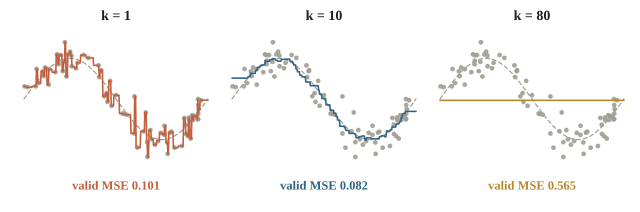
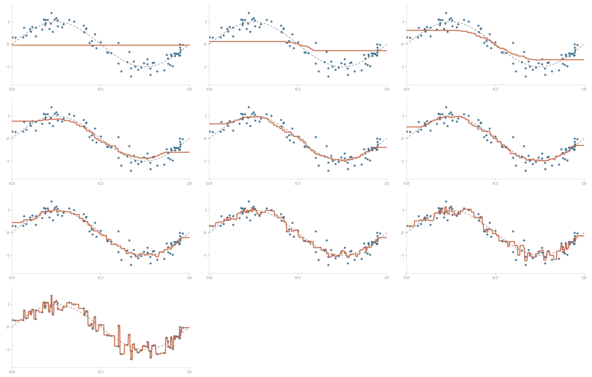
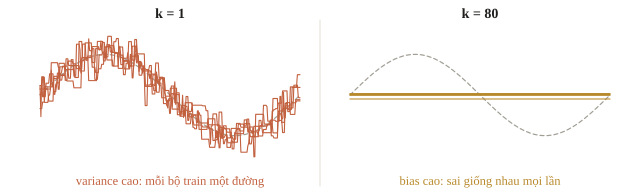
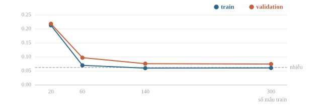

# Generalization

Sau buổi đầu, một thành viên đề xuất lưu nguyên bảng các buổi sinh hoạt: gặp lại đăng ký và dự báo mưa cũ thì trả đúng số người đã đến. Trên dữ liệu đã lưu, sai số có thể bằng 0. Nhưng thứ Bảy tuần sau là một buổi mới. Nếu thông tin hơi khác, bảng nhớ ấy sẽ đoán thế nào?

Khả năng dự đoán tốt trên mẫu chưa dùng để học gọi là khả năng tổng quát hóa (generalization). Học máy không kết thúc ở việc giảm sai số train. Bài này dùng một mô hình dễ hiểu để nhìn thấy underfitting, overfitting và ý nghĩa của learning curve, rồi quay lại quyết định nên thử gì tiếp.

::: goal Sau bài này, có thể
- Phân biệt lỗi train với lỗi trên dữ liệu mới và đọc khoảng cách giữa chúng.
- Nhận diện bằng chứng của underfit, overfit qua một thí nghiệm có kiểm soát.
- Đọc learning curve theo số mẫu, phân biệt với đường loss theo vòng huấn luyện.
- Chọn bước xử lý dựa trên dữ liệu, đồng thời kiểm tra leakage và thay đổi phân phối.
:::

## Nhớ một ví dụ khác với học một quy luật

Ta tạm thu bài toán xuống một feature $x$ trong khoảng 0–1: vị trí của một buổi trong lịch hoạt động. Mức tham gia đã chuẩn hóa là

$$y=\sin(2\pi x)+\varepsilon.$$

$\sin$ tạo một xu hướng lên rồi xuống để nhìn được bằng hình. $\varepsilon$ là nhiễu, ở đây sinh ngẫu nhiên với trung bình 0 và độ lệch chuẩn 0.25. Các giá trị âm có nghĩa là thấp hơn mức tham gia chuẩn, không phải số người âm. Dạng sóng này do ta tự đặt ra để thí nghiệm, nhờ đó biết chính xác đâu là quy luật, đâu là nhiễu. Học được là nhờ có quy luật: nếu nhãn hoàn toàn ngẫu nhiên như kết quả xổ số thì không mô hình nào đoán được, dù dữ liệu nhiều đến đâu.





Mô hình trong hình là k-Nearest Neighbors regression, viết ngắn là kNN. Để đoán tại $x$, nó tìm $k$ điểm train gần nhất rồi lấy trung bình nhãn của chúng. Bài 2.4 sẽ học thuật toán kỹ hơn; hôm nay chỉ dùng đặc tính: $k$ nhỏ cho đường linh hoạt hơn, $k$ lớn cho đường trơn hơn.

Với $k=1$, tại một điểm train, hàng xóm gần nhất chính là nó, nên mô hình trả đúng nhãn đã quan sát. Điều ấy bao gồm cả phần nhiễu của riêng điểm đó. Với $k$ bằng toàn bộ số mẫu train, mọi vị trí nhận cùng một giá trị trung bình, dù xu hướng thật lên xuống rõ rệt.

::: quiz
Mô hình đoán đúng mọi nhãn trên tập train. Điều đó chứng minh được gì?
- [x] Nó khớp các mẫu đã học, còn mẫu mới thì chưa biết
- [ ] Nó chắc chắn đã tìm ra quy luật thật
- [ ] Dữ liệu train chắc chắn không có nhãn nhiễu
- [ ] Nó sẽ đúng ít nhất 90% trên dữ liệu mới
Khớp train chỉ là một quan sát trên dữ liệu cũ. Mô hình đủ mạnh có thể khớp cả những nhãn nhiễu, giống học thuộc đáp án đề cũ. Muốn biết khả năng tổng quát hóa, ta cần dữ liệu chưa hề được dùng để học hay để chọn phương án.
:::

## Viết rõ đang đo lỗi ở đâu

Giả sử có $n$ mẫu train. Sai số train với MSE là

$$\widehat R_{\rm train}(f)=\frac1n\sum_{i=1}^{n}(f(x_i)-y_i)^2.$$

Ký hiệu $\widehat R$ nhắc rằng đây là một phép ước lượng từ hữu hạn mẫu. Rủi ro trên mẫu mới có thể viết

$$R(f)=\mathbb E_{(x,y)\sim P}\big[(f(x)-y)^2\big].$$

$\mathbb E$ nghĩa là trung bình nếu ta có rất nhiều mẫu mới; $P$ là cách sinh dữ liệu trong tình huống sử dụng. Ta không biết toàn bộ $P$, nên dùng validation được chia phù hợp để ước lượng lỗi. Điều kiện quan trọng là validation phải mô phỏng được dữ liệu mới; một split sai có thể cho điểm đẹp nhưng trả lời câu hỏi khác. Khả năng làm tốt trên mẫu chưa gặp lúc học gọi là khái quát hóa (generalization); đó là thứ ta cần, không phải điểm trên train.

Trong thí nghiệm này, train và validation được sinh độc lập từ cùng công thức. Vì vậy ta có thể tập trung vào độ linh hoạt của mô hình. Code tạo 80 mẫu train và 160 mẫu validation, không dùng test để chọn $k$.

```python
import numpy as np
from sklearn.neighbors import KNeighborsRegressor
from sklearn.metrics import mean_squared_error

rng = np.random.default_rng(12)

def make_data(n):
    X = rng.uniform(0, 1, size=(n, 1))
    y = np.sin(2 * np.pi * X[:, 0]) + rng.normal(0, 0.25, size=n)
    return X, y

X_train, y_train = make_data(80)
X_valid, y_valid = make_data(160)
print(X_train.shape, y_train.shape)
for k in [80, 10, 1]:
    model = KNeighborsRegressor(n_neighbors=k).fit(X_train, y_train)
    train_mse = mean_squared_error(y_train, model.predict(X_train))
    valid_mse = mean_squared_error(y_valid, model.predict(X_valid))
    print(f"k={k:2d}: train={train_mse:.4f}, valid={valid_mse:.4f}")
```

```output
(80, 1) (80,)
k=80: train=0.5861, valid=0.5654
k=10: train=0.0574, valid=0.0820
k= 1: train=0.0000, valid=0.1011
```

Đọc cả hai cột. Khi $k=80$, train và validation cùng có lỗi lớn: mô hình quá đơn giản để giữ xu hướng. Khi $k=1$, train có lỗi bằng 0, nhưng validation không vì thế thấp nhất. $k=10$ lấy trung bình cục bộ, giảm tác động của nhiễu mà còn giữ được dạng sóng.

Không chọn mô hình từ cột train. Cũng không biến ví dụ thành quy tắc “luôn dùng $k=10$”: số mẫu, mật độ điểm, độ nhiễu và số chiều thay đổi thì $k$ phù hợp cũng đổi.

::: quiz
Phương án A có MSE 0.01 trên train và 0.30 trên validation. Phương án B có MSE 0.08 trên train và 0.12 trên validation. Chọn theo validation thì ta chọn phương án nào?
- [ ] A, vì MSE trên train nhỏ hơn
- [ ] A, vì chênh lệch lớn cho thấy nó học được nhiều hơn
- [x] B, vì MSE trên validation nhỏ hơn
- [ ] Chưa chọn được, phải xem điểm test của cả hai
Mục tiêu là đoán tốt mẫu mới, và validation là nơi đo điều đó. A khớp train rất sát nhưng đoán validation kém hẳn, đây là dấu hiệu cần xem kỹ. Test chỉ mở ra sau khi đã chọn xong; dùng test để chọn thì nó không còn độc lập.
:::

## Underfit và overfit là chẩn đoán có điều kiện

Underfitting (học chưa đủ) là tình huống mô hình không biểu diễn hoặc không học được cấu trúc cần thiết. Trong ví dụ, $k=80$ san phẳng đường cong. Thêm dữ liệu từ cùng phân phối vẫn không khiến phương án đoán hằng số biến thành đường sóng. Ta có thể cần mô hình linh hoạt hơn hoặc feature tốt hơn.

Overfitting (học quá sát) là tình huống mô hình khai thác những chi tiết của train mà không ổn định trên mẫu mới. Với $k=1$, đổi một nhãn nhiễu có thể kéo một đoạn dự đoán theo nó. Để giảm điều ấy, có thể tăng $k$, dùng regularization ở chương 2, hoặc tăng dữ liệu có ích.

Dấu hiệu thường gặp: train tốt mà validation kém hẳn là overfitting; train và validation cùng kém, gần nhau, là underfitting. Overfitting dễ xảy ra khi mô hình có rất nhiều tham số mà dữ liệu ít, hay có nhiều đặc trưng hơn số mẫu, như 100 chỉ số xét nghiệm cho 50 bệnh nhân. Một mạng đủ lớn còn học thuộc được cả nhãn bị xáo ngẫu nhiên, đạt 100% trên train, nên điểm train cao chưa chứng minh mô hình học được quy luật. Underfitting cần mô hình mạnh hơn hoặc đặc trưng tốt hơn; giảm regularization hay thêm dữ liệu cùng loại không đủ, vì mô hình chưa khớp nổi cả train.

Hai tên này là giả thuyết, không phải kết luận. Train tốt mà validation tệ cũng có thể do split thời gian chứa một đợt thay đổi lớn, cột feature dùng sai đơn vị, hoặc pipeline biến đổi hai tập khác nhau. Train và validation cùng tệ cũng có thể do nhãn bị đọc lệch hàng hay metric cài sai. Trước khi sửa mô hình, kiểm hợp đồng dữ liệu và một ví dụ nhỏ.

::: quiz
Một mô hình phân loại review phim là khen hay chê, có 2.4 triệu tham số, học trên 5000 review. Nó đoán đúng 98.5% trên train, 72.3% trên validation và 71.8% trên test. Số liệu này chỉ ra vấn đề gì?
- [ ] Lộ dữ liệu, vì validation và test gần bằng nhau
- [ ] Underfitting, vì 72% là thấp với bài này
- [x] Overfitting, vì train gần hoàn hảo còn validation kém xa
- [ ] Dữ liệu thay đổi, vì train cao còn test thấp
Hai dấu hiệu cùng chỉ một hướng: validation thấp hơn train tới 26 điểm, và mô hình có 2.4 triệu tham số mà chỉ có 5000 mẫu để học. Validation gần bằng test là điều bình thường khi hai tập giống nhau, không phải dấu hiệu lộ dữ liệu. Nếu dữ liệu đã thay đổi thì validation và test sẽ lệch nhau. Underfitting thì không thể đúng 98.5% trên train. Hướng chữa là giảm độ linh hoạt của mô hình, dùng regularization ở chương 2, hoặc thêm dữ liệu.
Đề thi: [NOAI 2026 Singapore · Vòng sơ loại · Câu 272](https://aisingapore.org/wp-content/uploads/2026/04/NOAI-2026-Preliminary-Round-Assessment-300-MCQs-Google-Forms.pdf#page=98)
:::

::: note Bias và variance ở mức trực giác
Bias là khuynh hướng sai có hệ thống do giả định mô hình, chẳng hạn ép mọi $x$ về cùng một dự đoán. Variance là mức mô hình thay đổi khi ta thay bộ train. Mô hình linh hoạt thường giảm được bias nhưng có thể tăng variance. Không thể suy ra chính xác hai đại lượng này chỉ từ một cặp điểm train/validation; cần nhìn nhiều lần lấy mẫu hoặc phép đánh giá thích hợp.

Với MSE, tại một điểm $x$, lỗi kỳ vọng tách thành ba phần: $\mathbb E[(y-\hat f(x))^2] = \sigma^2 + \text{bias}^2 + \text{variance}$, trong đó bias là độ lệch giữa dự đoán trung bình (trên nhiều bộ train) và giá trị thật, variance là phương sai của dự đoán quanh trung bình ấy. $\sigma^2$ là phương sai của nhiễu, sai số không thể giảm (irreducible error): không mô hình nào đoán được phần nhiễu. Bias và variance thường đánh đổi nhau khi chỉnh độ phức tạp, nhưng không có luật nào buộc chúng ngược chiều: đoán bừa có cả bias lẫn variance cao.
:::



## Learning curve: thêm dữ liệu có đáng làm không?

Ta giữ $k=10$ và tăng số mẫu được học. Với mỗi mức, learning curve đo lỗi train và lỗi validation. Trục ngang là **số mẫu**, không phải epoch. Một đường loss trong quá trình tối ưu có trục ngang là số bước học và trả lời câu hỏi khác.



Code sau dùng `learning_curve`; nó học những bản mô hình mới cho từng kích thước và từng fold. Fold là một lần giữ riêng một phần dữ liệu để chấm, sẽ học kỹ ở bài 1.3. Không có nhãn validation đi vào `fit` của lần học tương ứng.

```python
from sklearn.model_selection import KFold, learning_curve

X_curve, y_curve = make_data(400)
cv = KFold(n_splits=4, shuffle=True, random_state=12)
sizes, train_scores, valid_scores = learning_curve(
    KNeighborsRegressor(n_neighbors=10),
    X_curve, y_curve, cv=cv,
    train_sizes=[20, 60, 140, 300],
    scoring="neg_mean_squared_error",
    shuffle=True, random_state=12, n_jobs=1,
)
for size, train_score, valid_score in zip(
    sizes, train_scores.mean(axis=1), valid_scores.mean(axis=1)
):
    print(f"n={size:3d}: train MSE={-train_score:.4f}, valid MSE={-valid_score:.4f}")
```

```output
n= 20: train MSE=0.2133, valid MSE=0.2187
n= 60: train MSE=0.0701, valid MSE=0.0974
n=140: train MSE=0.0602, valid MSE=0.0761
n=300: train MSE=0.0610, valid MSE=0.0748
```

Các score có dấu âm vì công cụ chọn mô hình của scikit-learn quy ước “lớn hơn là tốt hơn”, nên MSE được đổi dấu thành neg-MSE; ta đổi dấu lại để đọc. Mỗi hàng là trung bình của bốn fold.

Với ít mẫu, mười hàng xóm phủ một vùng rộng, làm trơn quá mức. Thêm mẫu khiến vùng đó hẹp hơn và giữ được xu hướng. Đến lúc đường validation giảm rất chậm, thêm vài mẫu có thể chỉ cải thiện ít; cần kiểm feature, độ nhiễu và mô hình thay vì mặc định cứ thu thập thêm là đủ. Hai đường gặp nhau rồi cùng đi ngang ở mức lỗi cao là underfitting: thêm dữ liệu không giúp, cần mô hình mạnh hơn. Khoảng cách lớn giữa hai đường mà đường validation còn giảm thì thêm dữ liệu có ích; đường validation đã đi ngang thì nên giảm độ phức tạp, tăng regularization hay bỏ bớt đặc trưng. Đổi tỉ lệ chia cũng vậy: thêm train thường có ích nhưng không chắc, còn tập đánh giá nhỏ đi thì con số đo được dao động nhiều hơn.

Có một mốc để so: kể cả khi biết chính xác $\sin(2\pi x)$, lỗi kỳ vọng vẫn còn bằng phương sai nhiễu $0.25^2=0.0625$, vì không mô hình nào đoán được nhiễu. Validation MSE 0.0748 ở $n=300$ đã khá gần mốc ấy, nên dư địa cải thiện còn ít. (Trên một tập validation hữu hạn, lỗi đo được có thể thấp hơn 0.0625 đôi chút do ngẫu nhiên.) Với dữ liệu thật ta không biết mức nhiễu; kết quả tốt nhất mà con người đạt được, như một nhóm bác sĩ hội chẩn, thường được dùng làm ước lượng cho mức lỗi thấp nhất có thể (sai số Bayes).

::: quiz
Tăng train từ 200 lên 800 rồi 2000 mẫu. MSE trên train lần lượt là 0.42, 0.43, 0.43. MSE trên validation là 0.46, 0.45, 0.45. Cách chia và metric đều đã kiểm. Ta nên thử gì trước?
- [ ] Giữ nguyên mọi thứ, chỉ thu thêm mẫu
- [x] Thêm feature hoặc dùng mô hình mạnh hơn
- [ ] Giảm độ phức tạp để thu hẹp khoảng cách
- [ ] Đổi seed chia dữ liệu tới khi validation thấp hơn
Cả hai lỗi đều cao, gần như không đổi, và sát nhau. Đó là dấu hiệu mô hình quá đơn giản so với dữ liệu. Thêm mẫu không giúp được, còn giảm độ phức tạp chỉ làm tệ hơn. Chọn seed theo điểm là chọn lại cách đánh giá, không sửa được gì ở mô hình.
Phỏng theo: [CMU 10-601 · Practice Problems, Exam 1 · Q3.1](https://www.cs.cmu.edu/~mgormley/courses/10601/handout/exam1_practice_problems.pdf#page=14)
:::

## Ví dụ tính tay

Giữ $k=2$. Hai hàng xóm của một buổi mới có nhãn 1 và 3. Dự đoán là $(1+3)/2=2$. Nếu nhãn thật của buổi mới là 4, lỗi bình phương là $(2-4)^2=4$.

Trên ba buổi, nhãn thật $(1,3,5)$ và dự đoán $(2,3,4)$ cho MSE $=(1+0+1)/3=2/3$. Một phương án khác dự đoán đúng ba nhãn train chưa cho ta thêm thông tin nào về ba buổi này. Cần phân biệt rõ “những buổi nào” trong mỗi phép tính.

Khi so hai phương án trên nhiều fold, nên đọc từng fold và chênh lệch trên cùng fold. Một mô hình cải thiện ở mọi fold có bằng chứng ổn định hơn mô hình chỉ thắng nhờ một fold thuận lợi. Độ lệch chuẩn giữa các fold không tự là khoảng tin cậy vì các train của chúng có thể chồng nhau.

## Trở lại câu chuyện câu lạc bộ

Mô hình học trên các buổi trong năm rồi dùng vào dịp hè có thể gặp distribution shift (thay đổi phân phối): số đăng ký, lịch học và thói quen tham gia cùng đổi. Nếu các buổi hè rất khác, một split ngẫu nhiên trộn cả hè vào train sẽ che bớt khó khăn đó. Mô hình chỉ đáng tin trong vùng dữ liệu đã học: học giá nhà 40–120 m² rồi đoán căn 600 m² là ngoại suy; nhận diện khuôn mặt học trên người lớn sẽ kém với trẻ em; ảnh chụp ban ngày không dạy được ảnh ban đêm; dữ liệu năm 2023 có thể đã khác năm 2025. Cách sửa gốc là đưa loại dữ liệu lúc dùng thật vào train và đánh giá trên dữ liệu gần thời điểm dùng.

Vậy generalization luôn gắn với một mục tiêu sử dụng. Dự đoán buổi tương lai của cùng câu lạc bộ khác với dự đoán câu lạc bộ ở trường mới. Bài 1.3 biến hai câu hỏi này thành split theo thời gian và split theo group. Không có một khoảng cách train–validation nào tự chứng nhận mọi tình huống sử dụng.

::: quiz
Ta cần dự báo cho tháng sau. Chia dữ liệu ngẫu nhiên thì MAE là 2. Giữ riêng tháng cuối làm validation thì MAE là 5. Nên tin con số nào?
- [ ] Bỏ tháng cuối khỏi dữ liệu cho phép đánh giá ổn hơn
- [ ] Tin số 2, vì MAE thấp hơn là tốt hơn
- [ ] Lấy trung bình 3.5 làm MAE cuối cùng
- [x] Tin số 5, rồi tìm hiểu vì sao tháng cuối khó hơn
Cách chia phải giống lúc dùng thật, tức là đoán tương lai. Giữ riêng tháng cuối làm đúng việc ấy. Chia ngẫu nhiên thì mô hình được học cả những ngày xen kẽ trong chính tháng đang chấm. Khoảng chênh giữa 2 và 5 là điều cần tìm hiểu tiếp: tháng cuối có gì khác. Chưa đủ căn cứ để đổ hết cho dữ liệu hay cho mô hình.
:::

## Khi đi thi

- **Ghi cả train và validation** cho mỗi lần thử, kèm số mẫu và cách chia; nhìn một cột thì không chẩn đoán được.
- **Thua baseline thì kiểm dữ liệu trước**, chưa vội đổi mô hình.
- **Train tốt, validation kém:** giảm độ linh hoạt, thêm regularization, xem lỗi theo nhóm. **Cả hai cùng kém:** thêm feature hoặc mô hình mạnh hơn.
- **So cải thiện nhỏ trên cùng các fold**, không dựa vào một con số đã làm tròn.

## Tóm tắt

- Generalization là hiệu quả trên mẫu mới trong tình huống sử dụng đã nêu.
- Train nhỏ chưa đủ; đọc cả lỗi validation và điều kiện split.
- Underfit và overfit gợi ý cách xử lý, nhưng cần loại lỗi dữ liệu và leakage.
- Learning curve thay số mẫu; đường tối ưu thay số bước. Hai trục ngang khác nhau.

## Kiểm tra cuối bài

::: quiz Câu 1
Một mô hình khớp train rất tốt. Bằng chứng nào cho thấy nó cũng sẽ đoán tốt khi đem dùng thật?
- [ ] File mô hình nhỏ và huấn luyện nhanh
- [x] Lỗi thấp trên dữ liệu mới, chưa dùng để học hay để chọn
- [ ] Lỗi train còn giảm tiếp khi tăng số tham số
- [ ] Chạy lại với cùng seed thì dự đoán trên train không đổi
Muốn biết mô hình tổng quát hóa tốt không, phải đo trên mẫu mới. Dữ liệu ấy phải giống tình huống dùng thật và chưa tham gia quyết định nào. Khớp train, chạy lại ra cùng kết quả, hay tốn ít thời gian đều trả lời những câu hỏi khác.
:::
::: quiz Câu 2
kNN regression dùng trọng số đều, có 80 mẫu train, và ta chọn $k = 80$. Hai điểm cần đoán khác nhau sẽ nhận dự đoán thế nào?
- [x] Cả hai đều bằng trung bình của 80 nhãn train
- [ ] Khác nhau, vì khoảng cách tới 80 mẫu khác nhau
- [ ] Cả hai đều bằng median của 80 nhãn train
- [ ] Mỗi điểm nhận nhãn của mẫu gần nó nhất
Khi $k$ bằng đúng số mẫu train, điểm nào cũng lấy cả 80 mẫu làm hàng xóm. Trọng số đều nên khoảng cách không còn tác dụng, và dự đoán luôn là trung bình của 80 nhãn.
:::
::: quiz Câu 3
Bài phân loại văn bản 10 lớp, có 5000 mẫu. Ba mô hình cho tỉ lệ đúng trên train và validation như sau. A là một mô hình rất đơn giản: 68% và 67%. B là một mô hình rất lớn, 2 triệu tham số: 99% và 71%. C là mô hình vừa phải, có regularization: 85% và 83%. Chẩn đoán nào đúng?
- [x] A underfit, cần mô hình mạnh hơn. B overfit, cần regularization. C cân bằng.
- [ ] A khớp tốt, nên giữ. B bias cao, cần train lâu hơn. C variance cao, nên bớt regularization.
- [ ] A variance cao, cần thêm dữ liệu. B khớp tốt, đem dùng được. C bias cao, cần tăng sức chứa.
- [ ] Cả ba đều do dữ liệu bẩn, phải làm sạch trước khi chỉnh mô hình.
Underfit đi với bias cao, overfit đi với variance cao. A sai nhiều ở cả train lẫn validation, tức mô hình quá đơn giản. B gần như thuộc lòng train, nhưng validation chỉ hơn A 4 điểm. C chịu khớp train kém hơn B để có validation cao nhất, đúng tinh thần chọn theo validation của bài.
Đề thi: [NOAI 2026 Singapore · Vòng sơ loại · Câu 277](https://aisingapore.org/wp-content/uploads/2026/04/NOAI-2026-Preliminary-Round-Assessment-300-MCQs-Google-Forms.pdf#page=104)
:::
::: quiz Câu 4
kNN regression với $k = 1$, chấm trên chính tập train. Khi nào thì lỗi train chắc chắn bằng 0?
- [ ] Lúc nào cũng vậy, vì mỗi điểm là hàng xóm gần nhất của chính nó
- [x] Khi không có hai điểm train trùng input mà khác nhãn
- [ ] Khi nhiễu nhỏ
- [ ] Khi đã chuẩn hóa feature
Giả sử hai buổi cùng có $x = 0$ nhưng nhãn là 1 và 3. Cả hai đều cách điểm cần đoán một khoảng 0, và mô hình chỉ trả về một trong hai nhãn cho cả hai điểm, nên lỗi train khác 0. Dữ liệu thật hay có những bản ghi trùng như vậy. Vì thế, kiểm “lỗi train có bằng 0 không” cũng là một cách kiểm dữ liệu.
:::
::: quiz Câu 5
Một hàm của scikit-learn báo điểm `neg_mean_squared_error` bằng $-0.12$. MSE bằng bao nhiêu?
- [x] 0.12
- [ ] -0.12
- [ ] 8.33
- [ ] Không đổi được
scikit-learn quy ước điểm càng lớn càng tốt. Với những metric đo lỗi như MSE, nó trả về số đối để giữ quy ước ấy, nên tên mới có chữ `neg`. MSE thật là 0.12, và MSE thì không bao giờ âm.
:::
::: quiz Câu 6
Trên cùng một cách chia, kNN cho MSE trên train và validation như sau. $k = 1$: 0 và 0.48. $k = 5$: 0.07 và 0.21. $k = 25$: 0.25 và 0.29. Chỉ chọn trong ba giá trị này thì chọn $k$ nào?
- [ ] $k = 1$, vì lỗi train bằng 0
- [ ] $k = 25$, vì train và validation gần nhau nhất
- [ ] Lấy trung bình ba giá trị, tức khoảng $k = 10$
- [x] $k = 5$, vì MSE trên validation nhỏ nhất
$k = 5$ có MSE validation 0.21, thấp nhất trong những giá trị đã thử. Hai lỗi gần nhau chưa đủ để chọn: $k = 25$ có cả hai lỗi đều cao hơn.
Phỏng theo: [CMU 10-601 · Practice Problems, Exam 1 · Q3.2](https://www.cs.cmu.edu/~mgormley/courses/10601/handout/exam1_practice_problems.pdf#page=15)
:::
::: quiz Câu 7
Khi tăng độ phức tạp của mô hình, chẳng hạn tăng bậc đa thức trong hồi quy, bias và variance thường thay đổi thế nào?
- [ ] Cả hai cùng tăng
- [ ] Cả hai cùng giảm
- [ ] Cả hai không đổi
- [x] Bias giảm, variance tăng
- [ ] Bias tăng, variance giảm
Mô hình linh hoạt hơn thì ít bị ép vào một dạng cố định, nên bias giảm. Nhưng nó cũng nhạy hơn với từng bộ train, nên variance tăng. Trong bài, $k$ nhỏ của kNN là phía phức tạp, còn $k = 80$ là phía đơn giản nhất.
Đề thi: [USA-NA-AIO 2026 · Vòng 1 · Part 1.3](https://www.usaaio.org/attachments/past-problems/2026/usaaio-2026-round-1-problems.pdf#page=2)
:::
::: quiz Câu 8
Giữ nguyên validation, tăng train từ 100 lên 400 rồi 1600 mẫu. MSE trên train là 0.03, 0.07, 0.10. MSE trên validation là 0.50, 0.30, 0.18. Nếu còn kinh phí, ta nên làm gì?
- [ ] Giảm train về 100 mẫu để MSE train xuống 0.03
- [x] Thu thêm mẫu cùng loại, tiếp tục theo dõi validation
- [ ] Kết luận thêm dữ liệu có hại, vì MSE train tăng
- [ ] Chọn lại validation cho hai lỗi gần nhau nhất
Lỗi validation giảm rõ mỗi lần thêm dữ liệu. Lỗi train tăng lên một chút vì khó khớp hết nhiều mẫu hơn, và hai đường đang tiến lại gần nhau. Xu hướng này ủng hộ việc thu thêm mẫu, dù không hứa lỗi sẽ giảm mãi.
Phỏng theo: [CMU 10-601 · Practice Problems, Exam 1 · Q3.1](https://www.cs.cmu.edu/~mgormley/courses/10601/handout/exam1_practice_problems.pdf#page=14)
:::
::: quiz Câu 9
Một đội chia ngẫu nhiên train và validation 50 lần, rồi chỉ báo MSE nhỏ nhất trong 50 lần ấy. Làm vậy sai ở đâu?
- [ ] Số mẫu độc lập bị tăng lên 50 lần
- [ ] Không sai, thử 50 lần thì số nhỏ nhất là công bằng
- [ ] Đổi seed nên không chạy lại ra cùng kết quả được
- [x] Chọn lần chia may nhất, nên con số quá lạc quan
MSE nhỏ nhất trong 50 lần đo là con số may mắn nhất, thấp hơn mức sẽ gặp trên mẫu mới. Chọn cách chia theo điểm cũng là một quyết định dựa trên dữ liệu. Nên báo cả dải kết quả của 50 lần, hoặc dùng một phép đánh giá độc lập.
:::
::: quiz Câu 10
Mô hình đạt điểm tốt khi chia ngẫu nhiên từng hàng. Có chắc nó cũng đoán tốt cho một trường chưa có trong dữ liệu không?
- [ ] Có, nếu train đủ lớn và đa dạng
- [ ] Có, nếu MSE train bằng 0 ở mọi trường
- [x] Không, phải để riêng trọn vài trường ra mà kiểm
- [ ] Có, nếu chia nhiều lần hơn
Chia ngẫu nhiên từng hàng thì trường nào cũng có buổi nằm trong train. Khi đó validation chỉ đo việc đoán thêm buổi của những trường đã quen. Muốn biết với trường mới, ta phải để riêng trọn một số trường, không cho trường nào trong số đó vào train.
:::
## Đọc thêm

- [Dive into Deep Learning — Generalization](https://d2l.ai/chapter_linear-regression/generalization.html). Đọc để nối empirical risk, nhiễu và sự khác nhau giữa fitting với generalization.
- James và cộng sự — [An Introduction to Statistical Learning](https://www.statlearning.com/), chương 2 và 5. Đọc trực giác bias–variance và cách ước lượng lỗi dự đoán.
- [scikit-learn — Validation curves và learning curves](https://scikit-learn.org/stable/modules/learning_curve.html). Xem đúng trục của từng loại đường và quy ước score.
