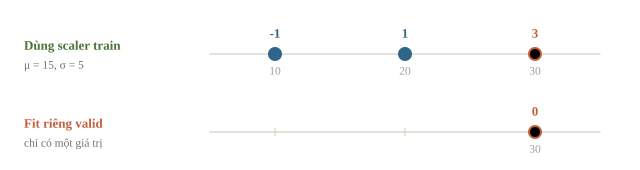
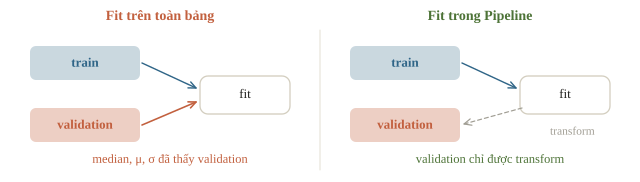
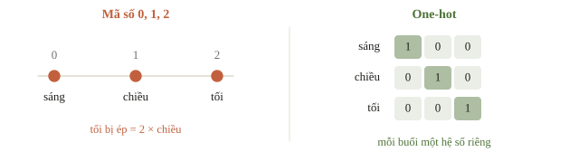
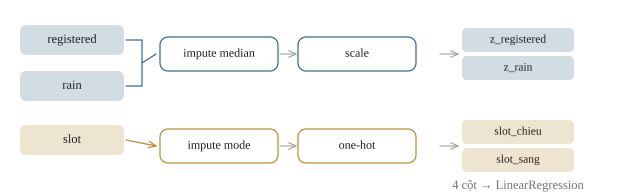
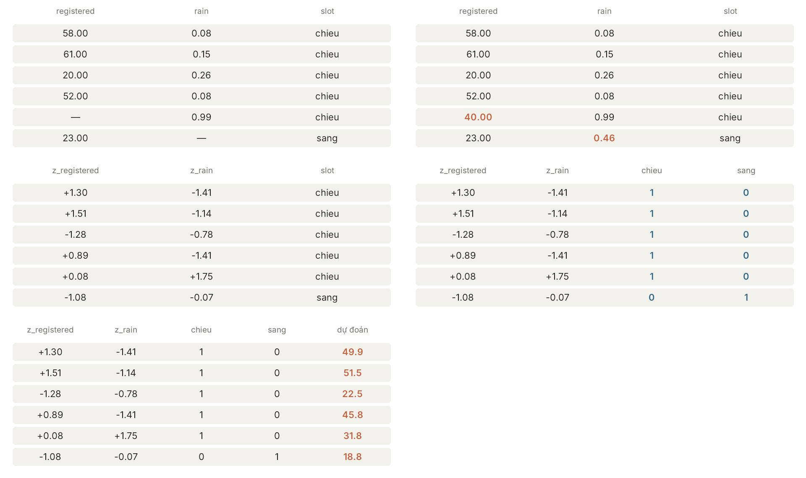

# Pipeline và data leakage

Trước khi đưa vào model, dữ liệu thường phải xử lý: điền ô trống, đổi cột chữ thành số, chuẩn hóa. Lỗi hay gặp là xử lý cả bảng rồi mới chia train/validation. Khi đó giá trị trung bình dùng để điền ô trống đã tính cả phần validation, nên điểm validation không còn đáng tin. Lỗi này gọi là data leakage (rò rỉ dữ liệu). Pipeline của scikit-learn ghép các bước xử lý với model thành một khối, để mỗi bước chỉ học từ train rồi áp nguyên cho dữ liệu mới.

::: goal Mục tiêu
- Phân biệt bước xử lý cố định với bước phải học từ train.
- Viết Pipeline và ColumnTransformer cho bảng có cột số, cột chữ và ô trống.
- Kiểm các bước xử lý được học lại trong mỗi fold.
- Nhận ra các kiểu data leakage hay gặp.
:::

## Tiền xử lý cũng là một phần của mô hình

Giả sử train có số đăng ký 10 và 20. Chuẩn hóa bằng trung bình $\mu=15$, độ lệch chuẩn $\sigma=5$ cho hai giá trị $-1$ và $1$. Validation có số đăng ký 30 phải được biến đổi thành $(30-15)/5=3$. Nếu chuẩn hóa validation riêng, 30 là giá trị duy nhất nên lại thành 0: ta đã đổi hệ tọa độ.

Chuẩn hóa dùng

$$z_j=\frac{x_j-\mu_j}{\sigma_j}.$$

$\mu_j$ và $\sigma_j$ là các con số **học từ dữ liệu**, dù không dùng nhãn. Median để điền ô trống, danh sách từ của văn bản, việc chọn feature cũng vậy. Vì thế chúng cũng là một phần của model: chỉ được học từ train, rồi giữ nguyên khi xử lý dữ liệu khác. Trong scikit-learn: `scaler.fit_transform(X_train)` rồi `scaler.transform(X_test)`; gọi `fit_transform` trên test là học lại $\mu$, $\sigma$ từ chính test.

Min-max đưa mỗi cột về $[0, 1]$ bằng $(x-\min)/(\max-\min)$, nên cần một cặp min, max cho mỗi cột, tính trên train. Giá trị test ngoài khoảng của train sẽ ra ngoài $[0, 1]$: train có tuổi 20–60 thì tuổi 70 thành $(70-20)/(60-20)=1{,}25$, chuyện bình thường chứ không phải lỗi. Vì dựa vào cực trị, min-max dễ bị một điểm ngoại lai làm lệch cả thang; z-score chỉ dùng μ và σ.



Biến đổi cố định, như đổi cm sang m bằng cách chia 100, thì không học gì từ dữ liệu, chỉ cần áp dụng giống nhau cho train và dữ liệu mới.

```python
import numpy as np
from sklearn.preprocessing import StandardScaler

small_train = np.array([[10.0], [20.0]])
small_valid = np.array([[30.0]])
scaler = StandardScaler().fit(small_train)
print('Train:', scaler.transform(small_train).ravel())
print('Valid dùng scaler train:', scaler.transform(small_valid).ravel())
wrong_valid = StandardScaler().fit_transform(small_valid)
print('Valid fit riêng, cách sai:', wrong_valid.ravel())
```

```output
Train: [-1.  1.]
Valid dùng scaler train: [3.]
Valid fit riêng, cách sai: [0.]
```

Nhìn hai cách biến đổi 30. Cách đúng giữ quan hệ cao hơn trung bình train ba độ lệch chuẩn. Cách fit riêng đưa một buổi rất đông về ngay trung tâm thang đo, làm model nhận một ý nghĩa khác.

::: quiz
Ta cần điền các ô thiếu ở validation bằng median. Median ấy phải tính từ đâu?
- [ ] Từ chính các hàng validation
- [x] Từ train của lần học đang đánh giá
- [ ] Từ train và validation gộp lại, trước khi chia
- [ ] Từ test, vì test giống dữ liệu lúc dùng thật nhất
Median cũng là thứ được học từ dữ liệu, giống trọng số của mô hình, nên chỉ được tính từ train của lần đang đánh giá. Tính từ validation hay test là đã dùng chính dữ liệu đang chấm để chuẩn bị bài làm.
:::

## Data leakage: thông tin vượt qua ranh giới

Rò rỉ dữ liệu (data leakage) xuất hiện khi quy trình xây mô hình dùng thông tin không được phép có trong tình huống đang đánh giá. Có nhiều đường đi, và không phải đường nào Pipeline cũng chặn được.

| Đường rò rỉ | Ví dụ ở câu lạc bộ | Cách chặn |
|---|---|---|
| Feature có sau lúc dự đoán | Số vé đã quét sau buổi | Kiểm thời điểm cột được biết |
| Preprocessing | Median tính trên toàn bảng | Fit trong Pipeline và từng fold |
| Mẫu gần trùng | Một phiếu lưu hai lần | Gom bản trùng, chia group đúng |
| Nhãn tương lai | Tổng tham gia tuần sau trong feature tuần này | Kiểm lag/cửa sổ/thời điểm |
| Quyết định theo test | Chọn model vì test đẹp hơn | Dùng validation, giữ test độc lập |

Dùng feature của test để học bước tiền xử lý, dù không đụng tới nhãn, vẫn làm sai phép đánh giá: lúc dùng thật, dữ liệu mới chưa có khi ta học. Có đề cho phép dùng cả input của tập test (không có nhãn) và sẽ ghi rõ trong thể lệ; nếu đề không nói gì thì không làm.

Bước nào học từ nhãn càng phải làm lại trong từng fold. Ví dụ chọn 50 feature tương quan mạnh nhất với nhãn trên cả bảng rồi mới cross-validation có thể cho 92%, trong khi chọn lại trong từng fold chỉ còn 78%. Khi điểm cao bất thường so với độ khó của bài, như 99,99% ở một bài nổi tiếng là khó, việc đầu tiên là tìm chỗ rò rỉ, rồi xem các lớp có lệch cực mạnh không.



::: quiz
Cột `final_attendance` chỉ có sau khi buổi sinh hoạt kết thúc. Đặt cột này vào Pipeline thì nó có thành feature hợp lệ không?
- [x] Không, lúc dự đoán vẫn chưa có cột này
- [ ] Có, vì Pipeline tự chặn mọi kiểu rò rỉ
- [ ] Có, miễn là không gọi `fit` trên test
- [ ] Không, vì Pipeline chỉ nhận cột số
Pipeline chỉ lo thứ tự các bước và chỗ gọi `fit`. Nó không biết một cột có sẵn vào lúc nào hay mang ý nghĩa gì. Cột chữ vẫn vào Pipeline được qua bước mã hóa, nên lý do không nằm ở kiểu dữ liệu.
:::

## Bảng có số, chữ và ô thiếu

Ta tạo 80 buổi giả. Cột `slot` là sáng hoặc chiều; target tăng thêm năm người cho buổi chiều theo công thức giả lập. Một số feature được che thành missing sau khi sinh target để mô phỏng việc ghi chép thiếu. Ta giữ 60 buổi đầu làm train, 20 buổi cuối làm validation.

```python
import pandas as pd

rng = np.random.default_rng(14)
n = 80
registered = rng.integers(15, 65, size=n).astype(float)
rain = rng.uniform(0, 1, size=n)
slot = rng.choice(['sang', 'chieu'], size=n)
y = 4 + 0.7 * registered - 5 * rain + 5 * (slot == 'chieu')
y = y + rng.normal(0, 1.5, size=n)
X = pd.DataFrame({'registered': registered, 'rain': rain, 'slot': slot})
X.loc[[2, 13, 44, 64], 'registered'] = np.nan
X.loc[[6, 50, 75], 'rain'] = np.nan
X_train, X_valid = X.iloc[:60], X.iloc[60:]
y_train, y_valid = y[:60], y[60:]
print(X_train.isna().sum().to_dict())
print(X_valid.isna().sum().to_dict())
```

```output
{'registered': 3, 'rain': 2, 'slot': 0}
{'registered': 1, 'rain': 1, 'slot': 0}
```

Missing là thiếu thông tin, không mặc nhiên là giá trị 0. Đăng ký chưa ghi lại khác với chắc chắn không ai đăng ký. Median là baseline có thể dùng cho cột số; nó không khôi phục chính xác dữ liệu bị mất. Có thể thêm cột chỉ báo missing nếu validation đúng cách cho thấy hữu ích.

Với chữ, one-hot encoding tạo một cột cho mỗi danh mục đã thấy: sáng thành vector đánh dấu sáng, chiều thành vector đánh dấu chiều. Không mã hóa sáng=0, chiều=1, tối=2 rồi mặc nhiên coi khoảng cách giữa chúng có ý nghĩa: với mã 1, 2, 3, mô hình tuyến tính coi danh mục thứ hai nằm “giữa” hai danh mục kia. Ô thiếu ở cột chữ có thể điền bằng danh mục gặp nhiều nhất trong train, hoặc thêm hẳn một danh mục “thiếu”. Bài 2.11 (Feature engineering) sẽ mở rộng phần này.

::: quiz
Thay vì one-hot, ta mã hóa `slot` thành sáng = 0, chiều = 1, tối = 2, rồi đưa vào `LinearRegression`. Làm vậy là ngầm giả định điều gì?
- [ ] Không giả định gì, vì số chỉ là tên của từng buổi
- [ ] Đủ dữ liệu thì mô hình sẽ tự học ra thứ tự đúng
- [ ] Cách mã hóa chỉ ảnh hưởng khi cột có ô thiếu
- [x] Sáng, chiều, tối nằm trên một đường thẳng, cách đều nhau
Cột số này được nhân với một hệ số $w$, nên sáng đóng góp 0, chiều đóng góp $w$, tối đóng góp $2w$. So với buổi sáng, buổi tối bị ép phải lệch đúng gấp đôi buổi chiều, trong khi dữ liệu chưa hề nói vậy. One-hot cho mỗi buổi một hệ số riêng, nên không áp đặt thứ tự nào.
:::



## Ghép ColumnTransformer với Pipeline

`ColumnTransformer` chia các cột thành nhóm, mỗi nhóm đi một nhánh xử lý riêng:

- Nhánh số: điền ô trống bằng median, rồi chuẩn hóa.
- Nhánh chữ: điền ô trống bằng danh mục hay gặp nhất, rồi one-hot.

`Pipeline` ngoài cùng ghép phần xử lý với `LinearRegression` thành một model. Nếu cột số có vài giá trị cực lớn, như thu nhập, thì nên điền bằng median thay vì trung bình, và có thể chặn (clip) giá trị theo ngưỡng tính trên train trước khi chuẩn hóa.





```python
from sklearn.compose import ColumnTransformer
from sklearn.impute import SimpleImputer
from sklearn.pipeline import Pipeline
from sklearn.preprocessing import OneHotEncoder
from sklearn.linear_model import LinearRegression
from sklearn.metrics import mean_absolute_error

numeric = Pipeline([
    ('impute', SimpleImputer(strategy='median')),
    ('scale', StandardScaler()),
])
category = Pipeline([
    ('impute', SimpleImputer(strategy='most_frequent')),
    ('onehot', OneHotEncoder(handle_unknown='ignore', sparse_output=False)),
])
preprocess = ColumnTransformer([
    ('num', numeric, ['registered', 'rain']),
    ('cat', category, ['slot']),
])
model = Pipeline([
    ('preprocess', preprocess),
    ('regressor', LinearRegression()),
])
model.fit(X_train, y_train)
prediction = model.predict(X_valid)
print('Sau biến đổi:', model.named_steps['preprocess'].transform(X_valid).shape)
print(f'Validation MAE={mean_absolute_error(y_valid, prediction):.3f}')
```

```output
Sau biến đổi: (20, 4)
Validation MAE=1.707
```

Nhìn shape sau biến đổi: hai cột số cộng hai cột one-hot. Tên `preprocess` và `regressor` do ta đặt để tra thành phần và chỉnh tham số sau này. Khi gọi `model.fit`, mọi bước cần fit đều học trên `X_train`; khi gọi `predict`, chỉ transform theo trạng thái đã lưu rồi dự đoán.

`sparse_output=False` giúp ví dụ nhỏ dễ nhìn dạng mảng đầy. Khi một cột có hàng nghìn danh mục, giữ mặc định mảng thưa để tiết kiệm bộ nhớ.

::: quiz
Imputer nằm trong Pipeline, nhưng giá trị median đã được tính sẵn từ toàn bảng rồi truyền cố định vào. Chạy cross-validation thì còn sai ở đâu?
- [x] Median ấy đã tính cả các hàng validation của từng fold
- [ ] Chỉ sai khi mô hình phía sau không tuyến tính
- [ ] Không sai, vì mỗi fold vẫn gọi `fit` trên Pipeline
- [ ] Phải dùng mean thay cho median thì mới đúng
Con số median ấy đã được tính khi nhìn cả các hàng validation, và đặt nó vào Pipeline không xóa được điều đó. Median phải được tính lại từ train của từng fold, nghĩa là để imputer tự `fit` bên trong Pipeline.
:::

## Đọc trạng thái đã học và thử danh mục mới

Có thể in ra median mà Pipeline đã học để kiểm, giống in biến trung gian khi debug một thuật toán.

```python
fitted_numeric = model.named_steps['preprocess'].named_transformers_['num']
medians = fitted_numeric.named_steps['impute'].statistics_
print('Median đã học:', np.round(medians, 3))
print('Median tính từ train:', np.round(X_train[['registered', 'rain']].median().to_numpy(), 3))
new_session = pd.DataFrame({'registered': [30.0], 'rain': [0.2], 'slot': ['toi']})
new_features = model.named_steps['preprocess'].transform(new_session)
print('Cột one-hot của danh mục chưa thấy:', new_features[0, 2:])
print('Dự đoán buổi mới:', np.round(model.predict(new_session), 3))
```

```output
Median đã học: [40.     0.462]
Median tính từ train: [40.     0.462]
Cột one-hot của danh mục chưa thấy: [0. 0.]
Dự đoán buổi mới: [27.493]
```

Median đã học khớp median tính tay trên train. Còn buổi `'toi'` chưa từng có trong train: nhờ `handle_unknown='ignore'`, nó được mã hóa thành toàn số 0 ở hai cột one-hot. Không đặt tham số này thì `OneHotEncoder` báo lỗi khi gặp danh mục lạ. Code chạy được, nhưng model chưa hề học gì về buổi tối, nên con số dự đoán chỉ là đoán mò (câu hỏi dưới giải thích vì sao).

Một lỗi hay gặp khác là gọi `pd.get_dummies` riêng cho train và test. Train có các thành phố HN, HCM, DN, test có HN, HUE, nên hai bảng ra hai bộ cột khác nhau. Cách đúng là học một bộ mã hóa trên train rồi dùng nó để biến đổi test.

::: quiz
Buổi “toi” chưa từng có trong train, nên nhận vector one-hot `[0, 0]` và được dự đoán 27.49 người. Con số này thực chất là dự đoán cho cái gì?
- [ ] Mô hình đã học được buổi tối đông hay vắng
- [x] Một buổi không phải sáng, cũng không phải chiều
- [ ] Mô hình coi buổi tối như buổi chiều vì gần nhau
- [ ] Không có nghĩa gì, lẽ ra phải báo lỗi
Với `LinearRegression`, mỗi cột one-hot cộng thêm một hệ số riêng vào dự đoán. Vector toàn 0 thì bỏ qua cả hai hệ số ấy, chỉ còn phần của các cột số và hệ số chặn. Kết quả là dự đoán cho một buổi “trung tính” mà dữ liệu chưa từng có. Code chạy được, nhưng con số này là đoán mò. Nếu buổi tối xuất hiện thật, ta phải thu thêm dữ liệu rồi học lại.
:::

## Cùng Pipeline, fit lại trong mỗi fold

Khi chạy cross-validation, đưa **cả Pipeline** vào `cross_val_score`, đừng đưa bảng đã xử lý sẵn trên toàn bộ dữ liệu. Ở mỗi fold, hàm này tạo một bản Pipeline mới và fit mọi bước chỉ trên train của fold đó.

Muốn chỉnh tham số của một bước bên trong Pipeline, ghi tên bước, hai dấu gạch dưới, rồi tên tham số, như `regressor__fit_intercept`. Nếu tạo Pipeline bằng `make_pipeline`, tên bước là tên lớp viết thường, nên tham số `C` của `SVC` là `svc__C`.

```python
from sklearn.model_selection import TimeSeriesSplit, cross_val_score

cv = TimeSeriesSplit(n_splits=3, test_size=10)
scores = cross_val_score(
    model, X_train, y_train, cv=cv,
    scoring='neg_mean_absolute_error', n_jobs=1,
)
print('Fold MAE:', np.round(-scores, 3))
print(f'Mean CV MAE={-scores.mean():.3f}')
```

```output
Fold MAE: [1.087 1.995 1.314]
Mean CV MAE=1.465
```

Như ở bài 1.2, scikit-learn trả MAE mang dấu âm (`neg_mean_absolute_error`), nên lấy `-scores` để đọc. Chỉ `X_train` được đưa vào cross-validation; 20 buổi validation bên ngoài chưa tham gia fit lần nào. Đây là cách bố trí hay dùng: cross-validation trên train để chọn tham số, rồi một phần giữ riêng bên ngoài để kiểm lại model đã chọn. Ba fold chênh nhau khá nhiều (1.09 đến 2.00); nên xem số mẫu và số ô trống của từng fold để hiểu vì sao.

::: quiz
Muốn cross-validation không bị rò rỉ qua bước điền median, ta đưa gì vào `cross_val_score`?
- [ ] Bảng đã điền median tính từ mọi hàng
- [ ] Chỉ đưa regressor, còn scaler đã fit trên toàn bảng
- [ ] Bảng mà mỗi fold validation tự điền median của nó
- [x] Pipeline gồm imputer, scaler và regressor
Đưa cả Pipeline vào thì ở mỗi fold, imputer, scaler và regressor đều được fit lại chỉ trên train của fold ấy. Điền median từ toàn bảng, hay từ chính fold validation, đều là lấy thông tin của phần đang chấm.
:::

## Ví dụ tính tay: điểm hoàn hảo có thể vô dụng

Giả sử train có số người đến là $(20, 30)$, validation là 40. Bảng có thêm một cột ghi sau buổi, đếm đúng số người đã vào cửa. Model $\hat y = x_{\rm final\_count}$ cho lỗi 0 trên cả ba hàng. Phép tính không sai, nhưng model vô dụng: chiều thứ Sáu chưa có cột ấy.

Code dưới cố tình mô phỏng đường tắt này, để nhìn vì sao điểm gần 0 không đủ bảo đảm tính hợp lệ. Nó không phải phương án dùng thật.

```python
hindsight_model = LinearRegression().fit(y_train.reshape(-1, 1), y_train)
hindsight_prediction = hindsight_model.predict(y_valid.reshape(-1, 1))
print(f'MAE dùng chính target làm feature, cách sai={mean_absolute_error(y_valid, hindsight_prediction):.6f}')
```

```output
MAE dùng chính target làm feature, cách sai=0.000000
```

Vì vậy trước khi mừng vì điểm đẹp, hãy kiểm từng feature có sẵn vào lúc dự đoán không. Pipeline không nhận ra một cột thực chất là nhãn nếu nó mang tên khác. Những bước dùng đến nhãn, như chọn feature theo tương quan với nhãn, cũng phải làm lại trong từng fold; Pipeline không tự lo được việc đó nếu ta tính sẵn bên ngoài.

## Khi đi thi

- **Lập bảng feature**: mỗi cột biết được lúc nào, tính từ đâu.
- **Gói mọi bước học từ dữ liệu vào một Pipeline**, giữ phép chia cố định rồi mới thử tham số.
- **Điểm nhảy vọt sau khi thêm một cột** thì truy nguồn cột ấy trước khi mừng.
- **Chạy thử đường inference** với một mẫu không có nhãn và một danh mục chưa thấy.

## Tóm tắt

- Median, trung bình, độ lệch chuẩn, bộ mã hóa đều học từ train, rồi giữ nguyên cho dữ liệu khác.
- `ColumnTransformer` xử lý từng nhóm cột; `Pipeline` ghép xử lý với model thành một khối.
- Cross-validation phải fit lại cả Pipeline trong từng fold.
- Pipeline không chặn được mọi rò rỉ: cột có sau lúc dự đoán, bản ghi trùng, chọn theo test phải tự kiểm.

## Kiểm tra cuối bài

::: quiz Câu 1
Bảng dữ liệu cho vay có cột số (thu nhập, tuổi) và cột chữ (nghề nghiệp, học vấn). 15% số dòng có ô thiếu, và cột thu nhập có vài giá trị cực lớn. Chuỗi tiền xử lý nào hợp lý nhất?
- [ ] Xóa mọi dòng có ô thiếu, đưa cột số về khoảng 0 đến 1 theo min và max, đổi cột chữ thành 0, 1, 2…
- [ ] Điền 0 vào ô thiếu, xóa dòng có thu nhập quá xa trung bình, giữ nguyên thang cột số, đổi cột chữ thành 0, 1, 2…
- [x] Điền median cho cột số và giá trị hay gặp nhất cho cột chữ, chặn bớt giá trị cực lớn, chuẩn hóa cột số, one-hot cột chữ
- [ ] Giữ nguyên ô thiếu, chuẩn hóa cột số, one-hot cột chữ, rồi đưa thẳng vào `LinearRegression`
Xóa dòng thiếu là mất 15% dữ liệu. Đưa về 0 đến 1 theo min và max thì một giá trị cực lớn ép mọi giá trị khác dồn về gần 0. Đổi chữ thành 0, 1, 2 tạo ra một thứ tự giả. Điền 0 làm sai nghĩa “không biết”. `LinearRegression` thì không chạy được khi còn ô thiếu. Chuỗi nào cũng vậy, median, giá trị hay gặp nhất, ngưỡng chặn, trung bình và độ lệch chuẩn đều phải học từ train, nên cả chuỗi phải nằm trong Pipeline.
Đề thi: [NOAI 2026 Singapore · Vòng sơ loại · Câu 304](https://aisingapore.org/wp-content/uploads/2026/04/NOAI-2026-Preliminary-Round-Assessment-300-MCQs-Google-Forms.pdf#page=117)
:::
::: quiz Câu 2
Thao tác nào phải học một con số từ train trước khi dùng?
- [ ] Đổi cm sang m, tức chia cho 100
- [x] Điền ô thiếu bằng median
- [ ] Đổi tên cột theo một danh sách cố định
- [ ] Nhân một cột với hằng số mà đề đã cho
Median thay đổi theo dữ liệu, nên phải tính từ train rồi giữ nguyên khi xử lý validation và test. Ba thao tác còn lại dùng hằng số hoặc quy tắc cố định, không học gì từ dữ liệu.
:::
::: quiz Câu 3
Bảng có cột tuổi là số và cột loại trường là chữ. ColumnTransformer chuẩn hóa cột tuổi, one-hot cột loại trường, rồi ghép kết quả lại. Cách tổ chức này bảo đảm được điều gì?
- [ ] Các cột không được chỉ định luôn được giữ lại, bất kể `remainder`
- [x] Mỗi nhánh nhận đúng nhóm cột của nó, rồi các đầu ra được ghép lại
- [ ] Scaler và encoder dùng chung một bộ trung bình và phương sai
- [ ] Encoder tự chọn những loại trường liên quan nhất đến nhãn
ColumnTransformer chỉ chia cột cho từng nhánh rồi ghép kết quả lại. Cột không được chỉ định có giữ hay không là do tham số `remainder`. Mỗi nhánh fit riêng, nên không dùng chung trung bình hay phương sai, và không nhánh nào tự chọn feature theo nhãn.
:::
::: quiz Câu 4
OneHotEncoder đã học hai loại A và B, với `drop=None` và `handle_unknown="ignore"`. Gặp loại C chưa từng thấy, nhóm cột này sẽ cho vector nào?
- [ ] (1, 0)
- [ ] (0, 1)
- [ ] (1, 1)
- [x] (0, 0)
Encoder chỉ có hai cột cho A và B đã học, khi transform không thêm cột cho C. Với `handle_unknown="ignore"`, loại lạ nhận toàn số 0. Nếu có dùng `drop` thì phải kiểm thêm, vì loại bị bỏ cũng có mã toàn 0, và hai trường hợp sẽ trùng nhau.
:::
::: quiz Câu 5
Một mô hình được học lại mỗi tuần. Sau 6 tuần, có người cần dựng lại đúng mô hình của tuần 3, nhưng nhóm chỉ còn file mô hình mới nhất. Muốn dựng lại được một mô hình đã học, ta cần lưu những gì?
- [x] Dữ liệu đã dùng, cấu hình, seed, phiên bản thư viện, và cả Pipeline đã fit
- [ ] File mô hình và đoạn code huấn luyện
- [ ] Code, điểm validation và nhật ký huấn luyện
- [ ] File mô hình, các tham số đã chọn và điểm trên test
Mô hình chỉ có nghĩa khi đi cùng đúng phép biến đổi đầu vào đã học. Thiếu median, trung bình, độ lệch chuẩn hay danh sách loại của encoder, thì cùng một hàng dữ liệu sẽ được đưa vào mô hình dưới một dạng khác. Lưu nguyên Pipeline đã fit là giữ được phần này. Còn dữ liệu, seed và phiên bản thư viện quyết định việc học lại có ra đúng kết quả cũ hay không.
Đề thi: [NOAI 2026 Singapore · Vòng sơ loại · Câu 308](https://aisingapore.org/wp-content/uploads/2026/04/NOAI-2026-Preliminary-Round-Assessment-300-MCQs-Google-Forms.pdf#page=120)
:::
::: quiz Câu 6
Ta cần dự báo trước buổi sinh hoạt một ngày. Cột `actual_attendance` trong bảng được ghi sau sự kiện, và có nó thì MAE gần bằng 0. Nên xử lý thế nào?
- [x] Bỏ cột này khỏi feature, vì lúc dự báo chưa có nó
- [ ] Giữ cột này, nhưng đặt scaler vào Pipeline
- [ ] Giữ cột này, nhưng tăng số fold validation
- [ ] Giữ cột này, miễn là không dùng nó làm nhãn
Cột này chỉ có sau sự kiện, nên lúc dự báo trước một ngày ta không có nó để đưa vào. MAE gần 0 chính là dấu hiệu rò rỉ. Đặt scaler vào Pipeline, thêm fold, hay không dùng nó làm nhãn đều không thay đổi được việc cột này chưa tồn tại.
:::
::: quiz Câu 7
Mỗi học sinh được chụp ảnh nhiều lần, và một số ảnh còn bị lưu lại dưới tên khác. Muốn đánh giá trên học sinh mới, ta cần làm gì trước khi chạy cross-validation?
- [ ] Đặt scaler vào Pipeline, rồi chia ngẫu nhiên từng ảnh
- [ ] Giữ tỉ lệ nhãn ở hai phía, thay cho việc chia theo học sinh
- [x] Tìm các ảnh trùng, rồi chia theo nhóm học sinh
- [ ] Đổi tên file, rồi chia ngẫu nhiên từng ảnh
Chia theo học sinh thì validation toàn là học sinh mới, đúng tình huống cần đo. Tìm ảnh trùng giúp phát hiện cả những bản sao đang mang tên hay thông tin khác. Pipeline hay việc giữ tỉ lệ nhãn đều không tự xử lý được chuyện này.
:::
::: quiz Câu 8
Scaler fit trên train có mean 10, std 2, và mô hình học trên thang đã chuẩn hóa ấy. Validation có mean 20, std 5. Giá trị $x = 22$ ở validation phải được đưa vào mô hình thành bao nhiêu?
- [ ] $(22-10)/5 = 2.4$
- [x] $(22-10)/2 = 6$
- [ ] $(22-20)/5 = 0.4$
- [ ] $22-20 = 2$
Validation phải được biến đổi bằng đúng mean và std đã học từ train: $(22-10)/2 = 6$. Fit scaler riêng trên validation thì ra một thang khác với thang mô hình đã học, giống như đổi đơn vị đo giữa chừng.
:::
::: quiz Câu 9
Một nhóm chọn 20 feature từ cả 100 dòng, rồi mới chạy 5-fold cross-validation, và thấy điểm rất cao. Kiểm lại thế nào cho đáng tin?
- [ ] Ở mỗi fold, chọn feature trên phần validation
- [ ] Dùng test để chọn feature, miễn là không fit mô hình trên test
- [x] Ở mỗi fold, chỉ chọn feature từ phần train của fold đó
- [ ] Chọn một lần trên cả 100 dòng, dùng chung cho mọi fold
Chọn feature cũng là học từ dữ liệu, nên phải fit trên phần train của fold rồi mới áp dụng cho phần validation, như mọi bước khác trong Pipeline. Nếu nhìn cả bảng trước khi chia, các hàng validation đã góp phần vào lựa chọn, và điểm sẽ quá lạc quan.
Phỏng theo: [NOAI 2026 Singapore · Chung kết · Câu 4](https://aisingapore.org/wp-content/uploads/2026/04/NOAI-2026-Final-Assessment-Section-1-MCQs-Google-Forms.pdf#page=5)
:::
::: quiz Câu 10
Ta đã dùng kết quả trên test để chọn số feature, rồi chấm lại cấu hình thắng trên chính test đó. Muốn báo một con số độc lập, ta phải làm gì?
- [ ] Fit lại mô hình từ đầu với seed khác rồi chấm lại
- [ ] Đổi tên test thành validation, giữ nguyên điểm cũ
- [ ] Bỏ bước chọn feature khỏi Pipeline rồi chấm lại
- [x] Chấm trên dữ liệu mới, chưa tham gia quyết định nào
Test đã được dùng để chọn số feature, nên giờ nó là dữ liệu để chọn, không còn độc lập. Ta phải chốt quy trình rồi chấm trên dữ liệu chưa từng dùng. Đổi seed hay sửa lại code không xóa được ảnh hưởng của việc đã chọn theo test.
:::
## Đọc thêm

- [scikit-learn — Common pitfalls](https://scikit-learn.org/stable/common_pitfalls.html). Đọc các ví dụ về preprocessing không nhất quán và leakage.
- [scikit-learn — Pipelines and composite estimators](https://scikit-learn.org/stable/modules/compose.html). Tra cách ghép Pipeline, ColumnTransformer và tên bước.
- [scikit-learn — OneHotEncoder](https://scikit-learn.org/stable/modules/generated/sklearn.preprocessing.OneHotEncoder.html). Xem cách xử lý danh mục mới và lựa chọn mảng thưa.
