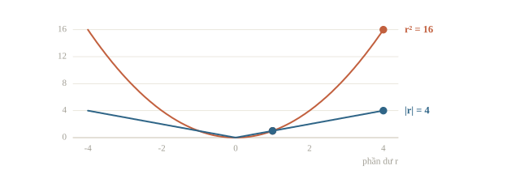
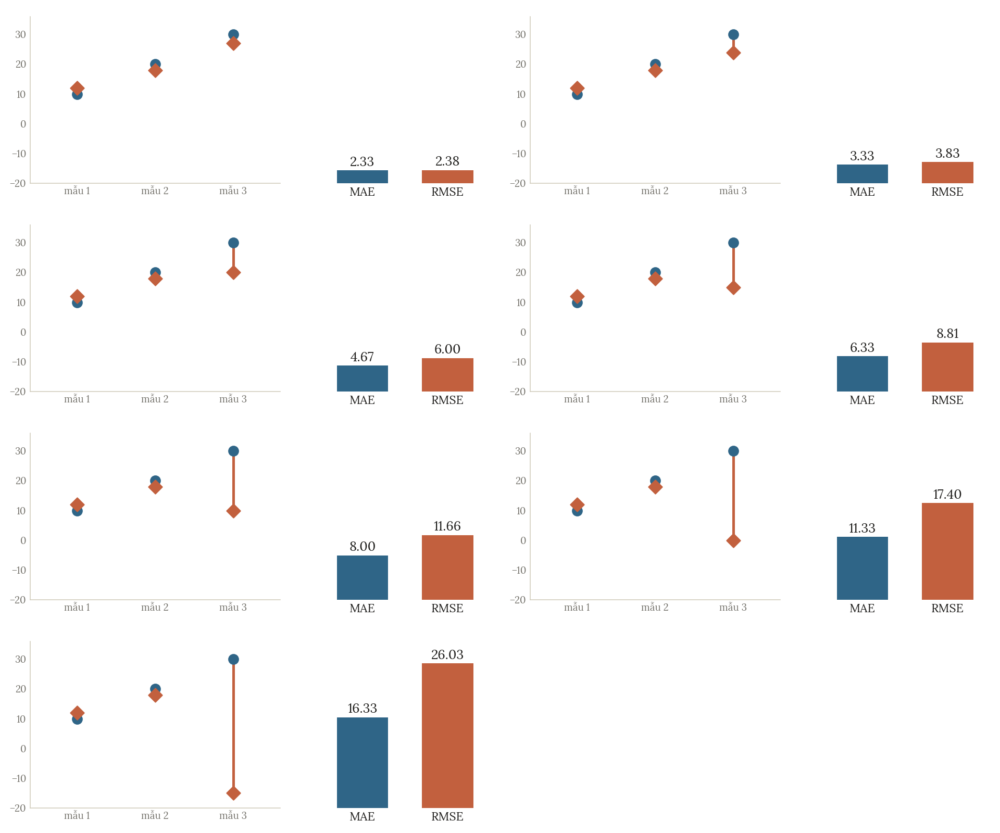
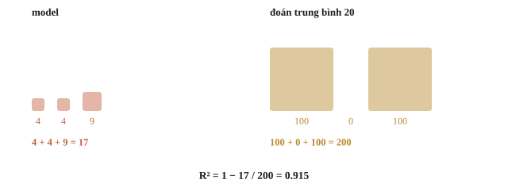
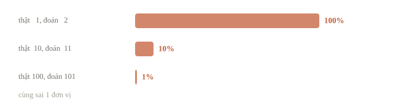
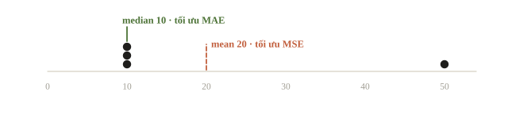
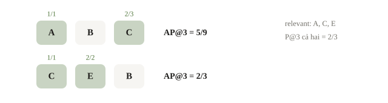

# Regression và ranking metrics

Câu lạc bộ có hai công việc khác nhau. Một là đoán số người đến để đặt ghế. Hai là đề xuất ba bài luyện tập phù hợp nhất cho mỗi học sinh. Ở công việc đầu, đoán 32 thay vì 30 sai hai người. Ở công việc sau, ta quan tâm bài phù hợp có đứng gần đầu danh sách hay không; khoảng cách số học giữa các mã bài không có ý nghĩa.

Ta cần chọn metric theo loại quyết định. Bài này đối chiếu MAE, MSE, RMSE, $R^2$, MAPE và MAP@k, rồi phân biệt metric dùng chấm với loss dùng để học. Cùng một bộ dự đoán có thể được xếp tốt theo metric này và kém theo metric khác.

::: goal Sau bài này, có thể
- Tính tay MAE, MSE, RMSE và $R^2$, đọc đúng đơn vị và chiều tốt/xấu.
- Nhận diện bẫy MAPE khi target gần hoặc bằng 0.
- Tính AP@k và MAP@k theo một quy ước được nêu rõ, kiểm duplicate và nhóm query.
- Phân biệt loss tối ưu với metric lựa chọn mô hình và metric chấm bài.
:::

## Độ lớn lỗi và đơn vị

Gọi phần dư $r_i=\hat y_i-y_i$. Với $n$ mẫu,

$$\operatorname{MAE}=\frac1n\sum_i|r_i|,\qquad
\operatorname{MSE}=\frac1n\sum_i r_i^2,\qquad
\operatorname{RMSE}=\sqrt{\operatorname{MSE}}.$$

MAE giữ cùng đơn vị với target. Nếu target là số người, MAE cũng là số người. MSE có đơn vị người bình phương, nên khó đọc trực tiếp; RMSE đưa về người. Cả ba đều càng thấp càng tốt.





Bình phương khiến lỗi 4 đóng góp 16, gấp 16 lần lỗi 1; trong MAE chỉ gấp bốn lần. MSE/RMSE nhạy với sai số lớn và outlier. Điều ấy có thể phù hợp nếu lỗi rất lớn đắt giá; cũng có thể bị một nhãn nhập nhầm chi phối. Không coi outlier mặc nhiên là rác: cần kiểm ý nghĩa và nguồn ghi nhãn.

RMSE **không** phải trung bình căn của từng lỗi bình phương. Làm theo cách ấy sẽ thành MAE, vì $\sqrt{r_i^2}=|r_i|$. Thứ tự lấy trung bình và căn quan trọng.

::: quiz
Đổi target từ giờ sang phút, nên mọi target và mọi dự đoán đều nhân 60. MSE thay đổi thế nào?
- [ ] Không đổi, vì target và dự đoán cùng nhân 60
- [ ] Nhân 60, giống phần dư
- [ ] Nhân $\sqrt{60}$
- [x] Nhân $60^2 = 3600$
Phần dư nhân 60, nên bình phương của nó nhân 3600. MAE và RMSE thì chỉ nhân 60. Tỉ số giữa hai mô hình không đổi, nên phép so sánh vẫn công bằng; chỉ con số tuyệt đối đổi theo đơn vị.
:::

## Ví dụ tính tay rồi đối chiếu thư viện

Ba buổi có target $(10,20,30)$ và dự đoán $(12,18,27)$. Phần dư là $(2,-2,-3)$, nên MAE $=7/3\approx2.333$, MSE $=17/3\approx5.667$, RMSE $=\sqrt{17/3}\approx2.380$.

$R^2$ so tổng bình phương lỗi với phương án dự đoán trung bình của **tập đang chấm**:

$$R^2=1-\frac{\sum_i(y_i-\hat y_i)^2}{\sum_i(y_i-\bar y)^2}.$$

Trong ví dụ $\bar y=20$, mẫu số là $100+0+100=200$, nên $R^2=1-17/200=0.915$. Mốc “đoán trung bình tập chấm” chỉ dùng để định nghĩa metric: một model thật không được biết trung bình ấy. Baseline thật học trung bình train, nên trên validation nó thường có $R^2$ hơi dưới 0 chứ không đúng bằng 0.



```python
import numpy as np
from sklearn.metrics import (
    mean_absolute_error, mean_squared_error, r2_score,
    mean_absolute_percentage_error,
)

y = np.array([10.0, 20.0, 30.0])
prediction = np.array([12.0, 18.0, 27.0])
residual = prediction - y
print('Phần dư:', residual)
print(f'MAE={mean_absolute_error(y, prediction):.3f}')
print(f'MSE={mean_squared_error(y, prediction):.3f}')
print(f'RMSE={np.sqrt(mean_squared_error(y, prediction)):.3f}')
print(f'R2={r2_score(y, prediction):.3f}')
```

```output
Phần dư: [ 2. -2. -3.]
MAE=2.333
MSE=5.667
RMSE=2.380
R2=0.915
```

Các dòng phải khớp phép tính tay. $R^2=1$ là dự đoán đúng hết; bằng 0 là ngang mốc trung bình tập chấm; âm là tệ hơn mốc ấy. Nó không phải phần trăm số mẫu đoán đúng. Chẳng hạn $R^2=0.915$ không nói rằng 91.5% buổi có số người dự đoán chính xác.

Nếu target của tập chấm hằng số, mẫu số bằng 0, công thức $R^2$ không xác định theo cách thông thường. scikit-learn mặc định có `force_finite` để thay một số trường hợp bằng 0 hoặc 1; khi cần phân tích, xem rõ quy ước thay vì suy ra từ một số đẹp. Không so $R^2$ giữa hai bộ dữ liệu rất khác rồi kết luận model nào tốt hơn.

::: quiz
Mô hình có $R^2 = -0.5$ trên validation. Con số này nói lên điều gì?
- [ ] Code chắc chắn sai dấu, vì $R^2$ là một bình phương
- [x] Mô hình còn tệ hơn cách đoán hằng số bằng trung bình của tập chấm
- [ ] Mô hình đoán đúng chưa tới một nửa số mẫu validation
- [ ] Mô hình tốt hơn mức trung bình 50%, theo chiều ngược lại
$R^2 = -0.5$ nghĩa là tổng bình phương lỗi bằng 1.5 lần tổng bình phương độ lệch quanh trung bình. Cái tên “R bình phương” dễ gây hiểu nhầm: công thức là 1 trừ đi một tỉ số, nên âm là chuyện bình thường. $R^2$ cũng không đếm số mẫu đoán đúng.
:::

## MAPE: tỉ lệ lỗi nhưng có mẫu số nguy hiểm

Mean absolute percentage error dùng độ lớn tương đối so với target:

$$\operatorname{MAPE}=\frac1n\sum_i\frac{|y_i-\hat y_i|}{|y_i|},\qquad y_i\ne0.$$

Muốn biểu diễn phần trăm, nhân kết quả với 100. Với ba buổi trên, các lỗi tương đối là 0.2, 0.1, 0.1: trung bình khoảng 0.1333, tức 13.33%.

Target nhỏ khiến cùng một lỗi tuyệt đối bị phạt lớn hơn. Đoán 2 khi thật là 1 sai 100%; đoán 101 khi thật là 100 chỉ sai 1%, dù cả hai sai một đơn vị. Nếu có $y=0$, công thức này chia 0. Thư viện thay mẫu số bằng một số rất nhỏ nên có thể trả số hữu hạn khổng lồ; đó không có nghĩa metric đã trở nên dễ diễn giải.

```python
print(f'MAPE dạng tỉ lệ={mean_absolute_percentage_error(y, prediction):.4f}')
print(f'MAPE phần trăm={100 * mean_absolute_percentage_error(y, prediction):.2f}%')
zero_case = mean_absolute_percentage_error([0.0, 10.0], [1.0, 9.0])
print(f'MAPE với target 0 theo thư viện={zero_case:.3e}')
```

```output
MAPE dạng tỉ lệ=0.1333
MAPE phần trăm=13.33%
MAPE với target 0 theo thư viện=2.252e+15
```

Số ở dòng cuối là lời nhắc kiểm miền target. Không tự thêm 1 vào mẫu số rồi vẫn gọi là MAPE của đề. Nếu đề dùng công thức có epsilon, clipping hoặc metric khác như sMAPE, phải cài đúng scorer và ghi rõ.



Để thấy việc chọn metric làm đổi quyết định, xét hai dự đoán sau trên cùng target $(1,100)$.

```python
small_large = np.array([1.0, 100.0])
candidate_a = np.array([2.0, 100.0])
candidate_b = np.array([1.0, 104.0])
for name, pred in [('A', candidate_a), ('B', candidate_b)]:
    mae = mean_absolute_error(small_large, pred)
    mape = mean_absolute_percentage_error(small_large, pred)
    print(f'{name}: MAE={mae:.3f}, MAPE={mape:.3f}')
```

```output
A: MAE=0.500, MAPE=0.500
B: MAE=2.000, MAPE=0.020
```

Theo MAE, A tốt hơn vì tổng lỗi chỉ là 1 thay vì 4. Theo MAPE, B tốt hơn vì tránh lỗi trên target 1. Không có mâu thuẫn: hai metric đặt trọng số khác nhau cho hai buổi.

::: quiz
Trong dữ liệu có những target bằng 0, mà đề chấm bằng MAPE. Ta xử lý thế nào?
- [ ] Bỏ các hàng có target 0 khỏi validation cho số đẹp hơn
- [ ] Cộng 1 vào mọi target, vẫn gọi là MAPE như đề
- [ ] Dùng hàm MAPE của thư viện, vì nó đã tự xử lý chia cho 0
- [x] Đọc công thức chấm của đề rồi cài đúng như thế
Điểm trên validation phải được tính giống hệt điểm thật của đề. Bỏ hàng hay cộng 1 đều làm con số ở máy mình lệch đi. Hàm của thư viện chỉ thay mẫu số 0 bằng một số rất nhỏ, nên ra con số khổng lồ như $2.252\times 10^{15}$ ở trên. Nếu đề có quy ước riêng cho trường hợp này, ta cài đúng quy ước ấy. Nếu được tự chọn metric, nên cân nhắc thước đo không chia cho target.
:::

## Loss học và metric chấm có thể khác nhau

Loss là hàm mà thuật toán tối ưu trên train. Metric là thước đo chất lượng theo nhiệm vụ, dùng trên validation/test. Chúng có thể trùng, nhưng không bắt buộc. Một model tối ưu MSE vẫn có thể được so theo MAE; phải đo xem thực tế tốt thế nào.

Với dự đoán hằng số, MSE được tối ưu bằng mean, MAE bằng median. Train target $(10,10,10,50)$ có mean 20 và median 10. Mean kéo về phía mẫu 50; median giữ ở 10.



```python
train_targets = np.array([10.0, 10.0, 10.0, 50.0])
for name, value in [('mean', train_targets.mean()), ('median', np.median(train_targets))]:
    constant_prediction = np.full(len(train_targets), value)
    print(
        f'{name}: giá trị={value:.1f}, '
        f'MAE={mean_absolute_error(train_targets, constant_prediction):.1f}, '
        f'MSE={mean_squared_error(train_targets, constant_prediction):.1f}'
    )
```

```output
mean: giá trị=20.0, MAE=15.0, MSE=300.0
median: giá trị=10.0, MAE=10.0, MSE=400.0
```

Mean có MSE thấp hơn, median có MAE thấp hơn: mỗi loss kéo dự đoán về “tâm” riêng của nó. Phép tính trên train chỉ cho thấy cơ chế; muốn chọn thật thì đo trên validation bằng metric của đề. Nếu hai model dùng cùng target và cùng tập, xếp hạng theo MSE và RMSE luôn trùng vì căn bậc hai tăng nghiêm ngặt; các giá trị và đơn vị thì khác.

::: quiz
Muốn phạt lỗi lớn còn mạnh hơn MSE, một bạn đề xuất học linear regression bằng trung bình lập phương của phần dư, $\frac1n\sum_i(\hat y_i - y_i)^3$. Cách này sai ở đâu?
- [ ] Lỗi lớn bị phạt quá mạnh, nên mô hình chỉ chạy theo vài điểm ngoại lai
- [ ] Tính lập phương quá chậm khi dữ liệu lớn
- [x] Phần dư âm cho lập phương âm, nên càng đoán thấp thì loss càng giảm mãi
- [ ] Đơn vị bị lập phương nên không đọc được lỗi lớn hay nhỏ
Khi $r < 0$ thì $r^3 < 0$. Kéo mọi dự đoán xuống thật thấp là loss giảm không có điểm dừng, nên bài toán không có nghiệm. Đơn vị lạ chỉ là chuyện phụ. Muốn phạt lỗi lớn mạnh hơn thì phải giữ dấu dương, chẳng hạn dùng $|r|^3$, và vẫn chọn mô hình theo metric của đề.
Phỏng theo: [CMU 10-601 · Exam 1 Practice · Q5.4](https://www.cs.cmu.edu/~mgormley/courses/10601/handout/exam1_practice_problems.pdf#page=20)
:::

## Ranking: một danh sách, không phải một số

Câu lạc bộ muốn gợi ý ba bài luyện cho mỗi học sinh. Với một query, tức một yêu cầu gợi ý của một học sinh, ta có tập bài thật sự phù hợp (relevant). Một danh sách tốt đặt nhiều bài phù hợp gần đầu. Xét tập relevant `{A,C,E}` và danh sách `[A,B,C]`: vị trí 1 đúng, vị trí 2 sai, vị trí 3 đúng.

Precision@r là số bài relevant trong $r$ vị trí đầu chia $r$. Average precision ở top $k$ cần một quy ước mẫu số. Trong bài này chọn

$$\operatorname{AP@}k=\frac{\sum_{r=1}^{k} P@r\cdot\operatorname{rel}(r)}{\min(R,k)},\qquad R>0,$$

$R$ là số bài relevant thật, $\operatorname{rel}(r)$ bằng 1 khi bài ở vị trí $r$ phù hợp, bằng 0 khi không. Nếu danh sách có ít hơn $k$ phần tử, chỉ cộng các vị trí được trả, còn mẫu số vẫn là $\min(R,k)$. Code trong bài quy ước $R=0$ cho AP bằng 0 và không chấp nhận duplicate trong top $k$.

Một số scorer dùng $R$ làm mẫu số, hoặc bỏ query không có relevant. Khi $R>k$, hai định nghĩa khác nhau. Vì vậy “MAP@k” chưa đủ để cài scorer; đọc công thức, quy tắc duplicate, query rỗng, tie và độ dài danh sách.



Với `[A,B,C]`, tử số là $1+2/3=5/3$, mẫu số là 3, nên AP@3 $=5/9$. Với `[C,E,B]`, tử số là $1+1=2$, mẫu số 3, nên AP@3 $=2/3$. Precision@3 của cả hai bằng $2/3$, nhưng AP thích cách đặt bài đúng sớm hơn.

::: quiz
Các bài liên quan (relevant) là `{A,C,E}`. So hai danh sách xếp hạng `[B,A,C]` và `[A,B,C]` ở top 3. Precision@3 và AP@3 của hai danh sách khác nhau thế nào?
- [ ] Precision@3 bằng nhau, AP@3 cũng bằng nhau
- [x] Precision@3 bằng nhau, nhưng AP@3 của `[B,A,C]` thấp hơn
- [ ] Precision@3 của `[B,A,C]` thấp hơn, còn AP@3 bằng nhau
- [ ] Cả precision@3 lẫn AP@3 của `[B,A,C]` đều thấp hơn
Cả hai danh sách có hai bài relevant trong top 3, nên $P@3 = 2/3$. AP@3 của `[A,B,C]` là $(1 + 2/3)/3 = 5/9 \approx 0.556$. AP@3 của `[B,A,C]` là $(1/2 + 2/3)/3 = 7/18 \approx 0.389$. Lùi bài đúng đầu tiên xuống một hạng làm AP giảm, dù precision@3 vẫn thế.
:::

## Cài một scorer nhỏ và kiểm tay

MAP@k (mean average precision) lấy trung bình AP@k qua các query, mỗi query có trọng số bằng nhau trong quy ước đang dùng. Không nối mọi danh sách rồi tính AP một lần: mỗi người có tập bài relevant riêng.

```python
def ap_at_k(ranking, relevant, k):
    assert k >= 1, 'k phải dương'
    top = list(ranking[:k])
    assert len(top) == len(set(top)), 'Không cho duplicate trong top k'
    relevant = set(relevant)
    if not relevant:
        return 0.0
    hits = 0
    total = 0.0
    for rank, item in enumerate(top, start=1):
        if item in relevant:
            hits += 1
            total += hits / rank
    return total / min(len(relevant), k)

rankings = [['A', 'B', 'C'], ['B', 'D', 'E']]
relevant_sets = [{'A', 'C', 'E'}, {'D'}]
ap_scores = [ap_at_k(rank, rel, 3) for rank, rel in zip(rankings, relevant_sets)]
print('AP@3 từng query:', np.round(ap_scores, 6))
print(f'MAP@3={np.mean(ap_scores):.6f}')
assert np.isclose(ap_scores[0], 5 / 9)
assert np.isclose(ap_scores[1], 1 / 2)
```

```output
AP@3 từng query: [0.555556 0.5     ]
MAP@3=0.527778
```

Query thứ hai có một bài relevant ở hạng 2 nên AP@3 $=1/2$. MAP của hai query là $(5/9+1/2)/2=19/36\approx0.527778$. Các assert đối chiếu với phép tính độc lập, giống kiểm một hàm CP bằng vài trường hợp nhỏ có đáp án chắc chắn.

::: quiz
Bỏ dòng `assert` chặn mục trùng trong `ap_at_k`, rồi gọi `ap_at_k(['A', 'A', 'C'], {'A', 'C'}, 3)`. Kết quả là bao nhiêu?
- [ ] $1.0$, vì cả hai bài relevant đều có mặt
- [ ] $0.833$, vì lần xuất hiện thứ hai của A bị bỏ qua
- [ ] Báo lỗi, vì `relevant` là một set
- [x] $1.5$, vì A được tính như hai bài đúng
Cả ba vị trí đều được tính là đúng: $1/1 + 2/2 + 3/3 = 3$, chia cho $\min(2, 3) = 2$ ra $1.5$. AP lớn hơn 1 là dấu hiệu chắc chắn hàm chấm bị sai. Nếu hàm chấm không chặn mục trùng, một bài nộp lặp lại mục đúng sẽ được điểm cao vô lý, vì vậy đề thường quy định rõ cách xử lý mục trùng.
:::

Để chọn model gợi ý, split theo mục tiêu người mới hoặc thời gian, rồi tạo danh sách trong từng validation query. Cũng cần tránh đưa tương tác ở tương lai vào feature lịch sử. Metric đúng chưa sửa được một split rò rỉ.

## Bẫy cài đặt

Kiểm `y` và prediction cùng shape trước khi trừ. RMSE là căn của MSE trên **cùng tập**, không phải trung bình RMSE fold mặc nhiên bằng RMSE gộp. Khi báo cáo CV, ghi cách gộp và trọng số fold.

Ranking cần đúng query ID, danh sách không trùng và quy tắc tie. AP phân loại trong scikit-learn và AP@k theo danh sách của bài này là hai giao thức đầu vào khác nhau; không thay thế nhau chỉ vì đều có chữ average precision. Một bài có nhiều mức relevance có thể dùng NDCG thay vì relevance binary, nhưng phải theo công thức đề.

## Khi đi thi

- **Viết scorer local từ công thức của đề**, kiểm bằng vài ví dụ tay có đáp án chắc chắn; có scorer mẫu thì so hai kết quả.
- **Đọc cả cách quy ra điểm**: lỗi thấp hơn hay cao hơn là tốt, điểm có tính so với baseline không, thành phần nào có trọng số lớn.
- **Ghi metric của đề vào log thí nghiệm**, không dựa vào `model.score` mặc định.
- **Regression**: kiểm đơn vị, miền target (có 0 không), outlier và giá trị thiếu trước khi chỉnh model. Một ô thiếu có thể bị phạt nặng hơn mọi lỗi thường.
- **Ranking**: kiểm từng query, duplicate và độ dài danh sách trước khi gộp.

## Tóm tắt

- MAE giữ đơn vị; MSE phạt lỗi lớn; RMSE là căn của MSE.
- $R^2$ dùng mốc trung bình tập chấm và có thể âm.
- MAPE đặt trọng số lớn lên target nhỏ và cần quy ước khi target 0.
- AP@k thưởng bài relevant ở gần đầu; MAP trung bình theo query.
- Loss trên train và metric chọn/chấm phải được phân biệt rõ.

## Kiểm tra cuối bài

::: quiz Câu 1
Trên năm buổi, lỗi tuyệt đối của mô hình A là $(1, 1, 1, 1, 8)$, của mô hình B là $(3, 3, 3, 3, 3)$. Theo MAE thì mô hình nào tốt hơn, theo RMSE thì sao?
- [x] Theo MAE là A, theo RMSE là B
- [ ] Theo MAE là B, theo RMSE là A
- [ ] Theo cả hai đều là A
- [ ] Theo cả hai đều là B
MAE của A là $12/5 = 2.4$, của B là 3. RMSE của A là $\sqrt{68/5} \approx 3.69$, của B là 3. Một lỗi bằng 8 của A khi bình phương thành 64, đủ lật ngược kết quả. Muốn biết đề phạt lỗi lớn nặng đến đâu, ta đọc metric.
:::

::: quiz Câu 2
Mô hình đoán số người đến có MSE bằng 9, đơn vị là “người bình phương”. RMSE bằng bao nhiêu?
- [ ] 9 người
- [x] 3 người
- [ ] 81 người
- [ ] 3 người bình phương
RMSE là căn bậc hai của MSE: $\sqrt 9 = 3$. Lấy căn cũng đưa đơn vị về lại “người”, cùng đơn vị với target. Vì vậy khi báo cáo, RMSE dễ đọc hơn MSE.
:::

::: quiz Câu 3
Một đề tính điểm theo RMSE: $\text{điểm} = \dfrac{X_\text{baseline} - X}{X_\text{baseline} - X_\text{best}} \times 100\%$, và bằng 0 nếu $X$ tệ hơn baseline. Baseline có RMSE 2.0, bài tốt nhất có 1.0, đội mình có 1.4. Điểm hiện tại là bao nhiêu, và nếu RMSE giảm còn 1.2 thì được bao nhiêu?
- [ ] 40% và 20%
- [ ] 30% và 40%
- [ ] 71% và 83%
- [x] 60% và 80%
$(2.0 - 1.4)/(2.0 - 1.0) = 60\%$ và $(2.0 - 1.2)/1.0 = 80\%$. Điểm đo xem ta đã đi được bao nhiêu phần đường từ baseline tới bài tốt nhất. Ở gần đỉnh, mỗi 0.1 RMSE đáng 10 điểm. Còn tệ hơn baseline thì được 0 điểm, dù mô hình vẫn chạy.
Phỏng theo: [USA-NA-AIO 2026 · Vòng 2 · Ngày 2](https://www.usaaio.org/attachments/past-problems/2026/usaaio-2026-round-2-day-2-problems.pdf#page=13)
:::

::: quiz Câu 4
Lỗi của mỗi mẫu được tính bằng $10^3 \cdot e_\text{vị trí} + 3 \cdot 10^{-3} \cdot e_\text{trường}$. Ở đây $e_\text{vị trí}$ là tổng sai số tuyệt đối của tọa độ nguồn, còn $e_\text{trường}$ là RMSE của 100 giá trị cường độ. Trên validation, trung bình $e_\text{vị trí} = 0.02$ và $e_\text{trường} = 50$. Ta chỉ đủ thời gian làm một việc. Việc nào giảm lỗi nhiều hơn?
- [x] Giảm lỗi vị trí còn 0.01
- [ ] Giảm RMSE cường độ còn 25
- [ ] Hai việc như nhau, vì cùng giảm một nửa
- [ ] Không so được, vì hai lỗi khác đơn vị
Lỗi hiện tại là $20 + 0.15 = 20.15$. Giảm lỗi vị trí còn 0.01 thì lỗi còn $10.15$. Giảm RMSE cường độ còn 25 thì lỗi chỉ còn $20.075$. Các hệ số trong công thức cho biết phần nào đang kéo điểm xuống, nên phải đọc công thức chấm trước khi chọn việc.
Phỏng theo: [USA-NA-AIO 2026 · Vòng 2 · Ngày 1](https://www.usaaio.org/attachments/past-problems/2026/usaaio-2026-round-2-day-1-problems.pdf#page=12)
:::

::: quiz Câu 5
Hai buổi có target là 2 và 50, mô hình đoán 3 và 60. Ta chỉ được sửa một dự đoán về đúng giá trị thật. Muốn MAPE giảm nhiều nhất thì sửa buổi nào? Muốn MAE giảm nhiều nhất thì sửa buổi nào?
- [ ] MAPE thì sửa buổi 50, MAE thì sửa buổi 2
- [x] MAPE thì sửa buổi 2, MAE thì sửa buổi 50
- [ ] Cả hai đều sửa buổi 50, vì lỗi 10 lớn hơn
- [ ] Cả hai đều sửa buổi 2, vì lỗi tương đối lớn hơn
MAPE hiện là $(0.5 + 0.2)/2 = 0.35$. Sửa buổi 2 thì còn $0.10$, sửa buổi 50 thì còn $0.25$. MAE hiện là $5.5$. Sửa buổi 2 thì còn $5$, sửa buổi 50 thì còn $0.5$. Cùng một dữ liệu, metric quyết định ta nên dồn công sức vào đâu.
:::

::: quiz Câu 6
Target train là $(0, 0, 0, 8, 12)$. Nếu chỉ được đoán một hằng số cho mọi mẫu, hằng số nào cho MAE nhỏ nhất, hằng số nào cho MSE nhỏ nhất?
- [x] MAE nhỏ nhất với 0, MSE nhỏ nhất với 4
- [ ] Cả hai đều nhỏ nhất với 0
- [ ] Cả hai đều nhỏ nhất với 4
- [ ] MAE nhỏ nhất với 4, MSE nhỏ nhất với 0
Median, ở đây bằng 0, làm tổng sai số tuyệt đối nhỏ nhất. Mean bằng 4 làm tổng sai số bình phương nhỏ nhất, dù không target nào bằng 4.
Phỏng theo: [CMU 10-601 · Exam 1 Practice · Q5.5](https://www.cs.cmu.edu/~mgormley/courses/10601/handout/exam1_practice_problems.pdf#page=20)
:::

::: quiz Câu 7
Các mục relevant là B, D, E, F. Hệ thống trả về thứ hạng [A, B, C, D]. AP@4 dùng mẫu số $\min(R, 4)$, với $R$ là tổng số mục relevant. AP@4 bằng bao nhiêu?
- [ ] 1/8
- [ ] 1
- [x] 1/4
- [ ] 1/2
Hai mục đúng nằm ở hạng 2 và hạng 4, và precision tại hai hạng ấy đều là 1/2. $R = 4$ nên mẫu số là $\min(4, 4) = 4$. Vậy $\text{AP@4} = (1/2 + 1/2)/4 = 1/4$. Còn 1/2 là precision@4, một đại lượng khác.
:::

::: quiz Câu 8
Hai query có AP là 0.8 và 0.2. Query đầu có 1 mục relevant, query sau có 9. MAP, tức trung bình đều theo query, bằng bao nhiêu?
- [x] 0.50
- [ ] 0.80
- [ ] 1.00
- [ ] 0.26
MAP lấy trung bình đều theo query: $(0.8 + 0.2)/2 = 0.50$. Còn 0.26 là trung bình có trọng số theo số mục relevant, $(0.8 \cdot 1 + 0.2 \cdot 9)/10$, khác với định nghĩa của đề.
:::

::: quiz Câu 9
Có $R = 5$ mục relevant. Hệ thống chỉ trả về $k = 3$ kết quả, và cả ba đều relevant. Nếu chia cho $R$ thì AP@3 bằng bao nhiêu? Nếu chia cho $\min(R, k)$ thì sao?
- [ ] 0.6 và 0.6
- [x] 0.6 và 1.0
- [ ] 1.0 và 0.6
- [ ] 1.0 và 1.0
Precision tại cả ba vị trí đều bằng 1, tổng là 3. Chia cho 5 ra 0.6, chia cho 3 ra 1. Hai quy ước cùng mang tên AP@k mà cho hai con số khác nhau, nên phải đọc đúng công thức của hàm chấm.
:::

::: quiz Câu 10
Trên cùng validation, mô hình A có MAE 2.0 và MSE 10. Mô hình B có MAE 2.4 và MSE 8. Cả hai đều học bằng MSE, nhưng đề chấm bằng MAE. Ta chọn mô hình nào?
- [ ] B, vì MSE trên validation thấp hơn
- [ ] Lấy trung bình MAE và MSE, chọn bên nhỏ hơn
- [x] A, vì MAE trên validation thấp hơn
- [ ] B, vì MSE là loss dùng để học
Loss dùng để học và metric dùng để chọn có thể khác nhau. Đề chấm MAE thì ta chọn theo MAE: A có 2.0, thấp hơn 2.4 của B. MSE của B thấp hơn cũng không thay đổi được điều đó.
:::

## Đọc thêm

- [scikit-learn — Regression metrics](https://scikit-learn.org/stable/modules/model_evaluation.html#regression-metrics). Tra định nghĩa, đơn vị, multioutput và giới hạn của $R^2$.
- [scikit-learn — Mean absolute percentage error](https://scikit-learn.org/stable/modules/generated/sklearn.metrics.mean_absolute_percentage_error.html). Xem cách trả tỉ lệ và xử lý target gần 0.
- Manning, Raghavan, Schütze — [Introduction to Information Retrieval: Evaluation of ranked retrieval results](https://nlp.stanford.edu/IR-book/html/htmledition/evaluation-of-ranked-retrieval-results-1.html). Đọc AP/MAP trong truy hồi, rồi đối chiếu phần cắt top-k của scorer đề.
