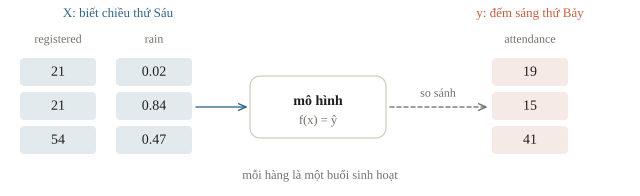
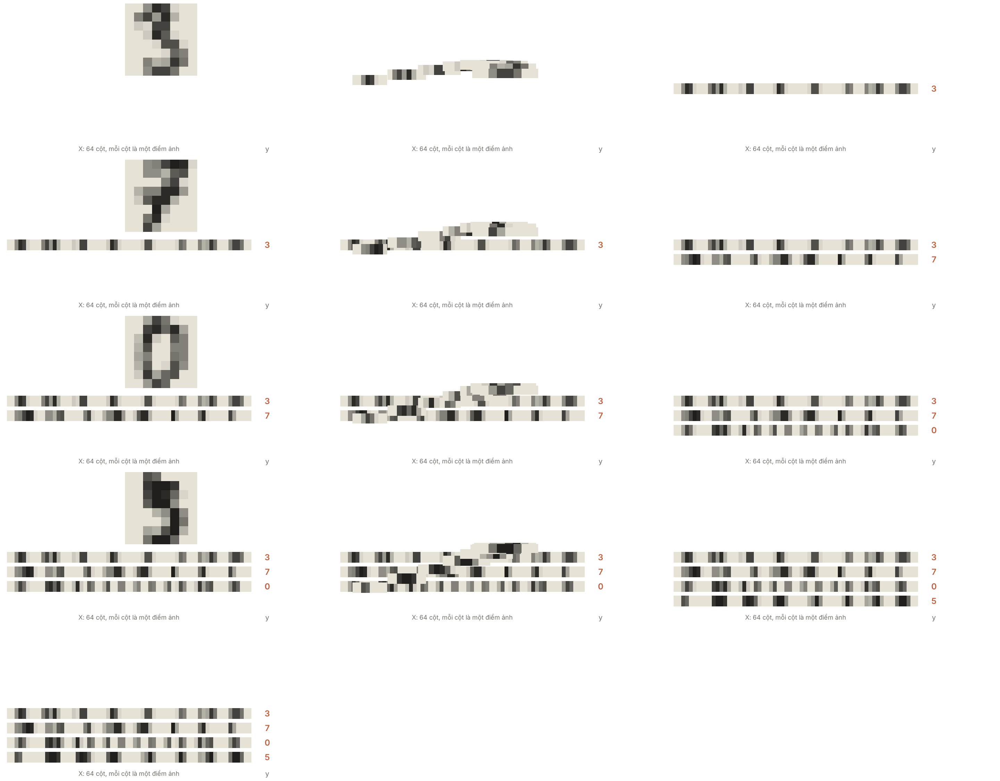
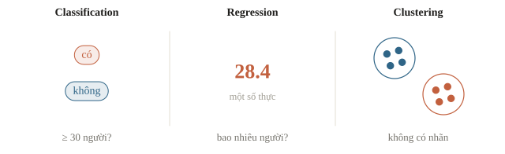
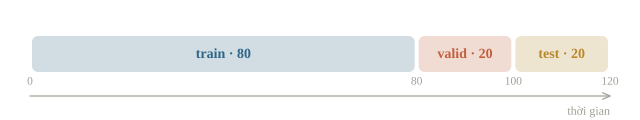
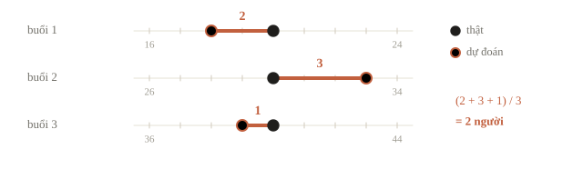
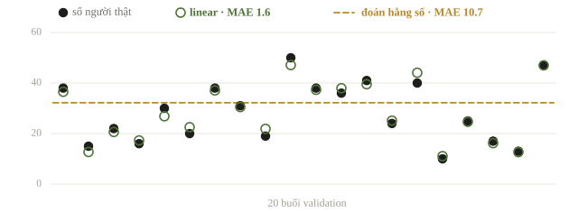

<!-- title -->
# Bài toán học máy

Đặt ghế cho buổi sinh hoạt thứ Bảy

Phase 1 · Bài 1.1

---
<!-- split -->
## Ta đang dự đoán điều gì?

Chiều thứ Sáu: biết số đăng ký và dự báo mưa.

Thứ Bảy: mới biết số người thật sự đến.

|||

Mỗi hàng = một buổi.

Một dự đoán = một con số người.

Thông tin đầu vào phải có đúng lúc sử dụng.

---
<!-- center -->
## Mục tiêu buổi này

Viết hợp đồng: dự đoán số người đến từ dữ liệu chiều thứ Sáu.

Dựng baseline, đọc MAE theo đơn vị người và kiểm bảng theo ID.

---
<!-- section 1 -->
# Dữ liệu và đầu ra

---
<!-- figure -->
## Feature, target và ID



---

<!-- figure -->
## Ảnh cũng thành một hàng dữ liệu



---
<!-- figure -->
## Kiểu đầu ra của bài toán



---
<!-- split -->
## Classification hay regression?

Có ít nhất 30 người không?

**Classification:** một nhãn.

|||

Có bao nhiêu người?

**Regression:** một giá trị số.

Mã lớp bằng số không tự biến classification thành regression.

---
<!-- quiz -->
::: quiz
Input là ảnh chụp một bài giải. Output là một trong ba nhãn “đúng”, “sai”, “chưa đủ bước”. Đây là loại bài toán nào?
- [ ] Regression, vì nhãn mã hóa được thành 0, 1, 2
- [x] Classification có giám sát, với ba lớp
- [ ] Clustering, vì cần chia bài giải thành ba nhóm
- [ ] Classification nhị phân, đúng hoặc không đúng
Mã 0, 1, 2 chỉ là tên lớp, lớp 2 không “lớn gấp đôi” lớp 1, nên đây không phải hồi quy. Đề đã cho sẵn ba lớp, và “sai” khác “chưa đủ bước”, nên cũng không gộp thành bài nhị phân.
:::

---
<!-- quiz -->
::: quiz
Câu lạc bộ muốn chạy mô hình vào chiều thứ Sáu để đoán số người đến buổi sáng thứ Bảy. Cột nào **không** được dùng làm feature?
- [ ] Số người đăng ký tính đến chiều thứ Sáu
- [ ] Số buổi câu lạc bộ đã tổ chức từ đầu học kỳ
- [ ] Dự báo mưa lưu lúc chiều thứ Sáu
- [x] Số người quét mã vào cửa sáng thứ Bảy
Số người quét mã sáng thứ Bảy chính là điều ta đang muốn đoán. Mô hình dùng cột này sẽ đạt điểm rất cao trên bảng cũ, nhưng chiều thứ Sáu thì chưa có cột ấy để đưa vào.
:::

---
<!-- center -->
## Shape trước model

```python
X = data[["registered", "rain_forecast"]]
y = data["attendance"]
print(X.shape, y.shape)
print(data.head(3).round(2).to_string(index=False))
```

```output
(120, 2) (120,)
 session_id  registered  rain_forecast  attendance
          0          21           0.02        19.0
          1          21           0.84        15.0
          2          54           0.47        41.0
```

`X` có 120 hàng và 2 feature. `y` có 120 phần tử. Mỗi hàng là một buổi.

---
<!-- quiz -->
::: quiz
`session_id` chạy từ 0 đến 119 theo thứ tự thời gian. Vì sao không đưa cột này vào `X`?
- [x] ID chỉ là mã để ghép, buổi mới có ID chưa từng thấy
- [ ] Không sao, mô hình tự bỏ qua cột vô dụng
- [ ] Nên đưa vào, miễn là chuẩn hóa trước
- [ ] Phải đưa vào để giữ đúng thứ tự các buổi
ID chỉ là số thứ tự. Mô hình bám vào ID thì gặp buổi mới, có ID lớn hơn mọi ID đã thấy, sẽ kéo dài một xu hướng không có thật. Nếu có xu hướng theo thời gian, hãy tạo feature có nghĩa như tháng hay mùa.
:::

---
<!-- section 2 -->
# Học, chọn và chấm

---
<!-- figure -->
## Ba phần, ba công việc



---
<!-- quiz -->
::: quiz
Có hai mô hình, ta cần chọn một. Ta so điểm của chúng trên tập nào?
- [x] Validation
- [ ] Train, vì mô hình đã học trên đó
- [ ] Test, tập đã giữ riêng từ đầu
- [ ] Gộp train và test lại
Validation là phần giữ riêng để so và chọn. Trên train, mô hình đã thấy chính các mẫu ấy nên điểm đẹp mà không nói lên gì. Test chỉ mở ra sau khi đã chốt phương án.
:::

---
<!-- center -->
## MAE có đơn vị người

$$\operatorname{MAE}=\frac1m\sum_i|\hat y_i-y_i|.$$

Với `m` buổi đang chấm, MAE có đơn vị người.

Càng nhỏ càng tốt. Giá trị này không nói mọi buổi đều sai bằng nhau.

---
<!-- figure -->
## Ví dụ tính tay



Sai cao và sai thấp không triệt tiêu nhau.

---
<!-- split -->
## Baseline hằng số và linear

```python
for name, model in models.items():
    model.fit(X_train, y_train)
    prediction = model.predict(X_valid)
    assert prediction.shape == y_valid.shape
    mae = mean_absolute_error(y_valid, prediction)
    valid_mae[name] = mae
    print(name, f"valid MAE = {mae:.3f}")
chosen_name = min(valid_mae, key=valid_mae.get)
print("Chọn bằng validation:", chosen_name)
```

|||

`models` gồm `DummyRegressor(strategy="mean")` và `LinearRegression`; `valid_mae` ban đầu là dict trống. Hai model dùng cùng train/validation.

```output
mean valid MAE = 10.740
linear valid MAE = 1.561
Chọn bằng validation: linear
```

Hằng số sai gần 11 người, linear khoảng 1.6 người trên cùng 20 buổi.

---
<!-- figure -->
## Nhìn từng buổi validation



---
<!-- quiz -->
::: quiz
Trên cùng 20 buổi validation, một mô hình mới có MAE 11.5 người, còn baseline đoán hằng số có MAE 10.74. Ta nên làm gì tiếp?
- [ ] Giữ mô hình mới, vì nó dùng nhiều thông tin hơn
- [ ] Bỏ baseline đi, vì đoán hằng số không phải mô hình
- [x] Tìm lỗi trong dữ liệu hoặc trong cách tính điểm
- [ ] Tính thêm điểm trên test để có thêm ý kiến
Thua cả cách đoán không nhìn feature nào là dấu hiệu có lỗi: cột bị lệch, shape sai, dùng nhầm tập, hay quên chuẩn hóa. Mở test ra để “hỏi thêm” thì test không còn độc lập nữa.
:::

---
<!-- center -->
## Chốt rồi chấm

```python
final_model = models[chosen_name]
final_model.fit(X.iloc[:100], y.iloc[:100])
test_prediction = final_model.predict(X_test)
print(f"Test MAE = {mean_absolute_error(y_test, test_prediction):.3f}")
```

```output
Test MAE = 1.317
```

Fit lại trên train và validation. Test MAE là 1.317 người.

Sau khi xem test, không chỉnh rồi gọi cùng điểm là độc lập.

---
<!-- section 3 -->
# Bảng dự đoán

---
<!-- split -->
## Kiểm bảng CSV

Một hàng cho mỗi ID.

Đúng tên cột, đúng thứ tự, số hữu hạn.

Dùng `index=False`.

|||

```output
 session_id  attendance
        100       16.19
        101       26.21
        102       42.31
Số hàng: 20
```

---
<!-- quiz -->
::: quiz
Một bạn sắp xếp cột dự đoán từ nhỏ đến lớn nhưng để nguyên cột ID. File nộp còn đúng không?
- [ ] Đúng, vì số hàng và số cột vẫn khớp với đề
- [ ] Đúng, vì MAE không phụ thuộc thứ tự hàng
- [ ] Sai, vì phải sắp theo ID tăng dần
- [x] Sai, vì dự đoán đã bị ghép nhầm sang mẫu khác
MAE so dự đoán với nhãn **có cùng ID**. Sắp lại cột dự đoán thì các số bị chuyển sang ID khác, nên điểm sai dù tập giá trị vẫn y nguyên. Điều bắt buộc là mỗi ID đi với đúng dự đoán của nó.
:::

---
<!-- split -->
## Bẫy và cách kiểm

Nhãn `(n,1)` trừ dự đoán `(n,)` có thể tạo `(n,n)`.

Kiểm shape trước khi chấm.

|||

`model.score` không luôn là metric đề.

Gọi MAE tường minh.

Không đưa thông tin có sau lúc dự đoán vào feature.

---
## Khi đi thi

- Viết hợp đồng: mẫu, nhãn, metric, output, ID, thời điểm.
- Nộp baseline sớm để kiểm đường đi tới file nộp.
- Gọi metric của đề tường minh.
- Quy định môi trường đọc từ thông báo cuộc thi.

---
<!-- section 4 -->
# Luyện đề

---
<!-- quiz -->
::: quiz Luyện đề 1
Bảng chỉ có feature của từng buổi, không có cột nhãn. Ta muốn gom các buổi giống nhau thành từng nhóm. Đây là loại bài toán nào?
- [x] Học không giám sát, chẳng hạn clustering
- [ ] Học có giám sát, vì feature đã là số
- [ ] Classification có giám sát
- [ ] Regression có giám sát
Không có nhãn thì không có cặp feature và nhãn để học, nên đây không phải học có giám sát. Clustering chỉ tìm cấu trúc trong feature để gom nhóm.
Phỏng theo: [USA-NA-AIO 2026 · Vòng 1 · Part 1.1](https://www.usaaio.org/attachments/past-problems/2026/usaaio-2026-round-1-problems.pdf#page=1)
:::

---
<!-- quiz -->
::: quiz Luyện đề 2
Một mô hình được huấn luyện và kiểm trên dữ liệu năm 2023: đúng 99.8% trên train, 92% trên validation. Đem dùng cho dữ liệu năm 2025 thì chỉ còn đúng 64%. Vấn đề chính nằm ở đâu?
- [ ] Validation cùng năm với train nên con số 92% là ảo
- [ ] Dữ liệu năm 2025 bị gán nhãn sai nên điểm thấp giả tạo
- [x] Dữ liệu năm 2025 đã khác dữ liệu năm 2023
- [ ] Mô hình quá yếu, dù đúng tới 99.8% trên train
Con số 92% đã ước lượng tốt cho dữ liệu cùng thời kỳ. Điểm chỉ tụt khi sang năm khác, tức là dữ liệu đã thay đổi. Vì vậy nên lấy giai đoạn gần nhất trước lúc dùng làm validation.
Đề thi: [NOAI 2026 Singapore · Vòng sơ loại · Câu 286](https://aisingapore.org/wp-content/uploads/2026/04/NOAI-2026-Preliminary-Round-Assessment-300-MCQs-Google-Forms.pdf#page=108)
:::

---
<!-- center -->
## Chốt ý

Train học tham số. Validation chọn phương án. Test báo cáo sau khi đã chốt.

Kiểm tra cuối bài có 10 câu, gồm cả shape, metric và định dạng output.
