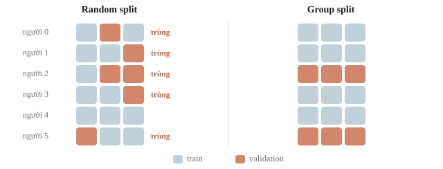
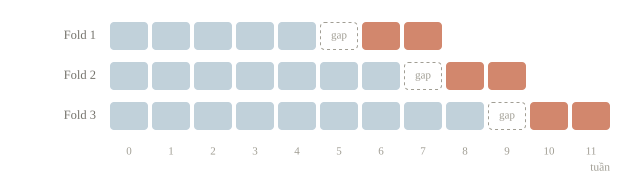
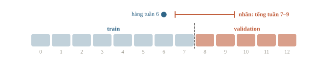
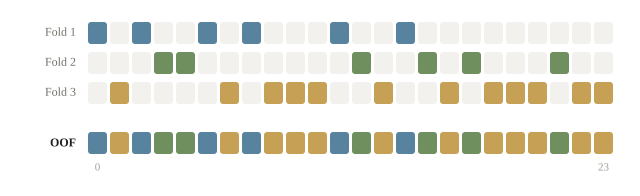
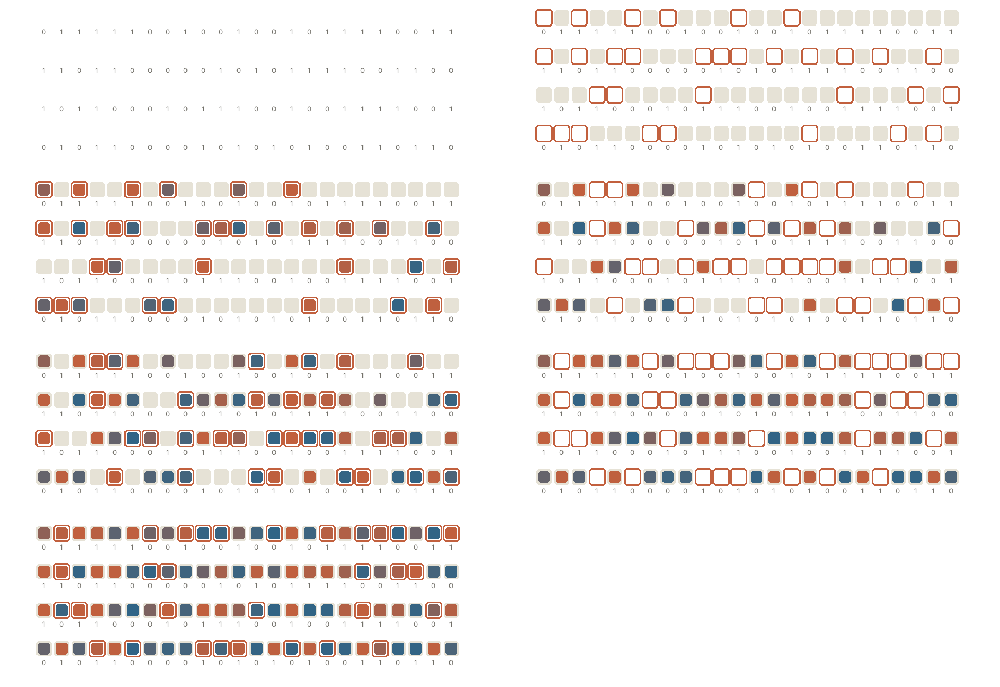

<!-- title -->
# Data split và cross-validation

Mẫu mới là một hàng, một người hay một thời điểm?

Chương 1 · Bài 1.3

---
<!-- split -->
## Ba bài làm của một học sinh

Chia ngẫu nhiên từng bài làm: cùng một học sinh có bài ở cả train lẫn validation.

|||

Nhưng model sẽ dùng cho học sinh ở trường mới.

Validation phải toàn học sinh, toàn trường chưa có trong train.

---
<!-- section 1 -->
# Chọn split từ nhiệm vụ

---
<!-- figure -->
## Hàng khác nhưng người trùng



---
<!-- quiz -->
::: quiz
Mô hình sẽ dùng cho những trường chưa có trong train. Mỗi học sinh có nhiều bản ghi. Ta để riêng validation theo đơn vị nào?
- [x] Theo trường
- [ ] Theo học sinh, các trường vẫn trộn ở hai phía
- [ ] Theo từng bản ghi, có giữ tỉ lệ nhãn
- [ ] Theo thời gian, để riêng tháng cuối của mọi trường
Để riêng trọn vài trường thì validation giống đúng tình huống gặp trường mới. Chia theo học sinh tránh được trùng người, nhưng trường nào cũng vẫn có mặt ở hai phía.
:::

---
<!-- split -->
## Stratified giữ nhãn

```output
Số mẫu train/valid: 9 3
Số nhãn 1 train/valid: 2 1
Trùng hàng: 0
```

|||

12 mẫu, ba dương.

Valid ba mẫu không thể giữ đúng tỉ lệ 25%.

Stratified không tự giữ người hoặc thời gian.

---
<!-- quiz -->
::: quiz
Mỗi học sinh có nhiều bài làm. Ta dùng stratified split. Cách chia này bảo đảm được điều gì?
- [ ] Không học sinh nào có bài ở cả hai phía
- [ ] Bài trong validation đều làm muộn hơn train
- [x] Tỉ lệ nhãn ở hai phía gần nhau, và chỉ có vậy
- [ ] Mỗi học sinh có đúng một bài trong validation
Stratified split chỉ lo tỉ lệ các lớp. Không trùng người thì cần chia theo nhóm, không dùng tương lai thì cần chia theo thời gian. Ba yêu cầu này phải kiểm riêng.
:::

---
<!-- split -->
## Kiểm group giao nhau

```output
Random split, người trùng: [0, 1, 2, 3, 5]
Fold 1: valid groups=[2, 5], trùng=0
Fold 2: valid groups=[1, 4], trùng=0
Fold 3: valid groups=[0, 3], trùng=0
```

|||

Không chỉ kiểm chỉ số hàng.

Khi đánh giá group mới, giao của các group train và valid phải rỗng.

$$G_{\text{train}}\cap G_{\text{valid}}=\varnothing.$$

---
<!-- quiz -->
::: quiz
Nhiều ảnh là bản cắt, bản xoay, hay bản chụp lại từ cùng một tờ giấy. Chia ngẫu nhiên theo ảnh thì validation đúng 99%, gặp bài lớp khác chỉ đúng 80%. Sửa cách chia thế nào?
- [ ] Giữ tỉ lệ nhãn ở hai phía bằng nhau
- [x] Gom ảnh cùng tờ giấy thành nhóm, rồi chia theo nhóm
- [ ] Chia lại với seed khác cho điểm ổn định
- [ ] Bỏ ảnh cắt khỏi validation, giữ trong train
Các bản của cùng một tờ nằm ở cả hai phía, nên validation gần như chấm lại ảnh đã học. Gom theo tờ giấy rồi chia theo nhóm thì validation mới giống bài mới.
:::

---
<!-- section 2 -->
# Dự đoán tương lai

---
<!-- figure -->
## Train đứng trước validation



---
<!-- center -->
## Các chỉ số đã chạy

```output
Fold 1: train=[0, 1, 2, 3, 4], valid=[6, 7]
Fold 2: train=[0, 1, 2, 3, 4, 5, 6], valid=[8, 9]
Fold 3: train=[0, 1, 2, 3, 4, 5, 6, 7, 8], valid=[10, 11]
```

Sắp theo thời gian trước. `gap=1` ở đây chỉ để minh họa; bài thật tính gap theo lúc nhãn được biết.

---
<!-- quiz -->
::: quiz
Nhãn của mỗi hàng là tổng số người đến trong ba tuần tiếp theo. Ta chỉ bảo đảm ngày bắt đầu của mọi hàng train sớm hơn validation. Như vậy đủ chưa?
- [ ] Đủ, vì ngày bắt đầu đã đúng thứ tự
- [ ] Đủ, nếu giữ thêm tỉ lệ nhãn
- [ ] Chưa, phải bỏ hẳn cột ngày khỏi feature
- [x] Chưa, vì nhãn của train có thể tính cả tuần thuộc validation
Hàng train bắt đầu sát ranh giới có nhãn tính cả ba tuần sau, mà các tuần ấy đã thuộc validation. Có khi phải chừa một khoảng trống ở ranh giới, hoặc bỏ những hàng vắt qua ranh giới.
:::

---
<!-- figure -->
## Nhãn nhìn vào tương lai



---
<!-- section 3 -->
# K-fold và OOF

---
<!-- center -->
## Mỗi mẫu được chấm khi nó ở ngoài train

$$\bar s=\frac1K\sum_{k=1}^Ks_k.$$

`s_k` là metric của fold `k`. Điểm trung bình fold và metric gộp không luôn giống nhau.

---
<!-- figure -->
## Ghi OOF về vị trí gốc



---

<!-- figure -->
## Lấp đầy cột OOF



---
<!-- split -->
## Kiểm các hàng được chấm

```python
# Trong mỗi fold:
oof_probability[valid_ids] = probability
times_scored[valid_ids] += 1
# Sau khi hoàn tất tất cả fold:
assert np.all(times_scored == 1)
assert np.isfinite(oof_probability).all()
```

|||

```output
Fold 1: n=32, accuracy=0.969
Fold 2: n=32, accuracy=0.906
Fold 3: n=32, accuracy=0.906
OOF shape: (96,)
Mean fold accuracy=0.927
Pooled OOF accuracy=0.927
```

Ở K-fold, mỗi hàng được chấm đúng một lần.

Ba fold cùng 32 mẫu, nên mean fold accuracy trùng accuracy gộp trong ví dụ này.

TimeSeriesSplit có hàng đầu chưa từng làm validation: cần mask, không điền bằng nhãn.

---
<!-- quiz -->
::: quiz
Một đội dùng điểm OOF để chọn feature, rồi lại dùng nó để chọn mô hình. Điểm OOF của phương án thắng còn được coi là điểm test độc lập không?
- [ ] Còn, vì mỗi mẫu không nằm trong train của fold chấm nó
- [ ] Còn, nếu mọi hàng đều được chấm đúng một lần
- [x] Không, vì các lựa chọn đều đã dựa vào điểm OOF
- [ ] Còn, nếu tăng số fold để bớt nhiễu
Mỗi mẫu được chấm bởi mô hình chưa học nó, nhưng mọi lựa chọn đều dựa vào chính điểm này. Phương án thắng vì thế đã hợp với nhiễu của OOF. Muốn chấm cả quy trình chọn, cần một tập test riêng.
:::

---
<!-- split -->
## Tính tay: validation thiếu lớp

$\binom{12}{3}=220$ bộ ba.

Có 9 mẫu âm, nên $\binom9{3}=84$ bộ ba không có mẫu dương.

|||

Xác suất 84/220 ≈ 0.382.

Kiểm số mẫu lớp trong từng fold.

---
## Khi đi thi

- Hỏi “mẫu mới là ai” trước khi chọn split.
- Cố định fold, dùng chung cho mọi phương án.
- In số mẫu, tỉ lệ lớp, giao group, khoảng thời gian mỗi fold.
- Chọn cách chia giống lúc dùng thật, dù điểm thấp hơn.

---
<!-- section 4 -->
# Luyện đề

---
<!-- quiz -->
::: quiz Luyện đề 1
A chia 70/30, chỉnh mô hình theo test 50 vòng, báo điểm test cao nhất **94.2%**. B chia 60/20/20, chỉnh theo validation, chấm test một lần được **91.8%**. Con số nào đáng tin hơn?
- [ ] Của A, vì train nhiều hơn và tìm kỹ hơn
- [ ] Của A, vì xem test 50 lần thì ổn định hơn
- [x] Của B, vì test không tham gia việc chọn
- [ ] Như nhau, vì hai tập test gần bằng nhau
Sau 50 vòng chỉnh theo test, tập test của A đã thành validation, nên 94.2% bị thổi phồng. B chỉ nhìn test một lần, 91.8% mới là con số sạch.
Đề thi: [NOAI 2026 Singapore · Vòng sơ loại · Câu 303](https://aisingapore.org/wp-content/uploads/2026/04/NOAI-2026-Preliminary-Round-Assessment-300-MCQs-Google-Forms.pdf#page=116)
:::

---
<!-- quiz -->
::: quiz Luyện đề 2
Câu nào mô tả đúng K-fold cross-validation cho linear regression với một feature $x$?
- [ ] Sắp theo $x$, cắt thành $K$ khối liền nhau, lần lượt giữ một khối
- [ ] Học một lần trên toàn bộ dữ liệu, rồi chấm $K$ lần
- [ ] Học trên mọi tập con cỡ $K$, lấy trung bình lỗi trên test riêng
- [x] Chia ngẫu nhiên thành $K$ phần, mỗi vòng giữ lại một phần để chấm
Mỗi vòng giữ một phần để chấm và học trên phần còn lại. Cắt theo $x$ đã sắp thì khối đầu và khối cuối nằm ngoài vùng $x$ của train, nên validation thành bài đoán ra ngoài vùng đã thấy.
Phỏng theo: [CMU 10-601 · Practice Problems, Exam 1 · Q3.4](https://www.cs.cmu.edu/~mgormley/courses/10601/handout/exam1_practice_problems.pdf#page=16)
:::

---
<!-- center -->
## Chốt ý

Random phù hợp khi các mẫu độc lập. Stratified giữ tỉ lệ lớp.

Group giữ đơn vị mới. Split theo thời gian giữ tương lai ở ngoài train.

Làm **10 câu cuối bài**.
