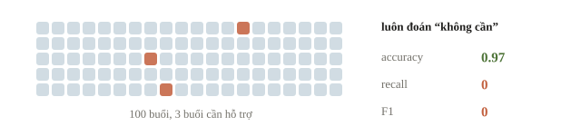
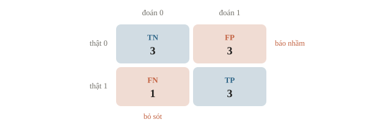
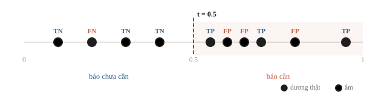
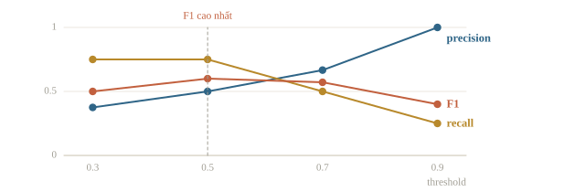
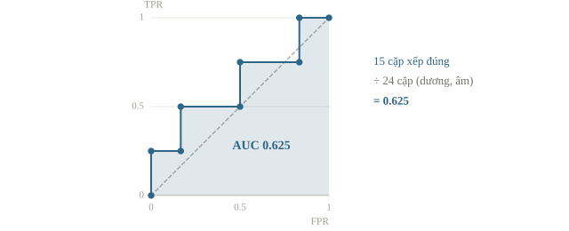
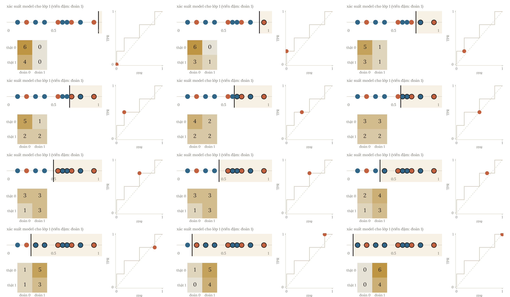
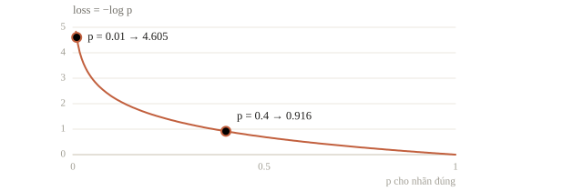

<!-- title -->
# Classification metrics

Một cảnh báo đúng nghĩa là gì?

Chương 1 · Bài 1.5

---
<!-- figure -->
## Accuracy 97% vẫn bỏ sót mọi buổi cần



Dương là buổi thực tế cần hỗ trợ. Cần đọc loại lỗi, không chỉ một điểm tổng.

---
<!-- section 1 -->
# Bốn ô và hai mẫu số

---
<!-- figure -->
## Confusion matrix



---
<!-- quiz -->
::: quiz
Mô hình báo buổi ấy không cần hỗ trợ, nhưng thực tế lại cần. Trường hợp này nằm ở ô nào?
- [ ] TP
- [x] FN
- [ ] FP
- [ ] TN
Buổi thực tế cần hỗ trợ là mẫu dương, mà mô hình lại báo âm. Đó là bỏ sót, tức FN (false negative).
:::

---
<!-- center -->
## Precision và recall

$$P=\frac{TP}{TP+FP},\qquad R=\frac{TP}{TP+FN}.$$

Precision: trong các cảnh báo, bao nhiêu là đúng.

Recall: trong các buổi thật sự cần, bao nhiêu được tìm thấy.

---
<!-- quiz -->
::: quiz
Có TP = 3, FP = 3, FN = 1. Precision và recall lần lượt bằng bao nhiêu?
- [x] $0.5$ và $0.75$
- [ ] $0.75$ và $0.5$
- [ ] $0.6$ và $0.6$
- [ ] $3/7$ và $0.75$
Precision là $3/(3+3)$, recall là $3/(3+1)$. Phương án đảo ngược là nhầm mẫu số, còn $0.6$ là F1.
:::

---
<!-- split -->
## Tính tay F1

TP=3, FP=3, FN=1.

P=0.5, R=0.75.

|||

$$F_1=\frac{2TP}{2TP+FP+FN}=0.6.$$

F1 là trung bình điều hòa của P và R. F1 không trực tiếp dùng TN.

---
<!-- split -->
## Đối chiếu code

```output
[[3 3]
 [1 3]]
TN, FP, FN, TP: 3 3 1 3
Accuracy=0.600
Precision=0.500
Recall=0.750
F1=0.600
```

|||

Mười score cho sẵn, chưa huấn luyện trong bài.

Threshold 0.5, quy tắc ≥.

Kiểm labels và chia 0.

---
<!-- figure -->
## Mười score, một ngưỡng



---
<!-- quiz -->
::: quiz
Vẫn mười score ở trên, giờ đổi ngưỡng thành $t = 0.7$. Precision và recall lần lượt bằng bao nhiêu?
- [ ] $1/2$ và $2/3$
- [x] $2/3$ và $1/2$
- [ ] $3/4$ và $3/4$
- [ ] $1$ và $1/4$
Có ba buổi score từ 0.7 trở lên: 0.95 dương, 0.80 âm, 0.70 dương. Vậy TP = 2, FP = 1. Hai buổi dương còn lại bị bỏ sót, nên FN = 2. Precision là $2/3$, recall là $2/4$.
:::

---
<!-- section 2 -->
# Chọn threshold

---
<!-- figure -->
## Cùng score, đổi quyết định



---
<!-- split -->
## Chọn trên validation

```output
t=0.3: F1=0.500
t=0.5: F1=0.600
t=0.7: F1=0.571
t=0.9: F1=0.400
Chọn trên validation: 0.5
```

|||

Chọn 0.5 trong bốn ứng viên.

Đây là một hyperparameter.

Đặt quy tắc hòa trước khi xem test.

---
<!-- split -->
## Áp dụng nguyên ngưỡng cho test

```python
test_prediction = p_test >= chosen_threshold
```

```output
Test F1 với ngưỡng đã chốt=0.571
```

|||

F1 test 0.571.

Không thử ngưỡng trên test để đổi lựa chọn.

---
<!-- quiz -->
::: quiz
Trọng số của mô hình chỉ học trên train, nhưng ngưỡng phân lớp lại được chọn bằng nhãn test. Điểm trên test còn độc lập không?
- [ ] Còn, vì không fit lại trọng số trên test
- [ ] Còn, vì ngưỡng không phải tham số của mô hình
- [x] Không, vì ngưỡng đã được chọn bằng nhãn test
- [ ] Không, vì phải dùng ngưỡng mặc định 0.5
Ngưỡng cũng là một phần của quy tắc ra nhãn. Nó đã được chỉnh theo nhãn test, nên điểm test quá lạc quan. Ngưỡng phải chọn trên validation và chốt trước khi mở test.
:::

---
<!-- section 3 -->
# Score, thứ tự và xác suất

---
<!-- figure -->
## ROC-AUC



---

<!-- figure -->
## Hạ dần threshold



---
<!-- split -->
## Tính AUC theo cặp

Bốn dương ghép với sáu âm tạo 24 cặp.

Score dương: `[0.95,0.70,0.55,0.20]`.

Score âm: `[0.80,0.65,0.60,0.40,0.30,0.10]`.

Một cặp đúng khi score của dương cao hơn score của âm. Có $6+5+3+1=15$ cặp đúng.

|||

```output
AUC tính theo cặp=0.625
AUC thư viện=0.625
Average precision=0.653
```

AUC=15/24=0.625.

---
<!-- quiz -->
::: quiz
Hai mô hình xếp các mẫu theo đúng cùng một thứ tự score, chỉ khác mức tự tin. ROC-AUC có phân biệt được hai mô hình này không?
- [ ] Có, vì AUC đo độ đúng của từng xác suất
- [ ] Có, vì AUC là accuracy ở ngưỡng 0.5
- [ ] Có, nếu một mô hình tự tin hơn hẳn
- [x] Không, vì AUC chỉ phụ thuộc thứ tự score
AUC chỉ hỏi mẫu dương có được xếp trên mẫu âm hay không, nên cùng thứ tự score thì cùng AUC. Muốn chấm độ đúng của các xác suất, ta dùng thước đo khác, như log loss.
:::

---
<!-- split -->
## Log loss phạt sai quá tự tin

```output
Sai rất tự tin: log loss=4.605
Sai ít tự tin: log loss=0.916
```

|||

Cùng dự đoán sai, nhưng xác suất của lớp đúng có thể là 0.01 hoặc 0.4.

Xác suất gán cho **lớp đúng** càng gần 0 thì log loss càng lớn.

AUC chỉ nhìn thứ tự.

---
<!-- figure -->
## Đường −log p



---
<!-- split -->
## Nhiều lớp và lớp hiếm

Macro-F1: trung bình đều lớp.

Weighted-F1: trọng số theo số mẫu thật.

Micro: gộp TP/FP/FN trước.

|||

Đúng pos_label, classes_, labels.

Resampling chỉ trong train mỗi fold.

Không đổi metric vì điểm cao hơn.

---
<!-- quiz -->
::: quiz
Có 9800 giao dịch hợp lệ và 200 gian lận. Mô hình để mặc định thì đoán gần hết là hợp lệ. Sửa cách nào hợp lý nhất?
- [x] Dùng `class_weight` cho lớp gian lận
- [ ] Nhân bản 200 mẫu gian lận lên 9800
- [ ] Tạo thêm 9600 mẫu gian lận giả
- [ ] Bỏ bớt 9600 giao dịch hợp lệ
`class_weight` khiến lỗi trên lớp gian lận bị tính nặng hơn khi học, mà không thêm bớt dòng nào. Nhân bản dễ khiến mô hình học thuộc 200 mẫu. Bỏ bớt là vứt đi 98% dữ liệu hợp lệ. Tạo mẫu giả thì tốn công hơn và phải làm riêng trong từng fold.
Đề thi: [NOAI 2026 Singapore · Vòng sơ loại · Câu 275](https://aisingapore.org/wp-content/uploads/2026/04/NOAI-2026-Preliminary-Round-Assessment-300-MCQs-Google-Forms.pdf#page=101)
:::

---
<!-- quiz -->
::: quiz
Bài 3 lớp, đề chấm macro-F1. Ba lớp chiếm 60%, 35% và 5% số mẫu. F1 trên từng lớp là 0.95, 0.90 và 0.20, nên weighted-F1 là 0.90 còn macro-F1 là 0.68. Ta nên làm gì?
- [ ] Báo weighted-F1 là 0.90, vì nó phản ánh phần lớn dữ liệu
- [ ] Báo accuracy, vì nó không phụ thuộc cách lấy trung bình
- [x] Báo macro-F1 là 0.68, và tập trung cải thiện lớp C
- [ ] Gộp lớp C vào lớp gần nhất cho điểm cao hơn
Macro-F1 lấy trung bình đều ba lớp, nên lớp C hiếm kéo điểm xuống, và đó đúng là điều đề muốn đo. Nâng F1 của lớp C từ 0.20 lên 0.50 là macro-F1 tăng 0.10.
:::

---
## Khi đi thi

- Đọc metric và dạng output: nhãn, xác suất hay score.
- In confusion matrix và tỉ lệ lớp.
- Chọn threshold trên validation/OOF, lưu cùng model.
- Macro-F1: kiểm F1 từng lớp.

---
<!-- section 4 -->
# Luyện đề

---
<!-- quiz -->
::: quiz Luyện đề 1
Khi nào ta thường nên dùng F1 thay cho accuracy?
- [ ] Khi dữ liệu rất lớn, tới hàng triệu mẫu
- [ ] Khi số mẫu của các lớp gần bằng nhau
- [ ] Khi mô hình là mô hình tuyến tính
- [x] Khi một lớp hiếm hơn hẳn lớp kia
- [ ] Khi có rất nhiều feature
Khi lớp dương hiếm, đoán toàn lớp âm vẫn được accuracy cao. F1 chỉ nhìn TP, FP và FN của lớp dương, nên không bị số TN rất lớn che đi.
Đề thi: [USA-NA-AIO 2026 · Vòng 1 · Part 1.4](https://www.usaaio.org/attachments/past-problems/2026/usaaio-2026-round-1-problems.pdf#page=2)
:::

---
<!-- quiz -->
::: quiz Luyện đề 2
Có 10 000 giao dịch, 200 gian lận. Mô hình cho TP = 180, FP = 294, FN = 20. Mỗi lần bỏ sót tốn 500 đơn vị, mỗi lần báo nhầm tốn 1. Mô hình này có dùng được không?
- [ ] Rất tốt, vì accuracy là 96.9%
- [ ] Không tốt, vì precision chỉ 38%
- [ ] Chưa kết luận được khi chưa có ROC-AUC
- [x] Dùng được, vì recall 90% và báo nhầm rẻ hơn bỏ sót rất nhiều
Tổng thiệt hại là $20\cdot 500 + 294 = 10\,294$, so với $100\,000$ nếu đoán hết là hợp lệ. Báo nhầm rẻ hơn bỏ sót 500 lần, nên precision 38% vẫn chấp nhận được. Accuracy gần như không khác đoán hết là hợp lệ, nên không nói lên gì.
Phỏng theo: [NOAI 2026 Singapore · Vòng sơ loại · Câu 276](https://aisingapore.org/wp-content/uploads/2026/04/NOAI-2026-Preliminary-Round-Assessment-300-MCQs-Google-Forms.pdf#page=103)
:::

---
<!-- center -->
## Chốt ý

Nhãn dự đoán cho confusion matrix và F1. Thứ tự score cho AUC và AP.

Xác suất cho log loss. Threshold phải được chọn từ validation.

Kiểm tra cuối bài có 10 câu.
