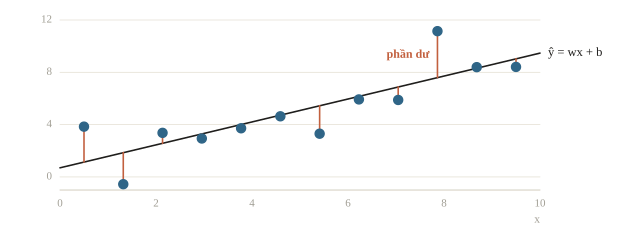
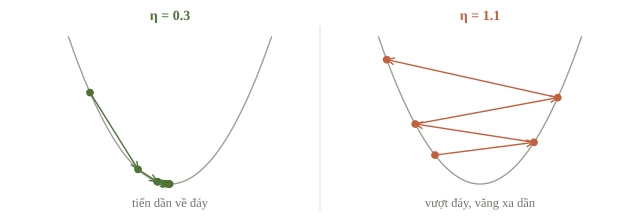
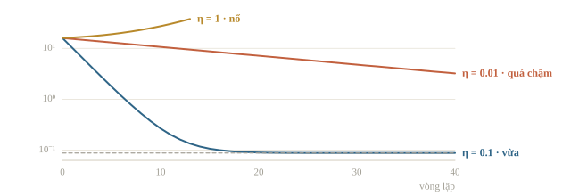
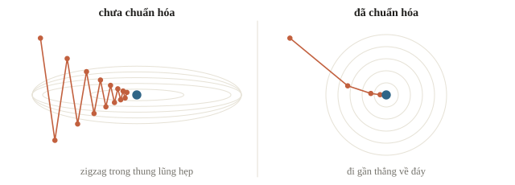
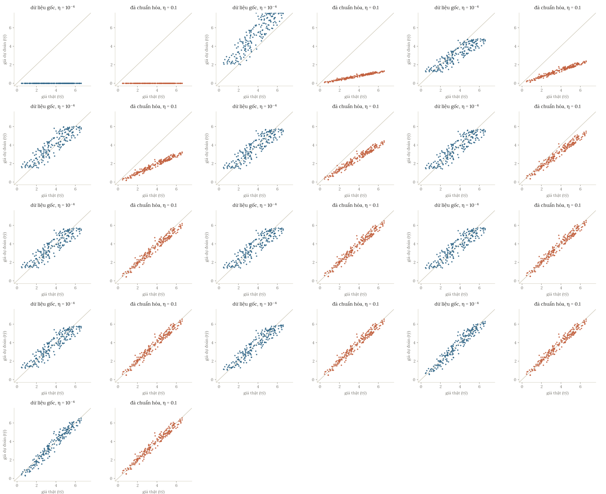
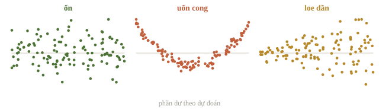
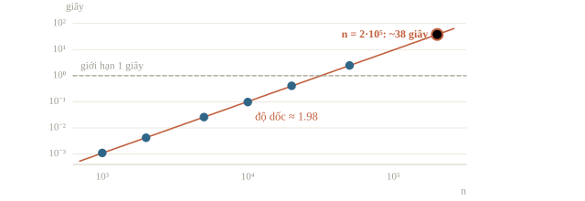

<!-- title -->
# Linear regression

Định giá căn hộ từ diện tích và khoảng cách

Chương 2 · Bài 2.1

---
<!-- split -->
## Giá này cao hay thấp?

Một căn hộ **70 m²**, cách trung tâm **8 km**, rao bán **4,2 tỷ**.

Có giá của **200 căn** đã bán quanh đó (dữ liệu giả lập).

|||

Căn rộng hơn thì đắt hơn, xa trung tâm thì rẻ hơn.

Linear regression viết cách ước lượng ấy thành công thức và tìm hệ số từ dữ liệu.

---
## Mục tiêu

- Hiểu model tuyến tính và ý nghĩa từng hệ số.
- Tìm hệ số bằng công thức nghiệm và bằng gradient descent.
- Biết vì sao learning rate quá lớn làm loss tăng vọt, và vì sao cần chuẩn hóa đặc trưng.
- Dùng scikit-learn và tự cài lại bằng NumPy.

---
<!-- section 1 -->
# Dữ liệu và mô hình

---
<!-- split -->
## Mô hình tuyến tính

Mỗi đặc trưng đóng góp một lượng tỉ lệ với nó, rồi cộng lại:

$$\hat{y} = w_1 x_1 + \dots + w_d x_d + b = \mathbf{w}^\top \mathbf{x} + b$$

$w_j$: dự đoán tăng bao nhiêu khi $x_j$ tăng 1 đơn vị **và các đặc trưng khác giữ nguyên**.

|||

Cho cả $n$ mẫu cùng lúc:

$$\hat{\mathbf{y}} = X\mathbf{w} + b$$

| Ký hiệu | Shape |
|---|---|
| $X$ | `(n, d)` |
| $\mathbf{w}$ | `(d,)` |
| $\hat{\mathbf{y}}$, $\mathbf{y}$ | `(n,)` |

---
<!-- split -->
## Dữ liệu của buổi học

Tự sinh 200 căn theo một công thức biết trước, cộng nhiễu:

$$\text{giá} = 0.05 \cdot \text{diện tích} - 0.15 \cdot \text{khoảng cách} + 1$$

Biết trước đáp án thì kiểm tra được mô hình học đúng hay sai.

|||

```python
rng = np.random.default_rng(0)
n = 200
area = rng.uniform(30, 120, n)
dist = rng.uniform(1, 15, n)
y = 0.05 * area - 0.15 * dist + 1.0 \
    + rng.normal(0, 0.3, n)
X = np.column_stack([area, dist])
print(X.shape, y.shape)
```

```output
(200, 2) (200,)
```

---
<!-- quiz -->
::: quiz
`X` có shape `(200, 2)`, `w` có shape `(2,)`. `X @ w + b` có shape gì?
- [x] `(200,)`
- [ ] `(2,)`
- [ ] `(200, 2)`
- [ ] `(200, 1)`
Mỗi hàng của `X` nhân vô hướng với `w` cho ra một số, nên 200 hàng cho 200 số. NumPy không tự thêm chiều thứ hai.
:::

---
<!-- section 2 -->
# Hàm mất mát

---
## Mean squared error

$$J(\mathbf{w}, b) = \frac{1}{n}\sum_{i=1}^{n}\left(\hat y_i - y_i\right)^2$$

Vì sao bình phương?

- Trơn, đạo hàm được ở mọi điểm.
- Phạt lỗi lớn nặng hơn: sai 10 bị phạt gấp 4 lần sai 5.
- Nếu phần nhiễu độc lập, trung bình bằng 0 và có cùng phương sai theo điều kiện trên đặc trưng, MSE tương ứng với maximum likelihood dưới giả định Gaussian.

Nhược điểm: nhạy với outlier.

---
<!-- figure -->
## Phần dư trên một đường thẳng



---
<!-- center -->
## Mốc so sánh

Mô hình đoán mọi căn bằng giá trung bình có

$$\text{MSE} = \operatorname{Var}(y) = 2.34$$

Trên cùng tập chấm, mô hình có MSE lớn hơn mốc này chưa cải thiện sai số so với dự đoán hằng số.

$$R^2 = 1 - \frac{\text{MSE}}{\operatorname{Var}(y)}$$

$R^2 = 0$: ngang mốc · $R^2 = 1$: đoán trúng hết

---
<!-- quiz -->
::: quiz
Đổi đơn vị giá từ tỷ đồng sang triệu đồng, tức nhân mọi $y$ với 1000. MSE thay đổi thế nào?
- [ ] Không đổi
- [ ] Tăng 1000 lần
- [x] Tăng $10^6$ lần
- [ ] Giảm 1000 lần
Mỗi phần dư nhân 1000, bình phương lên thành $10^6$. Vì vậy người ta hay báo RMSE, cùng đơn vị với giá.
:::

---
<!-- section 3 -->
# Nghiệm đóng

---
<!-- center -->
## Phương trình chuẩn

Thêm cột 1 vào $X$: $\tilde X = [X \;\; \mathbf{1}]$, gộp $\boldsymbol\theta = (\mathbf{w}, b)$, khi đó $\hat{\mathbf{y}} = \tilde X\boldsymbol\theta$.

Cực tiểu của $J$ là nơi gradient bằng 0:

$$\nabla J(\boldsymbol\theta) = \frac{2}{n}\tilde X^\top(\tilde X\boldsymbol\theta - \mathbf{y}) = \mathbf{0} \quad\Longleftrightarrow\quad \tilde X^\top \tilde X\,\boldsymbol\theta = \tilde X^\top \mathbf{y}$$

Nếu các cột của $\tilde X$ độc lập, hệ có nghiệm duy nhất và có thể giải bằng `np.linalg.solve`. Với hệ suy biến hoặc điều kiện kém, dùng `lstsq`/QR/SVD thay cho nghịch đảo ma trận.

---
<!-- split -->
## Giải trên dữ liệu căn hộ

```python
Xb = np.column_stack([X, np.ones(n)])
theta = np.linalg.solve(Xb.T @ Xb, Xb.T @ y)
w_cf, b_cf = theta[:2], theta[2]
print(w_cf.round(4), round(b_cf, 4))
print(mse(predict(X, w_cf, b_cf), y))
print(predict(np.array([70, 8]), w_cf, b_cf))
```

```output
[ 0.0499 -0.1453] 0.9809
0.08807615180405967
3.309815169606732
```

|||

- Hệ số $\approx (0.05,\ -0.15,\ 1)$: khôi phục đúng công thức sinh dữ liệu.
- MSE $0.088 \approx 0.3^2$: nhiễu độc lập không dự đoán được cho căn mới; train noise vẫn có thể bị học thuộc.
- Căn 70 m², 8 km: mô hình định giá **3,3 tỷ**. Rao 4,2 tỷ là cao hơn 0,9 tỷ.

---
## Cách nhìn hình học

$\mathbf{y}$ là một vector trong không gian $n$ chiều. Mọi dự đoán $\tilde X\boldsymbol\theta$ nằm trên mặt phẳng sinh bởi các cột của $\tilde X$.

Least squares chọn **hình chiếu vuông góc** của $\mathbf{y}$ lên mặt phẳng đó.

Phần dư vuông góc với mọi cột, kể cả cột số 1, nên tổng phần dư bằng 0.

---
<!-- figure -->
## Hình chiếu vuông góc


---
<!-- quiz -->
::: quiz
Thêm vào `X` một cột “diện tích tính bằng dm²”, đúng bằng 100 lần cột diện tích. Nghiệm đóng sẽ ra sao?
- [ ] Chính xác hơn, vì có thêm một cột thông tin
- [ ] Không đổi gì, cột mới chỉ nhận hệ số 0
- [x] Ma trận suy biến, hệ số có thể rất lớn và trái dấu
- [ ] Chỉ chạy chậm hơn một chút vì thêm một cột
Cột mới chỉ là cột cũ nhân 100. Có vô số cách chia trọng số cho hai cột mà dự đoán vẫn y hệt, nên $\tilde X^\top\tilde X$ suy biến. `solve` nếu vẫn chạy thì trả về những hệ số rất lớn, trái dấu.
:::

---
<!-- section 4 -->
# Gradient descent

---
<!-- split -->
## Đi xuống trong sương mù

Không thấy đáy, chỉ cảm nhận độ dốc dưới chân: bước một bước nhỏ về phía dốc xuống, rồi lặp lại.

Với $r_i = \hat y_i - y_i$:

$$\frac{\partial J}{\partial \mathbf{w}} = \frac{2}{n} X^\top \mathbf{r}, \qquad \frac{\partial J}{\partial b} = \frac{2}{n}\sum_i r_i$$

$$\mathbf{w} \leftarrow \mathbf{w} - \eta\,\frac{\partial J}{\partial \mathbf{w}}, \qquad b \leftarrow b - \eta\,\frac{\partial J}{\partial b}$$

|||

```python
def grad(theta, X, y):
    r = predict(X, theta[:-1], theta[-1]) - y
    return np.append(2 / len(y) * X.T @ r,
                     2 * r.mean())

def gd(X, y, lr, epochs):
    theta = np.zeros(X.shape[1] + 1)
    history = []
    for _ in range(epochs):
        history.append(loss(theta, X, y))
        theta -= lr * grad(theta, X, y)
    return theta, history
```

---
<!-- quiz -->
::: quiz
Đặt `r = y_hat - y`. Dòng nào cập nhật bias đúng?
- [x] `b -= lr * 2 * r.mean()`
- [ ] `b += lr * 2 * r.mean()`
- [ ] `b -= lr * 2 * r.sum()`
- [ ] `b -= lr * r`
`r.mean()` dương nghĩa là đang đoán cao, nên phải trừ bớt `b`. Dùng `r.sum()` thì bước lớn gấp $n$ lần.
:::

---
<!-- split -->
## Tính tay trên lớp

Ba điểm $(1, 2)$, $(2, 3)$, $(3, 5)$.

1. Tìm đường least squares $\hat y = wx + b$.
2. Từ $w = b = 0$, $\eta = 0.1$, làm một bước gradient descent.

|||

Công thức cho một đặc trưng:

$$w = \frac{\sum (x_i - \bar x)(y_i - \bar y)}{\sum (x_i - \bar x)^2}, \qquad b = \bar y - w \bar x$$

---
<!-- split -->
## Lời giải

$\bar x = 2$, $\bar y = 10/3$, tử số $= 3$, mẫu số $= 2$:

$$w = 1.5, \qquad b = \tfrac{1}{3}, \qquad J = 0.056$$

|||

Tại $w = b = 0$: $r = (-2, -3, -5)$,

$$\frac{\partial J}{\partial w} = -\frac{46}{3}, \qquad \frac{\partial J}{\partial b} = -\frac{20}{3}$$

Sau một bước: $w = 1.53$, $b = 0.67$, loss từ $12.67$ xuống $0.22$.

---
<!-- split -->
## Kiểm tra gradient

Xấp xỉ đạo hàm chỉ bằng hàm loss, như viết code trâu để đối chiếu:

$$\frac{\partial J}{\partial \theta_j} \approx \frac{J(\boldsymbol\theta + h\mathbf{e}_j) - J(\boldsymbol\theta - h\mathbf{e}_j)}{2h}$$

Sai số $O(h^2)$, chọn $h \approx 10^{-5}$.

|||

| Phiên bản `grad` | Sai số tương đối |
|---|---|
| Đúng | $7 \cdot 10^{-13}$ |
| Quên hệ số 2 | $0.333$ |

Sai số nhỏ xác nhận đạo hàm tại điểm đã kiểm. Kiểm vài điểm và thang bước sai phân; bước quá nhỏ có thể tăng sai số số học.

---
<!-- quiz -->
::: quiz
Vì sao ta dùng sai phân trung tâm $\frac{J(\theta + h) - J(\theta - h)}{2h}$ thay vì $\frac{J(\theta + h) - J(\theta)}{h}$?
- [ ] Vì tính nhanh hơn
- [x] Vì sai số là $O(h^2)$ thay vì $O(h)$
- [ ] Vì không phải chọn $h$
- [ ] Vì sai phân một phía có thể ra số âm
Trừ hai khai triển Taylor cho nhau, các số hạng bậc chẵn triệt tiêu, nên sai số chỉ còn $O(h^2)$.
:::

---
<!-- section 5 -->
# Learning rate và chuẩn hóa

---
<!-- split -->
## Thử ba learning rate

```python
for lr in [1e-3, 2e-4, 1e-4]:
    theta_gd, hist = gd(X, y, lr, 1000)
    print(f"lr={lr:g}, loss={hist[-1]:.4g}")
```

```output
lr=0.001, loss=nan
lr=0.0002, loss=inf
lr=0.0001, loss=0.1541
```

|||

- Hai giá trị đầu: loss nổ tung.
- $10^{-4}$: hội tụ nhưng rất chậm; sau 1000 vòng, $b$ mới đi được $0.01$ trên đường tới $0.98$.

Có đoán trước được không?

---
## Ngưỡng của learning rate

Hessian của $J$ là hằng số $H = \frac{2}{n}\tilde X^\top\tilde X$. Mỗi bước nhân sai số theo hướng ứng với trị riêng $\lambda$ với $(1 - \eta\lambda)$, nên cần

$$0<\eta < \frac{2}{\lambda_{\max}}$$

Dữ liệu căn hộ: ngưỡng $= 1.43 \cdot 10^{-4}$, số điều kiện $\kappa = \lambda_{\max}/\lambda_{\min} \approx 10^5$.

---
<!-- figure -->
## Bước vừa phải và bước quá lớn



---
<!-- quiz -->
::: quiz
Linear regression tối ưu MSE, loss qua các vòng là 15.9, 41.2, 260, 17 000, rồi NaN. Shape và công thức gradient đều đã kiểm. Ta nên thử gì trước?
- [ ] Tăng learning rate để vượt qua vùng loss cao
- [ ] Giữ learning rate, chỉ đổi seed vài lần
- [x] Giảm learning rate, và kiểm thang đo của các feature
- [ ] Tăng số vòng để loss có thời gian ổn định
Loss tăng theo cấp số nhân là dấu hiệu bước quá lớn, tức $\eta > 2/\lambda_{\max}$. Feature chênh thang đo làm $\lambda_{\max}$ phình to.
:::

---
## Chuẩn hóa đặc trưng

$$z_j = \frac{x_j - \mu_j}{\sigma_j}$$

| | Dữ liệu gốc | Đã chuẩn hóa |
|---|---|---|
| Số điều kiện | $10^5$ | $1.1$ |
| Ngưỡng $\eta$ | $1.4 \cdot 10^{-4}$ | $0.95$ |
| Số vòng tới sát đáy | ~180 000 | 28 |

$\mu, \sigma$ tính trên tập train, dùng lại cho test.

---
<!-- figure -->
## Sau chuẩn hóa: ba learning rate



---
<!-- figure -->
## Thung lũng hẹp thành cái bát tròn



---

<!-- figure -->
## Cùng gradient descent, hai thang đo



---
<!-- quiz -->
::: quiz
Chuẩn hóa feature rồi học lại cho tới khi MSE chạm đáy. So với mô hình học trên dữ liệu gốc, cái gì thay đổi?
- [ ] Dự đoán chính xác hơn, vì thang đo tốt hơn
- [ ] Trọng số giữ nguyên, chỉ bias đổi theo trung bình
- [x] Dự đoán y hệt, chỉ cách viết trọng số và tốc độ của gradient descent đổi
- [ ] `LinearRegression` của scikit-learn cũng hội tụ nhanh hơn
Đổi biến tuyến tính không làm đổi tập mô hình, nên đáy vẫn cho cùng dự đoán. `LinearRegression` giải trực tiếp, không lặp, nên chẳng có gì để “hội tụ nhanh hơn”.
:::

---
<!-- section 6 -->
# Thực hành và đọc kết quả

---
<!-- split -->
## Dùng scikit-learn

```python
X_tr, X_te, y_tr, y_te = train_test_split(
    X, y, test_size=0.2, random_state=0)
model = LinearRegression().fit(X_tr, y_tr)
print(model.score(X_tr, y_tr),
      model.score(X_te, y_te))
```

```output
0.9604123189943734 0.9689505848749018
```

Kết quả trùng với code tự viết: `np.allclose` cho `True`.

Hai số lần lượt là $R^2$ train và test. Test cao hơn train có thể xảy ra do cách chia ngẫu nhiên, không tự là lỗi code.

|||

Đọc hệ số cho đúng:

- Hệ số phụ thuộc đơn vị; muốn so sánh thì chuẩn hóa trước.
- Hệ số là mối liên hệ khi giữ các biến khác cố định, **không phải nhân quả**.
- Luôn vẽ phần dư theo dự đoán.

---
<!-- figure -->
## Đồ thị phần dư



---
<!-- quiz -->
::: quiz
Linear regression cho hệ số dương giữa số kem bán ra và số vụ đuối nước mỗi tuần. Chỉ từ kết quả này, ta kết luận được gì?
- [ ] Giảm bán kem sẽ giảm số vụ đuối nước đúng theo hệ số
- [ ] Ăn kem làm tăng nguy cơ đuối nước khi bơi
- [ ] Nhiệt độ chắc chắn là nguyên nhân duy nhất của cả hai
- [x] Hai đại lượng cùng tăng, còn tác động của kem thì chưa biết
Hệ số học từ dữ liệu quan sát chỉ nói hai đại lượng đi cùng nhau, không nói điều gì xảy ra nếu ta can thiệp.
:::

---
## Đoán độ phức tạp trước khi nộp

“Tuyến tính” là theo tham số; đặc trưng có thể là $x^2$, $\log x$, $x_1 x_2$.

Nếu $t \approx C n^k$ thì

$$\log t = k \log n + \log C$$

Hồi quy trên trục log–log: hệ số góc $\approx 1.98$, gợi tăng gần bậc hai trong miền đo. Với $n = 2 \cdot 10^5$: ngoại suy khoảng 38 giây; chưa là chứng minh Big-O.

---
<!-- figure -->
## Độ dốc trên trục log–log



---
<!-- quiz -->
::: quiz
Sau khi tạo thêm feature, mô hình nào **không** giải được bằng code linear regression của bài này?
- [ ] $\hat y = w_1 x + w_2 x^2 + b$
- [ ] $\hat y = w_1 \log x + b$
- [ ] $\hat y = w_1 x_1 x_2 + w_2 x_1 + b$
- [x] $\hat y = e^{w x} + b$
Ba mô hình đầu tuyến tính theo $w$, chỉ cần tạo thêm cột. Ở mô hình cuối, $w$ nằm trong hàm mũ.
:::

---
## Khi đi thi

- **Baseline cho hồi quy**: thử `LinearRegression` trên feature số và so với mốc hằng số.
- **Loss nổ**: chuẩn hóa đặc trưng trước, chỉnh learning rate sau.
- **Target không âm, metric RMSLE**: cân nhắc $\log(1 + y)$; kiểm miền prediction và quy ước scorer.
- **Ngoại suy**: mô hình tuyến tính kéo xu hướng ra ngoài vùng dữ liệu, mô hình cây thì không.
- **Tự viết thì tự kiểm**: kiểm shape và gradient trên dữ liệu nhỏ trước khi chạy thật.

---
## Tóm tắt

- $\hat y = \mathbf{w}^\top\mathbf{x} + b$, học bằng cách cực tiểu MSE; $R^2$ so với mốc đoán trung bình.
- Nghiệm đóng: giải $\tilde X^\top\tilde X\boldsymbol\theta = \tilde X^\top\mathbf{y}$ bằng `solve`; về hình học là phép chiếu vuông góc.
- Gradient descent hội tụ khi $\eta < 2/\lambda_{\max}$; chuẩn hóa đặc trưng kéo số điều kiện về gần 1.
- Dùng scikit-learn với train/test; hệ số là liên hệ, không phải nhân quả.

---
<!-- section 7 -->
# Luyện đề

---
<!-- quiz -->
::: quiz Luyện đề 1
Với $L(\theta) = N^{-1}\sum_{n=0}^{N-1}(y_n - \theta^\top x_n)^2$, gradient theo $\theta$ là gì?
- [ ] $\frac{2}{N}\sum(\theta^\top x_n - y_n)$
- [x] $\frac{2}{N}\sum(\theta^\top x_n - y_n)x_n$
- [ ] $\frac{2}{N}\sum(y_n - \theta^\top x_n)x_n$
- [ ] $\frac{1}{N}\sum(\theta^\top x_n - y_n)x_n$
Đạo hàm của bình phương cho hệ số 2, dấu theo hiệu dự đoán trừ target, rồi nhân với $x_n$.
Đề thi: [USA-NA-AIO 2026 · Vòng 1 · Part 4.2](https://www.usaaio.org/attachments/past-problems/2026/usaaio-2026-round-1-problems.pdf#page=8)
:::

---
<!-- quiz -->
::: quiz Luyện đề 2
Công thức nghiệm $\boldsymbol\theta^\ast = (\tilde X^\top\tilde X)^{-1}\tilde X^\top\mathbf y$ dùng được khi nào?
- [ ] Luôn luôn, với mọi ma trận dữ liệu
- [ ] Khi $\tilde X$ vuông, tức số mẫu bằng số cột
- [x] Khi các cột của $\tilde X$ độc lập tuyến tính
- [ ] Khi $\tilde X$ đối xứng qua đường chéo
Cần $\tilde X^\top\tilde X$ khả nghịch, tức các cột của $\tilde X$ độc lập tuyến tính. Cột diện tích theo dm² phá đúng điều kiện này.
Đề thi: [NOAI 2026 Singapore · Vòng sơ loại · Câu 34](https://aisingapore.org/wp-content/uploads/2026/04/NOAI-2026-Preliminary-Round-Assessment-300-MCQs-Google-Forms.pdf#page=16)
:::

---
<!-- quiz -->
::: quiz Luyện đề 3
Hệ phương trình chuẩn của một bộ dữ liệu có số điều kiện cỡ $10^{10}$. Vì sao điều này đáng lo khi giải bằng máy?
- [ ] Ma trận chắc chắn suy biến, nên hệ vô nghiệm
- [ ] Định thức cỡ $10^{10}$ nên phép tính bị tràn số
- [ ] Ma trận có quá nhiều phần tử khác 0 nên chạy chậm
- [x] Sai số nhỏ ở dữ liệu có thể thành sai số lớn ở nghiệm
$\kappa$ cho biết sai số nhỏ ở đầu vào, kể cả sai số làm tròn, có thể bị phóng to bao nhiêu lần ở nghiệm. Với $\kappa$ cỡ $10^{10}$, float64 chỉ còn khoảng 6 chữ số đáng tin, dù ma trận vẫn khả nghịch.
Đề thi: [NOAI 2026 Singapore · Vòng sơ loại · Câu 35](https://aisingapore.org/wp-content/uploads/2026/04/NOAI-2026-Preliminary-Round-Assessment-300-MCQs-Google-Forms.pdf#page=16)
:::

---
<!-- center -->
## Sau giờ học

Làm **10 câu cuối bài**.

Chạy notebook của bài: đổi learning rate, thử bỏ bước chuẩn hóa, xem kết quả đổi ra sao.
