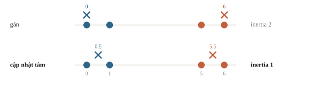
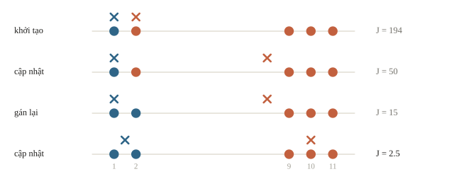
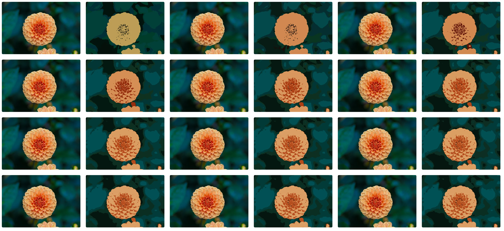
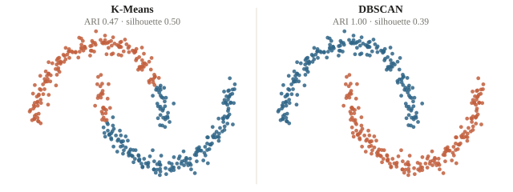
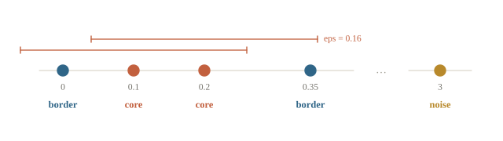
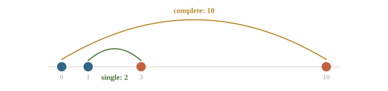
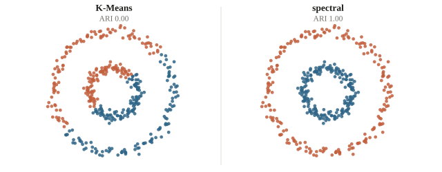
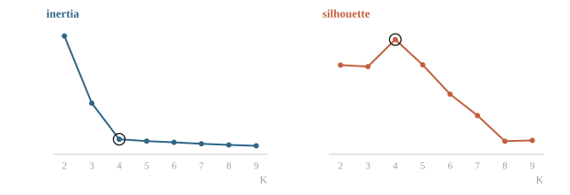

<!-- title -->
# Clustering

Tính một vòng gán/cập nhật K-Means và inertia.

Chương 2 · Bài 2.10

---
<!-- split -->
## Nhóm nào có ý nghĩa?

Có hồ sơ học nhưng chưa có nhãn nhóm.

Thuật toán gợi một cách chia; con người kiểm và đặt tên.

|||
Chọn clustering là chọn định nghĩa “cụm”.

Hai thuật toán có thể đúng theo hai giả định khác nhau.

---
<!-- section 1 -->
# K-Means

---
<!-- center -->
## K-Means tối ưu điều gì?

Giả sử có $K$ tâm $\boldsymbol\mu_k$. Inertia là tổng bình phương khoảng cách đến tâm gần nhất:

$$J=\sum_i\min_k\lVert\mathbf x_i-\boldsymbol\mu_k\rVert^2.$$

Lloyd lặp gán điểm rồi cập nhật tâm. Mỗi bước không làm $J$ tăng, nhưng khởi tạo khác có thể dừng ở cực tiểu địa phương.

`k-means++` chọn tâm kế tiếp với xác suất tỉ lệ bình phương khoảng cách đến tâm gần nhất; `n_init` giữ nghiệm có inertia nhỏ nhất.

---
<!-- quiz -->
::: quiz
Có ba điểm trên trục số: 0, 1 và 10. k-means++ đã chọn tâm đầu tiên là 0. Xác suất điểm 10 được chọn làm tâm thứ hai là bao nhiêu?
- [ ] khoảng $0.33$
- [ ] khoảng $0.91$
- [x] khoảng $0.99$
- [ ] khoảng $0.01$
Bình phương khoảng cách là 0, 1, 100, nên xác suất là $100/101$. Ra $0.91$ là quên bình phương.
:::

---
<!-- quiz -->
::: quiz
Tăng $K$ lên bằng số điểm $n$, mỗi điểm có một tâm riêng. Inertia tối ưu khi ấy bằng bao nhiêu?
- [ ] Bằng phương sai của dữ liệu
- [x] $0$
- [ ] Bằng $n$
- [ ] Không xác định, vì cụm quá nhỏ
Mỗi điểm trùng tâm của nó nên inertia bằng 0. Vì thế không chọn $K$ theo inertia nhỏ nhất.
:::

---
<!-- figure -->
## Gán điểm rồi cập nhật tâm



---
<!-- split -->
## Một vòng trên giấy

Điểm: 0,1,5,6. Tâm đầu: 0,6.

Gán: [0,0,1,1].

|||
Tâm mới: 0.5,5.5.

Inertia: 2 → 1.

Gán xong mới cập nhật; mean là điểm làm tổng bình phương khoảng cách nhỏ nhất.

---
<!-- split -->
## Đối chiếu trên máy

Bốn điểm 0, 1, 5, 6 và hai tâm ban đầu 0, 6 của ví dụ tính tay.

```python
delta = (
    values[:, None, :] - centers[None, :, :]
)
distance2 = np.sum(delta ** 2, axis=2)
assigned = np.argmin(distance2, axis=1)
new_centers = np.array([
    values[assigned == k].mean(axis=0)
    for k in range(2)
])
print(assigned.tolist())
print(new_centers.ravel().tolist())
```

|||

```output
[0, 0, 1, 1]
[0.5, 5.5]
```

Đối chiếu từng bước với phép tính tay.

---
<!-- quiz -->
::: quiz
Tự cài Lloyd bằng NumPy, tới một vòng thì có một cụm không được gán điểm nào. Xử lý thế nào là hợp lý?
- [ ] Coi tâm NaN là 0 rồi chạy tiếp
- [x] Đặt lại tâm theo một quy tắc được ghi rõ
- [ ] Lấy bớt vài điểm của cụm khác chia sang
- [ ] Chia tổng tọa độ cho $K$ thay vì cho số điểm
Trung bình của một tập rỗng không cho ra tâm nào. Giữ tâm cũ, hoặc chuyển tâm tới điểm đang xa tâm của nó nhất, miễn là ghi rõ quy tắc.
:::

---
<!-- split -->
## Khởi tạo tệ: tự sửa hay kẹt?

Điểm $1,2,9,10,11$; tâm đầu $1, 2$.

Điểm 2 chuyển cụm ở vòng hai; dừng ở $\{1,2\},\{9,10,11\}$.

$J$: $194\to50\to15\to2.5$.

|||
Đổi điểm 2 thành 5 thì may mắn biến mất.

Lloyd luôn dừng, nhưng không hứa dừng ở nghiệm tốt nhất.

---
<!-- figure -->
## Bốn bước của Lloyd



---

<!-- figure -->
## Lloyd gom màu của ảnh thật



---
<!-- quiz -->
::: quiz
Giữ khởi tạo $\mu_1 = 1$, $\mu_2 = 2$, nhưng đổi điểm 2 thành 5, tức dữ liệu là 1, 5, 9, 10, 11. Thuật toán Lloyd dừng ở cách chia nào?
- [ ] $\{1, 5\}$ và $\{9, 10, 11\}$
- [x] $\{1\}$ và $\{5, 9, 10, 11\}$
- [ ] $\{1, 5, 9\}$ và $\{10, 11\}$
- [ ] Không dừng, các tâm dao động mãi
Sau vòng đầu $\mu_2 = 8.75$. Điểm 5 gần $\mu_2$ hơn (3.75 so với 4) nên không đổi cụm, và Lloyd kẹt ở cực tiểu địa phương.
:::

---
<!-- figure -->
## Cụm tròn hay cụm cong?



K-Means thích cụm tròn, kích thước gần nhau. Trên hai nửa hình trăng, DBSCAN có thể theo mật độ còn K-Means chia theo vùng gần tâm.

---
<!-- section 2 -->
# DBSCAN

---
<!-- figure -->
## Core, border và noise



`eps` là bán kính lân cận; `min_samples` là số điểm tối thiểu trong bán kính, tính cả chính điểm xét theo quy ước sklearn. Core nối thành cụm; border được nối từ core; noise nhận nhãn `-1`.

---
<!-- quiz -->
::: quiz
Dữ liệu có hai cụm. Cụm A dày, các láng giềng thường cách nhau $0.1$. Cụm B thưa, các láng giềng thường cách nhau $0.8$. Với `eps=0.2`, DBSCAN dễ cho ra kết quả nào?
- [ ] Cả hai cụm đều được tìm đúng
- [ ] B thành cụm, còn phần lớn A thành noise
- [x] A thành cụm, còn phần lớn B thành noise
- [ ] A và B bị gộp thành một cụm
Với bán kính 0.2, điểm của B hiếm khi đủ hàng xóm nên phần lớn thành noise. Một `eps` không phục vụ được cả hai mật độ.
:::

---
<!-- split -->
## Đọc output

Điểm: 0,0.1,0.2,0.35,3.

eps=0.16, min_samples=3.

|||
Core: chỉ số 1,2.

Điểm 0 và 0.35 là border.

Giá trị 3 là noise (nhãn −1).

Điểm 0 chỉ có hai điểm trong lân cận nhưng vẫn vào cụm vì nối được với core 0.1.

---
<!-- quiz -->
::: quiz
Giữ `eps=0.16` như ví dụ trên, nhưng đặt `min_samples=1`. Điểm 3 nhận nhãn gì?
- [ ] $-1$, vì vẫn ở xa mọi điểm khác
- [ ] Cụm 0, cùng với bốn điểm còn lại
- [ ] Báo lỗi, vì `min_samples` quá nhỏ
- [x] Một cụm riêng, chỉ có mình nó
Ngưỡng 1 thì điểm nào cũng tự đếm chính nó, nên điểm nào cũng là core. Điểm 3 thành cụm riêng.
:::

---
<!-- section 3 -->
# Phân cấp và spectral

---
<!-- split -->
## Gộp dần hay cắt đồ thị?

Agglomerative: mỗi điểm một cụm, gộp dần hai cụm gần nhất.

Linkage: *single* (cặp gần nhất), *complete* (cặp xa nhất), *average*, *Ward*.

|||
Spectral: dựng đồ thị láng giềng, lấy vector riêng của Laplacian làm tọa độ, rồi K-Means.

Mạnh với cụm không lồi; tốn kém khi $n$ lớn.

---
<!-- figure -->
## Single và complete



---
<!-- figure -->
## Hai vòng đồng tâm



---
<!-- quiz -->
::: quiz
Hai cụm trên trục số là $\{0, 1\}$ và $\{3, 10\}$. Khoảng cách giữa chúng theo single linkage và theo complete linkage lần lượt là bao nhiêu?
- [ ] $3$ và $9$
- [ ] $6$ và $6$
- [ ] $2$ và $6$
- [x] $2$ và $10$
Single linkage lấy cặp gần nhất, $|1 - 3| = 2$. Complete linkage lấy cặp xa nhất, $|0 - 10| = 10$.
:::

---
<!-- quiz -->
::: quiz
Hai vòng tròn đồng tâm, mỗi vòng là một cụm. K-Means với $K = 2$ cho ARI gần bằng 0, còn spectral clustering trên đồ thị láng giềng thì tách đúng. Lý do chính là gì?
- [x] Đồ thị láng giềng gần như không có cạnh nối hai vòng
- [ ] Spectral clustering dùng nhiều tâm hơn K-Means
- [ ] Vòng trong có mật độ điểm cao hơn vòng ngoài
- [ ] K-Means không chạy được trên dữ liệu hai chiều
Mọi cách chia theo tâm gần nhất đều cắt ngang cả hai vòng. Trong đồ thị láng giềng, mỗi vòng gần như là một thành phần riêng.
:::

---
<!-- section 4 -->
# Đánh giá cách chia

---
<!-- split -->
## Metric trả lời câu nào?

Có nhãn tham khảo: ARI, không phụ thuộc tên ID cụm.

Không nhãn: silhouette, cần điều kiện số cụm và cách xử lý noise.

|||
Inertia nhỏ nhất tự đẩy về K lớn.

Elbow là gợi ý, không định lý về K thật.

Cụm số 0 chưa có nghĩa là “giỏi”.

$s(i)=\frac{b(i)-a(i)}{\max\{a(i),b(i)\}}$: gần 1 là gọn và tách, gần 0 là ở giữa, âm là có thể xếp nhầm.

---
<!-- figure -->
## Chọn K



---
<!-- quiz -->
::: quiz
Một điểm có $a(i) = 1$, tức khoảng cách trung bình tới cụm của nó, và $b(i) = 4$, tức khoảng cách trung bình tới cụm khác gần nhất. Silhouette của điểm này bằng bao nhiêu?
- [ ] $0.25$
- [ ] $3$
- [x] $0.75$
- [ ] $-0.75$
$(4 - 1)/\max(1, 4) = 0.75$. Đổi chỗ $a$ và $b$ thì ra $-0.75$.
:::

---
<!-- quiz -->
::: quiz
Nhãn tham khảo là $[0, 0, 1, 1]$, mô hình trả về $[1, 1, 0, 0]$. Accuracy so thẳng và ARI lần lượt bằng bao nhiêu?
- [x] $0$ và $1$
- [ ] $1$ và $1$
- [ ] $0$ và $0$
- [ ] $0.5$ và $0$
Hai cách chia giống hệt nhau, chỉ khác tên. Accuracy so từng ID nên bằng 0, ARI xét từng cặp nên bằng 1.
:::

---
<!-- split -->
## Cùng dữ liệu, metric có thể trái chiều

```output
K-Means ARI = 0.47  silhouette = 0.5
DBSCAN  ARI = 1.0  silhouette = 0.39
```

Trên `make_moons`, DBSCAN khớp nhãn tham khảo tốt hơn theo ARI dù silhouette thấp hơn. Metric phải khớp câu hỏi và cách xử lý noise.

|||
Nếu có nhãn tham khảo, ARI/NMI không phụ thuộc tên ID cụm. Nếu không có nhãn, silhouette chỉ đo một khía cạnh hình học.

`eps=0.3` chỉ có nghĩa sau `StandardScaler`.

---
<!-- quiz -->
::: quiz
Trong code trên, nhân `X` đã chuẩn hóa lên 10 lần nhưng giữ `eps=0.3`. DBSCAN sẽ trả về gì?
- [x] Gần như mọi điểm thành noise
- [ ] Như cũ, vì hình dạng các cụm không đổi
- [ ] Hai mặt trăng bị gộp thành một cụm
- [ ] Số cụm tăng lên khoảng mười lần
Khoảng cách tăng 10 lần mà bán kính giữ nguyên, nên hầu hết điểm không đủ hàng xóm và thành noise.
:::

---
## Khi đi thi

- Chấm bằng ARI/NMI: chọn thuật toán theo hình dạng dữ liệu, không mặc định K-Means.
- Cụm làm tiền xử lý hay đặc trưng: mã cụm, khoảng cách đến tâm.
- Cụm làm group cho `GroupKFold` khi có bản ghi gần trùng.
- Chuẩn hóa trước thuật toán dựa trên khoảng cách; fit scaler đúng giao thức.

---
<!-- section 5 -->
# Luyện đề

---
<!-- quiz -->
::: quiz Luyện đề 1
Có bảy điểm $x_1, \dots, x_7$, $K = 2$, hai tâm khởi tạo là $x_3$ và $x_6$. Khoảng cách từ $x_1, x_2, x_4, x_5, x_7$ tới $x_3$ lần lượt là 3, 4, 4, 3, 6. Tới $x_6$ lần lượt là 2, 7, 1, 8, 1. Sau bước gán đầu tiên, hai cụm là gì?
- [ ] $\{x_1, x_2, x_3, x_4\}$ và $\{x_5, x_6, x_7\}$
- [x] $\{x_2, x_3, x_5\}$ và $\{x_1, x_4, x_6, x_7\}$
- [ ] $\{x_1, x_2, x_3, x_5\}$ và $\{x_4, x_6, x_7\}$
- [ ] $\{x_2, x_3, x_4, x_7\}$ và $\{x_1, x_5, x_6\}$
$x_1$, $x_4$, $x_7$ gần $x_6$ hơn. $x_2$, $x_5$ gần $x_3$ hơn. Bước gán chỉ cần so khoảng cách.
Phỏng theo: [CMU 10-601 · Exam 3 Practice · Q8.3](https://www.cs.cmu.edu/~mgormley/courses/10601/handout/exam3_practice_problems.pdf#page=46)
:::

---
<!-- quiz -->
::: quiz Luyện đề 2
Mỗi bộ dữ liệu gồm 400 điểm $(x, y)$ sinh từ bốn hàm: mũ, log, sin và tuyến tính, mỗi hàm 100 điểm có nhiễu. Baseline của đề chạy K-Means với $k = 4$ trên $(x, y)$, rồi fit riêng từng cụm. Bước phân cụm này yếu ở đâu?
- [ ] $k = 4$ là sai, vì đề chưa cho số hàm thật
- [ ] K-Means không chạy được trên dữ liệu hai chiều
- [ ] Thiếu chuẩn hóa $y$ nên K-Means báo lỗi
- [x] Các đường cong cắt nhau, nên các cụm bị trộn lẫn
K-Means chia mặt phẳng thành các vùng lồi quanh tâm, còn mỗi hàm là một đường cong trải dài và có thể cắt nhau. Chỗ giao nhau là nơi các điểm bị trộn.
Phỏng theo: [USA-NA-AIO 2026 · Vòng 2 · Ngày 2 · Problem 5](https://www.usaaio.org/attachments/past-problems/2026/usaaio-2026-round-2-day-2-problems.pdf#page=13)
:::

---
<!-- center -->
## Chốt ba điều

K-Means tối ưu inertia theo các bước gán và cập nhật, nhưng cần $K$ và khởi tạo tốt.

DBSCAN dùng mật độ: phân biệt core, border và noise theo `eps`, `min_samples` và thang đo.

Đọc số cụm, metric và ảnh hưởng thang đo mà không tự gọi cụm là nhãn thật.

---
<!-- center -->
## Sau giờ học

Làm **10 câu kiểm tra cuối bài** trên trang bài học.

Chạy notebook từ đầu; đổi `K`, `eps` hoặc thang đo, dự đoán inertia/nhãn noise, rồi kiểm lại bằng output.
