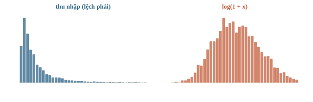
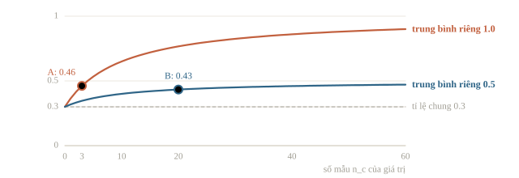
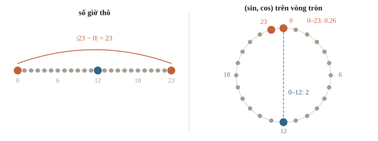
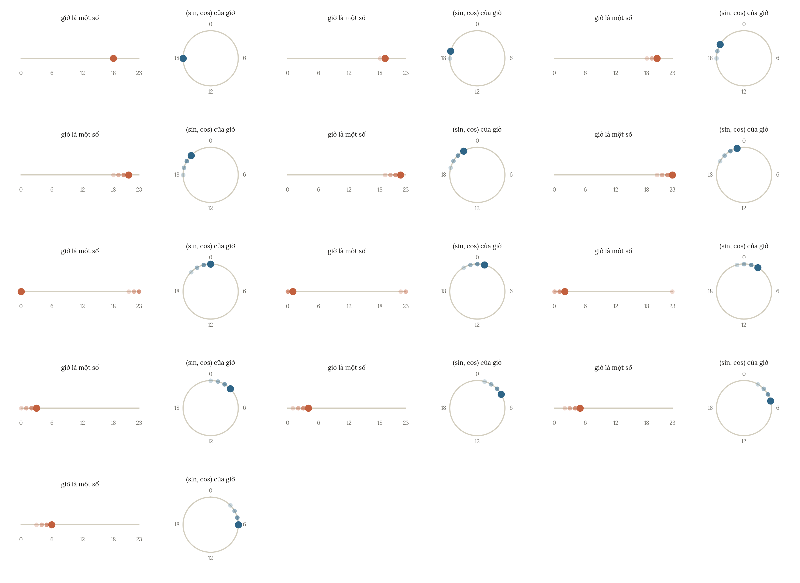
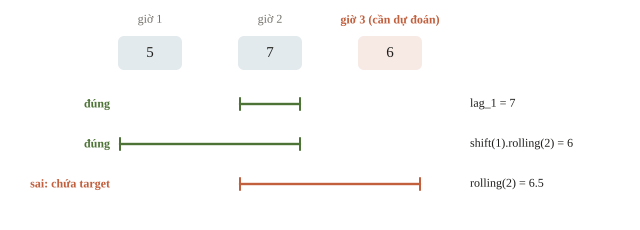

<!-- title -->
# Feature engineering

Tạo đặc trưng tốt từ thông tin có lúc dự đoán

Chương 2 · Bài 2.11

---
<!-- split -->
## Đặc trưng có sẵn lúc nào?

Dự đoán số đơn đầu giờ.

Giờ, cửa hàng và doanh số quá khứ đã biết.

|||
Doanh số giờ đang dự đoán chưa biết.

Feature tốt phải vừa có nghĩa vừa có sẵn đúng thời điểm.

---
<!-- section 1 -->
# Biểu diễn dữ liệu

---
<!-- split -->
## Số và danh mục

| Thao tác | Linear/kNN/SVM | Cây |
|---|---|---|
| Scale | Thường cần | Không cần cho ngưỡng |
| Log biến lệch | Thường có ích | Gần như không đổi |
| One-hot | Danh mục không thứ tự | Tùy thư viện |
| Tương tác, tỉ số | Thường phải tạo | Học được một phần |

|||
One-hot: category không có thứ tự.

Ordinal: chỉ khi thứ tự có ý nghĩa hoặc model xử lý rõ.

Không mã hóa mã cửa hàng thành 1, 2, 3 rồi để model hiểu đó là khoảng cách.

---
<!-- figure -->
## Log cho biến lệch



---
<!-- quiz -->
::: quiz
Áp $\log(1 + x)$ cho cột thu nhập, rồi học lại một cây quyết định trên cùng dữ liệu. Chuyện gì xảy ra?
- [ ] Cây sâu hơn, vì phân phối cân đối hơn
- [x] Cây chia train y hệt, chỉ có ngưỡng là đổi
- [ ] Cây tốt hơn hẳn, nhờ bớt lệch phải
- [ ] Phải chuẩn hóa lại thì cây mới chạy được
Log đồng biến nên giữ nguyên thứ tự: mỗi phép chia trên $x$ ứng đúng một phép chia trên $\log(1+x)$. Chỉ ngưỡng đặt giữa hai giá trị liên tiếp là có thể lệch chút ít.
:::

---
<!-- quiz -->
::: quiz
Cần dự đoán giá nhà trước khi bán. Cột `price/area` được tạo từ giá bán thực tế. Lúc dự đoán, `area` đã biết nhưng `price` thì chưa. Feature này có hợp lệ không?
- [ ] Có, vì chia cho diện tích đã loại ảnh hưởng của target
- [ ] Có, nếu chỉ fit scaler trên train
- [ ] Có, nếu dùng cây thay cho linear regression
- [x] Không, vì phép tính cần chính target chưa biết
`price/area` cần chính giá bán, thứ chưa biết lúc dự đoán. Một phép biến đổi của target vẫn chứa target.
:::

---
<!-- center -->
## Target encoding cần cross-fitting

$$TE(c)=\frac{n_c\bar y_c+m\bar y}{n_c+m}$$

Giá trị feature của mẫu không dùng y của chính mẫu đó; outer CV phải bao cả encoder.

Ví dụ $n_c=3$, $\bar y_c=1$, $m=10$, $\bar y=0.3$:

$$TE(c)=\frac{3\cdot1+10\cdot0.3}{13}\approx0.46,$$

không phải 1.0. Làm mượt giúp nhóm hiếm không quyết định cả mô hình.

---
<!-- figure -->
## Làm mượt theo số mẫu



---
<!-- quiz -->
::: quiz
Vẫn $m = 10$ và tỉ lệ chung là $0.3$. Quận B có 20 mẫu, một nửa mang nhãn 1. Giá trị mã hóa của B bằng bao nhiêu?
- [x] khoảng $0.43$
- [ ] $0.50$
- [ ] $0.30$
- [ ] khoảng $0.40$
$(20 \cdot 0.5 + 10 \cdot 0.3)/30 = 13/30 \approx 0.43$. Nhiều mẫu hơn thì trung bình riêng được tin nhiều hơn.
:::

---
<!-- quiz -->
::: quiz
Khách bỏ trống ô thu nhập có tỉ lệ vỡ nợ 40%, khách điền đầy đủ chỉ 10%. Ta điền median vào ô trống và không thêm cột nào khác. Hệ quả chính là gì?
- [x] Mô hình mất đi tín hiệu “bỏ trống”, một tín hiệu rất mạnh
- [ ] Không sao, vì median giữ nguyên phân phối
- [ ] Tốt hơn, vì dữ liệu không còn giá trị NaN
- [ ] Mô hình báo lỗi, vì cột đã đổi kiểu dữ liệu
Sau khi điền, khách bỏ trống trông y như khách có thu nhập trung vị. Thêm cột đánh dấu ô thiếu thì giữ được khác biệt 40% so với 10%.
:::

---
<!-- figure -->
## Thời gian có chu kỳ



---

<!-- figure -->
## Giờ đi qua nửa đêm



---
<!-- center -->
## Tọa độ của chu kỳ 24 giờ

$$x_{\sin}=\sin\frac{2\pi t}{24},\qquad x_{\cos}=\cos\frac{2\pi t}{24}.$$

23 giờ và 0 giờ cách nhau khoảng 0.26 trên đường tròn; 12 giờ và 0 giờ cách nhau 2. Hai tọa độ giữ quan hệ cuối ngày và đầu ngày.

---
<!-- quiz -->
::: quiz
Sau khi mã hóa giờ bằng sin và cos với $T = 24$, khoảng cách Euclid giữa 22 giờ và 2 giờ bằng bao nhiêu?
- [ ] $20$
- [x] $1$
- [ ] $4$
- [ ] khoảng $0.26$
Hai mốc cách nhau $60^\circ$ trên đường tròn bán kính 1, nên dây cung dài 1. Số giờ thô cho ra 20.
:::

---
<!-- section 2 -->
# Thông tin từ quá khứ

---
<!-- figure -->
## Cửa sổ nào được phép?



Mọi feature ở bên trái vạch phải có sẵn trước thời điểm dự đoán; target ở bên phải chưa được dùng.

---
<!-- quiz -->
::: quiz
Dùng sai phân $y_t - y_{t-1}$ làm feature để dự đoán $y_t$. Có hợp lệ không?
- [ ] Có, vì sai phân đo xu hướng gần nhất
- [ ] Có, nếu $y_{t-1}$ đã được lấy bằng `shift(1)`
- [x] Không, vì nó chứa chính $y_t$
- [ ] Không, vì sai phân chỉ thêm nhiễu
Biết $y_t - y_{t-1}$ và $y_{t-1}$ là biết luôn $y_t$. Bản hợp lệ phải lùi một bước: $y_{t-1} - y_{t-2}$.
:::

---
<!-- quiz -->
::: quiz
Thêm cột `shop_mean = groupby("shop")["sales"].transform("mean")`, tính trên toàn bảng train theo giờ, rồi dùng nó để dự đoán `sales`. Có vấn đề gì?
- [ ] Không sao, đây chỉ là thống kê theo nhóm
- [ ] Cột này trùng thông tin với one-hot của shop
- [ ] `transform` làm xáo trộn thứ tự các hàng
- [x] Mỗi hàng chứa cả sales của chính nó lẫn sales tương lai
Trung bình ấy gồm cả giờ đang dự đoán và mọi giờ sau nó. Bản hợp lệ là trung bình mở rộng đã dịch: `s.shift(1).expanding().mean()`.
:::

---
<!-- split -->
## Một hàng cụ thể

Dự đoán giờ 3 của A; hai giờ trước có 5, 7.

`lag_1=7`, `mean_prev_2=(5+7)/2=6`.

|||
Shift trước rolling, sort thời gian trong nhóm.

NaN đầu chuỗi là thiếu lịch sử thật, không tự điền bằng tương lai.

---
<!-- quiz -->
::: quiz
Quên `shift(1)`, viết thẳng `rolling(2).mean()` trên doanh số 5, 7, 6 của cửa hàng A. Giá trị ở giờ 3 bằng bao nhiêu?
- [ ] $6$, giống hệt bản có shift
- [ ] $7$, giá trị gần nhất trước đó
- [x] $6.5$, có chứa luôn target của giờ 3
- [ ] NaN, vì chưa đủ lịch sử
$(7 + 6)/2 = 6.5$, trong đó 6 chính là doanh số cần dự đoán. Lúc dùng thật thì cột này không tính được.
:::

---
<!-- split -->
## Đối chiếu trên máy

Cửa hàng A bán 5, 7, 6 và B bán 3, 4 qua các giờ, như ví dụ trên.

```python
def previous_mean(s):
    return s.shift(1).rolling(2).mean()

by_shop = history.groupby("shop")["sales"]
history["lag_1"] = by_shop.shift(1)
history["mean_prev_2"] = by_shop.transform(
    previous_mean
)
print(history["mean_prev_2"].tolist())
```

|||

```output
[nan, nan, 6.0, nan, nan]
```

`history` đã sort theo shop và time. A có sales 5,7,6; B có 3,4. Chỉ hàng thứ ba của A có đủ hai giá trị trước để lấy mean 6.

---
<!-- quiz -->
::: quiz
Hàng 4, thuộc cửa hàng B, có `lag_1 = 3` nhưng `roll_mean_2` lại là NaN. Vì sao?
- [ ] `shift` làm mất dữ liệu của B
- [x] Trước đó B mới có một giờ bán
- [ ] Rolling tính chung cả A và B
- [ ] Do `round(2)` khi in kết quả
Trước hàng 4, nhóm B chỉ có một giờ bán, nên cửa sổ hai giá trị chưa đầy và NaN là đúng.
:::

---
<!-- split -->
## Giá trị mới ở test

Fit OneHotEncoder trên A/B.

Test có C: `handle_unknown="ignore"`.

```output
shape: (3, 3) (1, 3)
mẫu mới: [[0.0, 0.0, 0.0]]
```

|||
Hai cột A/B bằng 0: schema chạy được, nhưng model chưa hiểu C.

Cột `size=20` bằng mean train sau impute nên cũng bằng 0.

Không fit lại encoder trên test.

---
<!-- quiz -->
::: quiz
Trong code trên, nếu lỡ gọi `preprocessor.fit_transform(new_features)` thay vì `transform`, đầu ra có shape gì?
- [ ] `(1, 3)`, như cũ
- [ ] `(1, 4)`
- [x] `(1, 2)`
- [ ] Báo lỗi, vì C chưa từng xuất hiện
Encoder fit lại chỉ thấy C, nên one-hot còn một cột, cộng `size` là hai.
:::

---
<!-- section 3 -->
# Kiểm giả thuyết

---
<!-- split -->
## So sánh có kiểm soát

Giữ nguyên fold và metric.

Thêm hoặc bỏ một nhóm đặc trưng.

Ghi điểm từng fold, chi phí và giả thuyết.

|||
Đổi feature lẫn split cùng lúc không tách được nguyên nhân.

Feature importance chỉ gợi ý; ablation trên cùng fold mới kiểm được đóng góp.

---
<!-- quiz -->
::: quiz
Mô hình đầy đủ có MAE 2.0 trên các fold cố định. Bỏ nhóm lag thì MAE là 2.9, bỏ nhóm thời gian là 2.02, bỏ nhóm thống kê cửa hàng là 2.3. Nhóm nào đóng góp nhiều nhất?
- [x] Nhóm lag
- [ ] Nhóm thời gian
- [ ] Nhóm thống kê cửa hàng
- [ ] Chưa biết khi chưa xem feature importance
Bỏ nhóm lag làm MAE tăng 0.9, nhiều nhất. Nhóm thời gian chỉ đổi 0.02, có thể chỉ là dao động.
:::

---
<!-- quiz -->
::: quiz
Với mô hình cây, cột `order_id` đứng đầu bảng feature importance. Phản ứng hợp lý nhất là gì?
- [ ] Giữ lại, vì importance cao là feature tốt
- [x] Nghi ngờ, vì mã có thể tăng dần theo thời gian
- [ ] Chuẩn hóa `order_id` rồi học lại
- [ ] One-hot `order_id` cho mô hình hiểu rõ hơn
Mã tăng dần đang lén mã hóa thời gian. Kiểm bằng cách chia theo thời gian, hoặc bỏ cột rồi so trên cùng các fold.
:::

---
<!-- quiz -->
::: quiz
Đếm tần suất của mã sản phẩm trên train và test gộp lại, không dùng nhãn. Cách này hợp lệ khi nào?
- [ ] Luôn hợp lệ, vì không đụng tới nhãn
- [ ] Không bao giờ, vì đã nhìn vào dữ liệu test
- [ ] Chỉ khi mô hình phía sau là cây
- [x] Khi lúc dự đoán thật cũng có sẵn cả lô ấy
Câu hỏi là thông tin có sẵn lúc dự đoán hay không. Đề cho cả lô test một lúc thì hợp lệ, dự đoán từng đơn khi nó đến thì không.
:::

---
## Khi đi thi

- Mỗi cột: sinh ra lúc nào, lúc dự đoán đã có chưa?
- Thống kê dùng nhãn: out-of-fold.
- Thêm từng nhóm feature, so trên cùng fold.

---
<!-- section 4 -->
# Luyện đề

---
<!-- quiz -->
::: quiz Luyện đề 1
Dự đoán số khách của một buổi hòa nhạc. Một feature là “số khách của buổi trước, nếu biết”. Nên mã hóa thế nào?
- [ ] One-hot cho từng giá trị số khách
- [ ] Giữ dạng số đã chuẩn hóa, điền 0 khi không biết
- [x] Giữ dạng số đã chuẩn hóa, thêm một cột đánh dấu khi không biết
- [ ] Bỏ cột này, vì đôi khi bị thiếu
Số khách có thứ tự và độ lớn, nên giữ dạng số. Điền 0 khiến “không biết” trông như “buổi trước vắng tanh”.
Phỏng theo: [MIT 6.036 · Final, Spring 2022 · Q5(a)](https://introml.mit.edu/_static/fall22/final/review/6036_final_sp22.pdf#page=12)
:::

---
<!-- quiz -->
::: quiz Luyện đề 2
Đầu vào $(x_1, x_2)$ được thay bằng vector feature $(1, x_1^2, x_2^2)$, rồi học logistic regression với tham số $(b, w_1, w_2)$. Ranh giới quyết định, nơi $P(Y=1) = P(Y=0)$, là tập nào?
- [x] $b + w_1x_1^2 + w_2x_2^2 = 0$, chẳng hạn một ellipse
- [ ] $b + w_1x_1 + w_2x_2 = 0$, một đường thẳng
- [ ] $w_1x_1^2 = w_2x_2^2$, hai đường thẳng qua gốc
- [ ] $x_1^2 + x_2^2 = 1$, luôn là đường tròn
Ranh giới là $b + w_1x_1^2 + w_2x_2^2 = 0$: tuyến tính theo tham số nhưng cong theo đầu vào gốc, chẳng hạn một ellipse quanh gốc.
Phỏng theo: [CMU 10-601 · Exam 2 Practice · Q2.5(a)](https://www.cs.cmu.edu/~mgormley/courses/10601/handout/exam2_practice_problems.pdf#page=9)
:::

---
<!-- center -->
## Chốt ba điều

Tạo đặc trưng số, phân loại, chu kỳ và lịch sử từ thông tin đúng thời điểm.

Đọc shape/output của lag, rolling, target encoding và OneHotEncoder.

So nhóm đặc trưng bằng cùng fold; tránh target leakage và time leakage.

---
<!-- center -->
## Sau giờ học

Làm **10 câu kiểm tra cuối bài** trên trang bài học.

Chạy notebook từ đầu; đổi thời điểm dự đoán hoặc category mới, dự đoán NaN/shape, rồi kiểm lại bằng output.
