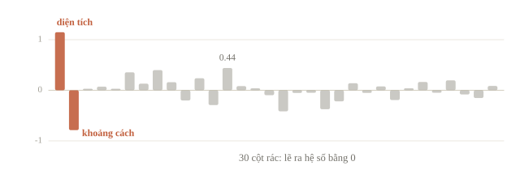
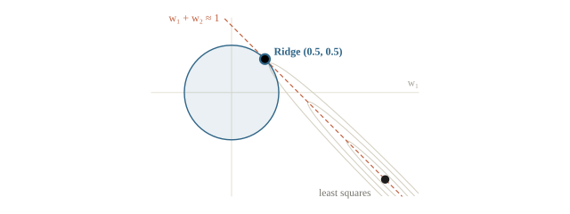
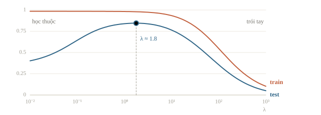
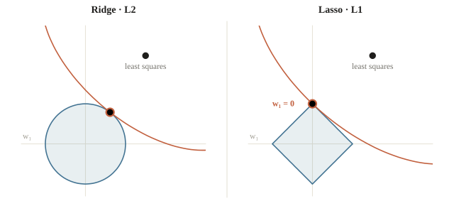
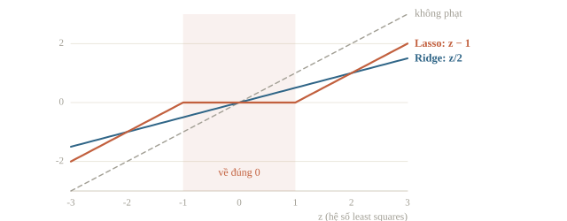
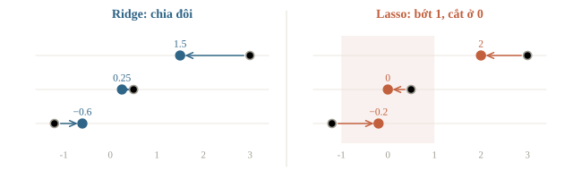
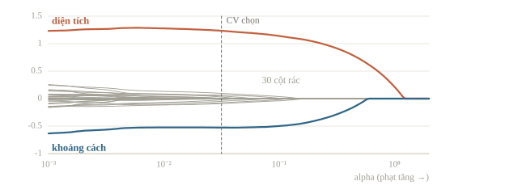
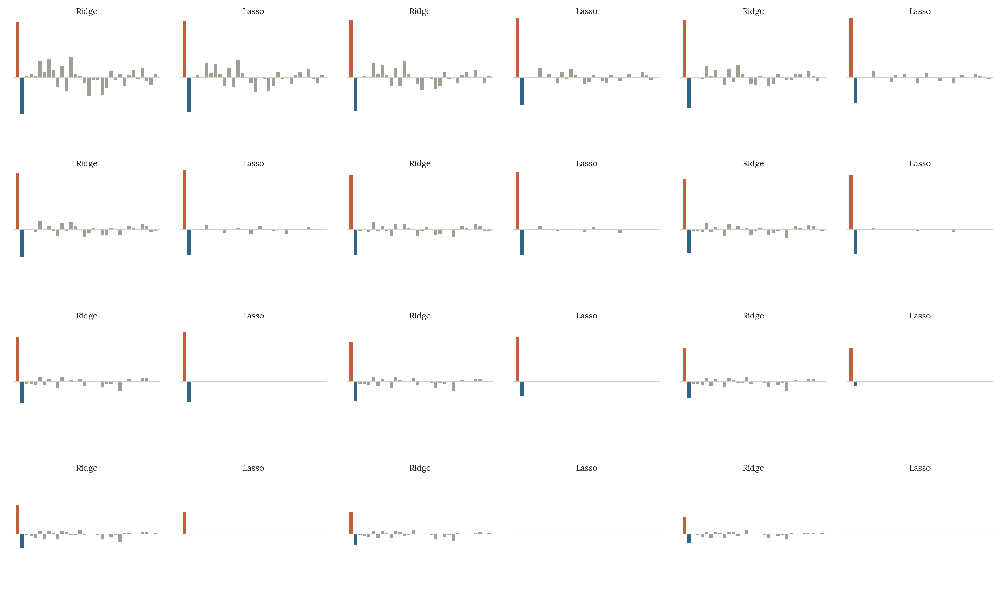
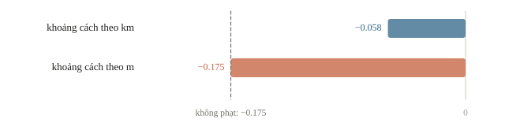
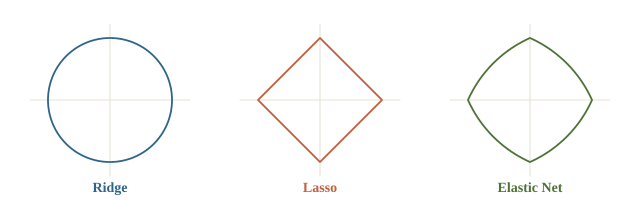

<!-- title -->
# Regularization

Khi mô hình học thuộc thay vì học quy luật

Chương 2 · Bài 2.2

---
<!-- split -->
## Bảng dữ liệu rộng hơn

Vẫn định giá căn hộ, nhưng thêm **30 cột** kiểu số chữ cái trong tên chủ nhà: không cột nào liên quan tới giá.

Chỉ có **40 căn** để học, 60 căn để kiểm tra.

|||

::: note Câu hỏi
Linear regression sẽ dùng 30 cột rác này thế nào?

Và làm sao bắt nó bỏ qua chúng?
:::

---
## Mục tiêu

- Nhận ra overfitting qua chênh lệch điểm train và test.
- Dùng Ridge và Lasso; chọn mức phạt bằng cross-validation.
- Biết vì sao Lasso đưa được trọng số về 0 còn Ridge thì không.
- Đọc tham số `alpha`, `C` trong scikit-learn.

---
<!-- section 1 -->
# Khi mô hình học thuộc

---
<!-- split -->
## Linear regression trên 40 căn

```python
w, b = fit_ols(A_tr, y_tr)
print("R2 train:", round(r2(A_tr @ w + b, y_tr), 3),
      " R2 test:", round(r2(A_te @ w + b, y_te), 3))
print("2 hệ số thật:", w[:2].round(2),
      " max rác:", np.abs(w[2:]).max().round(2))
```

```output
R2 train: 0.985  R2 test: 0.349
2 hệ số thật: [ 1.15 -0.79]  max rác: 0.44
```

|||

- Train gần hoàn hảo, test tệ: **overfitting**.
- Cột rác nhận hệ số tới $0.44$, cỡ một nửa hệ số của khoảng cách.
- 33 tham số cho 40 mẫu: đủ chỗ để khớp cả phần nhiễu của tập train.

---
<!-- figure -->
## Hệ số của 32 cột



---
<!-- quiz -->
::: quiz
Giữ nguyên 40 căn train, nhưng tăng số cột rác từ 30 lên 37. Khi đó có 39 hệ số cộng thêm bias, tức là 40 ẩn cho 40 căn. Không cần chạy code, $R^2$ trên train của least squares sẽ là bao nhiêu?
- [ ] Vẫn khoảng $0.985$, vì cột rác không mang thông tin về giá
- [ ] Thấp hơn $0.985$, vì thêm cột rác là thêm nhiễu
- [x] Đúng bằng $1$
- [ ] Chưa đoán được khi chưa biết giá trị các cột rác
40 phương trình, 40 ẩn, ma trận gần như chắc chắn khả nghịch, nên có nghiệm khớp đúng từng căn. Điểm train hoàn hảo chỉ cho biết mô hình đủ chỗ để học thuộc.
:::

---
<!-- section 2 -->
# Phạt độ lớn trọng số

---
<!-- center -->
## Lỗi cộng phạt

$$J(\mathbf{w}, b) = \underbrace{\sum_{i}\left(\mathbf{w}^\top\mathbf{x}_i + b - y_i\right)^2}_{\text{khớp dữ liệu}} + \underbrace{\lambda\,\Omega(\mathbf{w})}_{\text{phạt độ lớn}}$$

Đặc trưng cùng thang đo: trọng số lớn làm dự đoán nhạy với dao động nhỏ, tức variance cao.

$\lambda = 0$: least squares · $\lambda \to \infty$: chỉ còn đoán trung bình · bias $b$ không bị phạt

---
## Ridge và Lasso

| | Ridge (L2) | Lasso (L1) |
|---|---|---|
| Khoản phạt | $\sum_j w_j^2$ | $\sum_j \lvert w_j\rvert$ |
| Tác dụng | Co mọi trọng số về gần 0 | Đưa nhiều trọng số về **đúng** 0 |
| Hợp khi | Nhiều đặc trưng cùng có ích, có tương quan | Chỉ ít đặc trưng thật sự quan trọng |

---
<!-- quiz -->
::: quiz
Ridge có intercept không bị phạt. Giữ nguyên dữ liệu train và tăng mức phạt $\lambda$ lên rất lớn. Dự đoán sẽ tiến dần về giá trị nào?
- [ ] Trung vị của `y_train`
- [ ] Giá trị hay gặp nhất của `y_train`
- [x] Trung bình của `y_train`
- [ ] 0
Hệ số của các feature co về 0, chỉ còn intercept. Hằng số làm tổng bình phương lỗi nhỏ nhất là trung bình.
:::

---
<!-- section 3 -->
# Ridge

---
<!-- split -->
## Nghiệm đóng

Trừ trung bình khỏi $X$ và $\mathbf{y}$ để không phạt $b$:

$$\mathbf{w}^\ast = \left(X_c^\top X_c + \lambda I\right)^{-1} X_c^\top \mathbf{y}_c$$

$$b = \bar y - \bar{\mathbf{x}}^\top\mathbf{w}$$

$\lambda I$ làm ma trận khả nghịch khi $\lambda>0$: hai đặc trưng gần trùng nhau không còn cho $+500$ và $-499$.

|||

```python
def fit_ridge(A, y, lam):
    a_mean, y_mean = A.mean(axis=0), y.mean()
    Ac, yc = A - a_mean, y - y_mean
    w = np.linalg.solve(
        Ac.T @ Ac + lam * np.eye(A.shape[1]),
        Ac.T @ yc)
    return w, y_mean - a_mean @ w
```

Trùng `Ridge(alpha=lam)` của scikit-learn.

---
<!-- figure -->
## Hai cột gần trùng nhau



---
<!-- quiz -->
::: quiz
Lấy nghiệm Ridge với $\lambda = 3$ làm điểm xuất phát, rồi chạy gradient descent của bài 2.1 trên tổng bình phương lỗi **không** có khoản phạt, với bước nhỏ và chạy đủ lâu. Trọng số sẽ đi về đâu?
- [ ] Đứng yên, vì nghiệm Ridge đã là điểm tối ưu
- [x] Dịch dần về nghiệm least squares
- [ ] Dao động mãi quanh nghiệm Ridge
- [ ] Co dần về 0
Tại nghiệm Ridge, gradient của riêng phần lỗi bằng $-2\lambda\mathbf w$, khác 0. Gradient descent đi tiếp tới cực tiểu của phần lỗi, tức nghiệm least squares.
Phỏng theo: [MIT 6.036 · Final, Spring 2022 · Q4(a), (d)](https://introml.mit.edu/_static/fall22/final/review/6036_final_sp22.pdf#page=8)
:::

---
## Thử nhiều mức phạt

| $\lambda$ | $R^2$ train | $R^2$ test |
|---|---|---|
| 0 | 0.985 | 0.349 |
| 0.1 | 0.985 | 0.644 |
| 1 | 0.982 | **0.839** |
| 3 | 0.974 | **0.839** |
| 10 | 0.934 | 0.764 |
| 30 | 0.814 | 0.603 |
| 100 | 0.547 | 0.356 |

---
<!-- figure -->
## Đỉnh của R² test



---
<!-- quiz -->
::: quiz
Ở dòng $\lambda = 100$ của bảng, $R^2$ trên train là $0.547$, trên test là $0.356$. Mô hình đang gặp vấn đề gì?
- [ ] Variance cao, vì vẫn còn học thuộc tập train
- [x] Bias cao, vì phạt quá mạnh nên khớp không nổi cả tập train
- [ ] Không có vấn đề gì, vì khoảng cách train và test đã nhỏ hơn ở $\lambda = 0$
- [ ] Dữ liệu test bị lỗi, vì điểm test thấp hơn ở $\lambda = 3$
Khoảng cách nhỏ lại chưa có nghĩa là tốt, vì chính điểm train đã thấp. Phạt quá mạnh co cả hai hệ số thật, đó là underfitting.
:::

---
<!-- section 4 -->
# Lasso

---
<!-- figure -->
## Vì sao L1 cho số 0: hình học



---
## Vì sao L1 cho số 0: tính thẳng

Các cột trực chuẩn, $z_j$ là hệ số least squares. Lasso viết với $\tfrac12$ trước phần lỗi:

$$w_j^{\text{ridge}} = \frac{z_j}{1 + \lambda}$$

$$w_j^{\text{lasso}} = \operatorname{sign}(z_j)\max\left(\lvert z_j\rvert - \lambda,\ 0\right)$$

Ridge co theo tỉ lệ. Lasso trừ đi $\lambda$ rồi cắt về 0: **soft-thresholding**.

---
<!-- figure -->
## Soft-thresholding



---
<!-- quiz -->
::: quiz
Lasso dùng hàm $\frac12\|y-Xw\|^2+\lambda\|w\|_1$, với $X^\top X=I$. Một hệ số least squares bằng $z = 0.8$, và $\lambda = 1$. Hệ số Lasso tương ứng bằng bao nhiêu?
- [x] 0
- [ ] 0.8
- [ ] 0.4
- [ ] $-0.2$
Soft-thresholding: $\max(0.8 - 1, 0) = 0$. Lasso không làm hệ số đổi dấu. Ra 0.4 là quy tắc co theo tỉ lệ của Ridge.
:::

---
<!-- split -->
## Tính tay trên lớp

$\mathbf{z} = (3,\ 0.5,\ -1.2)$, $\lambda = 1$, các cột trực chuẩn.

Tính hệ số Ridge và Lasso.

|||

Ridge: $\mathbf{w} = (1.5,\ 0.25,\ -0.6)$

Lasso: $\mathbf{w} = (2,\ 0,\ -0.2)$

Ridge giảm mọi hệ số một nửa. Lasso loại đặc trưng thứ hai, hai đặc trưng còn lại mất đúng 1 đơn vị.

---
<!-- figure -->
## Đáp án trên trục số



---
<!-- quiz -->
::: quiz
Vẫn $\mathbf{z} = (3,\ 0.5,\ -1.2)$, các cột trực chuẩn. Với Lasso, $\lambda$ nhỏ nhất bằng bao nhiêu thì **cả ba** hệ số đều bằng 0?
- [ ] $0.5$
- [ ] $1.2$
- [x] $3$
- [ ] Không có, vì Lasso luôn giữ ít nhất một feature
Hệ số $j$ bằng 0 khi $\lambda \ge |z_j|$, nên cần $\lambda \ge \max_j |z_j| = 3$. Từ đó trở lên chỉ còn intercept.
:::

---
<!-- split -->
## Coordinate descent

Lần lượt tối ưu từng $w_j$; mỗi bước là một phép soft-thresholding.

```python
for j in range(len(w)):
    r_j = yc - Ac @ w + Ac[:, j] * w[j]
    w[j] = soft(Ac[:, j] @ r_j, lam) / col_sq[j]
```

|||

Với $\lambda = 8$ trên dữ liệu căn hộ:

```output
giữ lại các cột: [0 1]  hệ số: [ 1.037 -0.408]
R2 test: 0.891
```

Giữ đúng diện tích và khoảng cách, loại cả 30 cột rác. Không ai nói cho nó biết cột nào là rác.

---
<!-- section 5 -->
# Chọn mức phạt và chuẩn hóa

---
## Cross-validation trên lưới log

Bảng $\lambda$ ở mục Ridge đã nhìn tập test: chỉ để quan sát. Muốn chọn thật thì dùng CV trên tập train; scaler nằm trong Pipeline nên được fit lại trong từng fold.

```python
pipeline = make_pipeline(StandardScaler(), Lasso(max_iter=10000))
search = GridSearchCV(pipeline, {"lasso__alpha": alpha_grid}, cv=5)
search.fit(X_tr, y_tr)
```

```output
Ridge: alpha = 3.162  R2 test = 0.837  số hệ số khác 0 = 32
Lasso: alpha = 0.03162  R2 test = 0.925  số hệ số khác 0 = 14
```

Ridge chọn đúng vùng $\lambda$ từ 1 đến 3, lần này không cần nhìn test.

---
## Loại sạch rác chưa chắc tốt nhất

| | Lasso λ = 8 | Lasso do CV chọn |
|---|---|---|
| Cột rác giữ lại | 0 | 12, đều dưới 0.1 |
| Hai hệ số thật | 1.037 và −0.408 | 1.234 và −0.527 |
| R² test | 0.891 | **0.925** |

Một $\lambda$ chung phạt mọi hệ số như nhau: muốn ép hết rác về 0 thì hệ số thật cũng bị co. Cross-validation tối ưu điểm dự đoán, không cam kết tìm đúng tập đặc trưng thật.

---
<!-- figure -->
## Regularization path



---

<!-- figure -->
## Ridge co, Lasso cắt



---
<!-- quiz -->
::: quiz
Lasso với $\lambda = 8$ loại sạch 30 cột rác, còn Lasso do cross-validation chọn vẫn giữ 12 cột rác. Vậy mà bản thứ hai lại dự đoán tốt hơn trên test, $0.925$ so với $0.891$. Vì sao?
- [x] Vì phạt mạnh cũng co cả hai hệ số thật, gây bias lớn
- [ ] Vì 12 cột rác ấy thật ra có liên quan đến giá
- [ ] Vì cross-validation đã nhìn thấy tập test
- [ ] Vì mô hình có nhiều feature hơn luôn dự đoán tốt hơn
Phạt đủ mạnh để loại sạch rác thì cũng co luôn hai hệ số thật, từ khoảng $1.23$ xuống $1.04$ và từ $-0.53$ xuống $-0.41$. Vài hệ số rác dưới $0.1$ gây hại ít hơn thế. Cross-validation không thấy test, nó chỉ chia tập train.
:::

---
<!-- split -->
## Chuẩn hóa trước khi phạt

Đổi khoảng cách từ km sang m: hệ số nhỏ đi 1000 lần, khoản phạt $w^2$ nhỏ đi $10^6$ lần.

```output
khoảng cách theo km: hệ số quy về mỗi km = -0.058
khoảng cách theo  m: hệ số quy về mỗi km = -0.175
```

|||

Cùng dữ liệu, cùng $\lambda$, chỉ đổi đơn vị.

Mức phạt phụ thuộc đơn vị, không phụ thuộc mức quan trọng.

`make_pipeline(StandardScaler(), Ridge())` để cross-validation chuẩn hóa đúng trên từng fold.

---
<!-- figure -->
## Cùng λ, khác đơn vị



---
<!-- quiz -->
::: quiz
Đổi một feature từ km sang m mà vẫn giữ nguyên dự đoán, thì hệ số của feature ấy giảm 1000 lần. Nếu giữ nguyên $\lambda$, khoản phạt L2 trên riêng hệ số này thay đổi thế nào?
- [ ] Giảm 1000 lần
- [ ] Tăng 1 000 000 lần
- [ ] Không đổi
- [x] Giảm 1 000 000 lần
L2 phạt bình phương hệ số: $(w/1000)^2 = w^2/10^6$. Không chuẩn hóa thì mức phạt phụ thuộc vào đơn vị.
:::

---
## Tên gọi trong scikit-learn

| Lớp | Hàm mất mát | Tham số phạt |
|---|---|---|
| `Ridge` | $\sum r_i^2 + \alpha\lVert\mathbf{w}\rVert_2^2$ | `alpha` $= \lambda$ |
| `Lasso` | $\frac{1}{2n}\sum r_i^2 + \alpha\lVert\mathbf{w}\rVert_1$ | `alpha` $= \lambda / n$ |
| `LogisticRegression`, `SVC` | $C\sum \text{loss}_i + \tfrac12\lVert\mathbf{w}\rVert_2^2$ | `C` tỉ lệ nghịch với $\lambda$ |

Dòng `Lasso` so với quy ước $\tfrac12\sum r_i^2 + \lambda\lVert\mathbf{w}\rVert_1$ của bài. Chép `alpha` từ `Ridge` sang `Lasso` là sai thang đo.

---
<!-- quiz -->
::: quiz
So `LogisticRegression(C=0.01)` với `LogisticRegression(C=100)`. Khác nhau thế nào?
- [x] `C=0.01` phạt mạnh hơn, trọng số nhỏ hơn
- [ ] `C=0.01` phạt yếu hơn, trọng số lớn hơn
- [ ] Như nhau, vì `C` chỉ ảnh hưởng tốc độ
- [ ] `C` là số vòng lặp
`C` tỉ lệ nghịch với $\lambda$, nên `C` nhỏ là phạt mạnh. Người quen `alpha` của `Ridge` rất dễ đọc ngược chiều.
:::

---
<!-- section 6 -->
# Mở rộng và tổng kết

---
<!-- center -->
## Elastic Net

$$\lambda\left(\rho\lVert\mathbf{w}\rVert_1 + \tfrac{1-\rho}{2}\lVert\mathbf{w}\rVert_2^2\right)$$

Vẫn thưa như L1, nhưng phần L2 giữ được cả nhóm đặc trưng tương quan.

$\rho = 1$: Lasso · $\rho = 0$: Ridge · trong scikit-learn, $\rho$ là `l1_ratio`

---
<!-- figure -->
## Ba vùng ràng buộc



---
<!-- quiz -->
::: quiz
Có ba cột gần trùng nhau, cùng đo một thứ và cùng có ích, cộng thêm vài cột nhiễu. Elastic Net với `l1_ratio=0.5` thường làm gì với ba cột ấy?
- [ ] Bỏ cả ba, vì phạt L1 cộng L2 mạnh hơn Lasso
- [ ] Giữ đúng một cột như Lasso, vì vẫn còn phần L1
- [ ] Giữ cả ba, với hệ số lớn hơn của least squares
- [x] Giữ cả ba, với hệ số chia gần đều cho nhau
Phần L2 ưu tiên chia đều, giống Ridge với hai cột trùng nhau. Phần L1 vẫn đưa các cột nhiễu về 0.
:::

---
## Regularization ở khắp nơi

- `C` trong logistic regression (2.3) và SVM (2.8).
- Độ sâu tối đa, số mẫu tối thiểu ở lá của decision tree (2.5).
- Phạt L1, L2 trên giá trị lá trong XGBoost, LightGBM (2.7).
- Weight decay, dropout, early stopping trong mạng neural (3.6).

---
## Khi đi thi

- **Nhiều đặc trưng thưa** (one-hot, TF-IDF): mô hình tuyến tính có phạt L2 là baseline mạnh và rất nhanh.
- **Nghi có cột rác**: chạy Lasso để xem cột nào sống sót.
- **Ít mẫu, nhiều đặc trưng**: regularization là bắt buộc.
- **Dò `alpha`, `C` trên thang log**, chuẩn hóa trong pipeline.
- **Chọn bằng CV, không bằng bảng điểm công khai**: nộp nhiều lần để chọn cũng là chọn bằng tập test.

---
## Tóm tắt

- Cực tiểu lỗi cộng phạt độ lớn trọng số; $\lambda$ cân bằng bias và variance; không phạt $b$.
- Ridge có nghiệm đóng, co mọi hệ số về phía 0, ổn định khi đặc trưng tương quan.
- Lasso cắt hệ số nhỏ về đúng 0 nên chọn được đặc trưng; cái giá là hệ số thật cũng bị co.
- Chuẩn hóa trước khi phạt; chọn $\lambda$ bằng cross-validation trên lưới log, không bằng tập test.

---
<!-- section 7 -->
# Luyện đề

---
<!-- quiz -->
::: quiz Luyện đề 1
Trên cùng một bộ dữ liệu, ta học hai mô hình hồi quy tuyến tính với cùng mức phạt $\lambda > 0$. Mô hình A phạt L1, mô hình B phạt L2. Điều gì nhiều khả năng xảy ra nhất?
- [ ] A và B có số trọng số khác 0 bằng nhau.
- [x] A có ít trọng số khác 0 hơn B.
- [ ] B có ít trọng số khác 0 hơn A.
- [ ] Cả hai đều không thể có trọng số đúng bằng 0.
- [ ] Không có cách nào biết mô hình nào có ít trọng số khác 0 hơn.
L1 cắt các hệ số nhỏ về đúng 0, còn L2 chỉ co chúng lại. Chữ “nhiều khả năng” là vì từng trường hợp cụ thể có thể khác, nhưng xu hướng thì rõ.
Đề thi: [USA-NA-AIO 2026 · Vòng 1 · Part 1.2](https://www.usaaio.org/attachments/past-problems/2026/usaaio-2026-round-1-problems.pdf#page=1)
:::

---
<!-- quiz -->
::: quiz Luyện đề 2
Một bộ dữ liệu y khoa có 50 bệnh nhân, mỗi người đo 100 chỉ số. Một mô hình phân loại tuyến tính đúng 98% trên train, tức 49/50, nhưng chỉ đúng 62% trên validation, và gần như mọi trọng số đều khác 0. Đâu là chẩn đoán đúng nhất?
- [ ] Underfitting, vì 50 mẫu quá ít để mô hình nào học được
- [ ] Lệch lớp, nên mô hình chỉ đoán lớp đông hơn
- [ ] Các chỉ số khác đơn vị nên thuật toán không hội tụ
- [x] Overfitting, vì 100 trọng số cho 50 mẫu là đủ chỗ học thuộc
Số tham số nhiều hơn số mẫu thì điểm train gần như hoàn hảo dù không học được gì. Ba phương án kia đều kéo cả điểm train xuống. Cách chữa là phạt L1 hoặc L2, chọn mức phạt bằng cross-validation.
Đề thi: [NOAI 2026 Singapore · Vòng sơ loại · Câu 269](https://aisingapore.org/wp-content/uploads/2026/04/NOAI-2026-Preliminary-Round-Assessment-300-MCQs-Google-Forms.pdf#page=96)
:::

---
<!-- quiz -->
::: quiz Luyện đề 3
Một bạn học Ridge, thử $\lambda$ = 0.01, 0.1, 1, 10, so lỗi trên train, validation và test, rồi chọn $\lambda = 0.01$ vì lỗi **test** thấp nhất. Thấy lỗi test tăng dần từ $\lambda = 0.01$ đến 10, bạn ấy định thử thêm $\lambda$ = 0.0001 và 0.001 để tìm mô hình tốt hơn. Nhận xét nào đúng nhất?
- [ ] Hợp lý, vì lỗi test đang giảm về phía $\lambda$ nhỏ
- [x] Mở rộng thì được, nhưng phải chọn bằng lỗi validation
- [ ] Không cần thử, vì $\lambda$ dưới 0.01 chắc chắn overfit
- [ ] Nên thử $\lambda$ lớn hơn 10, vì phạt mạnh luôn an toàn hơn
Mở rộng vùng thử không sai, cái sai là thước đo dùng để chọn. Đã dùng test để chọn thì test thành validation, và điểm test không còn khách quan.
Phỏng theo: [CMU 10-601 · Practice Problems, Exam 2 · Q3.3](https://www.cs.cmu.edu/~mgormley/courses/10601/handout/exam2_practice_problems.pdf#page=12)
:::

---
<!-- quiz -->
::: quiz Luyện đề 4
Một đội đã giải nhiều bài cùng dạng và thấy trọng số tốt nhất thường nằm gần $\mathbf{w}_0 = (1, 1, \dots, 1)$. Bài mới chỉ có rất ít dữ liệu. Hàm mục tiêu nào tận dụng kinh nghiệm ấy hợp lý nhất?
- [x] $\sum_i (\mathbf{w}^\top\mathbf{x}_i - y_i)^2 + \lambda\lVert\mathbf{w}-\mathbf{w}_0\rVert_2^2$
- [ ] $\sum_i (\mathbf{w}^\top\mathbf{x}_i - y_i)^2 + \lambda\lVert\mathbf{w}\rVert_2^2$
- [ ] $\sum_i (\mathbf{w}^\top\mathbf{x}_i - y_i)^2$, vì kinh nghiệm cũ không đưa vào mô hình được
- [ ] $\sum_i (\mathbf{w}^\top\mathbf{x}_i - y_i)^2 + \lambda\lVert\mathbf{w}\rVert_1$
Ridge kéo trọng số về 0 vì ngầm giả định chúng nằm quanh 0. Kinh nghiệm cho một điểm neo khác, nên phạt khoảng cách tới điểm neo ấy.
Phỏng theo: [MIT 6.036 · Final, Spring 2022 · Q4(e)](https://introml.mit.edu/_static/fall22/final/review/6036_final_sp22.pdf#page=9)
:::

---
<!-- center -->
## Sau giờ học

Làm **10 câu kiểm tra cuối bài** trên trang bài học.

Chạy notebook của bài: tăng số cột rác lên 100, xem Ridge và Lasso thay đổi thế nào.
