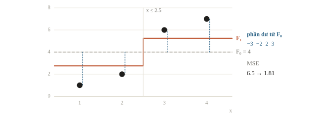
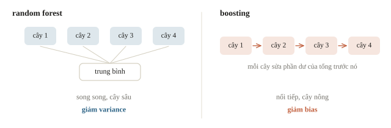
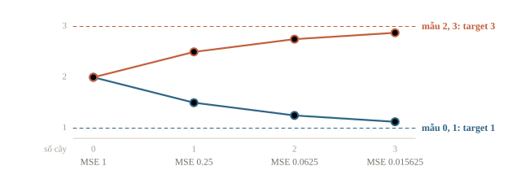
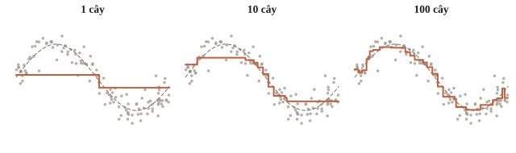
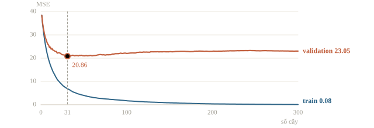
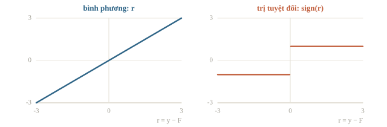
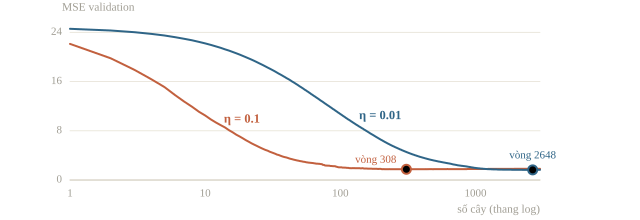
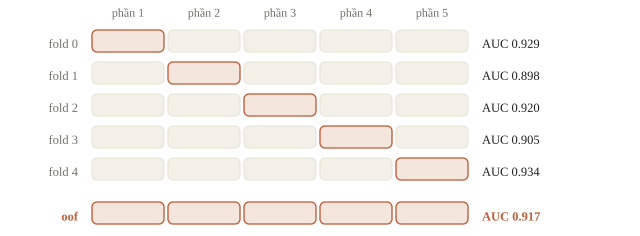

<!-- title -->
# Gradient boosting

Mỗi cây mới sửa phần sai của các cây trước

Chương 2 · Bài 2.7

---
<!-- split -->
## Cộng một bản sửa

Dự đoán quá thấp ở đầu vào lớn.

Một cây nhỏ học phần còn thiếu.

|||
Giữ model cũ, cộng thêm $\nu$ × bản sửa ($\nu$ là learning rate).

Cây sau phụ thuộc kết quả cây trước.

---
## Mục tiêu

- Tính một bước boosting với loss bình phương.
- So sánh boosting với random forest.
- Chọn số cây và learning rate bằng validation.

---
<!-- section 1 -->
# Boosting từng bước

---
<!-- center -->
## Squared error: học phần dư

$$r_i=y_i-F_{m-1}(x_i),\qquad F_m=F_{m-1}+\nu h_m$$

Phần dư ở đây là target trừ dự đoán: chỉ hướng cần sửa.

Với $L=\frac12(y-F)^2$, phần dư chính là gradient âm theo $F$.

---
<!-- split -->
## Một bước trên giấy

Target=5; dự đoán=3.

Cây sửa dự đoán r=2.

|||
$\nu$ nhỏ: nhiều bản sửa nhỏ thay cho một cú đổi lớn.

Cây sau học phần dư của tổng các cây trước, nên các cây không độc lập.

---
<!-- figure -->
## Bốn điểm, một stump



---
<!-- quiz -->
::: quiz
Target bằng 5, dự đoán hiện tại bằng 3, cây sửa đoán phần dư là 2. Với learning rate 0.1, dự đoán mới bằng bao nhiêu?
- [ ] 5
- [x] 3.2
- [ ] 2.8
- [ ] 3.02
Ta cộng thêm learning rate nhân bản sửa: $3 + 0.1\cdot 2 = 3.2$. Ra 5 là quên learning rate.
:::

---
<!-- quiz -->
::: quiz
Một mẫu có target 10, dự đoán hiện tại là 6. Cây mới đoán phần dư của mẫu ấy là 3, vì lá của nó lấy trung bình nhiều mẫu. Với $\nu = 0.5$, sau bước này phần dư của mẫu còn bao nhiêu?
- [ ] 4
- [ ] 1
- [x] 2.5
- [ ] 1.5
Dự đoán mới là $6 + 0.5\cdot 3 = 7.5$, phần dư còn $2.5$. Mỗi vòng chỉ cần đẩy đúng hướng một đoạn.
:::

---
<!-- split -->
## Random forest và boosting

Random forest: nhiều cây học song song trên các bootstrap khác nhau rồi trung bình, chủ yếu giảm variance.

|||
Gradient boosting: cây sau sửa dự đoán hiện tại, cộng nối tiếp với learning rate, chủ yếu giảm bias.

Thêm cây vào boosting có thể làm validation xấu đi; thêm cây vào random forest thường làm trung bình ổn định hơn rồi bão hòa.

---
<!-- figure -->
## Song song và nối tiếp



---
<!-- quiz -->
::: quiz
So random forest với gradient boosting khi ta thêm thật nhiều cây. Điểm trên validation của mỗi bên thường thay đổi thế nào?
- [ ] Cả hai đều tốt lên mãi, chỉ chậm dần
- [ ] Cả hai đều chắc chắn overfit nặng
- [x] Rừng thì bão hòa, còn boosting có thể tệ đi
- [ ] Rừng thì tệ đi, còn boosting bão hòa
Rừng lấy trung bình các cây độc lập, nên thêm cây chỉ làm trung bình ổn định rồi đứng yên. Boosting cộng mãi các bản sửa: sửa hết tín hiệu rồi thì quay sang sửa cả nhiễu.
:::

---
<!-- figure -->
## Ba lượt sửa



---
<!-- figure -->
## 1, 10, 100 cây



---

<!-- figure -->
## Mỗi cây sửa phần dư


---
<!-- figure -->
## Train giảm chưa đủ



Train MSE: 6.84 (vòng 31) → 0.08 (vòng 300). Validation: 20.86 → 23.05.

---
<!-- center -->
## Từ phần dư tới negative gradient

Với loss khả vi bất kỳ, cây thứ $m$ khớp

$$r_{im}=-\left.\frac{\partial L(y_i,F)}{\partial F}\right|_{F=F_{m-1}(x_i)}.$$

XGBoost dùng thêm đạo hàm bậc hai và phạt giá trị lá.

---
<!-- figure -->
## Hai loss, hai kiểu bản sửa



---
<!-- quiz -->
::: quiz
Đổi loss từ bình phương sang trị tuyệt đối, $L = |y - F|$. Pseudo-residual của một mẫu là gì?
- [x] $\operatorname{sign}(y - F)$, chỉ còn $\pm 1$
- [ ] $y - F$, giống hệt loss bình phương
- [ ] $(y - F)^2$, để phạt mạnh lỗi lớn
- [ ] $|y - F|$, độ lớn của lỗi
Đạo hàm của $|y - F|$ chỉ còn dấu $\pm 1$: cây biết nên nâng hay hạ, không biết bao nhiêu. Điểm ngoại lai lệch 100 có tiếng nói như mẫu lệch 1.
:::

---
<!-- quiz -->
::: quiz
Loss bình phương. Một lá chứa ba mẫu, với $g_i = F - y_i$ lần lượt là $-2$, $-1$, $-3$. Với $\lambda = 1$, giá trị lá $w^\ast$ bằng bao nhiêu?
- [ ] $2$
- [ ] $-1.5$
- [ ] $6$
- [x] $1.5$
$G = -6$, $H = 3$, nên $w^\ast = 6/4 = 1.5$. Không có $\lambda$ thì ra 2, đúng bằng trung bình phần dư.
:::

---
<!-- quiz -->
::: quiz
Bảng có 20 cột phân loại, nhiều cột có tới hàng nghìn giá trị như mã cửa hàng hay mã sản phẩm, và ta chỉ còn ít thời gian tinh chỉnh. Nên thử thư viện nào trước?
- [ ] XGBoost, sau khi one-hot mọi cột phân loại
- [ ] LightGBM, sau khi đổi mỗi mã thành một số nguyên
- [x] CatBoost, đưa thẳng các cột phân loại vào
- [ ] Random forest, sau khi xóa các cột phân loại
CatBoost mã hóa cột phân loại bằng thống kê target theo thứ tự, tránh rò nhãn mà không làm số cột tăng vọt. Đổi mã thành số nguyên thì áp một thứ tự vô nghĩa.
:::

---
<!-- quiz -->
::: quiz
Đang dùng `learning_rate=0.1`, early stopping dừng ở khoảng 300 cây. Đổi sang `learning_rate=0.01`, số cây trước khi dừng có xu hướng thế nào?
- [x] Tăng nhiều, cỡ vài lần đến mười lần
- [ ] Giảm còn khoảng 30, vì mỗi cây mạnh hơn
- [ ] Không đổi, vì early stopping tự bù
- [ ] Không đoán được, vì hai tham số độc lập với nhau
Mỗi bản sửa nhỏ đi mười lần, nên cần nhiều bản sửa hơn để đi cùng quãng đường, thường cỡ vài lần đến mười lần số cây.
:::

---
<!-- section 2 -->
# Chọn số vòng

---
<!-- split -->
## staged_predict

Đọc metric sau từng số cây.

best_round là argmin validation loss.

|||
Nếu vòng cuối thắng: chưa có lý do dừng sớm hơn.

Nếu vòng trước thắng: lưu model ở mức đó, không vô tình dùng vòng cuối.

---
<!-- center -->
## Early stopping cần đúng split

Mẫu độc lập: random split có thể phù hợp.

Cùng người nhiều hàng: group split.

Dự báo tương lai: time split.

Validation mặc định trong thư viện cần kiểm trước khi dùng.

---
<!-- quiz -->
::: quiz
Trong thí nghiệm trên, MSE validation thấp nhất ở vòng 31 với 20.86, còn ở vòng 300 là 23.05. Nên lưu mô hình ở vòng nào, và báo điểm nào làm ước lượng cho dữ liệu mới?
- [ ] Vòng 300, báo MSE validation 23.05
- [ ] Vòng 300, báo MSE train 0.08
- [ ] Vòng 31, báo MSE train 6.84
- [x] Vòng 31, báo điểm trên một tập test riêng
Giữ mô hình vòng 31 vì nó thắng trên validation. Nhưng 20.86 đã được dùng để chọn vòng nên hơi lạc quan, ước lượng sạch phải lấy từ test riêng.
:::

---
## Mỗi lượt, MSE còn một phần tư

```python
prediction = np.full(len(yb), yb.mean())
for stage in range(3):
    residual_to_fix = yb - prediction
    correction = DecisionTreeRegressor(
        max_depth=1, random_state=0
    )
    correction.fit(xb, residual_to_fix)
    prediction = prediction + learning_rate * correction.predict(xb)
    mse_now = np.mean((prediction - yb) ** 2)
    print(stage + 1, prediction.tolist(), round(float(mse_now), 6))
```


```output
1 [1.5, 1.5, 2.5, 2.5] 0.25
2 [1.25, 1.25, 2.75, 2.75] 0.0625
3 [1.125, 1.125, 2.875, 2.875] 0.015625
```

---
<!-- split -->
## HistGradientBoosting trên dữ liệu phi tuyến

```output
số cây: 285  R2 validation: 0.944
```

`make_friedman1`, 5000 mẫu, `learning_rate=0.05`, tối đa 2000 vòng, early stopping.

|||

Early stopping tách ngẫu nhiên 10% train làm validation, dừng sau 50 vòng không cải thiện.

Dữ liệu nhóm hay thời gian: tự làm validation đúng cấu trúc.

---
<!-- figure -->
## Learning rate và số cây



---
<!-- quiz -->
::: quiz
Đặt `max_iter=2000`, nhưng mô hình chỉ có `n_iter_ = 285` cây. Vì sao?
- [ ] Hết thời gian chạy nên thư viện tự dừng
- [ ] Learning rate tự giảm về 0 sau 285 vòng
- [ ] Từ vòng 286, các cây mới đều bằng 0
- [x] Early stopping dừng sau 50 vòng liền không cải thiện
`early_stopping=True` tách 10% train làm validation nội bộ, và dừng khi 50 vòng liền không cải thiện. Phần tách ấy chia ngẫu nhiên theo hàng.
:::

---
<!-- quiz -->
::: quiz
Giảm learning rate từ 0.1 xuống 0.02 nhưng vẫn giữ 100 cây, thì MAE cả trên train lẫn validation đều tăng. Thí nghiệm tiếp theo nào kiểm giả thuyết “chưa học đủ vòng”?
- [ ] Giảm tiếp số cây để tránh overfit
- [ ] Nhân dự đoán với 5 để bù cho learning rate
- [ ] Kết luận learning rate nhỏ luôn làm mô hình kém đi
- [x] Thử thêm vòng ở mức 0.02, theo dõi validation
Bản sửa nhỏ hơn có thể cần thêm vòng. Theo dõi validation thì mới phân biệt được thiếu vòng với nguyên nhân khác.
:::

---
<!-- split -->
## LightGBM trong khuôn K-fold

- Mỗi fold: học trên $K-1$ phần, early stopping và chấm trên phần còn lại.
- Gom các phần được chấm: dự đoán out-of-fold (OOF).
- Test: trung bình $K$ model.
- Cột `category` đưa thẳng vào LightGBM, không cần one-hot.

|||

```output
fold 0: cây tốt nhất 104, AUC 0.929
fold 1: cây tốt nhất 98, AUC 0.898
fold 2: cây tốt nhất 79, AUC 0.920
fold 3: cây tốt nhất 74, AUC 0.905
fold 4: cây tốt nhất 89, AUC 0.934
AUC out-of-fold: 0.917
AUC test (trung bình 5 model): 0.923
```

So thay đổi bằng điểm OOF, không bằng một fold.

---
<!-- figure -->
## Ghép năm phần thành OOF



---
<!-- quiz -->
::: quiz
Vì sao điểm trên `oof` ước lượng được điểm trên dữ liệu mới, còn điểm của model fold 0 chấm lại trên toàn bộ train thì không?
- [ ] `oof` có nhiều dòng hơn
- [x] Mỗi dòng của `oof` được dự đoán bởi model chưa học dòng đó
- [ ] Model fold 0 dừng sớm hơn các fold khác
- [ ] `StratifiedKFold` giữ tỉ lệ nhãn
Model fold 0 đã học 80% số dòng train, nên chấm lại trên toàn bộ train phần lớn là chấm bài nó đã thuộc. Mỗi dòng của `oof` được chấm bởi model không thấy nó.
:::

---
## Khi đi thi

- Dữ liệu bảng: LightGBM/CatBoost + early stopping trước.
- Early stopping trong từng fold; test là trung bình $K$ mô hình.
- Feature tốt đáng công hơn chỉnh tham số.

---
<!-- section 3 -->
# Luyện đề

---
<!-- quiz -->
::: quiz Luyện đề 1
Tự cài boosting: dòng A là `residuals = y - F`, dòng B là `tree.fit(X, residuals)`, dòng C là `F += lr * tree.predict(X)`. Đổi sang loss MAE thì phải sửa dòng nào?
- [ ] Chỉ dòng A, đổi thành `np.sign(y - F)`
- [x] Dòng A và B: dùng dấu phần dư, lá lấy median
- [ ] Chỉ dòng C, vì phải dò lại learning rate
- [ ] Mọi dòng, vì MAE cần thuật toán khác hẳn
Gradient âm của $|y - F|$ là $\operatorname{sign}(y - F)$, nên dòng A phải đổi. Giá trị lá tốt nhất cho MAE là median, nên dòng B cũng phải đổi.
Đề thi: [NOAI 2026 Singapore · Chung kết · Câu 3](https://aisingapore.org/wp-content/uploads/2026/04/NOAI-2026-Final-Assessment-Section-1-MCQs-Google-Forms.pdf#page=4)
:::

---
<!-- quiz -->
::: quiz Luyện đề 2
Trong XGBoost, giá trị lá là $w^\ast = -G/(H + \lambda)$. Tăng `reg_lambda`, tức $\lambda$, từ 0 lên 10 thì các giá trị lá thay đổi thế nào?
- [ ] Lớn hơn, vì $\lambda$ thưởng cho lá
- [x] Bị kéo về gần 0 hơn
- [ ] Không đổi, vì $\lambda$ chỉ ảnh hưởng gain
- [ ] Đổi dấu khi $\lambda > H$
$\lambda$ nằm ở mẫu số, nên giá trị lá co về 0, rõ nhất ở lá ít mẫu. Đây đúng là kiểu co của Ridge ở bài 2.2.
:::

---
<!-- center -->
## Chốt ý

Mỗi cây mới học phần dư của tổng các cây trước, rồi cộng vào với learning rate nhỏ.

Chọn số cây bằng early stopping trên validation đúng cách chia; so thay đổi bằng điểm OOF.

---
<!-- center -->
## Sau giờ học

Làm **10 câu kiểm tra cuối bài** trên trang bài học.

Chạy notebook: đổi learning rate, đoán trước số cây cần thiết rồi xem early stopping dừng ở đâu.
