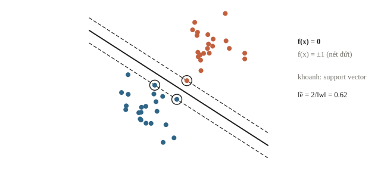
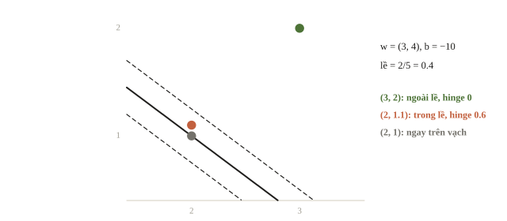
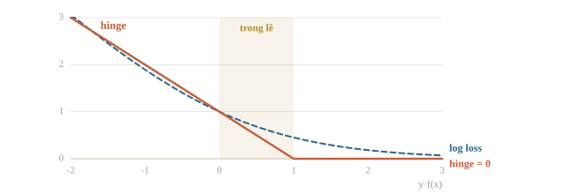
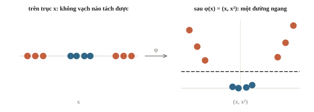
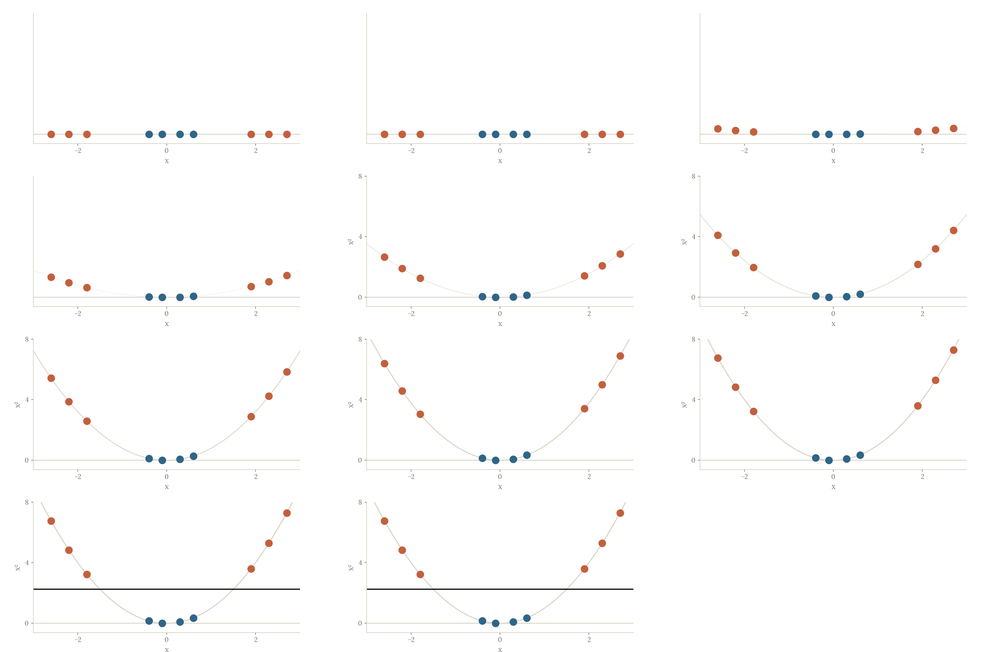
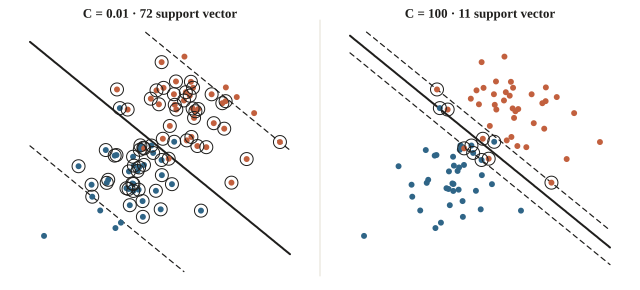
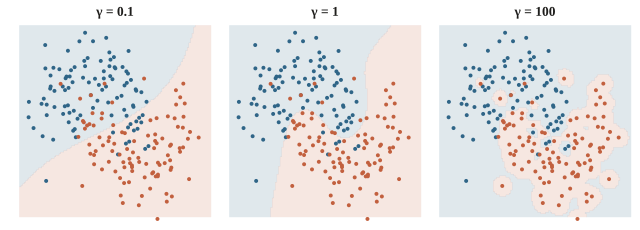
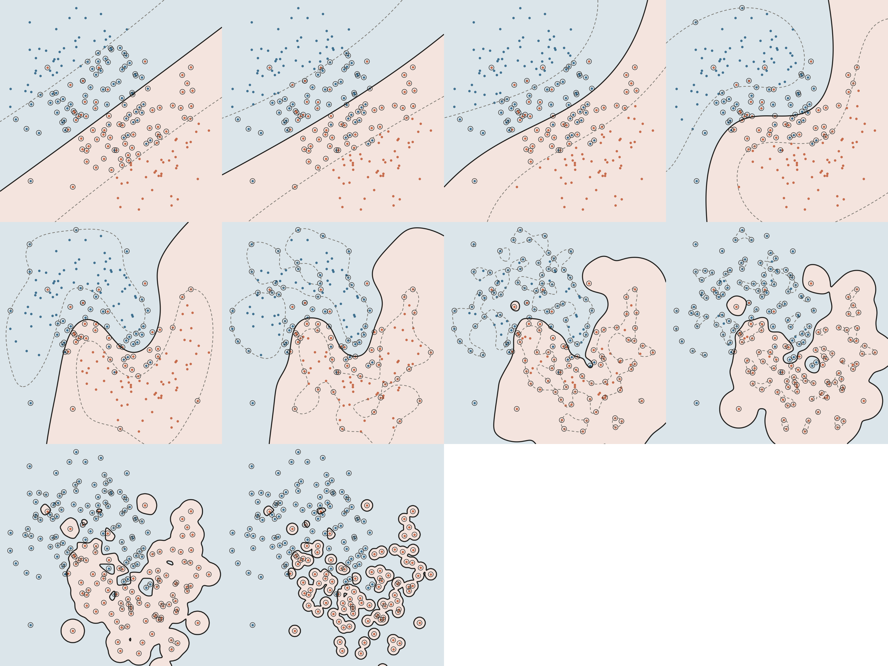

<!-- title -->
# SVM

Đường phân chia có lề rộng nhất

Chương 2 · Bài 2.8

---
<!-- split -->
## Vạch nào an toàn hơn?

Nhiều vạch tách được hai đội.

Ta muốn còn khoảng trống ở hai bên.

|||
Lề rộng giúp mô hình bớt nhạy với điểm hơi lệch.

Cần phân biệt score và khoảng cách.

---
## Mục tiêu

- Tính khoảng cách tới đường phân chia và hinge loss.
- Hiểu tham số C, gamma và vì sao cần chuẩn hóa.
- Dùng SVC với Pipeline và cross-validation.

---
<!-- section 1 -->
# Lề và hinge loss

---
<!-- figure -->
## Các điểm sát biên



Hai biên lề là $f(\mathbf x)=\pm1$, cách nhau $2/\lVert \mathbf w\rVert$: lề rộng nhất là $\lVert\mathbf w\rVert$ nhỏ nhất.

---
<!-- quiz -->
::: quiz
Sau khi chuẩn hóa, hai biên lề $f(\mathbf x) = \pm 1$ cách nhau đúng 1 đơn vị. $\lVert\mathbf w\rVert$ bằng bao nhiêu?
- [ ] $0.5$
- [ ] $1$
- [ ] $4$
- [x] $2$
Độ rộng lề là $2/\lVert\mathbf w\rVert = 1$, nên $\lVert\mathbf w\rVert = 2$. Lề rộng thì $\mathbf w$ nhỏ.
:::

---
<!-- center -->
## Score và khoảng cách

$$f(\mathbf x)=\mathbf w^\top\mathbf x+b,\qquad d=\frac{\lvert f(\mathbf x)\rvert}{\lVert\mathbf w\rVert}.$$

$\mathbf w=(3,4)$, $b=-10$ → $\lVert\mathbf w\rVert=5$.

$f=7$ → khoảng cách 1.4, chưa phải xác suất.

---
<!-- figure -->
## Ba điểm quanh vạch



---
<!-- center -->
## Hinge dùng nhãn có dấu

$\ell=\max(0,1-yf(x)),\quad y\in\{-1,+1\}$

$y=1$, $f=0.4$ → loss $=0.6$.

Soft margin tối thiểu hóa

$$\frac12\lVert w\rVert^2+C\sum_i\max(0,1-y_if(x_i)).$$

$C$ lớn phạt vi phạm nặng hơn, thường cho lề hẹp hơn; $C$ nhỏ ưu tiên mô hình đơn giản hơn.

---
<!-- quiz -->
::: quiz
Một mẫu có $y = -1$ và $f(\mathbf x) = -0.2$. Hinge loss bằng bao nhiêu?
- [ ] 1.2
- [x] 0.8
- [ ] 0
- [ ] 0.2
Signed margin là $0.2$, nên loss là $\max(0, 1 - 0.2) = 0.8$. Mẫu đúng phía nhưng chưa ra khỏi lề.
:::

---
<!-- quiz -->
::: quiz
Cho $C$ tiến dần về 0 trong bài toán lề mềm. Nghiệm có xu hướng thế nào?
- [ ] Lề hẹp lại, cố phân loại đúng mọi điểm train
- [x] $\mathbf w$ về gần 0, lề rất rộng, bỏ qua các vi phạm
- [ ] Không đổi, vì $C$ chỉ ảnh hưởng tốc độ tối ưu
- [ ] Trở thành SVM lề cứng, không chấp nhận vi phạm
Khi $C \to 0$, vi phạm gần như miễn phí, nên mục tiêu chỉ còn làm $\lVert\mathbf w\rVert$ nhỏ: lề rất rộng, gần như bỏ mặc dữ liệu, tức underfit.
:::

---
<!-- figure -->
## Đúng phía nhưng chưa an toàn



---
<!-- section 2 -->
# Kernel và tham số

---
<!-- split -->
## Không phải dựng mọi đặc trưng

$k(x,z)=\phi(x)^\top\phi(z)$

Tính dot trong không gian mới qua kernel.

|||
Polynomial: $(\mathbf x^\top\mathbf z)^2$.

$\mathbf x=(1,2)$, $\mathbf z=(3,4)$: tích vô hướng 11, kernel 121.

RBF: $k(\mathbf x,\mathbf z)=\exp(-\gamma\lVert \mathbf x-\mathbf z\rVert^2)$.

---
<!-- figure -->
## Thêm một chiều để tách



---
<!-- figure -->
## Nâng điểm lên một chiều mới



---
<!-- quiz -->
::: quiz
Với $\mathbf x \in \R^{1000}$, kernel $(\mathbf x^\top\mathbf z)^2$ ứng với một $\phi$ có khoảng bao nhiêu chiều? Tính thẳng kernel thì tốn khoảng bao nhiêu phép nhân?
- [ ] 2000 chiều, khoảng 2000 phép nhân
- [ ] 1 000 000 chiều, khoảng 1 000 000 phép nhân
- [ ] 500 500 chiều, khoảng 500 500 phép nhân
- [x] 500 500 chiều, khoảng 1000 phép nhân
$\phi$ gồm mọi tích $x_ix_j$ với $i \le j$, tức $500\,500$ chiều. Kernel chỉ cần một tích vô hướng 1000 chiều rồi bình phương.
:::

---
<!-- split -->
## Hai núm C và gamma

C lớn: phạt vi phạm nặng hơn so với norm.

Gamma lớn: RBF ảnh hưởng vùng nhỏ hơn.

|||
Dò cả hai trên thang log, trong Pipeline có scaler.

Kernel SVM chậm dần rất nhanh khi số mẫu tăng: đo trên một phần dữ liệu trước.

Văn bản thưa, nhiều mẫu: `LinearSVC`.

---
<!-- figure -->
## C nhỏ và C lớn



---
<!-- figure -->
## Ba mức gamma



---

<!-- figure -->
## Tăng dần γ



---
<!-- quiz -->
::: quiz
SVM với kernel RBF, $\gamma = 100$, đúng 100% trên train nhưng cross-validation chỉ được 70%. Ta nên thử gì trước?
- [ ] Tăng $\gamma$ lên 1000 cho ranh giới khít hơn
- [ ] Tăng $C$ để phạt vi phạm nặng hơn nữa
- [x] Giảm $\gamma$, và thử cả $C$ nhỏ hơn
- [ ] Bỏ chuẩn hóa để giữ đơn vị gốc của dữ liệu
$\gamma$ lớn làm ranh giới uốn theo từng điểm train. Giảm $\gamma$ cho ranh giới mượt hơn, $C$ nhỏ hơn cũng nới rộng lề.
:::

---
<!-- quiz -->
::: quiz
Cần phân loại 2 triệu bình luận, mỗi bình luận là một vector TF-IDF 100 000 chiều, rất thưa. Nên thử mô hình nào trước?
- [x] `LinearSVC` hoặc logistic regression tuyến tính
- [ ] `SVC(kernel="rbf")`, vì ranh giới cong thì mạnh hơn
- [ ] `SVC(kernel="poly", degree=5)` cho đủ phức tạp
- [ ] kNN với $k = 1$ trên toàn bộ vector TF-IDF
Kernel SVM tốn cỡ $O(n^2)$ trở lên theo số mẫu, không chạy nổi với 2 triệu mẫu. `LinearSVC` xử lý vector thưa rất nhanh.
:::

---
<!-- split -->
## Đối chiếu trên máy

Ba điểm và siêu phẳng $\mathbf w=(3,4)$, $b=-10$ của mục lề mềm.

```python
scores = points_margin @ w_margin + b_margin
distances = (
    np.abs(scores) / np.linalg.norm(w_margin)
)
hinge = np.maximum(
    0., 1. - labels_signed * scores
)
print("hinge:", hinge.round(3).tolist())
```

|||

```output
hinge: [1.0, 0.0, 0.6]
```

Điểm nằm trên vạch chịu hinge 1; điểm đúng phía nhưng trong lề chịu 0.6.

---
<!-- split -->
## Dùng SVC trên dữ liệu cong

```output
{'svc__C': 1, 'svc__gamma': 10} 0.936
số vector hỗ trợ: 221 trên 500
```

`make_moons`, `StandardScaler`, RBF, CV 5-fold.

|||

`decision_function` là score có dấu, chưa phải xác suất.

`probability=True` hiệu chỉnh thêm, chậm hơn, cần kiểm riêng.

---
<!-- quiz -->
::: quiz
Mô hình tốt nhất dùng 221 trên 500 điểm làm vector hỗ trợ. Con số này nói lên điều gì?
- [ ] Mô hình học thuộc 221 điểm nên chắc chắn overfit
- [ ] 279 điểm còn lại bị bỏ đi vì gán nhãn sai
- [x] Hai lớp chồng lên nhau, nhiều điểm nằm trong lề
- [ ] Lề cứng đã tách được hoàn toàn hai lớp
Hai lớp chồng nhau ở rìa, nên nhiều điểm nằm trong lề hoặc sai phía, và đều là vector hỗ trợ. Mỗi lần dự đoán phải tính kernel với 221 điểm.
:::

---
## Khi đi thi

- Scaler trong fold; `C`, `gamma` trên thang log.
- Văn bản: TF-IDF + `LinearSVC`.
- Cần xác suất: logistic regression hoặc hiệu chỉnh SVM.

---
<!-- section 3 -->
# Luyện đề

---
<!-- quiz -->
::: quiz Luyện đề 1
Một bài phân loại có vài điểm bị gán nhãn nhầm, nằm sâu trong vùng của lớp kia. SVM lề cứng và SVM lề mềm xử lý thế nào?
- [ ] Lề cứng tự bỏ qua các điểm nhầm, lề mềm thì không
- [ ] Hai cách cho cùng một siêu phẳng
- [x] Lề cứng vô nghiệm, còn lề mềm chịu phạt các điểm nhầm theo $C$
- [ ] Lề mềm không dùng được với kernel, nên phải dùng lề cứng
Chỉ cần một điểm nằm sâu bên kia là dữ liệu không tách được, nên lề cứng vô nghiệm. Lề mềm chịu một khoản phạt cho điểm ấy.
Phỏng theo: [NOAI 2026 Singapore · Vòng sơ loại · Câu 171](https://aisingapore.org/wp-content/uploads/2026/04/NOAI-2026-Preliminary-Round-Assessment-300-MCQs-Google-Forms.pdf#page=63)
:::

---
<!-- quiz -->
::: quiz Luyện đề 2
Nhà máy có 10 000 bản ghi máy chạy bình thường, và gần như không có bản ghi máy hỏng. Vì sao one-class SVM hợp với việc phát hiện bất thường ở đây?
- [ ] Vì nó cần đủ cả mẫu bình thường lẫn mẫu hỏng để học
- [ ] Vì nó chỉ dùng được cho bài phân loại hai lớp
- [ ] Vì nó là thuật toán nhanh nhất trên dữ liệu lớn
- [x] Vì nó chỉ cần học vùng của dữ liệu bình thường
One-class SVM chỉ học biên bao quanh dữ liệu bình thường, không cần mẫu hỏng. Điểm rơi ra ngoài biên được coi là bất thường.
Đề thi: [NOAI 2026 Singapore · Vòng sơ loại · Câu 170](https://aisingapore.org/wp-content/uploads/2026/04/NOAI-2026-Preliminary-Round-Assessment-300-MCQs-Google-Forms.pdf#page=63)
:::

---
<!-- quiz -->
::: quiz Luyện đề 3
Kernel $k(\mathbf x, \mathbf z) = (\mathbf x^\top\mathbf z + 1)^2$ với $\mathbf x \in \R^2$ ứng với một ánh xạ $\phi$ sang không gian bao nhiêu chiều?
- [ ] 3
- [ ] 4
- [x] 6
- [ ] 9
Khai triển ra $\phi(\mathbf x) = (x_1^2,\ x_2^2,\ \sqrt2x_1x_2,\ \sqrt2x_1,\ \sqrt2x_2,\ 1)$, tức 6 chiều.
Phỏng theo: [NOAI 2026 Singapore · Vòng sơ loại · Câu 161](https://aisingapore.org/wp-content/uploads/2026/04/NOAI-2026-Preliminary-Round-Assessment-300-MCQs-Google-Forms.pdf#page=60)
:::

---
<!-- center -->
## Chốt ý

SVM chọn vạch có lề rộng nhất; hinge loss chỉ phạt điểm sai phía hoặc nằm trong lề.

Kernel cho ranh giới cong; $C$ và $\gamma$ dò trên thang log, sau khi chuẩn hóa.

---
<!-- center -->
## Sau giờ học

Làm **10 câu kiểm tra cuối bài** trên trang bài học.

Chạy notebook: đổi `C` hoặc `gamma`, đoán trước số vector hỗ trợ rồi kiểm lại.
