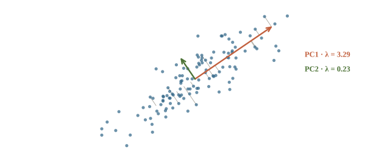
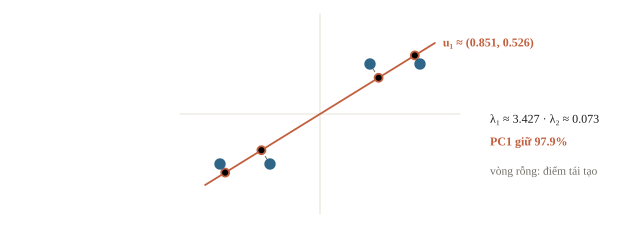
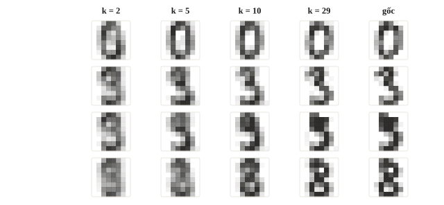
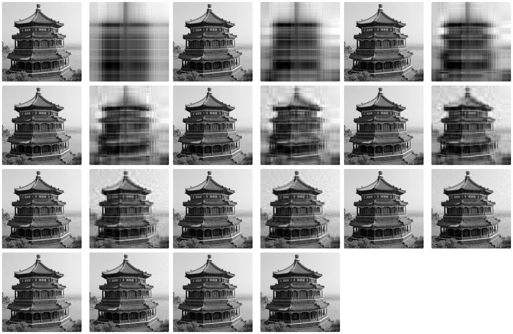
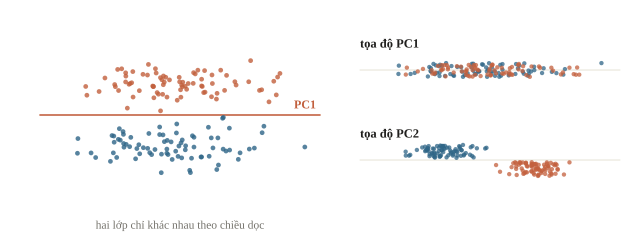
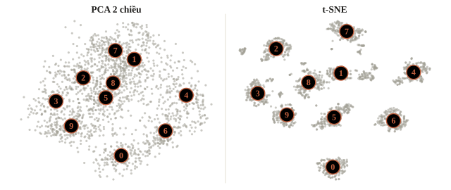
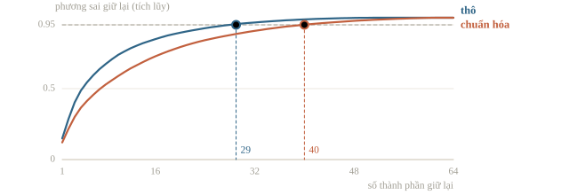

<!-- title -->
# Giảm chiều

Thay nhiều cột bằng vài cột mà mất ít thông tin

Chương 2 · Bài 2.9

---
<!-- split -->
## Nén một đám mây

Điểm toán và điểm lý tăng giảm cùng nhau.

Các điểm nằm gần đường chéo.

|||
Lưu vị trí trên đường thay cho hai tọa độ.

Phần ít biến thiên bị bỏ có chứa nhãn không?

---
## Mục tiêu

- Tính PCA bằng SVD và dựng lại dữ liệu từ các thành phần.
- Biết giữ nhiều phương sai chưa chắc giữ được thông tin để dự đoán.
- Đọc hình t-SNE, UMAP và biết giới hạn của chúng.

---
<!-- section 1 -->
# PCA và tái tạo

---
<!-- figure -->
## Chọn hướng trải rộng



PCA trừ trung bình từng cột trước. PC1 là hướng có phương sai chiếu lớn nhất; PC2 vuông góc với PC1 và giải quyết phần còn lại.

---
<!-- quiz -->
::: quiz
Dữ liệu hai chiều đã trừ trung bình có ma trận hiệp phương sai $\Sigma$ với hai trị riêng 4 và 1. Chiếu lên PC1 thì giữ được bao nhiêu phần phương sai, và tọa độ trên PC1 có độ lệch chuẩn bao nhiêu?
- [ ] 80%, độ lệch chuẩn 4
- [x] 80%, độ lệch chuẩn 2
- [ ] 50%, độ lệch chuẩn 2
- [ ] 75%, độ lệch chuẩn 4
Tỉ lệ là $4/5 = 80\%$. Trị riêng là phương sai, nên độ lệch chuẩn là $\sqrt4 = 2$.
:::

---
<!-- center -->
## Shape của phép chiếu

`X`: `(n, d)`; mean: `(d,)`; `X_centered`: `(n, d)`.

Giữ $k$ hàng đầu của `Vt` trong SVD.

`components`: `(d, k)`.

`coordinates = X_centered @ components`: `(n, k)`.

---
<!-- figure -->
## Bốn điểm, một trục



---
<!-- split -->
## Giữ phương sai bao nhiêu?

$$r_k=\frac{\lambda_1+\cdots+\lambda_k}{\lambda_1+\cdots+\lambda_d}$$

Trị riêng $\lambda_i=s_i^2/n$ khi tính bằng SVD.

|||
Đây là phương sai, không phải phần trăm accuracy hay mọi loại thông tin.

Nếu mục tiêu là phân loại, vẫn phải kiểm accuracy hoặc metric của nhiệm vụ sau đó.

---
<!-- figure -->
## Ảnh tái tạo từ k thành phần



---

<!-- figure -->
## PCA trên các hàng của một ảnh



---
<!-- quiz -->
::: quiz
SVD của dữ liệu đã trừ trung bình cho các giá trị kỳ dị $s = (6, 3, 1)$. Giữ hai thành phần đầu thì giữ được bao nhiêu phần phương sai?
- [ ] khoảng $0.90$
- [ ] khoảng $0.60$
- [ ] khoảng $0.75$
- [x] khoảng $0.978$
Trị riêng tỉ lệ với $s_i^2$: 36, 9, 1. Tỉ lệ giữ lại là $45/46 \approx 0.978$. Ra 0.9 là quên bình phương.
:::

---
<!-- quiz -->
::: quiz
Có hai cột: thu nhập tính bằng đồng, độ lệch chuẩn cỡ $10^7$, và tuổi, độ lệch chuẩn cỡ 10. Chạy PCA mà không chuẩn hóa. PC1 gần như là hướng nào?
- [ ] Trung bình cộng của hai cột
- [x] Gần như trùng với trục thu nhập
- [ ] Gần như trùng với trục tuổi
- [ ] Đường chéo $45^\circ$ giữa hai cột
Phương sai thu nhập lớn hơn tuổi cỡ $10^{12}$ lần, nên hướng trải rộng nhất gần như là trục thu nhập. Chuẩn hóa trước thì PC1 mới nói về quan hệ giữa hai cột.
:::

---
<!-- figure -->
## Phương sai nhỏ vẫn có thể cần



---
<!-- quiz -->
::: quiz
Hai lớp chỉ khác nhau ở một cột có biến thiên rất nhỏ. Cột còn lại là nhiễu, biên độ lớn. PCA không dùng nhãn sẽ ưu tiên giữ hướng nào?
- [x] Hướng có phương sai lớn, dù với bài này đó là nhiễu
- [ ] Hướng chứa thông tin về nhãn, vì nó tách hai lớp rõ nhất
- [ ] Cả hai hướng, vì PCA giữ mọi thông tin
- [ ] Một hướng ngẫu nhiên, tùy seed của thuật toán
PCA không biết nhãn. Nó giữ hướng có phương sai lớn, ở đây là nhiễu, và bỏ đúng hướng nhỏ chứa tín hiệu phân lớp.
:::

---
<!-- section 2 -->
# Kiểm phép biến đổi

---
<!-- center -->
## Dấu trục không phải lỗi

$\mathbf u$ và $-\mathbf u$ là cùng một đường.

Tọa độ đổi dấu; tái tạo giữ nguyên.

So dữ liệu tái tạo, không ép mọi hệ số trùng đúng dấu.

---
<!-- quiz -->
::: quiz
Trên hình t-SNE, cụm A nằm rất xa cụm B, còn A thì sát C. Ta được phép kết luận gì?
- [x] Chỉ quan hệ láng giềng bên trong cụm là đáng tin
- [ ] Trong không gian gốc, A gần C hơn hẳn so với B
- [ ] Cụm A to gấp đôi cụm C nên có gấp đôi số điểm
- [ ] Phải có đúng ba lớp, vì hình có ba cụm
t-SNE cố giữ láng giềng gần của từng điểm. Khoảng cách giữa các cụm và kích thước cụm trên hình gần như không mang thông tin.
:::

---
## PCA, TruncatedSVD, t-SNE

| | Trừ trung bình | Áp lên mẫu mới | Dùng để |
|---|---|---|---|
| PCA | Có | Có | Nén tuyến tính, tiền xử lý |
| TruncatedSVD | Không | Có | TF-IDF thưa |
| t-SNE | — | Không (sklearn) | Trực quan hóa |

Khoảng cách giữa các cụm t-SNE không phải thước đo của dữ liệu gốc; kiểm vài seed và vài cấu hình trước khi kết luận.

---
<!-- figure -->
## PCA và t-SNE trên digits



---
<!-- split -->
## Đối chiếu trên máy

Bốn điểm của mục PCA.

```python
X_centered = X_pca - X_pca.mean(axis=0)
U, s, Vt = np.linalg.svd(
    X_centered, full_matrices=False
)
components = Vt[:1].T
coordinates = X_centered @ components
print(components.shape, coordinates.shape)
print(round(float(s[0] ** 2 / sum(s ** 2)), 4))
reconstructed = coordinates @ components.T
error = np.mean((reconstructed - X_centered) ** 2)
print(round(float(error), 6))
```

|||

```output
(2, 1) (4, 1)
0.9792
0.036475
```

Khớp tỉ lệ 97.9% tính từ trị riêng.

---
## Chuẩn hóa ảnh: cần nhiều chiều hơn

```output
thô: cần 29 trên 64 thành phần để giữ 95% phương sai
chuẩn hóa: cần 40 trên 64 thành phần để giữ 95% phương sai
```

Pixel viền gần như hằng bị phóng lên phương sai 1.

Ảnh đã cùng đơn vị: chuẩn hóa không bắt buộc, kiểm bằng validation.

---
<!-- figure -->
## Phương sai tích lũy



---
<!-- quiz -->
::: quiz
Với bộ digits, dữ liệu thô cần 29 thành phần để giữ 95% phương sai, còn dữ liệu đã chuẩn hóa cần tới 40. Vì sao chuẩn hóa lại cần nhiều hơn?
- [ ] Chuẩn hóa làm mất thông tin, nên phải bù thêm chiều
- [x] Các pixel ở viền gần như không đổi bị đẩy lên phương sai 1
- [ ] Chuẩn hóa làm dữ liệu thưa hơn nên khó nén
- [ ] Đó là sai số ngẫu nhiên của thuật toán SVD
Sau chuẩn hóa, pixel nào cũng có phương sai 1, kể cả pixel viền gần như không đổi. Phương sai trải đều hơn nên cần nhiều thành phần hơn.
:::

---
## Khi đi thi

- Scaler và PCA fit trên train của fold.
- Embedding dài: PCA xuống vài trăm chiều, giữ nếu validation không tụt.
- t-SNE, UMAP để nhìn, không làm feature.

---
<!-- section 3 -->
# Luyện đề

---
<!-- quiz -->
::: quiz Luyện đề 1
Với $v = (1, -2, 3)$, vector đơn vị cùng hướng với $v$ là gì?
- [ ] $v/14$
- [ ] $-v/\sqrt{14}$
- [x] $v/\sqrt{14}$
- [ ] $v/\sqrt{6}$
Độ dài của $v$ là $\sqrt{14}$. Chia cho độ dài thì giữ hướng, đổi dấu thì thành hướng ngược lại.
Đề thi: [USA-NA-AIO 2026 · Vòng 1 · Part 2.1](https://www.usaaio.org/attachments/past-problems/2026/usaaio-2026-round-1-problems.pdf#page=4)
:::

---
<!-- quiz -->
::: quiz Luyện đề 2
UMAP vẽ một bản đồ 2 chiều cho các embedding. Khi đọc khoảng cách trên hình, câu nào đúng với điều UMAP ưu tiên?
- [ ] Mọi khoảng cách giữa hai điểm trong không gian gốc được giữ đúng tỉ lệ
- [ ] Phép chiếu luôn tuyến tính, nên đổi seed không làm đổi hình
- [ ] Nó tìm lỗi tái tạo nhỏ nhất, giống PCA
- [x] Nó ưu tiên giữ láng giềng gần hơn là khoảng cách toàn cục
UMAP giữ láng giềng gần và có `transform` cho điểm mới. Khoảng cách giữa các cụm vẫn phải đọc thận trọng, nên thử vài seed và vài `n_neighbors`.
Đề thi: [USA-NA-AIO 2026 · Vòng 1 · Part 1.5](https://www.usaaio.org/attachments/past-problems/2026/usaaio-2026-round-1-problems.pdf#page=3)
:::

---
<!-- center -->
## Chốt ba điều

Center dữ liệu, tính component bằng SVD và tái tạo bằng cùng phép chiếu.

Explained variance đo phương sai giữ lại, không đo trực tiếp chất lượng nhãn.

Fit phép biến đổi trên train và đọc hình t-SNE/UMAP thận trọng.

---
<!-- center -->
## Sau giờ học

Làm **10 câu kiểm tra cuối bài** trên trang bài học.

Chạy notebook từ đầu; đổi số component, dự đoán shape và MSE tái tạo, rồi kiểm lại bằng output.
