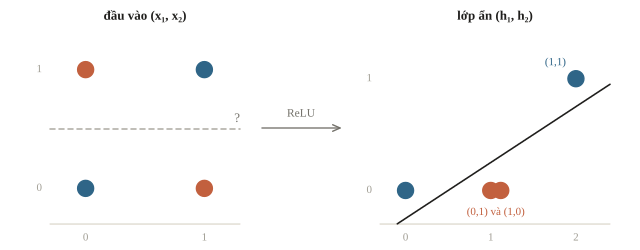
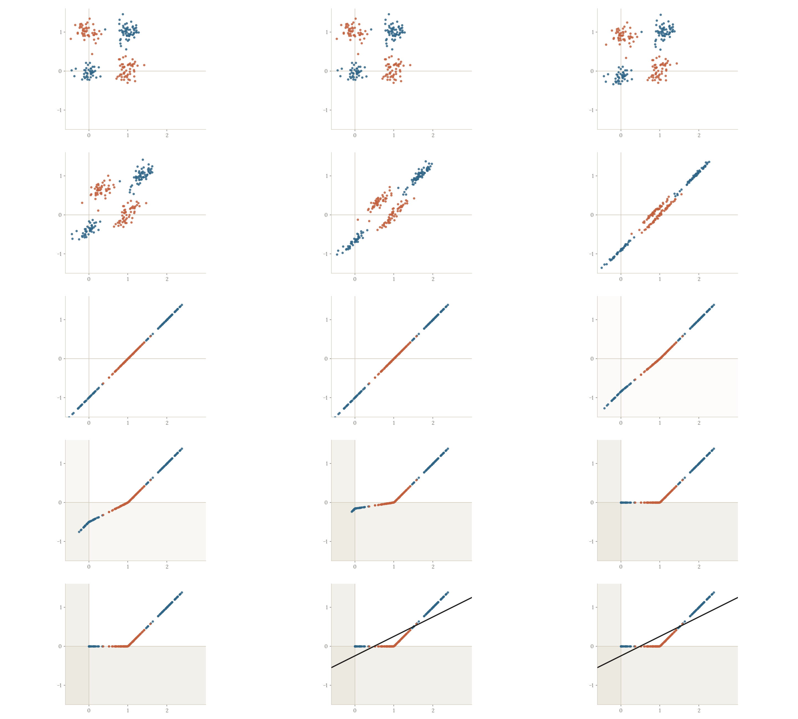
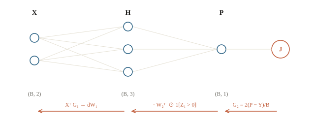
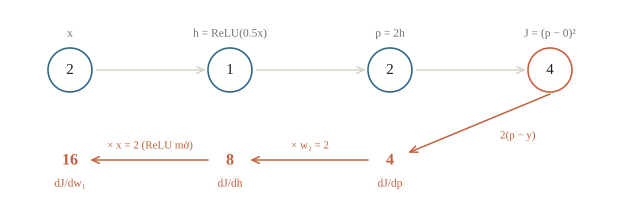
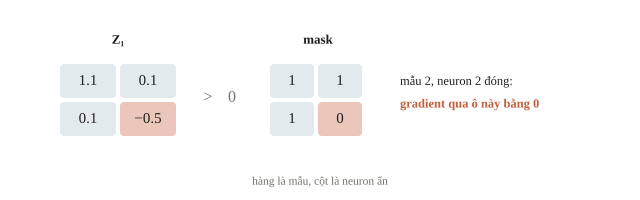
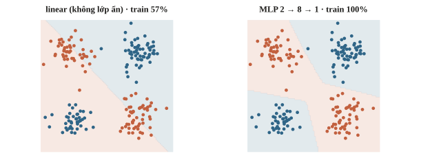

<!-- title -->
# MLP và backpropagation

Lỗi đầu ra quay về lớp đầu như thế nào?

Chương 3 · Bài 3.2

---
<!-- split -->
## Hai công tắc, một đèn

Đèn sáng khi đúng một công tắc bật.

XOR: 00→0, 01→1, 10→1, 11→0.

|||

Một đường thẳng có tách được hai lớp?

Thêm epoch chưa chắc sửa được hạn chế biểu diễn.

---
<!-- figure -->
## Nhìn bốn góc



---

<!-- figure -->
## Lớp ẩn gập mặt phẳng



---
<!-- center -->
## Tạo hai đặc trưng trung gian

$$h_1=\operatorname{ReLU}(x_1+x_2).$$
$$h_2=\operatorname{ReLU}(x_1+x_2-1).$$
$$\hat y=h_1-2h_2.$$

Trọng số đặt tay để kiểm khả năng biểu diễn.

---
<!-- split -->
## Tổng 0, 1, 2

| Tổng input | $h_1$ | $h_2$ | Output |
|---|---|---|---|
| 0 | 0 | 0 | 0 |
| 1 | 1 | 0 | 1 |
| 2 | 2 | 1 | 0 |

|||

Kết quả code:

```output
[0. 1. 1. 0.]
```

Activation tạo phi tuyến.

---
<!-- quiz -->
::: quiz
Giữ nguyên hai đặc trưng $h_1$, $h_2$ của mạng XOR đặt tay, chỉ đổi đầu ra thành $\hat y = h_1 - h_2$. Với bốn đầu vào $(0,0)$, $(0,1)$, $(1,0)$, $(1,1)$, mạng cho ra hàm nào?
- [x] OR: $0, 1, 1, 1$
- [ ] AND: $0, 0, 0, 1$
- [ ] Vẫn là XOR: $0, 1, 1, 0$
- [ ] NAND: $1, 1, 1, 0$
Tổng 2 cho $(h_1, h_2) = (2, 1)$, nên $h_1 - h_2 = 1$. Lớp ẩn không đổi, chỉ cách lớp cuối trộn đặc trưng thay đổi.
:::

---
<!-- quiz -->
::: quiz
Mạng $2 \to 100 \to 1$ gồm hai lớp linear nối thẳng, không có activation ở giữa. Mạng này biểu diễn được những hàm nào?
- [ ] Mọi hàm liên tục, nhờ 100 neuron ẩn
- [x] Đúng những hàm mà một lớp linear biểu diễn được
- [ ] Thêm được XOR, nhờ lớp ẩn tạo ra đặc trưng mới
- [ ] Nhiều hơn một lớp linear, nhưng chưa tới XOR
Hai lớp gộp lại thành $X(W_1W_2) + (b_1W_2 + b_2)$, vẫn là một phép affine, nên 100 neuron ẩn chỉ là tham số thừa. Khả năng biểu diễn đến từ phần phi tuyến ở giữa.
:::

---
<!-- section 1 -->
# Forward và shape

---
<!-- split -->
## Mẫu đặt ở hàng

$B$: số mẫu; $d$: feature vào; $h$: neuron ẩn; $c$: số đầu ra.

$$Z_1=XW_1+b_1.$$
$$H=\operatorname{ReLU}(Z_1).$$
$$P=HW_2+b_2.$$

|||

| Tensor | Shape |
|---|---|
| $X$ | `(B, d)` |
| $W_1$ | `(d, h)` |
| $H$ | `(B, h)` |
| $W_2$ | `(h, c)` |
| $P$ | `(B, c)` |

---
<!-- center -->
## Hai quy ước, một phép tính

NumPy trong bài: $Z=XW_1$, `W1` shape `(d,h)`.

`nn.Linear(d,h)`: $Z=X\,\text{weight}^\top+b$, `weight` shape `(h,d)`.

Chép trọng số tự cài sang `Linear`: gán `W1.T`.

---
<!-- quiz -->
::: quiz
Lớp đầu đã được cài bằng NumPy theo quy ước hàng, $Z = XW_1$, với `W1` có shape `(3, 3)`. Chép thẳng `W1` vào `weight` của `torch.nn.Linear(3, 3)` rồi chạy. Chuyện gì xảy ra?
- [ ] Báo lỗi shape ngay ở lần forward đầu tiên
- [ ] Ra đúng kết quả, vì PyTorch tự chuyển vị khi cần
- [x] Chạy êm, nhưng tính ra $XW_1^\top$, sai mà không báo
- [ ] Chỉ bias bị sai, phần trọng số vẫn đúng
`Linear` tính $X\,\text{weight}^\top$, nên gán thẳng sẽ cho ra $XW_1^\top$. Ma trận vuông nên không có lỗi nào được báo. Phải gán `W1.T`.
:::

---
<!-- center -->
## Đầu ra hồi quy một chiều

Với hồi quy một đầu ra và MSE trung bình trên $B$ mẫu:

$$G_2=\frac{2}{B}(P-Y).$$
$$\nabla_{W_2}J=H^\top G_2.$$
$$G_1=(G_2W_2^\top)\odot\mathbf1[Z_1>0].$$

Gradient phải có cùng shape tham số.

---
<!-- figure -->
## Gradient đi ngược mạng 2→3→1



---
<!-- quiz -->
::: quiz
`H` có shape `(5, 4)`, `G2` có shape `(5, 1)`. Gradient theo `W2` có shape gì?
- [ ] `(5, 5)`
- [ ] `(5, 4)`
- [ ] `(1, 4)`
- [x] `(4, 1)`
`H.T @ G2` cộng đóng góp của năm mẫu thành `(4, 1)`, đúng shape của $W_2$.
:::

---
<!-- section 2 -->
# Tính và kiểm

---
<!-- split -->
## Một mẫu tính tay

$x=2$, $y=0$, $w_1=0.5$, $b_1=0$, $w_2=2$, $b_2=0$.

$z=1$ → $h=1$ → $p=2$ → $J=(p-y)^2=4$.

|||

- $\partial J/\partial p = 4$
- $\partial J/\partial w_2 = 4$
- $\partial J/\partial h = 8$
- $\partial J/\partial w_1 = \mathbf{16}$

Dùng trọng số cũ trong toàn bộ backward.

---
<!-- figure -->
## Forward và backward của một mẫu



---
<!-- quiz -->
::: quiz
Mạng một mẫu có $h = \mathrm{ReLU}(w_1x)$, $p = w_2h$, $L = (p - y)^2$. Tại $x = 3$, $w_1 = 1$, $w_2 = 1$, $y = 1$, gradient $\partial L/\partial w_1$ bằng bao nhiêu?
- [ ] 6
- [ ] 3
- [x] 12
- [ ] 4
$\partial L/\partial p = 4$, nhân $w_2 = 1$, nhân đạo hàm ReLU bằng 1, nhân $x = 3$, được 12.
:::

---
<!-- split -->
## NumPy: từng phép có tên

Đoạn trích từ hàm `backward` trong notebook: `params[2]` là $W_2$, `Y` là target cùng shape với `P`.

```python
G2 = 2 * (P - Y) / len(X)
G1 = (G2 @ params[2].T) * (Z1 > 0)
```

|||

Đầu ra của batch kiểm:

```output
[0.56 0.1 ]
0.1018
```

Target hai mẫu là 1 và 0, nên loss $=\big((0.56-1)^2+(0.1-0)^2\big)/2=0.1018$.

---
<!-- figure -->
## Mask của ReLU



---
<!-- quiz -->
::: quiz
Hàm `backward` ở trên bị quên `* (Z1 > 0)`. Với $Z_1$ của batch này, những gradient nào bị sai?
- [ ] Cả bốn gradient, vì $G_1$ có mặt trong mọi công thức
- [x] Chỉ phần $W_1$, $b_1$ nối vào neuron ẩn thứ hai
- [ ] Chỉ $W_2$ và $b_2$, vì chúng nằm sát ReLU nhất
- [ ] Không gradient nào, vì forward đã cắt $H$ về 0
Mask chỉ có một số 0, ở mẫu 2, neuron 2, nên chỉ phần $W_1$, $b_1$ nối vào neuron ẩn thứ hai bị sai. Gradient của $W_2$, $b_2$ không đi qua mask.
:::

---
<!-- split -->
## Bias nhận tổng đóng góp

```python
G1.sum(axis=0)
G2.sum(axis=0)
```

Đã chia $B$ trong $G_2$, không chia thêm lần nữa.

|||

Gradient theo $W_2$:

```output
[[-0.474]
 [-0.044]]
```

$-0.474$ là tổng đóng góp hai mẫu.

---
<!-- center -->
## Ba cách đối chiếu

Backward NumPy · sai phân trung tâm · autograd

```output
numeric match: True
autograd match: True
0.1018 0.065513
```

Hai cách độc lập khớp backward; một bước lr 0.05 giảm loss.

---
<!-- quiz -->
::: quiz
Mạng nhỏ ở trên có 9 phần tử tham số. Kiểm bằng sai phân trung tâm thì phải tính `objective` bao nhiêu lần? Với một MLP có $10^6$ tham số thì sao?
- [x] 18 lần, và mạng $10^6$ tham số cần $2\cdot 10^6$ lần
- [ ] 9 lần, và mạng $10^6$ tham số cần $10^6$ lần
- [ ] 2 lần, số tham số không ảnh hưởng chi phí
- [ ] 4 lần, mỗi tensor một cặp, và mạng lớn vẫn chỉ 4 lần
Mỗi phần tử cần tính hai lần, với $+\varepsilon$ và $-\varepsilon$. Backward cho cả vector gradient với chi phí cỡ một forward, nên sai phân chỉ dùng để kiểm.
:::

---
<!-- quiz -->
::: quiz
Gradient tính bằng NumPy trùng với autograd và với sai phân trên một batch nhỏ. Điều đó bảo đảm được gì?
- [ ] Mạng sẽ có điểm validation cao sau khi train
- [ ] Gradient descent sẽ tới được nghiệm toàn cục
- [ ] Mọi batch khác cũng sẽ cho loss giảm
- [x] Backward tính đúng đạo hàm tại điểm đã kiểm
Phép kiểm chỉ nói backward tính đúng đạo hàm tại bộ tham số đã thử. Nó không nói gì về validation.
:::

---
<!-- split -->
## Dùng nn.Linear

Mạng 2→3→1 có 13 tham số tính cả bias.

Linear(2,3) lưu weight `(3,2)`.

|||

```output
(4, 1)
13
```

Chuyển NumPy weight `(2,3)` sang Linear cần chuyển vị.

---
<!-- figure -->
## Học XOR thật



---
<!-- quiz -->
::: quiz
Mạng hồi quy trả về `pred` shape `(4, 1)`, giá trị đúng bằng target `y = torch.tensor([1., 2., 3., 4.])` có shape `(4,)`. Thế nhưng `torch.nn.MSELoss()(pred, y)` lại cho $2.5$ thay vì $0$. Vì sao?
- [ ] `MSELoss` mặc định cộng các bình phương thay vì lấy trung bình
- [ ] Sai số làm tròn của `float32` cộng dồn qua bốn mẫu
- [x] `pred - y` bị broadcast thành `(4, 4)`, so mọi cặp mẫu
- [ ] `y` phải đổi sang `float64` cho cùng kiểu với `pred`
`(4, 1)` trừ `(4,)` bị broadcast thành `(4, 4)`, nên loss là trung bình trên 16 cặp: $40/16 = 2.5$. Sửa bằng `pred.squeeze(1)`.
:::

---
<!-- split -->
## Khi mạng không học

Kiểm shape · ReLU đóng · detach · zero_grad.

Tính đủ gradient rồi mới cập nhật.

|||

Chi phí forward chính:

$$O(Bdh+Bhc).$$

Tăng width tăng cả capacity và tài nguyên.

---
## Khi đi thi

- Học thuộc vài chục mẫu trước; không được thì lỗi ở code.
- Tự viết backward: kiểm sai phân, `float64`, mạng tí hon.
- Đếm tham số, bộ nhớ; so với baseline linear cùng seed.
- Đặt trọng số tay: neuron ẩn là nửa mặt phẳng, ghép AND/OR.
- Chép sang `nn.Linear`: chuyển vị rồi so output.

---
<!-- section 3 -->
# Luyện đề

---
<!-- quiz -->
::: quiz Luyện đề 1
Đề yêu cầu dựng một MLP chỉ gồm lớp linear và hàm ngưỡng $\Theta(z) = 1$ nếu $z \ge 0$, ngược lại bằng 0. Trọng số đặt tay, không huấn luyện. Đầu ra phải bằng 1 khi điểm $(x, y)$ nằm trong tam giác có đỉnh $(0,0)$, $(3,1)$, $(1,5)$, tính cả cạnh. Lớp ẩn có $h_1 = \Theta(3y - x)$, $h_2 = \Theta(7 - 2x - y)$, $h_3 = \Theta(5x - y)$. Chọn neuron đầu ra.
- [ ] $\Theta(h_1 + h_2 + h_3 - 1)$
- [ ] $\Theta(h_1 + h_2 + h_3 - 2)$
- [x] $\Theta(h_1 + h_2 + h_3 - 3)$
- [ ] $\Theta(3 - h_1 - h_2 - h_3)$
Tam giác là giao của ba nửa mặt phẳng, nên đầu ra cần phép AND, tức tổng phải bằng 3. Ngưỡng $-2$ nhận cả điểm $(2, 0)$ nằm ngoài.
Phỏng theo: [USA-NA-AIO 2026 · Vòng 1 · Part 7.4](https://www.usaaio.org/attachments/past-problems/2026/usaaio-2026-round-1-problems.pdf#page=19)
:::

---
<!-- quiz -->
::: quiz Luyện đề 2
Mạng không có bias. $z_1 = w_Ax_1 + w_Bx_2$, $a_1 = g(z_1)$. Từ $a_1$ tách ra hai nhánh: $z_2 = w_Ca_1$, $a_2 = g(z_2)$ và $z_3 = w_Da_1$, $a_3 = g(z_3)$. Cuối cùng $z_4 = w_Ea_2 + w_Fa_3$, $\hat y = g(z_4)$. Đặt $\delta = \partial\ell/\partial z_4$. Biểu thức nào là $\partial\ell/\partial a_1$?
- [x] $\delta\,\big(w_Eg'(z_2)w_C + w_Fg'(z_3)w_D\big)$
- [ ] $\delta\,w_Eg'(z_2)w_C$
- [ ] $\delta\,\big(w_Eg'(z_2)w_C\big)\big(w_Fg'(z_3)w_D\big)$
- [ ] $\delta\,\big(w_Ew_C + w_Fw_D\big)$
$a_1$ ảnh hưởng tới loss qua hai đường, và chain rule cộng đóng góp của hai đường lại.
Phỏng theo: [CMU 10-601 · Exam 2 Practice · Q4.4](https://www.cs.cmu.edu/~mgormley/courses/10601/handout/exam2_practice_problems.pdf#page=18)
:::

---
<!-- quiz -->
::: quiz Luyện đề 3
Mạng một đầu vào, hai neuron ẩn sigmoid, đầu ra linear: $\hat y = v_1\sigma(w_1x + c_1) + v_2\sigma(w_2x + c_2) + d$. Khởi tạo hai neuron giống hệt nhau, tức $w_1 = w_2$, $c_1 = c_2$, $v_1 = v_2$, rồi chạy batch gradient descent với MSE. Chuyện gì xảy ra?
- [ ] Trọng số đứng yên, vì gradient bằng 0 ngay từ đầu
- [x] Hai neuron mãi giống nhau, mạng không hơn một neuron
- [ ] Hai neuron tự tách nhau sau vài bước, nhờ nhiễu làm tròn
- [ ] Neuron thứ hai chết dần, chỉ neuron thứ nhất còn học
Hai neuron giống hệt nhận gradient giống hệt, nên mãi là bản sao của nhau. Khởi tạo ngẫu nhiên phá thế đối xứng này.
Phỏng theo: [MIT 6.036 · Final, Spring 2022 · Q4(h)](https://introml.mit.edu/_static/fall22/final/review/6036_final_sp22.pdf#page=11)
:::

---
<!-- center -->
## Chốt cơ chế

Hidden tạo feature · activation tạo phi tuyến.

Backward nhân độ nhạy, cộng các nhánh.

Làm 10 câu cuối bài, chạy notebook và kiểm lại bằng tay.
