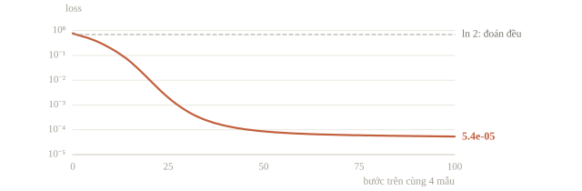
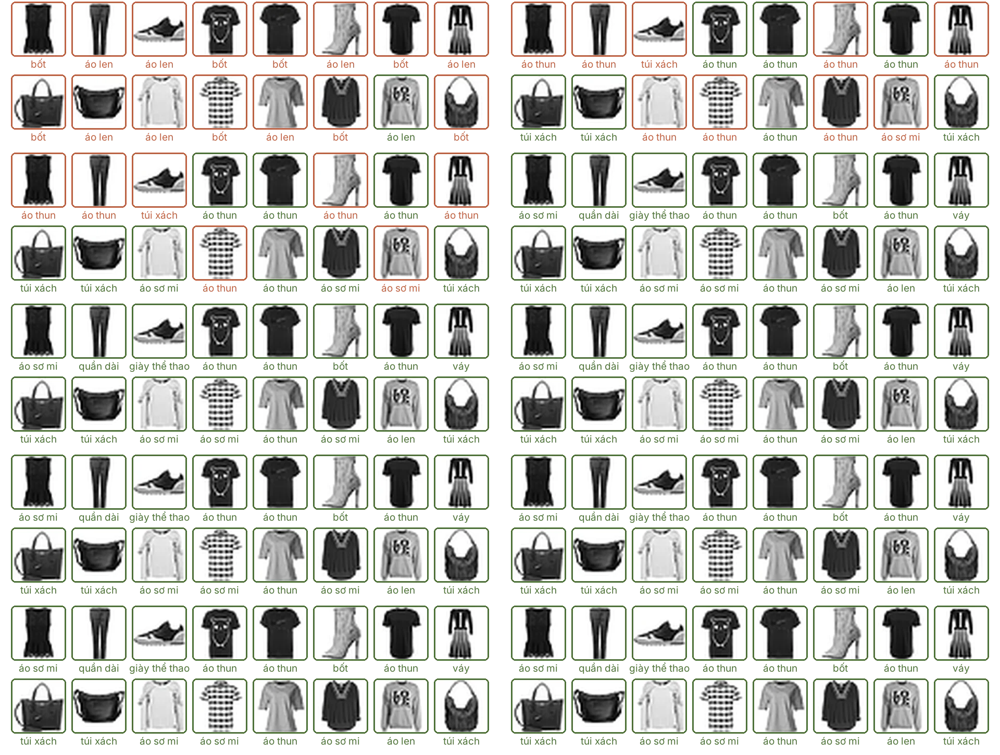
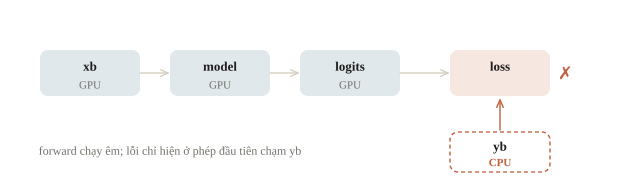
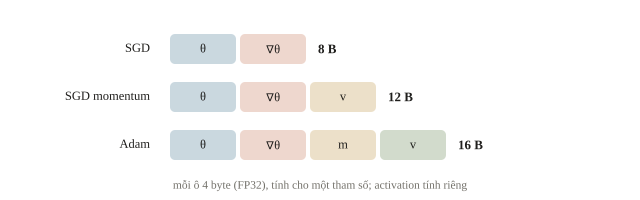
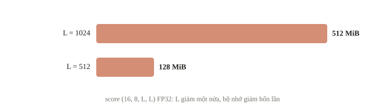
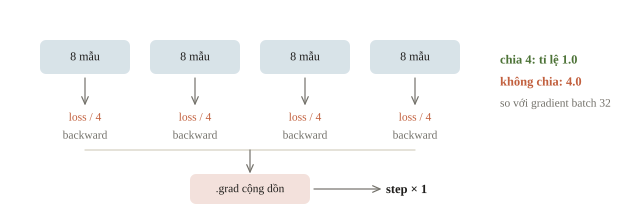
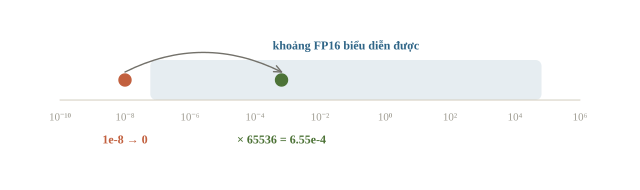
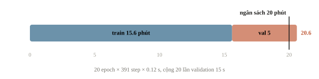

<!-- title -->
# Huấn luyện trên GPU

Kiểm đúng trước, đo tài nguyên sau

Phase 3 · Bài 3.7

---
<!-- split -->
## Giống kiểm TLE/MLE trong CP

Input nhỏ đúng chưa đủ cho input lớn.

Nhưng input nhỏ sai thì đo GPU chưa giúp ích.

|||

Overfit một batch → debug → ước lượng → đo thật.

Ba bước đầu chạy trên CPU; bước cuối cần GPU được cấp.

---
<!-- section 1 -->
# Một batch phải học được

---
<!-- split -->
## Bốn góc, nhãn theo dấu $x_1$

Mạng 2→8→2, không dropout/augmentation.

100 bước trên cùng batch.

|||

```output
loss: 0.776305 -> 5.4e-05
one-batch accuracy: 1.0
```

Điểm trên chính batch đã học, không phải validation.

---
<!-- figure -->
## Loss 100 bước



---

<!-- figure -->
## Overfit một batch ảnh thật



---
<!-- quiz -->
::: quiz
Sau 100 bước trên bốn mẫu, loss giảm từ 0.776 xuống 5.4e-05, và accuracy bằng 1.0. Ta kết luận được gì?
- [ ] Model sẽ đạt accuracy cao trên tập validation
- [ ] Có thể bỏ validation, vì loss đã gần bằng 0
- [x] Forward, loss, backward và bước cập nhật đã được nối đúng
- [ ] Learning rate 0.05 cũng sẽ hợp với dữ liệu thật
Phép thử chỉ cho thấy forward, loss, backward và bước cập nhật nối đúng, nên khớp được bốn mẫu đã học. Khớp nhóm nhỏ và tổng quát hóa là hai việc khác nhau.
:::

---
<!-- quiz -->
::: quiz
Thử cho model học thuộc 16 ảnh của một bài 10 lớp. Loss đứng yên ở 2.3026 suốt 200 bước, accuracy cũng không đổi. Nên kiểm gì trước?
- [ ] Thêm dữ liệu, vì 16 ảnh là quá ít để học
- [x] Optimizer có nắm đúng tham số không, và có gọi `step()` không
- [ ] Tăng dropout để model bớt học thuộc batch
- [ ] Giảm batch xuống 1 cho gradient rõ hơn
$\ln 10 \approx 2.3026$ là loss khi đoán đều 10 lớp, và con số không nhúc nhích nghĩa là tham số không đổi. Kiểm optimizer có đúng tham số, có gọi `step()`, learning rate có khác 0.
:::

---
<!-- split -->
## Tìm nơi lỗi xuất hiện đầu

Input → activation → logits → loss → gradient.

`torch.isfinite` phát hiện NaN và inf.

|||

```output
finite rows: [False, True]
bad row indices: [0]
```

Input đã NaN: đổi optimizer không sửa dữ liệu.

---
<!-- figure -->
## Cùng một thiết bị



---
<!-- quiz -->
::: quiz
Đã gọi `model.to('cuda')` và `xb = xb.to('cuda')`. Forward chạy được, nhưng dòng `loss = criterion(logits, yb)` báo các tensor không nằm trên cùng thiết bị. Vì sao?
- [ ] Model mới lên GPU một phần, phải gọi lại `.to`
- [x] `yb` vẫn ở CPU, phải chuyển nó sang cùng thiết bị
- [ ] Loss phải tính ở CPU, nên đưa logits về CPU
- [ ] `yb` phải đổi sang float cho khớp với logits
Forward chạy được nên model và `xb` đã cùng ở GPU, và phép đầu tiên chạm tới `yb` mới hỏng. Mọi tensor trong một phép phải cùng thiết bị.
:::

---
<!-- quiz -->
::: quiz
Logits có shape `(4, 3)`, target tạo bằng `torch.tensor([0., 2., 1., 1.])`. `nn.CrossEntropyLoss()` báo `expected scalar type Long but found Float`. Sửa thế nào?
- [ ] Đổi logits sang `.long()` cho cùng kiểu
- [ ] Đổi loss sang `BCEWithLogitsLoss`
- [x] Tạo target kiểu `long`, chẳng hạn bằng `.long()`
- [ ] Đưa target về shape `(4, 3)` bằng `.view`
Target của cross-entropy là chỉ số lớp: số nguyên kiểu `long`, shape `(4,)`. Ép logits về số nguyên thì mất gradient.
:::

---
<!-- center -->
## Bốn hợp đồng

Shape có tên chiều · dtype phù hợp loss.

Model/tensor cùng device · gradient còn đường nối.

Anomaly detection chỉ bật khi debug vài bước.

---
<!-- section 2 -->
# Bộ nhớ không chỉ có weight

---
<!-- figure -->
## Byte mỗi tham số



---
<!-- quiz -->
::: quiz
Đổi Adam sang SGD có momentum, tức mỗi tham số giữ một buffer vận tốc, và vẫn dùng FP32. Phần weight, gradient và trạng thái optimizer còn khoảng bao nhiêu byte cho mỗi tham số?
- [ ] 4
- [ ] 8
- [x] 12
- [ ] 16
Weight 4, gradient 4, buffer momentum 4, tổng 12 byte.
:::

---
<!-- split -->
## Mạng nhỏ và tensor lớn

```output
parameters: 42
weight bytes: 168
```

Weight, gradient, hai moment với Adam: 672 byte.

|||

Score `(16,8,1024,1024)` FP32:

**512 MiB** nếu lưu đủ cả tensor.

Chỉ tính kích thước, không cấp phát tensor ấy.

---
<!-- center -->
## Giảm batch, giảm độ dài

Batch 64 → 32: input và activation giảm khoảng một nửa.

Weight, gradient, moment: giữ nguyên.

Score `(16,8,L,L)`: $L$ 1024 → 512 thì 512 MiB → 128 MiB.

---
<!-- figure -->
## Bộ nhớ tỉ lệ với $L^2$



---
<!-- quiz -->
::: quiz
Giảm batch size đi một nửa, giữ nguyên kiến trúc và optimizer. Phần bộ nhớ nào giảm theo, trong khi weights vẫn đứng yên?
- [x] Input và activation của batch
- [ ] Mọi phần cùng giảm đúng một nửa
- [ ] Weights và hai moment của Adam
- [ ] Chỉ bộ nhớ đệm của allocator
Input và activation tỉ lệ với số mẫu trong batch, còn weights, gradient và moment tỉ lệ với số tham số.
:::

---
<!-- split -->
## OOM và graph sống

Giảm batch, độ dài, kích thước ảnh trước.

`empty_cache` không xóa tensor còn sống.

|||

`history.append(loss)` kéo theo graph.

Validation quên `no_grad` mà giữ loss: graph giữ cả activation.

Metric scalar: lưu `loss.item()`.

---
<!-- center -->
## Gradient accumulation

```python
for x_part, y_part in zip(X_acc.chunk(4), y_acc.chunk(4)):
    micro_loss = criterion(net(x_part), y_part)
    (micro_loss / 4).backward()   # .grad cộng dồn
```

```output
divide by 4: True | norm ratio: 1.0 | matches full batch: True
divide by 4: False | norm ratio: 4.0 | matches full batch: False
```

Bốn microbatch 8 mẫu so với một batch 32.

---
<!-- figure -->
## Bốn microbatch, một step



---
<!-- split -->
## Accumulation: điều kiện và cái giá

Loss mỗi microbatch chia $k$.

Microbatch bằng nhau; BatchNorm vẫn chỉ thấy microbatch.

|||

Activation chỉ cỡ một microbatch.

$k$ lượt forward/backward cho một step: tiết kiệm bộ nhớ, không tăng tốc.

---
<!-- quiz -->
::: quiz
Batch 64 bị OOM, batch 16 thì chạy được. Ta dùng accumulation 4 microbatch, mỗi microbatch 16 mẫu, trên 6400 mẫu train. Mỗi epoch có bao nhiêu lần `backward()` và bao nhiêu lần `optimizer.step()`?
- [ ] 100 lần backward, 100 lần step
- [ ] 400 lần backward, 400 lần step
- [ ] 100 lần backward, 400 lần step
- [x] 400 lần backward, 100 lần step
Mỗi microbatch backward một lần: 400 lần. Optimizer bước sau mỗi 4 microbatch: 100 lần.
:::

---
<!-- section 3 -->
# Mixed precision và CUDA

---
<!-- split -->
## Mixed precision và GradScaler

Autocast: matmul/conv FP16; softmax, log, tổng FP32.

GradScaler nhân loss với 65536 trước backward.

|||

```output
FP16 of 1e-8: 0.0
FP16 of 1e-8 * 65536: 0.00065517
unscaled in FP32: 9.9972e-09
```

Gradient nhỏ không bị làm tròn về 0.

---
<!-- figure -->
## Khoảng số của FP16



---
<!-- quiz -->
::: quiz
GradScaler nhân loss với 65536 trước khi backward. Vì sao bước cập nhật không lớn gấp 65536 lần?
- [x] Gradient được chia lại trước khi cập nhật
- [ ] Learning rate cũng tự chia cho 65536
- [ ] FP16 tự làm tròn gradient về giá trị thật
- [ ] Hệ số chỉ nhân vào con số loss in ra log
`scaler.step` chia gradient cho đúng hệ số rồi mới để optimizer dùng. Hệ số chỉ giúp gradient nhỏ không bị làm tròn về 0 trong backward.
:::

---
<!-- split -->
## Thứ tự một step AMP

Autocast forward và loss.

`scaler.scale(loss).backward()` → `unscale_`.

|||

Clip nếu cần → `scaler.step` → `update`.

Clip sau `unscale_` để ngưỡng có đúng nghĩa.

---
<!-- center -->
## Recipe đo trên GPU

Tệp [gpu_probe.py](../recipes/gpu_probe.py), chạy riêng trên máy có CUDA.

Lệnh mặc định: kiểm môi trường, `CUDA_READY` hoặc `CPU_ONLY`.

`--run --precision fp32` hoặc `amp`: benchmark trên GPU.

Không suy ra tốc độ từ tên card: đo trên đúng máy được cấp.

---
<!-- split -->
## Đo công việc đã hoàn tất

Warmup trước đoạn đo.

Synchronize trước và sau đồng hồ CPU.

Reset peak memory sau warmup.

|||

JSON: ms/step, samples/s, peak allocated/reserved.

Chỉ gồm train loop trên batch đã ở GPU.

I/O và CPU→GPU cần đo riêng.

---
<!-- quiz -->
::: quiz
Đo thời gian chạy CUDA bằng `time.perf_counter()` của CPU mà không synchronize. Con số đo được có thể phản ánh điều gì?
- [ ] Thời gian GPU thực sự chạy hết các kernel
- [ ] Thời gian chép dữ liệu từ ổ đĩa lên GPU
- [ ] Thời gian đã tự trừ đi các bước khởi động
- [x] Phần lớn chỉ là thời gian CPU gửi lệnh đi
CUDA chạy bất đồng bộ: CPU xếp lệnh vào hàng đợi rồi chạy tiếp ngay, nên đồng hồ dừng khi GPU có thể còn đang làm.
:::

---
<!-- center -->
## Ước lượng ngân sách

$$T_{\text{train}}\approx E\lceil N/B\rceil\,t.$$

$N=50\,000$, $B=128$: 391 step/epoch.

Nếu $t=0.12$ s: 20 epoch $\approx938$ s $\approx15.6$ phút.

Còn validation, I/O, checkpoint, khởi động.

---
<!-- figure -->
## Cộng validation vào



---
<!-- quiz -->
::: quiz
Tiếp ví dụ trên, với $t$ đã đo trên chính máy được cấp: phần train mất khoảng 15.6 phút, ngân sách là 20 phút, và mỗi epoch còn có validation đo được 15 giây. Kế hoạch 20 epoch có vừa không?
- [ ] Vừa, còn dư hơn 4 phút cho phần khác
- [ ] Vừa, vì validation dùng `no_grad` nên gần như không tốn
- [x] Không vừa, cộng validation vào đã khoảng 20.6 phút
- [ ] Chưa biết được, phải đo lại $t$ trên T4
Validation mất $20 \times 15$ giây, tức 5 phút, cộng 15.6 phút train là 20.6 phút. `no_grad` bỏ backward, nhưng forward trên validation vẫn tốn thời gian.
:::

---
## Khi đi thi

- Overfit một batch, assert shape và `isfinite` trước khi chạy dài.
- Ô đầu tiên: `torch.cuda.is_available()`, tên GPU, phiên bản PyTorch.
- Ngân sách: $E\lceil N/B\rceil t$ + validation, I/O, dư một lần chạy lại.
- OOM: giảm batch/độ dài, AMP, accumulation chia loss $k$.
- Lưu `state_dict` mỗi epoch, nộp sớm từ checkpoint tốt nhất.

---
<!-- section 4 -->
# Luyện đề

---
<!-- quiz -->
::: quiz Luyện đề 1
Accumulation 4 microbatch, có dòng A là `loss = loss / accumulation_steps` ngay trước `backward()`. Vì sao cần dòng A?
- [x] Để gradient cộng dồn bằng đúng gradient của cả batch lớn
- [ ] Để tránh tràn số khi gọi backward nhiều lần liên tiếp
- [ ] Không bắt buộc, dòng A chỉ đổi con số loss in ra log
- [ ] Để bù cho thống kê BatchNorm tính trên microbatch nhỏ
Loss mặc định là trung bình trong một microbatch, còn `.grad` cộng dồn qua bốn lần backward. Thiếu dòng A thì gradient lớn gấp 4, giống như lặng lẽ nhân learning rate với 4.
Đề thi: [NOAI 2026 Singapore · Chung kết · Câu 11](https://aisingapore.org/wp-content/uploads/2026/04/NOAI-2026-Final-Assessment-Section-1-MCQs-Google-Forms.pdf#page=16)
:::

---
<!-- quiz -->
::: quiz Luyện đề 2
Mixed precision: cách B là `scale → backward → step → update`, chạy tốt. Khi nào phải thêm `unscale_` trước `step`, tức cách C?
- [ ] Khi mạng rất sâu, để chống gradient bùng nổ
- [x] Khi có clip gradient, để ngưỡng clip đúng nghĩa
- [ ] Khi batch rất nhỏ làm gradient dao động mạnh
- [ ] Chỉ khi debug, để in ra độ lớn gradient thật
Cần `unscale_` khi muốn đọc hoặc clip gradient trước `step`. Clip trước khi unscale thì độ lớn còn gấp hệ số scale, nên ngưỡng gần như lần nào cũng bị kích hoạt.
Đề thi: [NOAI 2026 Singapore · Chung kết · Câu 16](https://aisingapore.org/wp-content/uploads/2026/04/NOAI-2026-Final-Assessment-Section-1-MCQs-Google-Forms.pdf#page=24)
:::

---
<!-- quiz -->
::: quiz Luyện đề 3
Có 140 giờ GPU, cần 90 epoch. Batch 256: 76.5%, 8 giờ mỗi epoch. Batch 2048: 75.8%, 1.5 giờ. Batch 8192: 73.2%, 0.5 giờ. Chọn cách nào?
- [ ] Batch 256, chạy tới khi hết ngân sách
- [ ] Batch 8192 đủ 90 epoch, chỉ hết 45 giờ
- [ ] Accumulation 4 × 2048, tốc độ của 8192 với chất lượng của 2048
- [x] Batch 2048 với LARS và warmup, chạy đủ 90 epoch
Batch 256 cần 720 giờ cho 90 epoch, ngân sách chỉ đủ 17.5 epoch. Batch 2048 hết 135 giờ, vừa 140 giờ, mà accuracy chỉ kém 0.7 điểm. Batch 8192 nhanh hơn nhưng mất 3.3 điểm.
Phỏng theo: [NOAI 2026 Singapore · Vòng sơ loại · Câu 295](https://aisingapore.org/wp-content/uploads/2026/04/NOAI-2026-Preliminary-Round-Assessment-300-MCQs-Google-Forms.pdf#page=113)
:::

---
<!-- center -->
## Chốt ba điều

Một batch phải học được trước khi đo tốc độ.

VRAM = tham số + gradient + optimizer + activation; batch chỉ chạm activation.

Accumulation chia loss $k$; AMP unscale trước clip; số đo lấy từ đúng máy.

---
<!-- center -->
## Sau giờ học

Làm **10 câu kiểm tra cuối bài** trên trang bài học.

Chạy notebook; đổi số microbatch, kiểm gradient vẫn trùng batch lớn.

Có GPU: chạy `gpu_probe.py` cả fp32 và amp, so ms/step và peak VRAM.
