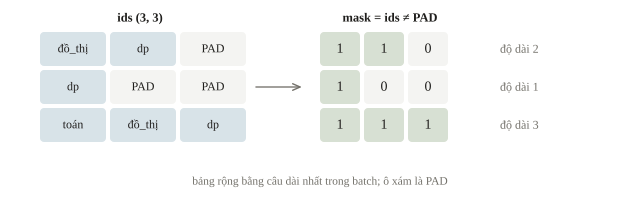
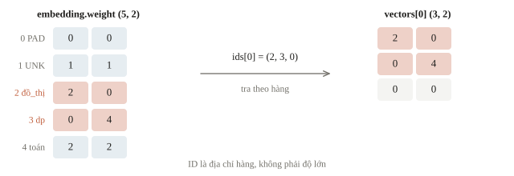
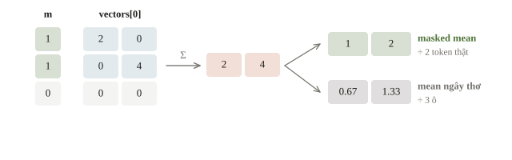
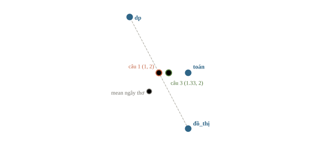
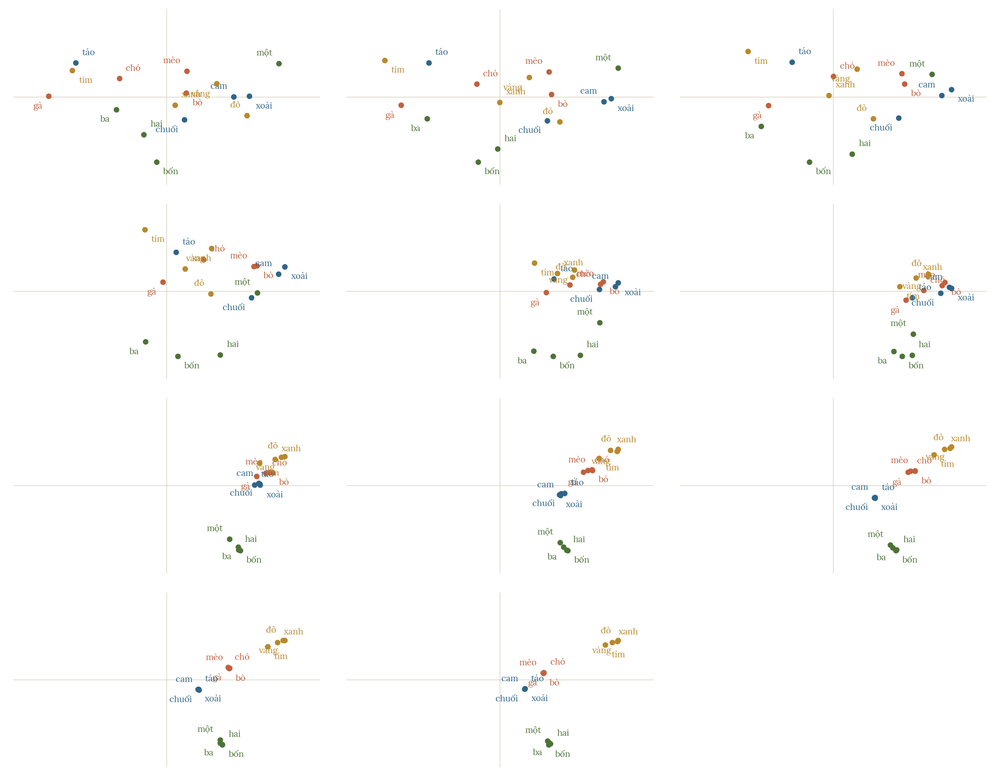
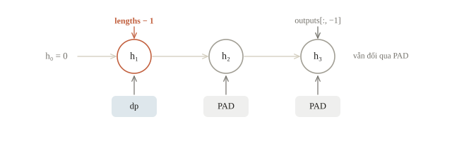
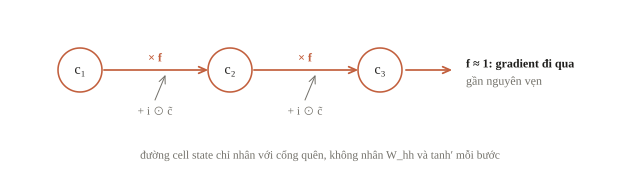

<!-- title -->
# Embedding và dữ liệu chuỗi

Padding để lưu, mask để hiểu đúng

Chương 3 · Bài 3.8

---
<!-- split -->
## Chuỗi ngắn, chuỗi dài

Tên bài có 2 token hoặc 6 token.

Batch cần một bảng chữ nhật.

|||

Thêm PAD không thêm nội dung.

Câu hỏi: thêm PAD có đổi biểu diễn của câu không?

---
<!-- section 1 -->
# ID và lookup

---
<!-- center -->
## ID là địa chỉ

Token “đồ_thị” có ID 2; “dp” có ID 3.

3 không lớn hơn 2 về ý nghĩa.

Embedding chọn hàng trong bảng `(V,d)`.

$V$ là số token trong vocabulary; $d$ là số thành phần của mỗi vector.

---
<!-- quiz -->
::: quiz
Một bạn đưa thẳng cột ID, với đồ_thị = 2, dp = 3, toán = 4, vào `nn.Linear(1, 8)` như một feature số. Câu nào đúng?
- [ ] Linear tự học một vector riêng cho từng ID, giống Embedding
- [x] Đầu ra là hàm tuyến tính của ID, nên đánh số lại là đổi model
- [ ] Chuẩn hóa ID bằng mean và std trước thì thành lookup đúng nghĩa
- [ ] Không sao, nếu ID được gán theo thứ tự tần suất xuất hiện
Đầu ra là $w\cdot\text{ID} + b$, nên ba token nằm trên một đường thẳng. Đánh số lại là đổi model. Embedding cho mỗi ID một hàng riêng.
:::

---
<!-- quiz -->
::: quiz
Vocabulary có 50 000 token, embedding rộng 300, batch token ID có shape `(32, 128)`. Nếu tạo one-hot float32 rồi nhân với bảng thay cho lookup, riêng tensor one-hot chiếm khoảng bao nhiêu?
- [ ] Khoảng 4.9 MB, bằng đầu ra lookup `(32, 128, 300)`
- [ ] Khoảng 60 MB, bằng bảng embedding `(50000, 300)`
- [x] Khoảng 819 MB, so với 4.9 MB của đầu ra lookup
- [ ] Khoảng 16 KB, vì one-hot chỉ lưu một số 1 cho mỗi token
One-hot dày lưu cả các số 0: $32\cdot 128\cdot 50\,000\cdot 4 \approx 819$ MB. Lookup trả thẳng `(32, 128, 300)`, chỉ khoảng 4.9 MB.
:::

---
<!-- figure -->
## Bảng chữ nhật và valid mask



---
<!-- split -->
## Batch trong notebook

```output
[[2, 3, 0], [3, 0, 0], [4, 2, 3]]
[[1, 1, 0], [1, 0, 0], [1, 1, 1]]
lengths: [2, 1, 3]
```

|||

`PAD = 0` · `UNK = 1`.

UNK là token thật chưa biết, PAD chỉ điền bảng.

Bảng dài bằng câu dài nhất **trong batch**.

---
<!-- quiz -->
::: quiz
Một batch gồm ba câu dài 5, 12 và 7 token. Câu dài nhất của cả dataset có 200 token. `pad_sequence(..., batch_first=True)` cho ra tensor shape gì, và có bao nhiêu ô PAD?
- [x] `(3, 12)`, 12 ô PAD
- [ ] `(12, 3)`, 12 ô PAD
- [ ] `(3, 12)`, không lưu ô PAD nào
- [ ] `(3, 200)`, 576 ô PAD
Câu dài nhất trong batch có 12 token, nên bảng có 36 ô, trong đó 24 token thật và 12 ô PAD.
:::

---
<!-- split -->
## Lookup giữ các vị trí

ID `(B,L)` → vector `(B,L,d)`.

$B$: số chuỗi trong batch; $L$: độ dài sau padding; $d$: embedding width.

Ví dụ batch `(3,3)`, bảng `(5,2)`.

|||

Câu đầu sau lookup:

```output
[[2.0, 0.0], [0.0, 4.0], [0.0, 0.0]]
```

Vector đặt tay để dễ đọc; model thật học chúng.

---
<!-- figure -->
## Tra theo hàng



---
<!-- quiz -->
::: quiz
Input ID có shape `(8, 12)`, embedding rộng 16. Đầu ra có shape gì?
- [ ] `(8, 16)`
- [ ] `(12, 16)`
- [ ] `(8, 16, 12)`
- [x] `(8, 12, 16)`
Lookup giữ nguyên batch và vị trí, thay mỗi ID bằng một vector 16 thành phần ở chiều cuối.
:::

---
<!-- quiz -->
::: quiz
Tạo `nn.Embedding(5, 2, padding_idx=0)`, rồi nạp một checkpoint có hàng 0 bằng `[0.3, -0.1]`. Lookup một ô PAD trả về gì, và masked mean của bài còn đúng không?
- [ ] `[0, 0]`, masked mean vẫn đúng
- [ ] `[0, 0]`, masked mean sai theo
- [x] `[0.3, -0.1]`, masked mean vẫn đúng
- [ ] `[0.3, -0.1]`, masked mean sai theo
`padding_idx` chỉ đặt 0 lúc khởi tạo và chặn gradient, nên lookup trả đúng hàng đang lưu. Masked mean chỉ đếm token thật nên vẫn đúng.
:::

---
<!-- section 2 -->
# Gộp đúng token thật

---
<!-- figure -->
## Tổng đúng, mẫu số cũng phải đúng



---
<!-- center -->
## Masked mean

$$\mathbf s_i=\frac{\sum_t m_{i,t}\mathbf e_{i,t}}{\sum_t m_{i,t}}.$$

$m_{i,t}=1$ ở token thật, bằng 0 ở PAD; $\mathbf e_{i,t}$ là vector token. Mẫu số là số token thật và phải khác 0.

Mask thêm chiều cuối trước nhân với vectors.

Gộp chiều độ dài, giữ batch và đặc trưng.

---
<!-- split -->
## Ví dụ tính tay

$([2,0]+[0,4])/2=\mathbf{[1,2]}$.

Mean cả PAD: $[2/3,\ 4/3]$.

|||

Trong output notebook:

`masked[0] = [1.0, 2.0]`

`naive first = [0.6667, 1.3333]`

PAD bằng 0 vẫn làm sai mẫu số nếu không mask.

---
<!-- figure -->
## Ba câu trong mặt phẳng



---
<!-- quiz -->
::: quiz
Vector của PAD bằng 0. Hai token thật có tổng vector là $(4, 6)$. Câu được pad thêm hai PAD, và code lấy mean trên cả bốn vị trí, ra $(1, 1.5)$. Sai ở đâu?
- [ ] Ở tử số, vì hai PAD đã cộng thêm vào tổng
- [x] Ở mẫu số, vì chia cho 4 vị trí thay vì 2 token thật
- [ ] Ở mask, vì mask chỉ cần khi PAD mang ID âm
- [ ] Không sai, vì PAD bằng 0 nên mean nào cũng như nhau
Vector PAD bằng 0 nên tổng vẫn là $(4, 6)$. Cái sai là mẫu số đếm 4 ô, chia cho 2 token thật mới được $(2, 3)$.
:::

---
<!-- quiz -->
::: quiz
Trong `masked_mean`, một bạn bỏ `keepdim=True`, nên `counts` có shape `(B,)`. Chạy với hai câu đầu của bài, `[2, 3]` và `[3]`, tức $B = d = 2$, code không báo lỗi. Kết quả là gì?
```py
counts = valid_mask.sum(dim=1)          # shape (2,)
return weighted.sum(dim=1) / counts     # (2,2) / (2,)
```
- [ ] `[[1, 2], [0, 4]]`, như bản đúng
- [ ] `[[1, 2], [0, 2]]`
- [ ] Báo lỗi broadcast, vì hai tensor khác số chiều
- [x] `[[1, 4], [0, 4]]`
`(2,)` bị broadcast thành `(1, 2)`, nên cột $j$ bị chia cho `counts[j]`. Lỗi chỉ lặng im khi $B = d$.
:::

---
<!-- split -->
## Hai phép kiểm

```output
adding PAD changes nothing: True
empty sequence rejected: True
```

|||

Thêm PAD không đổi thông tin.

Câu rỗng cần quy tắc rõ, tránh chia 0.

---
<!-- quiz -->
::: quiz
Thay `raise ValueError` bằng `counts.clamp_min(1)`, rồi chạy trên một câu toàn PAD. Chuyện gì xảy ra?
- [ ] Lỗi chia cho 0, chương trình dừng ngay ở câu ấy
- [ ] Trả về `nan`, loss thành `nan` nên lỗi lộ ra ngay
- [x] Trả về vector 0, rồi trôi vào classifier như một câu thật
- [ ] Trả về embedding của UNK, vì câu rỗng là token lạ
Tử số bằng 0, mẫu số kẹp thành 1, nên ra vector 0: không lỗi, không `nan`, và classifier vẫn dự đoán như với một câu thật.
:::

---
<!-- section 3 -->
# Học vector và thứ tự

---
<!-- split -->
## Gradient theo số lần dùng

Loss kiểm là tổng vector lookup.

Token 2 xuất hiện 2 lần → gradient $[2,2]$.

Token 3 xuất hiện 3 lần → gradient $[3,3]$.

|||

Hàng PAD nhận gradient 0 nhờ `padding_idx`.

Training thật: không `detach` vector `pooled` nếu muốn embedding học.

---
<!-- center -->
## Ý nghĩa đến từ mục tiêu học

Word2vec: mỗi từ dự đoán các từ quanh nó, không cần nhãn.

“BFS”, “DFS” cùng ngữ cảnh → hai vector gần nhau.

ID vẫn chỉ là địa chỉ.

---

<!-- figure -->
## Skip-gram trên 64 câu ngắn



---
<!-- quiz -->
::: quiz
Với `padding_idx=0` và loss là `embedding(ids).sum()`, batch là `ids = [[4, 4, 0], [4, 2, 0]]`. Gradient của hàng 4 và của hàng 0 là gì?
- [x] Hàng 4 nhận `[3, 3]`, hàng 0 nhận `[0, 0]`
- [ ] Hàng 4 nhận `[1, 1]`, hàng 0 nhận `[0, 0]`
- [ ] Hàng 4 nhận `[2, 2]`, hàng 0 nhận `[0, 0]`
- [ ] Hàng 4 nhận `[3, 3]`, hàng 0 nhận `[2, 2]`
Token 4 xuất hiện ba lần, mỗi lần góp $[1, 1]$, nên hàng 4 nhận `[3, 3]`. `padding_idx` chặn gradient, nên hàng 0 nhận 0.
:::

---
<!-- center -->
## Mean pooling mất thứ tự

“đồ_thị dp” và “dp đồ_thị” có cùng mean.

```output
same after swapping: True
```

Token phải gặp vị trí **trước** pooling: RNN hoặc attention.

---
<!-- quiz -->
::: quiz
Cộng một vector vị trí $\mathbf p_t$ vào embedding của token ở vị trí $t$, rồi lấy mean ngay. Hai câu “A thắng B” và “B thắng A” cho ra biểu diễn thế nào?
- [ ] Khác nhau, vì giờ mỗi token mang theo vị trí của nó
- [x] Giống nhau, vì tổng các token và tổng các vị trí đều không đổi
- [ ] Khác nhau, vì A và B mang hai ID khác nhau
- [ ] Giống nhau, nhưng chỉ khi vector của A và B trùng nhau
Mean bằng tổng vector token cộng tổng vector vị trí, chia cho 3. Hai tổng ấy đều không đổi khi đảo chỗ token, nên hai câu ra y hệt.
:::

---
<!-- section 4 -->
# RNN và chuỗi dài

---
<!-- center -->
## RNN: vòng lặp có trạng thái

$$\mathbf h_t=\tanh\big(W_{xh}\mathbf x_t+W_{hh}\mathbf h_{t-1}+\mathbf b\big).$$

Cùng trọng số ở mọi bước; đổi thứ tự token là đổi kết quả.

$d=2$, $H=3$: 21 tham số (PyTorch giữ hai bias).

---
<!-- split -->
## Đọc trạng thái đúng chỗ

PAD vẫn cập nhật $\mathbf h$ qua $W_{hh}$ và bias.

```python
last_column = outputs[:, -1]
last_valid = outputs[torch.arange(len(ids)),
                     lengths - 1]
```

|||

```output
last column is last token: [False, False, True]
gather matches packed: True
RNN same after swapping: False
```

---
<!-- figure -->
## Câu “dp” được pad tới 3



---
<!-- quiz -->
::: quiz
Phân loại câu bằng RNN với `batch_first=True`, batch được pad bên phải. Đội A lấy `outputs[:, -1]`, đội B lấy `outputs[i, lengths[i]-1]`. Validation của đội A thấp hơn, và còn đổi khi xáo lại các batch. Vì sao?
- [x] A đọc trạng thái đã chạy qua PAD, mà lượng PAD đổi theo batch
- [ ] A đọc trạng thái ở đầu chuỗi, khi chưa thấy các token sau
- [ ] B đọc nhầm PAD, vì `lengths` đếm cả token đặc biệt
- [ ] Hai cách như nhau, vì vector PAD bằng 0 ở mọi bước
Pad bên phải thì cột cuối của câu ngắn nằm sau các PAD, và mỗi bước PAD vẫn cập nhật trạng thái. Lượng PAD tùy câu dài nhất trong batch.
:::

---
<!-- split -->
## Gradient tắt dần

```output
token 40: 4.5e-01
token 30: 1.3e-03
token 20: 8.4e-06
token 10: 1.9e-08
token  1: 1.9e-10
```

|||

Mỗi bước nhân một Jacobian ($W_{hh}$ và $\tanh'$).

Vô hướng: $\partial h_L/\partial x_t=w^{L-t}$.

$|w|<1$ tắt; $|w|>1$ bùng nổ → clipping.

---
<!-- figure -->
## Gradient theo vị trí token



---
<!-- quiz -->
::: quiz
RNN một chiều số $h_t = w\,h_{t-1} + x_t$, chuỗi dài 30. Đạo hàm $\partial h_{30}/\partial x_1$ bằng bao nhiêu khi $w = 0.5$, và khi $w = 1.5$?
- [ ] $0.5\cdot 29 = 14.5$ và $1.5\cdot 29 = 43.5$
- [ ] Bằng 1 với mọi $w$, vì $x_1$ cộng thẳng vào trạng thái
- [ ] Khoảng $9.3\cdot 10^{-10}$ và $1.9\cdot 10^{5}$
- [x] Khoảng $1.9\cdot 10^{-9}$ và $1.3\cdot 10^{5}$
Đạo hàm là $w^{29}$: $0.5^{29} \approx 1.9\cdot 10^{-9}$ thì tắt, $1.5^{29} \approx 1.3\cdot 10^5$ thì bùng nổ.
:::

---
<!-- center -->
## LSTM: đường cộng có cổng

$$\mathbf c_t=\mathbf f_t\odot\mathbf c_{t-1}+\mathbf i_t\odot\tilde{\mathbf c}_t.$$

Forget gate gần 1: gradient qua nhiều bước gần nguyên vẹn.

`nn.LSTM` gọi như `nn.RNN`; trạng thái cuối là cặp `(h_n, c_n)`. Vẫn tuần tự; attention (bài 3.9) nối thẳng mọi cặp.

---
<!-- figure -->
## Đường cell state



---
## Khi đi thi

- Đọc định dạng đầu vào; ID là chỉ số, không chuẩn hóa.
- Lưu vocabulary, PAD/UNK, `max_len` cùng checkpoint.
- Baseline masked mean + linear trước RNN/Transformer.
- Thêm cột PAD: biểu diễn phải giữ nguyên.
- Đo phân phối độ dài trước khi chọn `max_len`.

---
<!-- section 5 -->
# Luyện đề

---
<!-- quiz -->
::: quiz Luyện đề 1
Train word2vec (skip-gram) từ một bảng ngẫu nhiên, trên nhiều bài tường thuật bóng đá. Train xong, cosine giữa “thắng” và “thua” rất cao. Giải thích nào đúng?
- [ ] Train bị lỗi, vì skip-gram phải đẩy hai từ trái nghĩa ra xa nhau
- [ ] Hai từ có ID kề nhau, nên khởi tạo đã đặt chúng gần nhau
- [x] Mục tiêu là đoán các từ xung quanh, mà hai từ này có ngữ cảnh rất giống nhau
- [ ] Skip-gram học theo nhãn chủ đề, và cả hai từ cùng nhãn thể thao
Hai từ đứng trong những ngữ cảnh rất giống nhau, nên skip-gram đẩy hai vector lại gần. Embedding kiểu này đo “được dùng giống nhau”, không đo “cùng nghĩa”.
Phỏng theo: [NOAI 2026 Singapore · Vòng sơ loại · Câu 218](https://aisingapore.org/wp-content/uploads/2026/04/NOAI-2026-Preliminary-Round-Assessment-300-MCQs-Google-Forms.pdf#page=79)
:::

---
<!-- quiz -->
::: quiz Luyện đề 2
Ba biến thể RNN, bỏ bias, với trạng thái $\mathbf s_t\in\mathbb R^m$ và đầu vào $\mathbf x_t\in\mathbb R^d$. (1) $\mathbf s_t = f(W_{ss}\mathbf s_{t-1} + W_{sx}\mathbf x_t)$. (2) $\mathbf s_t = f\big(W_{ssx}[\mathbf s_{t-1};\mathbf x_t]\big)$, với $W_{ssx}$ có shape $m\times(m+d)$. (3) $\mathbf s_t = f(W_{ss}\mathbf s_{t-1}) + f(W_{sx}\mathbf x_t)$. Với $f = \tanh$, câu nào đúng?
- [ ] Cả ba luôn tương đương, với mọi hàm $f$
- [x] (1) và (2) tương đương, với $W_{ssx} = [W_{ss}\;W_{sx}]$
- [ ] (1) và (3) tương đương, vì tanh là hàm lẻ
- [ ] Không cặp nào tương đương, khi $f$ là hàm phi tuyến
$[W_{ss}\;W_{sx}]$ nhân $[\mathbf s;\mathbf x]$ đúng bằng $W_{ss}\mathbf s + W_{sx}\mathbf x$, nên (1) và (2) là một. (3) cộng sau khi qua tanh, nên khác.
Phỏng theo: [MIT 6.036 · Final, Spring 2022 · Q9(a)](https://introml.mit.edu/_static/fall22/final/review/6036_final_sp22.pdf#page=23)
:::

---
<!-- quiz -->
::: quiz Luyện đề 3
Một RNN thường phân loại các review dài khoảng 400 token. Nhãn thường do câu đầu quyết định, kiểu “Không nên mua: …”, nhưng model chỉ học được tín hiệu từ vài chục token cuối. Nguyên nhân chính là gì, và sửa theo hướng nào?
- [x] Gradient về tới token đầu bị tắt dần qua nhiều bước, nên dùng LSTM, GRU hoặc attention
- [ ] Trạng thái ẩn quá nhỏ để chứa 400 token, nên tăng hidden size lên gấp bốn
- [ ] Dữ liệu lệch về các token gần cuối, nên cân bằng lại số mẫu của từng nhãn
- [ ] Learning rate quá nhỏ cho token đầu, nên tăng riêng learning rate của embedding
Tín hiệu từ token đầu phải qua khoảng 400 phép nhân Jacobian, nên gradient gần như tắt. LSTM và GRU giữ một đường cộng có cổng cho gradient đi xa.
Phỏng theo: [CMU 10-601 · Exam 3 Practice · Q2.3](https://www.cs.cmu.edu/~mgormley/courses/10601/handout/exam3_practice_problems.pdf#page=11)
:::

---
<!-- center -->
## Chốt lại

ID lookup → padding/mask → pooling đúng số token.

Mean bỏ thứ tự; RNN giữ thứ tự nhưng đọc tại `lengths-1`.

Chuỗi dài: gradient tắt dần, LSTM có đường cộng.

Làm **10 câu kiểm tra cuối bài**; trong notebook, thêm cột PAD và kiểm biểu diễn không đổi.
