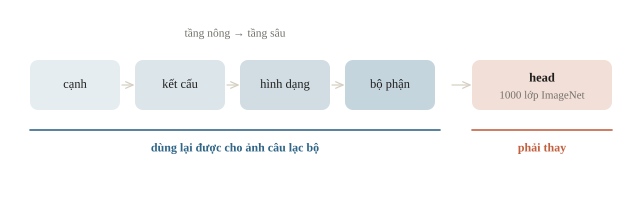
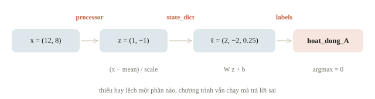
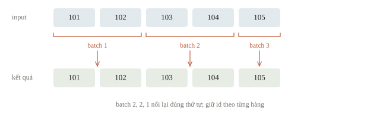
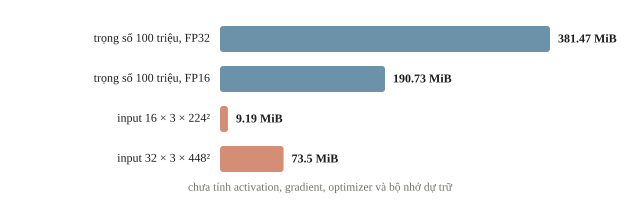
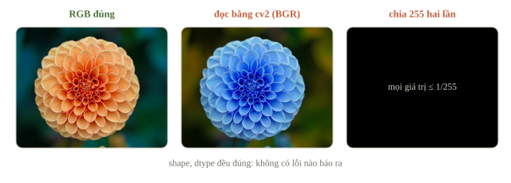
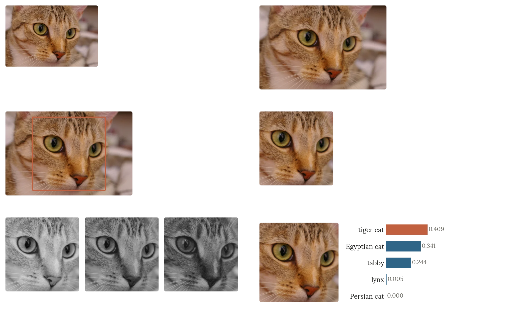

<!-- title -->
# Sử dụng model pretrained

Nạp đúng model và chạy dự đoán đầu tiên

Chương 4 · Bài 4.1

---
<!-- split -->
## Kho ảnh câu lạc bộ

Ít ảnh có nhãn, muốn xếp nhóm để tìm lại.

Có model đã được công bố. Ta cần gì ngoài tên model?

|||

Cần thêm: cách xử lý ảnh đầu vào, bảng nhãn, đúng phiên bản.

Sai một thứ thì code vẫn chạy, nhưng kết quả sai.

---
## Mục tiêu

- Phân biệt kiến trúc, trọng số, bộ xử lý đầu vào và tập nhãn của một model.
- Nạp model từ máy, chạy dự đoán theo batch và kiểm kết quả.
- Ước lượng bộ nhớ cho trọng số.
- Chuẩn bị file model để chạy khi không có Internet.

---
<!-- section 1 -->
# Hợp đồng của một gói model

---
<!-- split -->
## Kiến trúc khác checkpoint

`nn.Linear(2, 3)` tạo các phép toán và trọng số ban đầu.

Pretrained cần **trọng số đã học** từ nhiệm vụ trước.

|||

Processor quyết định input:

- Ảnh: resize, RGB, chuẩn hóa.
- Chữ: tokenizer, special token, padding.
- Head: nhãn và thứ tự lớp.

---
## Vì sao trọng số cũ có ích?

- Phân biệt hơn một triệu ảnh của 1000 lớp buộc mạng học cạnh, kết cấu, hình dạng.
- Những đặc trưng ấy có trong mọi ảnh, kể cả ảnh câu lạc bộ.
- Chỉ **head** gắn chặt với 1000 lớp cũ.

---
<!-- figure -->
## Phần dùng lại, phần phải thay



---
<!-- quiz -->
::: quiz
Có kiến trúc ResNet, và trọng số được khởi tạo ngẫu nhiên. Mô hình này đã là một model pretrained chưa?
- [ ] Rồi, vì tên kiến trúc trùng với model đã công bố
- [ ] Rồi, sau khi gọi `model.eval()` để suy luận
- [x] Chưa, vì chưa nạp trọng số đã học
- [ ] Chưa, vì phải fine-tune trên dữ liệu mới trước
“Pretrained” nằm ở trọng số đã học, không ở tên kiến trúc. `eval()` không thêm điều gì đã học.
:::

---
<!-- split -->
## Shape trước khi chạy

| Loại input | Shape |
|---|---|
| Ảnh | `(B, C, H, W)` |
| Token IDs | `(B, L)` |
| Logits phân loại | `(B, K)` |

|||

$B$: batch · $K$: lớp · $L$: độ dài token.

Ảnh có $C$ kênh, chiều cao $H$ và chiều rộng $W$.

ImageNet: chia 255, rồi chuẩn hóa mean/std từng kênh.

---
<!-- quiz -->
::: quiz
Processor của checkpoint nhận pixel từ 0 đến 255, tự chia cho 255, rồi trừ mean và chia std. Code của đội lại đã chia cho 255 trước khi gọi processor. Chuyện gì xảy ra?
- [ ] Báo lỗi kiểu dữ liệu, vì input không còn là số nguyên
- [x] Chạy bình thường, nhưng ảnh nào cũng gần như một màu
- [ ] Kết quả y hệt, vì chia hai lần vẫn giữ thứ tự các pixel
- [ ] Chỉ chậm hơn một chút, còn dự đoán không đổi
Sau hai lần chia, mọi pixel nằm trong $[0, 1/255]$, nên sau chuẩn hóa ảnh nào cũng gần như một màu. Shape và kiểu dữ liệu vẫn đúng nên không có lỗi nào.
:::

---
<!-- section 2 -->
# Kiểm bằng gói nhỏ

---
<!-- split -->
## Một gói nhỏ, đủ các bước

Trọng số đặt tay để mọi số đều tính tay được.

```python
model.load_state_dict(
    loaded["state_dict"], strict=True)
model.eval()
print("shape W:", tuple(model.weight.shape))
```

```output
shape W: (3, 2)
```

|||

- `strict=True`: kiểm tên và shape.
- `map_location="cpu"`: mở trên CPU.
- `weights_only=True`: chỉ mở tensor, số, chuỗi.
- Gói còn có mean, scale và nhãn.

---
<!-- quiz -->
::: quiz
Checkpoint được lưu từ một model bọc trong `DataParallel`, nên các khóa là `module.weight` và `module.bias`, trong khi model mới chờ `weight` và `bias`. Đội gọi `load_state_dict(sd, strict=False)`. Kết quả là gì?
- [ ] PyTorch tự bỏ tiền tố `module.` rồi nạp đủ
- [ ] Báo lỗi ngay khi nạp, vì tên khóa không khớp
- [ ] Nạp được `bias`, còn `weight` vẫn ngẫu nhiên
- [x] Không lỗi gì, nhưng model vẫn giữ trọng số khởi tạo
`strict=False` bỏ qua mọi khóa thiếu và thừa. Không khóa nào khớp, nên model giữ trọng số khởi tạo mà không báo lỗi. Bỏ tiền tố `module.` rồi nạp với `strict=True`.
:::

---
<!-- center -->
## Một mẫu tính tay

$$\mathbf{x}=(12,8)\quad\longrightarrow\quad\mathbf{z}=\frac{\mathbf{x}-(10,10)}{(2,2)}=(1,-1)$$

$$\boldsymbol{\ell}=W\mathbf{z}+\mathbf{b}=(2,-2,0.25)$$

Đây là logits của một mẫu. Lớp 0 thắng; argmax không cần softmax.

---
<!-- figure -->
## Ba phần của gói, ba bước



---
<!-- split -->
## Đọc logits

```python
with torch.inference_mode():
    logits = model(process(raw))
    predicted = logits.argmax(dim=1)
print(logits.numpy().round(2))
```

|||

```output
[[ 2.   -2.    0.25]
 [-2.    2.    0.25]
 [ 0.    0.    0.25]
 [ 4.   -4.    0.25]
 [-1.    1.    0.25]]
```

Hàng thứ ba chỉ còn bias: input ở đúng trung bình.

---
<!-- quiz -->
::: quiz
`logits` có shape `(5, 3)`. Muốn mỗi mẫu có một nhãn, ta dùng gì?
- [x] `logits.argmax(dim=1)`
- [ ] `logits.argmax(dim=0)`
- [ ] `logits.argmax()`
- [ ] `logits.max(dim=1).values`
Chiều 1 chạy qua ba lớp của cùng một mẫu, nên argmax theo chiều ấy cho mỗi mẫu một chỉ số.
:::

---
<!-- figure -->
## Batch cuối không được mất



---
<!-- split -->
## Hai phép kiểm khác nhau

```python
print("batch khop:",
      torch.allclose(batched, logits))
print("NumPy khop:",
      np.allclose(batched.numpy(), expected))
print("so mau:", len(batched))
```

```output
batch khop: True
NumPy khop: True
so mau: 5
```

|||

Phép so batch kiểm việc ghép hàng.

Phép so NumPy kiểm công thức bằng một đường tính độc lập.

ID phải đi cùng mỗi output.

---
<!-- split -->
## `eval()` và `inference_mode()` kiểm hai việc khác nhau

`model.eval()`:

Dropout và BatchNorm chuyển cách hoạt động.

|||

`torch.inference_mode()`:

Không theo dõi gradient cho suy luận.

Nó không tự gọi `eval()`.

---
## BatchNorm cần `eval()`

- Train mode: chuẩn hóa bằng thống kê **của batch**, đầu ra của một ảnh phụ thuộc ảnh đi cùng.
- Eval mode: dùng running statistics trong checkpoint, chia batch kiểu gì cũng như nhau.

---
<!-- quiz -->
::: quiz
CNN pretrained có BatchNorm. Đội quên gọi `eval()`, nhưng có `inference_mode()`. Chạy cùng tập test với batch 32 rồi với batch 8, hai file nộp khác nhau ở vài dòng. Vì sao?
- [ ] `inference_mode()` làm phép tính không còn tất định
- [x] Ở chế độ train, BatchNorm dùng thống kê của từng batch
- [ ] Batch cuối thiếu mẫu nên các dòng bị lệch hàng
- [ ] Batch nhỏ làm trọng số được cập nhật nhiều lần hơn
Ở chế độ train, BatchNorm chuẩn hóa mỗi ảnh bằng thống kê của batch chứa nó, nên đổi batch là đổi logits. `eval()` dùng running statistics đã lưu.
:::

---
<!-- quiz -->
::: quiz
Model đã gọi `eval()`, nhưng vòng dự đoán không bọc trong `inference_mode()` hay `no_grad()`. Tham số vẫn có `requires_grad=True`, còn input thì không. Câu nào đúng?
- [ ] Không ghi graph, vì `eval()` đã tắt autograd
- [ ] Không ghi graph, vì input không cần gradient
- [ ] Vẫn ghi graph, nhưng chỉ khi chạy trên GPU
- [x] Vẫn ghi graph, vì `eval()` không đụng tới autograd
Graph được ghi khi có một đầu vào cần gradient, và tham số đã đủ điều kiện ấy. `eval()` không đụng tới autograd.
:::

---
<!-- section 3 -->
# Bộ nhớ và model thật

---
<!-- center -->
## Tính phần bộ nhớ trọng số

$$\text{bytes}=P\times s$$

$P$ là số tham số; $s$ là byte mỗi tham số: FP32 dùng 4, FP16 dùng 2.

Một MiB bằng $2^{20}$ byte.

Model 100 triệu tham số:

| Precision | Trọng số thô |
|---|---|
| FP32 | 381.47 MiB |
| FP16 | 190.73 MiB |

Chưa tính input, activation, buffer, optimizer.

---
## Input và activation theo $B\cdot H\cdot W$

Batch 16 ảnh RGB $224\times224$, `float32`:

$$16\cdot3\cdot224\cdot224\cdot4\ \text{byte}\approx9.19\ \text{MiB}$$

Gấp đôi cạnh ảnh tốn ngang gấp bốn batch.

Đo một batch nhỏ trên đúng thiết bị rồi tăng dần.

---
<!-- figure -->
## Trọng số và input



---
<!-- quiz -->
::: quiz
Một batch 16 ảnh RGB $224\times 224$ kiểu `float32` chiếm 9.19 MiB. Đổi sang batch 32 và ảnh $448\times 448$ thì tensor input chiếm bao nhiêu?
- [ ] 18.38 MiB
- [ ] 36.75 MiB
- [x] 73.50 MiB
- [ ] 147.00 MiB
Batch gấp 2, số pixel mỗi ảnh gấp 4, nên tổng gấp 8: 73.5 MiB.
:::

---
## Đọc model card trước

- Học trên dữ liệu gì, input nào, nhãn nào, license nào.
- Head ImageNet chỉ chọn trong 1000 lớp cũ.
- Dùng lại các tầng dưới: 4.2 lấy đặc trưng, 4.3 học head mới.

---
<!-- quiz -->
::: quiz
Đội đưa ảnh câu lạc bộ vào một ResNet học trên ImageNet, còn nguyên head, rồi lấy argmax trên 1000 logits. Kết quả là gì?
- [ ] Nhãn của câu lạc bộ, nếu ảnh đủ rõ và đúng cỡ
- [x] Một lớp của ImageNet, không phải nhãn câu lạc bộ
- [ ] Báo lỗi shape, vì 1000 lớp không khớp ba nhãn mới
- [ ] Một nhãn ngẫu nhiên, vì model chưa thấy ảnh này
Head có đúng 1000 đầu ra, mỗi đầu ra là một lớp ImageNet, nên argmax luôn là một lớp ImageNet. Không có lỗi shape, vì model không biết đội muốn bao nhiêu nhãn.
:::

---
<!-- split -->
## Dùng model thật offline

Lượt có mạng:

- Đọc model card và license.
- Chốt revision commit.
- Ghi hash các tệp.

|||

Lượt offline:

- Kiểm hash.
- Nạp model và processor local.
- `local_files_only=True`.
- Chạy dữ liệu nhỏ, ghi `RESULT.json`.

Hash khớp → bytes đúng; shape, ID khớp → đường dữ liệu đúng; rồi mới tới validation.

---
<!-- quiz -->
::: quiz
Hai tuần sau, đội tải lại cùng model ID từ nhánh `main`, chạy năm ảnh kiểm ở chế độ eval, và thấy logits khác lần trước ngay từ chữ số đầu. Nên kiểm gì đầu tiên?
- [x] Commit và SHA-256, so với `ASSET.json` cũ
- [ ] Seed của NumPy và PyTorch trong notebook
- [ ] Batch size, vì đổi batch là đổi logits
- [ ] Phiên bản CUDA, vì GPU khác cho số khác
Nhánh `main` có thể đã được cập nhật. So commit và SHA-256 với `ASSET.json` để biết các byte còn như cũ không. Suy luận ở chế độ eval không có yếu tố ngẫu nhiên.
:::

---
<!-- figure -->
## Hai lỗi processor trên ảnh thật



---

<!-- figure -->
## Ảnh thật qua processor và model



---
## Khi đi thi

- Đọc quy định về model, Internet, thư viện trước khi chuẩn bị.
- Thử nạp offline và tạo file nộp thử ngay đầu giờ.
- Khóa processor cùng checkpoint, giống hệt ở validation và test.
- Đo bộ nhớ bằng batch thật; giữ một cấu hình chạy chắc trên CPU.
- Giữ ID suốt đường suy luận; chọn model bằng validation của đề.

---
<!-- section 4 -->
# Luyện đề

---
<!-- quiz -->
::: quiz Luyện đề 1
ResNet-50 nhận input `(B, 3, 224, 224)`. Phần đầu, gồm conv stride 2 rồi max-pool stride 2, đưa ảnh về $56\times 56$. `layer1` giữ $56\times 56$ và cho ra 256 kênh. Khối đầu của `layer2` có conv $3\times 3$ stride 2 trên 128 kênh, rồi conv $1\times 1$ mở ra 512 kênh. Đầu ra của `layer2` có shape gì?
- [ ] `(B, 128, 28, 28)`
- [x] `(B, 512, 28, 28)`
- [ ] `(B, 512, 56, 56)`
- [ ] `(B, 28, 28, 512)`
Stride 2 chia đôi cạnh, $56 \to 28$, và số kênh ra là của conv cuối khối, 512.
Phỏng theo: [USA-NA-AIO 2026 · Vòng 1 · Part 8.2](https://www.usaaio.org/attachments/past-problems/2026/usaaio-2026-round-1-problems.pdf#page=20)
:::

---
<!-- quiz -->
::: quiz Luyện đề 2
Biểu thức nào đếm đúng số tham số học được của ResNet-50?
- [ ] `len(list(model.parameters()))`
- [ ] `sum(t.numel() for t in model.state_dict().values())`
- [x] `sum(p.numel() for p in model.parameters())`
- [ ] `sum(p.numel() * p.element_size() for p in model.parameters())`
Đếm `numel` trên `parameters()` cho 25 557 032 tham số học được. `state_dict()` còn chứa buffer của BatchNorm, như running mean và variance, nên ra 25 610 205.
Phỏng theo: [USA-NA-AIO 2026 · Vòng 1 · Part 8.1](https://www.usaaio.org/attachments/past-problems/2026/usaaio-2026-round-1-problems.pdf#page=20)
:::

---
<!-- quiz -->
::: quiz Luyện đề 3
Trên Colab, đội lưu `torch.save(model, "m.pt")`, tức lưu cả đối tượng model. Máy chấm dùng PyTorch mới, và `torch.load("m.pt")` báo lỗi “Weights only load failed”. Lần sau nên lưu thế nào cho bền?
- [x] Lưu `state_dict()` kèm config, rồi dựng model và nạp vào
- [ ] Gọi `model.save("m.pt")` như trong Keras
- [ ] Vẫn dùng `torch.save(model)`, và nạp với `weights_only=False`
- [ ] Chỉ lưu dự đoán trên validation thay cho model
Lưu cả đối tượng model là pickle, phụ thuộc định nghĩa lớp, và bị `weights_only=True` chặn. Hãy lưu `state_dict()` kèm config, rồi dựng kiến trúc bằng code trước khi nạp.
Phỏng theo: [NOAI 2026 Singapore · Vòng sơ loại · Câu 134](https://aisingapore.org/wp-content/uploads/2026/04/NOAI-2026-Preliminary-Round-Assessment-300-MCQs-Google-Forms.pdf#page=51)
:::

---
## Bốn điều phải kiểm trước khi chạy

- Gói phải giữ trọng số, kiến trúc, processor và bảng nhãn.
- Phép kiểm phải giữ ID và có một đường tính độc lập.
- Tài nguyên phải được đo trên batch và thiết bị thật.
- Asset thật phải có revision, hash và chạy được offline.

---
<!-- center -->
## Sau giờ học

Làm **10 câu kiểm tra cuối bài** trên trang bài học.

Chạy notebook; đổi batch size và kiểm thứ tự output.

Đọc script của chương; khi được phép, tải model thật theo revision rồi nạp lại offline.
