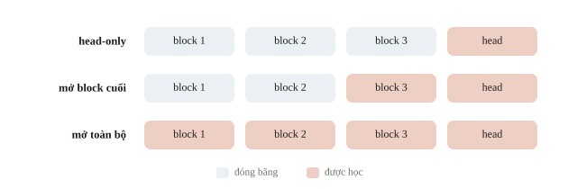
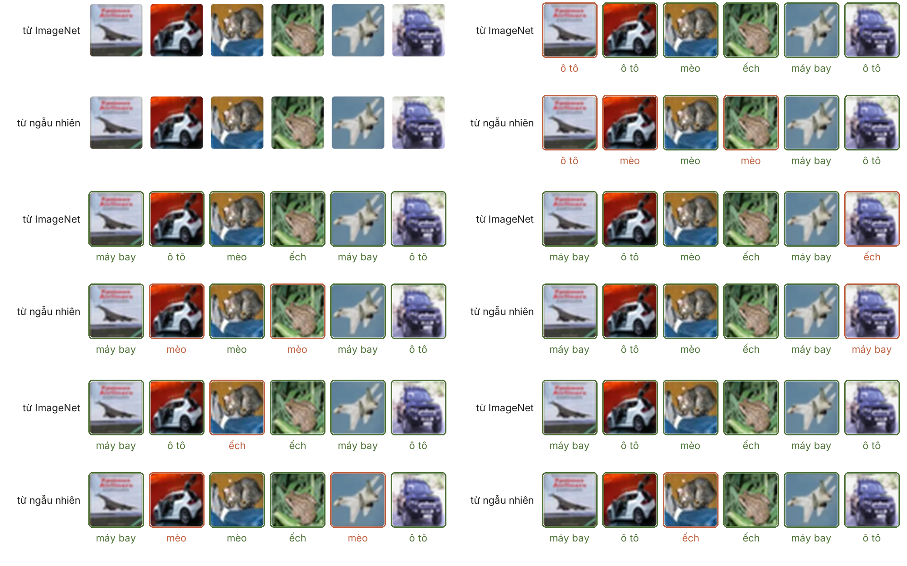
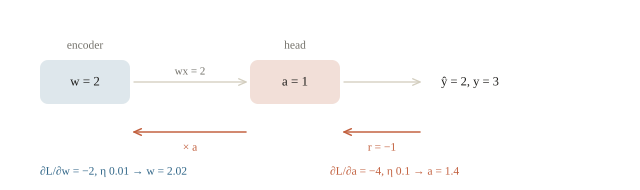
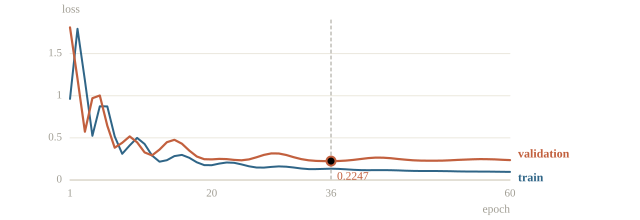
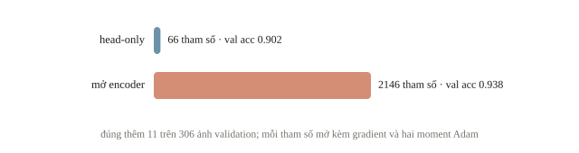
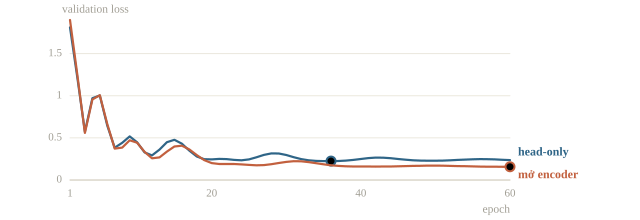
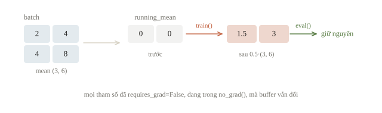

<!-- title -->
# Fine-tuning

Head mới trước, mở encoder có kiểm soát

Chương 4 · Bài 4.3

---
<!-- split -->
## Khi embedding chưa đủ

Ảnh bảng viết tay của câu lạc bộ khác miền dữ liệu nguồn.

Head nhỏ có thể chưa đọc được nhãn tốt.

|||

::: note Câu hỏi
Mở phần nào của encoder, bước dài bao nhiêu, giữ checkpoint nào?
:::

---
## Mục tiêu

- Thay lớp cuối và chọn phần nào của model được huấn luyện.
- Phân biệt `requires_grad`, `train()`/`eval()` và `no_grad()`.
- Đặt learning rate riêng cho thân model và lớp cuối; chọn checkpoint bằng validation.
- Biết BatchNorm vẫn thay đổi dù trọng số đã bị khóa.

---
<!-- section 1 -->
# Chuyển kiến thức

---
<!-- center -->
## Encoder và head

$$\mathbf{z}=f_\theta(\mathbf{x}),\qquad\boldsymbol\ell=g_\phi(\mathbf{z})$$

$\theta$ là encoder, $\phi$ là head.

Head-only: chỉ học $\phi$.

Fine-tuning: học thêm phần đã chọn của $\theta$.

Thứ tự thử: head → block cuối → toàn bộ.

---
<!-- figure -->
## Mở có chủ đích



---

<!-- figure -->
## Bắt đầu từ ImageNet hay từ ngẫu nhiên



---
<!-- quiz -->
::: quiz
Nhiệm vụ cũ có 1000 lớp, bài mới có 3 lớp. Nạp checkpoint xong, phần nào chắc chắn phải thay hoặc kiểm trước khi train?
- [ ] Batch size, vì đầu ra 3 lớp cần batch chia hết cho 3
- [x] Head cuối, và bảng đổi ba nhãn mới sang chỉ số 0, 1, 2
- [ ] Seed, vì head cũ được khởi tạo bằng một seed khác
- [ ] Learning rate của encoder, vì 1000 lớp cần bước nhỏ hơn
Head cũ có 1000 đầu ra mang nghĩa của nhãn cũ. Bài mới cần đúng 3 đầu ra và một bảng cố định từ tên lớp sang chỉ số, lưu lại để đổi ngược khi nộp.
:::

---
<!-- quiz -->
::: quiz
Dữ liệu đích ít và khá giống miền nguồn, head-only đã có điểm validation. Ngân sách chỉ đủ thử thêm một cấu hình. Nên thử gì?
- [ ] Mở toàn bộ mạng, với cùng learning rate của head
- [ ] Khởi tạo lại encoder rồi học từ đầu trên dữ liệu đích
- [ ] Mở block đầu gần input, vì đặc trưng nền quan trọng nhất
- [x] Mở thêm block cuối, giữ các block đầu đóng băng
Block cuối gần nhiệm vụ cũ nhất nên thường cần thích nghi trước. Mở toàn bộ với bước lớn dễ làm hỏng biểu diễn đã học.
:::

---
<!-- split -->
## Mô hình nguồn tự pretrain

Nguồn: chữ số **0–7**.

Đích: **8 và 9**, hoàn toàn bị loại khỏi học nguồn.

Encoder `64 → 32 → ReLU`.

|||

```output
source train/valid: 1082 361
source valid accuracy: 0.9806
source gap target: True
```

Đóng vai checkpoint: đã học 0–7, chưa thấy 8, 9.

---
<!-- quiz -->
::: quiz
Một đội pretrain encoder trên toàn bộ 1797 ảnh chữ số từ 0 đến 9 cùng nhãn của chúng, rồi báo accuracy của nhiệm vụ phân biệt 8 với 9 trên validation lấy từ chính bộ ảnh ấy. Con số này đo gì?
- [ ] Đúng khả năng chuyển học, vì head đích vẫn là head mới
- [ ] Đúng khả năng chuyển học, vì phần nguồn không dùng head đích
- [x] Một con số quá lạc quan, vì encoder đã học cả ảnh validation
- [ ] Một con số quá bi quan, vì nhãn 0 đến 7 làm nhiễu encoder
Encoder đã thấy ảnh validation, thậm chí đã học tách 8 khỏi 9 bằng nhãn thật, nên con số quá lạc quan.
:::

---
<!-- section 2 -->
# Freeze và learning rate

---
<!-- split -->
## Head mới, encoder giữ nguyên

```python
for parameter in head_only[0].parameters():
    parameter.requires_grad_(False)
optimizer = torch.optim.SGD(
    head_only[1].parameters(), lr=0.05)
```

|||

48 ảnh train đích, 306 ảnh validation.

Head `32 → 2` có **66 tham số**.

Đổi nhãn 8 thành 0, nhãn 9 thành 1.

---
<!-- split -->
## Kiểm đúng phần nào thay đổi

```output
encoder grad None: True
head co gradient: True
encoder khong doi: True
```

|||

Gradient đúng chưa đủ: so cả tensor trước/sau optimizer.

Loss giảm không cho biết encoder có bị thay đổi hay không.

---
<!-- quiz -->
::: quiz
Một tham số có `requires_grad=False` nhưng vẫn nằm trong forward. Khi dự đoán, nó đóng vai trò gì?
- [x] Vẫn tính forward như cũ, chỉ không được học
- [ ] Bị bỏ qua, nên output của tầng ấy bằng 0
- [ ] Bị thay bằng giá trị trung bình của nó
- [ ] Bị tách khỏi mạng cho tới khi gọi lại `train()`
Đóng băng chỉ tắt gradient của tham số nên optimizer không cập nhật nó, còn phép forward vẫn tính như cũ.
:::

---
<!-- quiz -->
::: quiz
Head hai lớp được học với nhãn `digit - 8`. Validation accuracy đạt 0.94, nhưng file nộp ghi thẳng `argmax` của logits và được chấm 0 điểm. Lỗi khả dĩ nhất là gì?
- [ ] Head hai lớp không đủ sức cho dữ liệu test
- [ ] Validation bị rò, nên 0.94 là con số ảo
- [x] File nộp ghi chỉ số 0, 1 thay vì 8, 9
- [ ] Encoder ở chế độ `eval()` khi dự đoán test
`argmax` trả về chỉ số 0, 1 trong khi đáp án là 8, 9, nên không dòng nào khớp. Phải cộng lại 8 trước khi ghi file.
:::

---
<!-- center -->
## Một bước cập nhật: head và encoder

$$\hat y=a(wx),\quad L=(\hat y-y)^2$$

$x=1$, $w=2$, $a=1$, $y=3$.

Gradient: $\partial L/\partial a=-4$, $\partial L/\partial w=-2$.

$\eta_a=0.1$, $\eta_w=0.01$ cho $a=1.4$, $w=2.02$.

---
<!-- figure -->
## Gradient về encoder nhân qua head



---
<!-- center -->
## Gradient của encoder đi qua head

$$\frac{\partial L}{\partial w}=2(\hat y-y)\cdot a\cdot x$$

Head mới còn ngẫu nhiên: encoder bị kéo để bù cho head.

Bước lớn dễ làm hỏng đặc trưng đã học: **quên thảm khốc**.

Cách giữ: rate encoder nhỏ, hoặc head-only trước rồi mới mở.

BERT fine-tune với learning rate từ $2\cdot10^{-5}$ đến $5\cdot10^{-5}$.

---
<!-- quiz -->
::: quiz
Vẫn ví dụ ấy, với $x = 1$, $w = 2$, $y = 3$, nhưng head mới được khởi tạo $a = -1$. Gradient theo $w$ bằng bao nhiêu, và gradient descent đẩy $w$ theo hướng nào?
- [ ] $-2$, nên $w$ tăng, như ví dụ có $a = 1$
- [ ] $-10$, nên $w$ tăng để $\hat y$ lớn lên
- [ ] $0$, nên $w$ đứng yên chờ head học xong
- [x] $10$, nên $w$ giảm
$\hat y = -2$, phần dư $-5$, nên gradient theo $w$ là $2(-5)(-1)(1) = 10$, và $w$ giảm.
:::

---
<!-- split -->
## Hai nhóm learning rate

```python
groups = [{
    "params": transferred[1].parameters(),
    "lr": 0.05,
}]
if open_encoder:
    groups.append({
        "params": transferred[0].parameters(),
        "lr": 0.003,
    })
optimizer = torch.optim.Adam(groups)
```

|||

Head mới dùng bước lớn hơn; encoder dùng bước nhỏ hơn.

Tỉ lệ khoảng 17 lần là một lựa chọn, không phải hằng số.

Mở block nhưng quên thêm vào optimizer thì block không được cập nhật.

---
<!-- section 3 -->
# Validation và trạng thái tầng

---
<!-- figure -->
## Chọn checkpoint từ validation



---
<!-- split -->
## So sánh cùng mốc và cùng split

Hai mode dùng cùng encoder nguồn, head mới và split đích.

| Mode | Tham số học | Epoch chọn | Val accuracy |
|---|---|---|---|
| Head-only | 66 | 36 | 0.9020 |
| Mở encoder | 2146 | 60 | 0.9379 |

|||

Chọn bằng **validation loss**:

- Head-only: 0.2247 (epoch 60: 0.2366).
- Mở encoder: 0.1570, đúng epoch cuối.

Tốt nhất ở epoch cuối: có thể chưa đủ epoch.

---
<!-- figure -->
## Tham số học và accuracy



---
<!-- figure -->
## Validation loss của hai cách



---
<!-- quiz -->
::: quiz
Một lần fine-tune 20 epoch có checkpoint tốt nhất ở epoch 20, và validation loss vẫn đang giảm. Hiểu kết quả này thế nào?
- [x] Có thể chưa đủ epoch, nên chạy thêm rồi xem tiếp
- [ ] Đã hội tụ đúng ở epoch 20, nên dừng tại đó
- [ ] Đã overfit, vì điểm tốt nhất rơi vào epoch cuối
- [ ] Chọn lại theo train loss, vì validation chưa ổn
Validation còn giảm ở epoch cuối nghĩa là chưa thấy điểm mô hình tệ đi, nên chạy thêm có thể cho checkpoint tốt hơn.
:::

---
<!-- split -->
## BatchNorm còn có buffer

- Weight/bias: tham số affine.
- Running mean/variance: buffer.
- Train mode có thể cập nhật buffer ở forward.

|||

Batch mean `(3,6)`, mean cũ `(0,0)`, momentum 0.5:

$$\text{mean mới}=(1.5,3.0)$$

Không cần gradient để có thay đổi này.

---
<!-- split -->
## Thực nghiệm buffer

```output
running mean sau train: [1.5, 3.0]
eval giu buffer: True
khop tinh tay: True
```

|||

Sau `model.train()`:

Nếu encoder cần đứng yên, gọi `encoder.eval()`.

Freeze tham số và giữ buffer là hai quyết định.

---
<!-- figure -->
## Buffer đổi dù đã đóng băng



---
<!-- quiz -->
::: quiz
Đóng băng weight và bias của BatchNorm, rồi cho một batch mới đi qua ở chế độ `train()`, bên trong `no_grad()`. Running mean có đổi không?
- [ ] Không, vì mọi tham số đều có `requires_grad=False`
- [ ] Không, vì `no_grad()` chặn mọi thay đổi trong forward
- [x] Có, vì buffer tự cập nhật ngay trong forward
- [ ] Có, nhưng chỉ khi gọi `optimizer.step()` sau đó
Running mean là buffer. BatchNorm ở chế độ train tự cập nhật nó trong forward, không cần gradient hay optimizer.
:::

---
<!-- quiz -->
::: quiz
Encoder có BatchNorm cần giữ nguyên. Đoạn sau có giữ được running mean của encoder không?
```py
encoder.eval()        # một lần
for epoch in range(10):
    model.train()
    ...
```
- [ ] Có, vì `encoder.eval()` đã được gọi từ trước
- [x] Không, vì `model.train()` lan xuống cả encoder
- [ ] Có, nếu tham số encoder đã `requires_grad=False`
- [ ] Không, vì optimizer cập nhật buffer ở mỗi `step()`
`model.train()` lan xuống mọi module con, kể cả encoder, nên BatchNorm lại cập nhật buffer. Phải gọi `encoder.eval()` sau `model.train()` ở mỗi epoch.
:::

---
## Khi đi thi

- Head-only trước, có bài nộp hợp lệ.
- Phần pretrained: learning rate nhỏ.
- Đúng processor của checkpoint.

---
<!-- section 4 -->
# Luyện đề

---
<!-- quiz -->
::: quiz Luyện đề 1
Accuracy chỉ khoảng 10% với 10 lớp, `fc.weight` y như lúc khởi tạo. Lỗi ở đâu?
```py
for p in model.parameters():
    p.requires_grad = False
opt = torch.optim.Adam(model.parameters())
model.fc = nn.Linear(2048, 10)
```
- [x] Optimizer tạo trước khi thay `fc`
- [ ] Backbone chặn gradient tới `fc`
- [ ] Learning rate quá nhỏ cho head mới
- [ ] Optimizer bỏ qua cả nhóm đóng băng
Optimizer giữ tham số của `fc` cũ, nên `fc` mới không bao giờ được `step()`.
Phỏng theo: [NOAI 2026 Singapore · Chung kết · Câu 15](https://aisingapore.org/wp-content/uploads/2026/04/NOAI-2026-Final-Assessment-Section-1-MCQs-Google-Forms.pdf#page=22)
:::

---
<!-- quiz -->
::: quiz Luyện đề 2
Ta muốn giữ cố định encoder khi học head, đồng thời tiết kiệm bộ nhớ và thời gian của backward. Cách nào đạt được cả hai?
- [ ] Đặt learning rate 0 cho nhóm tham số của encoder
- [x] Gọi `requires_grad_(False)` cho các tham số của encoder
- [ ] Gọi `encoder.eval()` trước mỗi epoch train
- [ ] Gọi `model.freeze()` một lần trước vòng lặp train
`requires_grad=False` mới bỏ hẳn việc tính và lưu gradient. Learning rate 0 vẫn tính gradient, `eval()` không đóng băng tham số, còn `freeze()` không có trong PyTorch.
Phỏng theo: [NOAI 2026 Singapore · Vòng sơ loại · Câu 132](https://aisingapore.org/wp-content/uploads/2026/04/NOAI-2026-Preliminary-Round-Assessment-300-MCQs-Google-Forms.pdf#page=50)
:::

---
<!-- quiz -->
::: quiz Luyện đề 3
BERT, AdamW với learning rate $10^{-3}$ cho cả mô hình. Validation loss thấp nhất sau epoch 1 rồi tăng mạnh, còn train loss vẫn giảm. Vì sao?
- [ ] Batch 32 quá nhỏ, cần gradient accumulation
- [ ] `max_length=128` cắt mất chữ
- [ ] Thiếu warmup, thêm warmup là đủ
- [x] Learning rate quá lớn đối với trọng số pretrained
$10^{-3}$ quá lớn cho một encoder pretrained: sau một epoch, trọng số đã bị kéo khỏi biểu diễn tốt. Dải thường dùng cho BERT là $2\cdot 10^{-5}$ đến $5\cdot 10^{-5}$. Trong lúc chờ chạy lại, giữ checkpoint epoch 1.
Phỏng theo: [NOAI 2026 Singapore · Chung kết · Câu 21](https://aisingapore.org/wp-content/uploads/2026/04/NOAI-2026-Final-Assessment-Section-1-MCQs-Google-Forms.pdf#page=34)
:::

---
## Điều cần giữ lại

- Fine-tuning học phần cần thay đổi cho nhiệm vụ mới.
- Freeze, eval, autograd và optimizer làm bốn việc riêng.
- Validation quyết định checkpoint; nhiều tham số hơn chưa chắc tốt hơn.

---
<!-- center -->
## Sau giờ học

Làm **10 câu kiểm tra cuối bài** trên trang bài học.

Chạy notebook; đổi learning rate encoder từ 0.003 lên 0.05, dự đoán trước validation loss rồi kiểm.

Có model trên máy: chạy script DistilBERT mode `head` và `full`, so hai `RESULT.json`.
