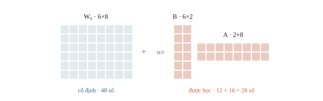
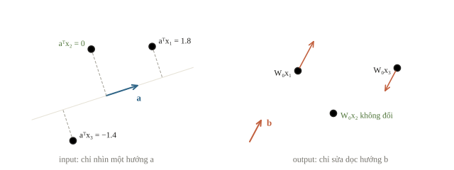
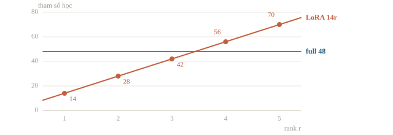
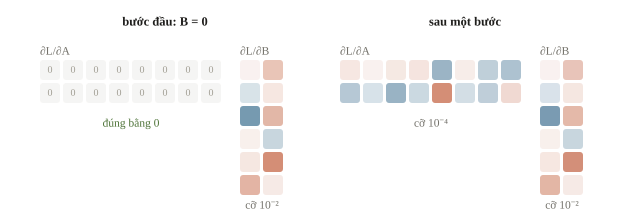
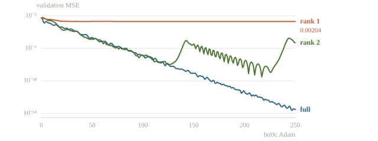
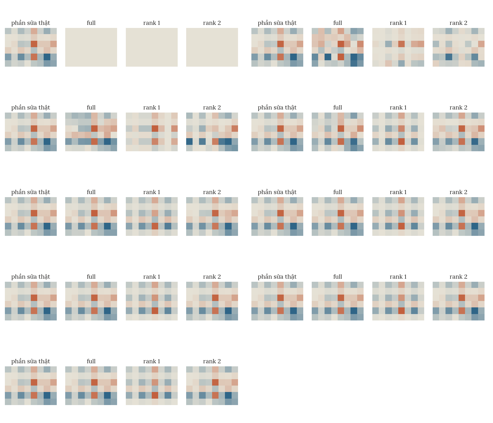
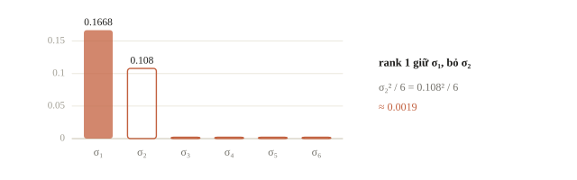
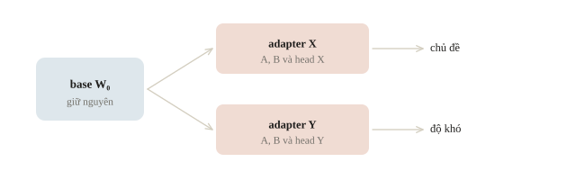
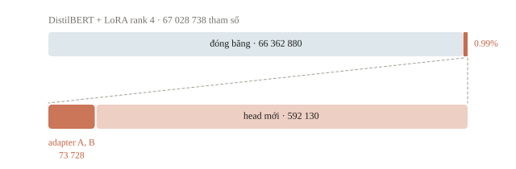

<!-- title -->
# LoRA

Học một phần sửa nhỏ cho ma trận lớn

Chương 4 · Bài 4.4

---
<!-- split -->
## Bộ nhớ fine-tuning gồm nhiều phần

Full fine-tuning còn giữ gradient, trạng thái optimizer và activation.

|||

::: note Câu hỏi
Có thể giữ trọng số nguồn và chỉ học phần sửa không?
:::

---
## Mục tiêu

- Viết lớp LoRA, tính shape và số tham số.
- Biết vì sao một trong hai ma trận khởi tạo bằng 0.
- Kiểm gradient của LoRA và phép gộp vào trọng số gốc.
- Gắn LoRA vào model Transformer và so với fine-tuning toàn bộ.

---
<!-- section 1 -->
# Hai ma trận nhỏ

---
<!-- figure -->
## Nhánh gốc cộng nhánh sửa



---
<!-- center -->
## Công thức của bài

$$\mathbf{y}=W_0\mathbf{x}+\frac{\alpha}{r}BA\mathbf{x}$$

$W_0:(d_{out},d_{in})$ · $A:(r,d_{in})$ · $B:(d_{out},r)$.

$BA$ có hạng tối đa $r$.

---
<!-- quiz -->
::: quiz
Với $d_{in} = 8$, $d_{out} = 6$, $r = 2$, hai ma trận $A$ và $B$ có shape gì?
- [ ] $A$ là $(8, 2)$, $B$ là $(2, 6)$
- [x] $A$ là $(2, 8)$, $B$ là $(6, 2)$
- [ ] $A$ là $(2, 6)$, $B$ là $(8, 2)$
- [ ] Cả hai đều là $(6, 8)$, cùng shape với $W_0$
$A$ nhận input 8 chiều nên có 8 cột, $B$ trả output 6 chiều nên có 6 hàng, và $BA$ có shape $(6, 8)$ như $W_0$.
:::

---
<!-- center -->
## Rank 1: đo một hướng, đẩy một hướng

$$\frac{\alpha}{r}BA\mathbf{x}=\frac{\alpha}{r}\,\mathbf{b}\,(\mathbf{a}^\top\mathbf{x})$$

$\mathbf{a}$ chọn phần input được “nhìn thấy”; $\mathbf{b}$ là hướng sửa output.

Rank $r$ là tổng của $r$ cặp như vậy.

---
<!-- figure -->
## Một hướng nhìn, một hướng sửa



---
<!-- quiz -->
::: quiz
LoRA rank 1 có $A = \mathbf{a}^\top$ và $B = \mathbf{b}$. Một input $\mathbf{x}$ vuông góc với $\mathbf{a}$, tức $\mathbf{a}^\top\mathbf{x} = 0$. Adapter làm output của input này thay đổi thế nào?
- [ ] Cộng thêm $\frac{\alpha}{r}\mathbf{b}$, như một bias chung
- [ ] Đổi output theo hướng $\mathbf{a}$ thay vì $\mathbf{b}$
- [ ] Đổi mọi thành phần, vì $BA$ có đủ shape $(d_{out}, d_{in})$
- [x] Không đổi gì, output vẫn đúng bằng $W_0\mathbf{x}$
Phần sửa bằng $\frac{\alpha}{r}\mathbf b\,(\mathbf a^\top\mathbf x) = \mathbf 0$. Hướng sửa luôn là $\mathbf b$, còn $\mathbf a$ chỉ quyết định input nào được “nhìn thấy”.
:::

---
<!-- split -->
## Tính tham số

$$P_{full}=d_{out}d_{in}$$

$$P_{LoRA}=r(d_{in}+d_{out})$$

|||

| Lớp giả định | Full | LoRA |
|---|---|---|
| $6\times8$, $r=2$ | 48 | 28 |
| $4096\times4096$, $r=8$ | 16 777 216 | 65 536 |

Tỉ lệ tham số học không phải tỉ lệ tổng bộ nhớ GPU.

---
<!-- figure -->
## Rank quá lớn có thể mất lợi thế



---
<!-- quiz -->
::: quiz
DistilBERT có 6 block, mỗi block có hai lớp `q_lin` và `v_lin`, cùng là Linear $768 \to 768$. Chèn LoRA rank 4 vào cả hai lớp ở mọi block. Không tính head, adapter có bao nhiêu tham số?
- [ ] 6144
- [ ] 36 864
- [x] 73 728
- [ ] 7 077 888
Một lớp có $4\cdot(768 + 768) = 6144$ tham số adapter, 12 lớp thì là $73\,728$.
:::

---
<!-- section 2 -->
# Khởi tạo và gradient

---
<!-- split -->
## A ngẫu nhiên, B bằng 0

```python
self.A = nn.Parameter(
    torch.randn(rank, din) * 0.1)
self.B = nn.Parameter(torch.zeros(dout, rank))
self.scale = alpha / rank
```

|||

$BA=0$ nên output ban đầu đúng model gốc.

Dữ liệu sinh từ $W_0$ + phần sửa hạng 2: biết trước đáp án.

---
<!-- quiz -->
::: quiz
Lớp LoRA khởi tạo $A$ ngẫu nhiên và $B = 0$. Vì sao output ban đầu đúng bằng output của lớp gốc?
- [x] $BA = 0$ nên nhánh sửa chưa đóng góp gì
- [ ] $W_0$ bị freeze nên chưa tham gia forward
- [ ] Rank thấp làm phần sửa nhỏ, xấp xỉ bằng 0
- [ ] Scale $\alpha/r$ bằng 0 khi chưa train
Nhân với ma trận 0 thì ra ma trận 0, nên output đúng bằng $W_0\mathbf x$, không chỉ xấp xỉ.
:::

---
<!-- split -->
## Forward cho batch hàng

```python
original = X @ self.base.T
update = (X @ self.A.T) @ self.B.T
return original + self.scale * update
```

|||

```output
ban dau dung model goc: True
tham so hoc: 28
```

Input `(N,8)` cho output `(N,6)`.

---
<!-- center -->
## Chain rule chỉ đường học

$G=\partial L/\partial Y$, $s=\alpha/r$:

$$\frac{\partial L}{\partial B}=sG^\top XA^\top$$

$$\frac{\partial L}{\partial A}=sB^\top G^\top X$$

$B=0$ nên gradient của $A$ bằng 0 ở bước đầu; $B$ vẫn học được.

---
<!-- quiz -->
::: quiz
Với $N = 64$, $d_{in} = 8$, $d_{out} = 6$, $r = 2$, tích $G^\top XA^\top$ trong công thức gradient của $B$ có shape gì?
- [x] $(6, 2)$
- [ ] $(2, 6)$
- [ ] $(6, 8)$
- [ ] $(64, 2)$
$(6, 64)$ nhân $(64, 8)$ nhân $(8, 2)$ ra $(6, 2)$, đúng shape của $B$.
:::

---
<!-- quiz -->
::: quiz
Ở bước đầu, với $B = 0$ và $A$ ngẫu nhiên, autograd báo gradient của $A$ bằng 0. Nên kết luận gì?
- [ ] Có lỗi, vì `A` chưa được đưa vào optimizer
- [ ] LoRA sẽ không bao giờ học được ma trận $A$
- [ ] Phải đặt $A = B = 0$ để hai ma trận cân bằng
- [x] Đúng như chain rule, vì gradient của $A$ chứa $B = 0$
Gradient của $A$ là $sB^\top G^\top X$, chứa $B$, nên bằng 0 khi $B = 0$. Sau bước đầu, $B \ne 0$ và $A$ bắt đầu học.
:::

---
<!-- split -->
## Ba cách kiểm gradient

1. Autograd PyTorch.
2. Công thức NumPy.
3. Sai phân trung tâm cho B[0,0].

|||

```output
A grad bang 0: True
B grad khac 0: True
W0 grad None: True
khop cong thuc A/B: True True
khop sai phan B00: True
```

---
<!-- split -->
## Kiểm A sau khi B đã học

Ở $B=0$, một bản gradient $A$ luôn trả 0 cũng vượt được phép kiểm đầu.

Đi một bước để $B$ khác 0, rồi kiểm lại $A$.

|||

```output
A grad sau buoc khac 0: True
A khop NumPy: True
A00 khop sai phan: True
```

---
<!-- figure -->
## Gradient ở hai trạng thái



---
<!-- section 3 -->
# Chất lượng và đóng gói

---
<!-- split -->
## So trên một mục tiêu có rank tối đa 2

Cùng $W_0$, train/validation, Adam rate 0.03, $\alpha=2r$.

| Mode | Tham số học | Val MSE |
|---|---|---|
| Full | 48 | 2.93e-14 |
| Rank 1 | 14 | 0.00204 |
| Rank 1, 2500 bước | 14 | 0.00204 |
| Rank 2 | 28 | 5.04e-06 |

|||

Rank 1 chạm sàn: thêm bước không giúp.

Rank 2 biểu diễn được, nhưng MSE dao động: con số phụ thuộc lúc dừng.

Chung ngân sách, không dò learning rate riêng.

---
<!-- figure -->
## Validation MSE theo bước



---

<!-- figure -->
## Phần sửa ΔW qua từng bước



---
<!-- center -->
## Sàn của rank 1

Giá trị kỳ dị của phần sửa: $0.1668$, $0.108$, $0$, …

Rank 1 bỏ hướng thứ hai: MSE $\approx0.108^2/6\approx0.0019$.

Sai số của rank $r$ do các giá trị kỳ dị từ thứ $r+1$ quyết định.

---
<!-- figure -->
## Phổ của phần sửa



---
<!-- quiz -->
::: quiz
Code đặt $\alpha = 2r$, và script của chương cũng vậy. Tăng rank từ 4 lên 16 thì hệ số scale $\alpha/r$ thay đổi thế nào?
- [ ] Tăng 4 lần, vì $\alpha$ tăng 4 lần
- [ ] Giảm 4 lần, vì chia cho $r$ lớn hơn
- [ ] Phụ thuộc vào $d_{in}$ và $d_{out}$ của lớp
- [x] Giữ nguyên bằng 2 với mọi rank
$\alpha/r = 2r/r = 2$ với mọi rank. Nếu giữ $\alpha$ cố định mà tăng $r$ thì scale mới giảm.
:::

---
<!-- quiz -->
::: quiz
Dựng lại thí nghiệm, cùng input, nhưng phần sửa có hai giá trị kỳ dị là 0.1668 và 0.01, các giá trị khác bằng 0. Train rank 1 đủ lâu thì validation MSE khoảng bao nhiêu?
- [ ] Vẫn cỡ 0.002, vì phần sửa vẫn có hạng 2
- [ ] Cỡ $2\cdot 10^{-4}$, vì sàn giảm tỉ lệ với $\sigma_2$
- [x] Cỡ $2\cdot 10^{-5}$, vì sàn giảm theo $\sigma_2^2$
- [ ] Bằng 0, vì rank 1 đã giữ được hướng mạnh nhất
Rank 1 bỏ hướng thứ hai, góp khoảng $\sigma_2^2/6 \approx 1.7\cdot 10^{-5}$ vào MSE. Sàn do độ lớn của hướng bị bỏ quyết định, tỉ lệ với $\sigma_2^2$.
:::

---
<!-- center -->
## Merge để suy luận

$$W=W_0+\frac{\alpha}{r}BA$$

Lớp tuyến tính của bài, không dropout, không quantization:

```output
merge khop: True
rank delta: 2
```

---
<!-- quiz -->
::: quiz
Đội có một base và hai adapter học riêng trên base ấy: X để phân loại chủ đề đề bài, Y để gắn nhãn độ khó. Cần phục vụ cả hai nhiệm vụ. Làm thế nào cho đúng?
- [x] Giữ nguyên $W_0$, gắn X hoặc Y tùy nhiệm vụ
- [ ] Merge cả X và Y vào cùng $W_0$ rồi dùng chung
- [ ] Cộng $B_X + B_Y$ và $A_X + A_Y$ thành một adapter
- [ ] Chỉ giữ adapter có validation tốt hơn, dùng cho cả hai
Mỗi adapter là phần sửa tính trên $W_0$ cho riêng nhiệm vụ của nó, kèm head riêng. Merge cả hai thì nhiệm vụ nào cũng nhận thêm phần sửa của nhiệm vụ kia.
:::

---
<!-- split -->
## Adapter cần base đúng phiên bản

Lưu A/B + cấu hình + head mới cần học.

Ghi model ID, revision và hash.

|||

Thiếu $W_0$ thì chưa có đủ model.

$W_0$ khác revision có thể cùng shape nhưng khác output.

Tải lại và so logits trước khi nộp.

---
<!-- figure -->
## Một base, nhiều adapter



---
<!-- section 4 -->
# LoRA trong model thật

---
<!-- split -->
## Chèn LoRA vào DistilBERT

```python
model.requires_grad_(False)
for name in targets:  # q_lin, v_lin
    parent_name, child_name = name.rsplit(".", 1)
    parent = model.get_submodule(parent_name)
    base = getattr(parent, child_name)
    setattr(parent, child_name,
            LoRALinear(base, rank=4, alpha=8))
model.pre_classifier.requires_grad_(True)
model.classifier.requires_grad_(True)
```

|||

```output
module duoc chen: 12
adapter: 73728 head: 592130
trainable: 665858 / 67028738 = 0.99%
logits giu nguyen: True
```

Trọng số ngẫu nhiên, đúng kiến trúc và tên module.

Head mới gấp 8 lần adapter.

---
<!-- figure -->
## Phần được học



---
<!-- quiz -->
::: quiz
Một báo cáo ghi: “LoRA rank 4 trên DistilBERT chỉ học 0.11% tham số.” Với cấu hình như code trên, head phân loại mới cũng được học. Nhận định nào đúng?
- [ ] Đúng, vì head đã có sẵn trong checkpoint pretrained
- [ ] Đúng, vì head chỉ có 1538 tham số của `classifier`
- [x] Thiếu head, thật ra khoảng 0.99%, vì head gấp 8 lần adapter
- [ ] Sai, phải tính cả 67 triệu vì đều nằm trên đường backward
0.11% chỉ đếm A và B. `pre_classifier` và `classifier` của head mới cũng được học, thêm 592 130 tham số, nên tổng là khoảng 0.99%.
:::

---
<!-- split -->
## PEFT với checkpoint thật

`text_experiment.py`: cùng CSV, bốn mode.

`features` · `head` · `full` · `lora`

PEFT bọc `q_lin`, `v_lin`, $\alpha=2r$; head lưu qua `modules_to_save`.

|||

`RESULT.json` của mỗi mode:

- Số tham số học.
- Macro-F1 validation.
- Thời gian chạy.
- Peak bộ nhớ khi chạy CUDA.

LoRA đáng giữ khi vượt head-only, gần full và rẻ hơn.

---
<!-- quiz -->
::: quiz
LoRA làm số tham số học của một lớp chỉ còn $1/256$. Đỉnh bộ nhớ GPU khi train có giảm còn $1/256$ không?
- [ ] Có, vì bộ nhớ khi train chủ yếu là gradient
- [x] Không, vì vẫn còn trọng số gốc và activation
- [ ] Không, vì LoRA luôn tốn bộ nhớ hơn học toàn bộ
- [ ] Có, miễn là rank là một lũy thừa của 2
Chỉ gradient và trạng thái optimizer tỉ lệ với số tham số học. $W_0$ và activation vẫn nằm trong bộ nhớ, nên mức giảm thật phải đo.
:::

---
## Khi đi thi

- Một batch: số tham số học, gradient đúng chỗ.
- Baseline head-only.
- Rank nhỏ trước, tăng khi validation cần.

---
<!-- section 5 -->
# Luyện đề

---
<!-- quiz -->
::: quiz Luyện đề 1
Đội cần thích nghi một model ngôn ngữ lớn cho bài thi, chỉ với một GPU. Một bạn đề xuất LoRA, và lập luận thêm: “Model nộp sẽ dự đoán nhanh hơn, vì chỉ có vài trăm nghìn tham số.” Nhận định nào đúng?
- [ ] Đúng, vì lúc dự đoán chỉ cần A và B nên nhanh hơn base nhiều
- [x] LoRA làm fine-tune rẻ hơn, nhưng lúc dự đoán input vẫn đi qua toàn bộ base
- [ ] LoRA cho phép dùng base lớn hơn mà không tốn thêm bộ nhớ khi suy luận
- [ ] LoRA tạo thêm dữ liệu train nên bớt công gán nhãn
LoRA làm fine-tune rẻ hơn vì ít tham số cần gradient và trạng thái optimizer. Lúc dự đoán, input vẫn đi qua toàn bộ base.
Phỏng theo: [NOAI 2026 Singapore · Vòng sơ loại · Câu 246](https://aisingapore.org/wp-content/uploads/2026/04/NOAI-2026-Preliminary-Round-Assessment-300-MCQs-Google-Forms.pdf#page=88)
:::

---
<!-- quiz -->
::: quiz Luyện đề 2
Lớp Linear $50 \to 100$, đặt LoRA $r = 64$. Nhận định nào đúng?
- [x] Hạng tối đa 50, adapter 9600 tham số, nhiều hơn 5000 của học toàn bộ
- [ ] Hạng tối đa 64, adapter 9600 tham số, nhiều hơn 5000 của học toàn bộ
- [ ] Hạng tối đa 50, adapter vẫn ít tham số hơn học toàn bộ
- [ ] Hạng tối đa 64, adapter vẫn ít tham số hơn học toàn bộ
Ma trận $100\times 50$ có hạng không quá 50, nên 14 hướng thêm không biểu diễn được gì mới. Adapter có $64\cdot 150 = 9600$ tham số, gần gấp đôi 5000.
Phỏng theo: [NOAI 2026 Singapore · Vòng sơ loại · Câu 30](https://aisingapore.org/wp-content/uploads/2026/04/NOAI-2026-Preliminary-Round-Assessment-300-MCQs-Google-Forms.pdf#page=14)
:::

---
<!-- quiz -->
::: quiz Luyện đề 3
Nén $\Delta W$ của full fine-tune thành rank 8 sao cho sai số Frobenius nhỏ nhất. Làm thế nào?
- [ ] Giữ 8 hàng dài nhất của $\Delta W$
- [ ] Lấy 8 cột đầu làm $B$, 8 hàng đầu làm $A$
- [ ] SVD rồi giữ 8 giá trị kỳ dị nhỏ nhất
- [x] SVD rồi giữ 8 giá trị kỳ dị lớn nhất
Theo Eckart–Young, xấp xỉ hạng 8 tốt nhất là SVD cắt cụt, và sai số bình phương bằng tổng bình phương các giá trị kỳ dị bị bỏ. Giữ giá trị nhỏ nhất là bỏ phần lớn nhất.
Phỏng theo: [USA-NA-AIO 2026 · Vòng 1 · Part 5.14](https://www.usaaio.org/attachments/past-problems/2026/usaaio-2026-round-1-problems.pdf#page=14)
:::

---
## Điều cần giữ lại

- LoRA học $sBA$ và giữ $W_0$; hạng không quá $r$.
- Khởi tạo giữ output nguồn nhưng vẫn mở đường gradient.
- Đếm cả adapter lẫn head; kiểm gradient, merge, rồi đo thực nghiệm.

---
<!-- center -->
## Sau giờ học

Làm **10 câu kiểm tra cuối bài** trên trang bài học.

Chạy notebook; thử rank 1–3 và đọc sàn MSE.

Đọc script của chương trước khi áp LoRA cho checkpoint thật.
