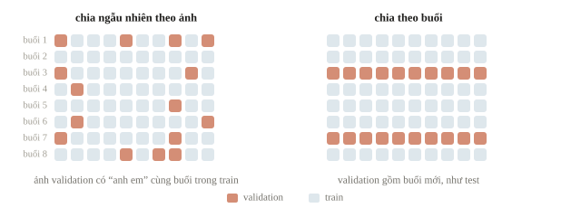
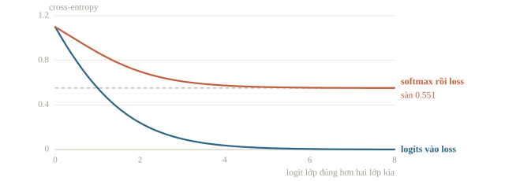
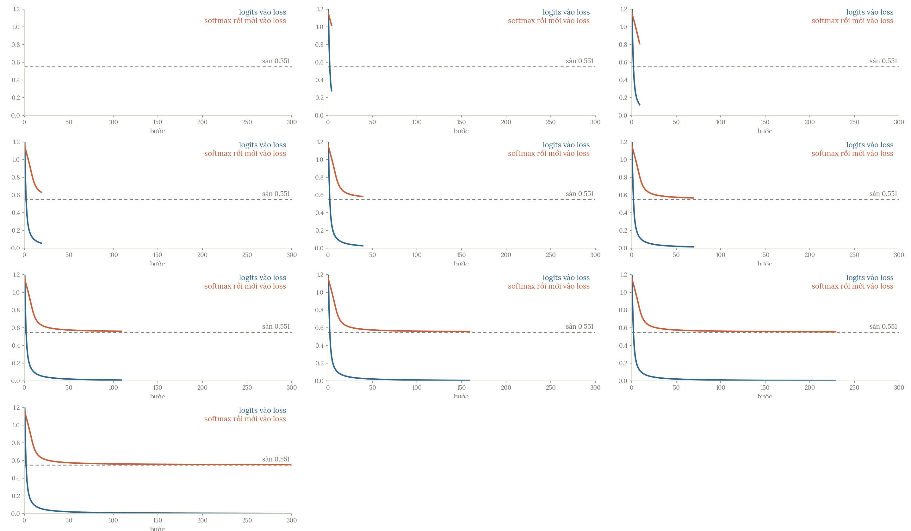
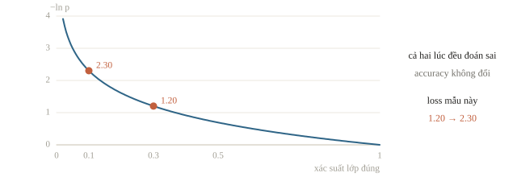
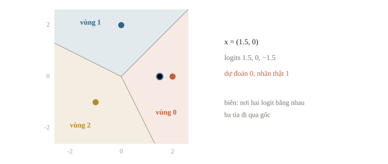
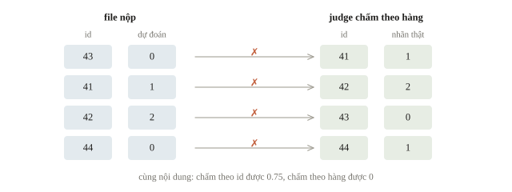
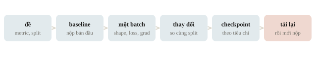

<!-- title -->
# Ôn kiểm tra khóa 2

Một pipeline chạy, đo và nộp được

Phase 4 · Ôn khóa Học sâu

---
<!-- split -->
## Đề ôn

Ảnh hoạt động, ba nhóm, metric macro-F1.

Một hàng dự đoán cho mỗi ID.

|||

Ảnh cùng buổi giống nhau: test là buổi mới thì validation cũng là buổi mới.

Buổi này đi lại cả quy trình bằng một ví dụ chạy được.

---
## Mục tiêu buổi ôn

- Dựng baseline theo đúng split và metric.
- Debug một batch bằng phép kiểm nhỏ.
- Chọn phương pháp bằng validation có ý nghĩa.
- Lưu, tải lại và kiểm file output.

---
<!-- section 1 -->
# Từ đề đến baseline

---
<!-- split -->
## Chạy vài hàng từ đầu đến cuối

- Theo dõi đủ các bước: input, tensor, logits, nhãn và CSV.
- Giữ ID qua mọi bước.
- Chia theo đơn vị cần tổng quát hóa.

|||

Baseline nộp được trước, model lớn sau.

`weights=None` là mạng chưa học, không phải pretrained.

---
<!-- figure -->
## Chia theo đơn vị của test



---
<!-- quiz -->
::: quiz
Ảnh đến từ 40 buổi sinh hoạt, mỗi buổi 30 ảnh, và test là 10 buổi tổ chức sau đó. Chia ngẫu nhiên theo ảnh thì macro-F1 trên validation là 0.93, chia theo buổi thì là 0.71. Con số nào gần với điểm test hơn?
- [x] 0.71, vì validation cũng gồm những buổi chưa thấy
- [ ] 0.93, vì validation ngẫu nhiên có đủ mọi buổi
- [ ] 0.93, vì hai cách chia dùng chung một kiến trúc model
- [ ] 0.82, vì trung bình hai cách chia cho ước lượng ổn hơn
Test là buổi mới, nên validation phải mô phỏng buổi mới. Chia theo ảnh đặt những ảnh gần như trùng nhau của cùng một buổi vào cả train lẫn validation.
:::

---
<!-- quiz -->
::: quiz
Máy thi không có Internet. Code gọi `resnet50(weights=None)`, freeze toàn bộ rồi train head trên 600 ảnh, và macro-F1 validation chỉ được 0.35. Nên nghi gì trước tiên?
- [ ] Head quá nhỏ, cần thêm hai lớp ẩn
- [x] Backbone chưa học gì, chỉ là trọng số ngẫu nhiên
- [ ] Learning rate của head quá lớn với 600 ảnh
- [ ] Macro-F1 luôn thấp hơn accuracy, nên số này bình thường
`weights=None` không nạp trọng số nào, nên freeze là giữ cố định một phép biến đổi ngẫu nhiên. Nạp đúng tệp trọng số được cấp, rồi kiểm dự đoán của một ảnh mẫu.
:::

---
<!-- section 2 -->
# Debug và chọn phương pháp

---
<!-- split -->
## Một batch trước khi chạy dài

`logits`: `(B,3)`; `labels`: `(B,)`, kiểu long.

Cross-entropy nhận logits.

Loss hữu hạn; gradient ở đúng phần cần học.

|||

Head-only: so `state_dict` encoder trước/sau.

BatchNorm: buffer đổi ở train mode dù đã freeze.

LoRA: gradient của $A$ bằng 0 ở bước đầu là đúng.

---
<!-- quiz -->
::: quiz
Model ba lớp kết thúc bằng `nn.Softmax(dim=1)`, rồi đưa output vào `CrossEntropyLoss`. Thử cho học thuộc 8 mẫu: accuracy lên 1.0, nhưng loss dừng ở 0.551 và không giảm thêm. Hiểu thế nào?
- [ ] Learning rate quá nhỏ, loss chưa kịp về 0
- [ ] 8 mẫu quá ít, loss không thể thấp hơn
- [ ] Nhãn bị lệch nên loss không xuống thêm
- [x] Softmax bị áp hai lần, nên loss có một mức sàn 0.551
`CrossEntropyLoss` tự làm log-softmax, nên khi đầu vào đã là xác suất thì trường hợp tốt nhất cho loss $\approx 0.551$. Bỏ Softmax, để loss nhận logits.
:::

---
<!-- figure -->
## Sàn của softmax hai lần



---

<!-- figure -->
## Hai cách tính loss khi train



---
<!-- quiz -->
::: quiz
LoRA một chiều: $y = (w_0 + ba)x$, với $w_0 = 1$ đã freeze, $a = 0.5$, $b = 0$. Mẫu có $x = 1$, target $t = 3$, loss $(y - t)^2$, SGD với learning rate 0.1. Ở bước 1, gradient của $a$ bằng 0. Ở bước 2, gradient của $a$ bằng bao nhiêu?
- [ ] 0
- [ ] $-2$
- [x] $-0.76$
- [ ] $-1.9$
Sau bước 1, $b$ lên 0.2. Ở bước 2, $y = 1.1$, $\partial L/\partial y = -3.8$, nên gradient của $a$ là $-3.8\cdot 0.2 = -0.76$.
:::

---
<!-- figure -->
## Ba mức mở tham số


---
<!-- split -->
## Bốn câu hỏi khác nhau

- Head-only: embedding đọc được nhãn?
- Fine-tuning: mở encoder có ích?
- LoRA: phần sửa nhỏ có đủ?
- Zero-shot: kiến thức nguồn tạo mốc gì?

|||

Mỗi thay đổi có một lý do từ lỗi hoặc giới hạn hiện tại.

Đo lại trên cùng split, so với mốc cũ.

---
<!-- quiz -->
::: quiz
Head-only cho macro-F1 0.74 trên train và 0.72 trên validation, và train thêm epoch cũng không đổi gì. Bước tiếp theo hợp lý nhất là gì?
- [ ] Train head thêm 50 epoch tới khi train đạt 1.0
- [x] Mở block cuối hoặc thêm LoRA, rồi so trên cùng cách chia
- [ ] Đổi sang accuracy, vì macro-F1 khó tăng hơn
- [ ] Gộp validation vào train để head có thêm dữ liệu
Train và validation cùng thấp, sát nhau và đã bão hòa: head tuyến tính trên embedding cố định là giới hạn. Mở block cuối hoặc thêm LoRA, rồi so với mốc 0.72.
:::

---
<!-- split -->
## Ghi một thí nghiệm dùng được

Split, processor, model/revision, seed.

Batch, precision, learning rate, phần mở.

|||

Validation metric, checkpoint chọn.

Thời gian và bộ nhớ thực đo.

Giữ bản có thể nộp trước khi thử thay đổi lớn.

---
<!-- quiz -->
::: quiz
Lần chạy mới vừa mở thêm hai block, vừa tăng learning rate từ $10^{-4}$ lên $3\cdot 10^{-4}$, và macro-F1 validation tăng từ 0.72 lên 0.75. Kết luận nào có căn cứ?
- [ ] Mở thêm block là nguyên nhân của cải thiện
- [ ] Learning rate lớn hơn là nguyên nhân của cải thiện
- [ ] Hai thay đổi đóng góp như nhau, mỗi cái 0.015
- [x] Cấu hình mới tốt hơn, nhưng chưa tách được nguyên nhân
Đổi hai thứ cùng lúc thì chỉ biết cấu hình mới tốt hơn, chưa biết vì sao. Muốn tách nguyên nhân, chạy thêm một lần chỉ đổi một yếu tố.
:::

---
<!-- section 3 -->
# Đọc kết quả và chốt output

---
<!-- split -->
## Train giảm, validation tăng

Validation loss đã qua đáy, train loss vẫn giảm.

Giữ checkpoint theo tiêu chí đã chọn; kiểm augmentation, mức mở, regularization.

|||

Accuracy chỉ nhìn argmax, loss nhìn xác suất lớp đúng.

Mẫu sai: xác suất đúng 0.3 → 0.1, loss 1.20 → 2.30, accuracy không đổi.

---
<!-- figure -->
## Loss nhìn xác suất, accuracy nhìn argmax



---
<!-- quiz -->
::: quiz
Từ epoch 3 tới epoch 5, validation accuracy giữ ở 0.84, validation loss tăng từ 0.41 lên 0.58, còn train loss giảm từ 0.20 xuống 0.05. Hiểu thế nào?
- [x] Model ngày càng tự tin vào những mẫu sai, tức đang overfit
- [ ] Loss bị tính sai, vì accuracy không đổi thì loss phải đứng yên
- [ ] Model chưa học xong, cần train thêm tới khi accuracy tăng
- [ ] Validation quá khó, train loss mới là thước đo đúng
Accuracy chỉ nhìn argmax, loss nhìn xác suất của lớp đúng. Argmax không đổi nhưng xác suất lớp đúng ở các mẫu sai giảm, nên validation loss tăng: đang overfit.
:::

---
## Tải lại trong process mới

- Model, processor và bảng nhãn đã lưu.
- Đúng chế độ eval, tắt gradient khi suy luận.
- So vài output trước/sau lưu.
- Dự đoán đủ dữ liệu; kiểm ID, số hàng và nhãn.

---
<!-- quiz -->
::: quiz
Trong process mới, cho vài ảnh mẫu đi qua processor và checkpoint đã lưu: logits khớp đến từng số với trước khi lưu. Vậy mà file nộp sai nhãn hàng loạt. Code dựng lại `class_names` từ `os.listdir` của thư mục ảnh. Lỗi nằm ở đâu?
- [ ] Trọng số nạp sai vì thiếu `strict=True`
- [ ] Processor chuẩn hóa ảnh khác lúc train
- [x] Bảng tên lớp dựng từ `os.listdir` bị lệch thứ tự
- [ ] Model còn ở chế độ train, nên dropout làm đổi dự đoán
Logits khớp đến từng số đã loại trừ trọng số, processor và chế độ train hay eval. Còn lại là bảng đổi chỉ số ra tên lớp, mà `os.listdir` không bảo đảm thứ tự.
:::

---
## Hai phép kiểm trước khi chốt

Trước khi nộp, kiểm metric trên một ví dụ nhỏ và tải lại checkpoint.

Hai phép kiểm này bắt lỗi mục tiêu đánh giá và lỗi phụ thuộc vào session.

---
<!-- split -->
## Đọc đúng metric

Head nhỏ có trọng số đặt tay.

Target: `[0, 1, 2, 1]`.

Dự đoán: `[0, 1, 2, 0]`.

|||

Accuracy $=3/4$.

F1 từng lớp: $2/3$, $2/3$, $1$.

Macro-F1 $=7/9$.

Cùng accuracy, macro-F1 vẫn có thể khác.

---
<!-- figure -->
## Vì sao mẫu cuối sai



---
<!-- quiz -->
::: quiz
Cùng target `[0, 1, 2, 1]`. Head A dự đoán `[0, 1, 2, 0]`, head B dự đoán `[0, 1, 1, 1]`. Cả hai có accuracy 0.75. Macro-F1 của head nào cao hơn?
- [x] A, với 0.778, còn B chỉ 0.600
- [ ] B, với 0.800, còn A chỉ 0.778
- [ ] Bằng nhau, vì accuracy bằng nhau
- [ ] B, vì B đoán đúng cả hai mẫu lớp 1
B không đoán lớp 2 lần nào, nên F1 của lớp 2 bằng 0, và macro-F1 của B là 0.6. A được $7/9 \approx 0.778$.
:::

---
<!-- split -->
## Dựng đối tượng mới để tải lại

```python
restored.load_state_dict(saved["state_dict"])
restored.eval()
with torch.inference_mode():
    restored_logits = restored(features)
assert torch.equal(logits, restored_logits)
```

|||

`BytesIO` đóng vai tệp trong bộ nhớ.

Trong bài thi: ghi tệp thật, tải lại ở tiến trình mới.

ID giữ thứ tự input: 43, 41, 42, 44.

---
<!-- quiz -->
::: quiz
Máy chấm bỏ qua cột `id`, chấm theo thứ tự hàng của file nộp mẫu `41, 42, 43, 44`, với nhãn thật lần lượt là 1, 2, 0, 1. Nộp nguyên file của ví dụ, có thứ tự `43, 41, 42, 44`, thì accuracy bằng bao nhiêu?
- [ ] 0.75, vì dự đoán không thay đổi
- [ ] 0.50, vì chỉ hai hàng đầu bị đảo
- [ ] 0.25, vì hàng ID 44 đúng vị trí
- [x] 0, vì cả bốn hàng đều sai
Ba hàng đầu mang dự đoán của mẫu khác, còn hàng ID 44 đúng vị trí nhưng vốn đã đoán sai, nên accuracy bằng 0.
:::

---
<!-- figure -->
## Chấm theo hàng hay theo id



---
## Khi đi thi

- Đọc metric và đơn vị chia trước khi viết model.
- Nộp một bản baseline sớm, so mọi thử nghiệm với nó.
- Nạp trọng số từ tệp được cấp; `weights=None` là mạng ngẫu nhiên.
- Debug một batch: shape, loss, gradient, optimizer, BatchNorm.
- Tải lại ở process mới rồi mới nộp.

---
<!-- section 4 -->
# Luyện đề

---
<!-- quiz -->
::: quiz Luyện đề 1
Mạng 10 lớp, mỗi lớp một neuron sigmoid: $o_i = \sigma(w_io_{i-1} + b_i)$, với $o_0 = x$ và mọi $w_i = 1$. Cận trên của $|\partial o_{10}/\partial w_1|$ và của $|\partial o_{10}/\partial w_{10}|$ là gì?
- [ ] Với $w_1$ là $|x|/4$, với $w_{10}$ là $1/4^{10}$
- [ ] Cả hai đều là $|x|/4^{10}$
- [ ] Với $w_1$ là $|x|/40$, với $w_{10}$ là $1/4$
- [x] Với $w_1$ là $|x|/4^{10}$, với $w_{10}$ là $1/4$
Gradient về $w_{10}$ chỉ qua một thừa số $\sigma' \le 1/4$. Gradient về $w_1$ đi qua mười thừa số nhân nhau, nên không vượt quá $|x|/4^{10}$.
Phỏng theo: [CMU 10-601 · Exam 2 Practice · Q4.5](https://www.cs.cmu.edu/~mgormley/courses/10601/handout/exam2_practice_problems.pdf#page=20)
:::

---
<!-- quiz -->
::: quiz Luyện đề 2
Linear attention cần một ánh xạ hữu hạn chiều $\phi$ sao cho $\phi(q)^\top\phi(k) \approx \exp(q^\top k)$, với hệ số $1/\sqrt d$ đã gộp vào $q$, $k$. Dùng Taylor bậc hai $\exp(x) \approx 1 + x + x^2/2$ và $(q^\top k)^2 = \sum_{a,b} q_aq_bk_ak_b$, ta lấy $\phi(q)$ gồm số 1, $d$ thành phần $q_a$, và $d^2$ tích $q_aq_b/\sqrt2$. Với $d = 64$, $\phi$ có bao nhiêu chiều $\ell$, và khi nào chi phí $O(T\ell d)$ thấp hơn $O(T^2d)$ của attention chuẩn?
- [ ] $\ell = 129$, khi $T > 129$
- [ ] $\ell = 4161$, với mọi $T$, vì chi phí tuyến tính theo $T$
- [x] $\ell = 4161$, khi $T > 4161$
- [ ] $\ell = 65$, khi $T > 65$
$\ell = 1 + 64 + 4096 = 4161$, và linear attention chỉ rẻ hơn khi $T > \ell$.
Phỏng theo: [USA-NA-AIO 2026 · Vòng 2 · Ngày 1 · Part 1.1.6](https://www.usaaio.org/attachments/past-problems/2026/usaaio-2026-round-2-day-1-problems.pdf#page=4)
:::

---
<!-- quiz -->
::: quiz Luyện đề 3
Validation có 100 ảnh: 80 ảnh nhóm A, 12 ảnh nhóm B, 8 ảnh nhóm C. Một baseline luôn đoán A. Accuracy và macro-F1 của nó bằng bao nhiêu?
- [ ] Accuracy 0.80, macro-F1 0.80
- [ ] Accuracy 0.80, macro-F1 0.89
- [x] Accuracy 0.80, macro-F1 0.30
- [ ] Accuracy 0.33, macro-F1 0.30
Lớp A có F1 khoảng 0.89, lớp B và C có F1 bằng 0, nên macro-F1 khoảng 0.30, trong khi accuracy là 0.80.
Phỏng theo: [CMU 10-601 · Exam 2 Practice · Q5.1](https://www.cs.cmu.edu/~mgormley/courses/10601/handout/exam2_practice_problems.pdf#page=21)
:::

---
<!-- center -->
## Chốt quy trình

Đọc đề → split có lý do → baseline nộp được → debug một batch → chọn cách dùng pretrained → chọn checkpoint → tải lại → kiểm file.

Mỗi bước để lại một bằng chứng: điểm validation, shape, output, schema.

---
<!-- figure -->
## Thứ tự làm bài



---
<!-- center -->
## Sau buổi ôn

Làm **10 câu kiểm tra cuối bài** trên trang bài học.

Chạy lại ba ví dụ: mạng nhỏ, feature extraction và LoRA; với mỗi ví dụ, giải thích một lỗi không báo exception.
