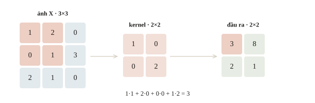
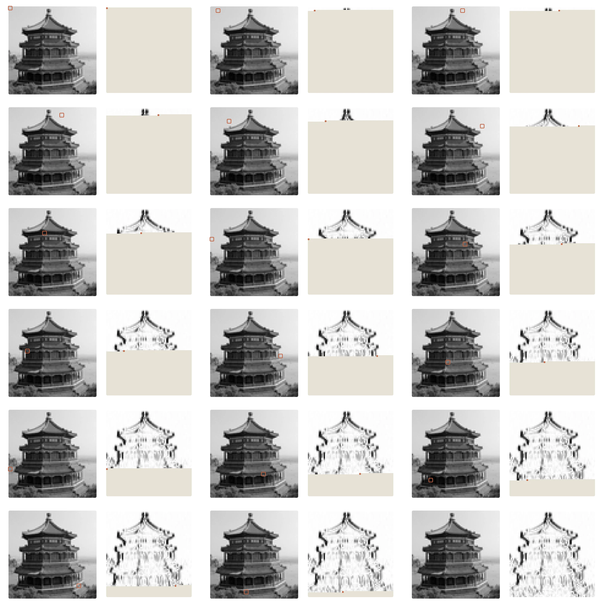
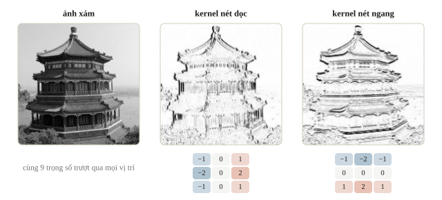
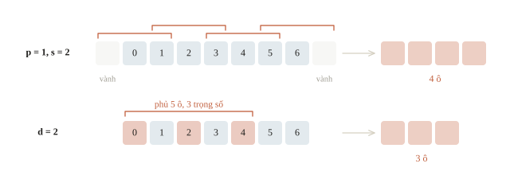
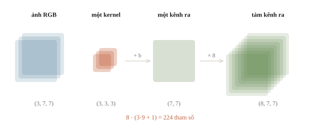
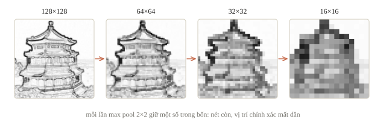
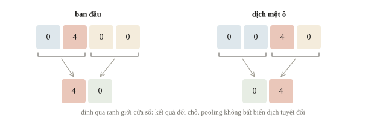
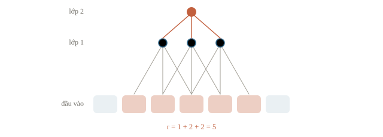
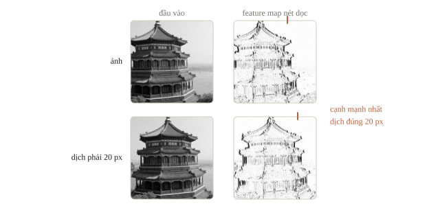

<!-- title -->
# Convolution và pooling

Một bộ dò nét dùng lại trên cả ảnh

Chương 5 · Bài 5.1

---
<!-- split -->
## Nét phấn dịch chỗ

MLP trải cả ảnh thành một vector.

Khi nét đổi vị trí, MLP có thể phải học lại nhiều trọng số.

|||

Ta muốn đọc cửa sổ nhỏ.

**Cùng kernel, nhiều vị trí.**

---
## Mục tiêu

- Tính convolution bằng tay và so với PyTorch.
- Tính kích thước đầu ra theo kernel, padding, stride, dilation.
- Phân biệt convolution và pooling.
- Tính receptive field của nhiều lớp.

---
<!-- section 1 -->
# Đọc một cửa sổ

---
<!-- figure -->
## Bốn phép nhân, một kết quả



---
<!-- split -->
## Không lật kernel

Convolution toán học lật kernel $180^\circ$.

`Conv2d` làm cross-correlation: nhân thẳng.

|||

Kernel học được: lật hay không như nhau.

Kernel đề cho sẵn: **tính không lật**.

---
<!-- quiz -->
::: quiz
Hàng ảnh `[0, 0, 5, 5]` có một cạnh chuyển từ tối sang sáng. Kernel `[-1, 1]`, stride 1, không padding. `Conv2d` của PyTorch cho ra kết quả nào?
- [x] `[0, 5, 0]`
- [ ] `[0, -5, 0]`
- [ ] `[0, 0, 5]`
- [ ] `[0, 5, 0, 0]`
Cửa sổ thứ hai là `[0, 5]`, nhân thẳng với `[-1, 1]` được 5. Ra $-5$ là lật kernel như convolution trong toán.
:::

---
<!-- quiz -->
::: quiz
Ảnh xám $64\times 64$, kernel $3\times 3$, không padding, stride 1, đầu ra $62\times 62$. Nếu mỗi vị trí đầu ra có một kernel riêng thay vì dùng chung, lớp này cần bao nhiêu trọng số, bỏ qua bias?
- [ ] 9
- [ ] 3844
- [x] 34 596
- [ ] 36 864
Có 3844 vị trí đầu ra, mỗi vị trí một kernel 9 số, nên cần $34\,596$ trọng số. Lớp conv thường chỉ cần 9.
Phỏng theo: [CMU 10-601 · Exam 3 Practice · Q1.4(a)](https://www.cs.cmu.edu/~mgormley/courses/10601/handout/exam3_practice_problems.pdf#page=8)
:::

---
<!-- center -->
## Ô đầu của feature map

Ô trên trái là $1\times1+2\times0+0\times0+1\times2=3$.

Ô bên phải là $2\times1+0\times0+1\times0+3\times2=8$.

---
## Code đọc từng cửa sổ

Chỉ đọc cửa sổ nằm trọn trong ảnh, không lật kernel, như `Conv2d`.

```python
def correlate_valid(image, kernel):
    height, width = image.shape
    kh, kw = kernel.shape
    result = np.zeros((height - kh + 1, width - kw + 1))
    for row in range(result.shape[0]):
        for col in range(result.shape[1]):
            window = image[row:row + kh, col:col + kw]
            result[row, col] = np.sum(window * kernel)
    return result
```

---
## Kết quả để đối chiếu

```python
feature_map = correlate_valid(image, kernel)
print(feature_map)
```

```output
[[3. 8.]
 [2. 1.]]
```

Ô 8 lớn nhất: cửa sổ ấy có số lớn trên đường chéo, đúng chỗ kernel có trọng số dương.

---

<!-- figure -->
## Một kernel quét cả ảnh



---
<!-- figure -->
## Kernel dò nét trên ảnh thật



---
<!-- quiz -->
::: quiz
Ta muốn một kernel $2\times 2$ cho số dương với cửa sổ nét chéo $\begin{bmatrix}1&0\\0&1\end{bmatrix}$, nhưng cho 0 với mọi vùng nền đều màu $\begin{bmatrix}c&c\\c&c\end{bmatrix}$. Chọn kernel nào?
- [ ] $\begin{bmatrix}1&0\\0&1\end{bmatrix}$
- [x] $\begin{bmatrix}1&-1\\-1&1\end{bmatrix}$
- [ ] $\begin{bmatrix}0&1\\1&0\end{bmatrix}$
- [ ] $\begin{bmatrix}1&1\\1&1\end{bmatrix}$
Kernel có tổng trọng số bằng 0 cho 0 với nền đều, và cho 2 với nét chéo.
:::

---
<!-- section 2 -->
# Đọc thưa, đọc sát biên

---
<!-- split -->
## Ba cách đổi cửa sổ

Padding thêm vành quanh ảnh.

Stride quyết định mỗi lần dịch bao nhiêu ô.

|||

Dilation giãn vị trí kernel.

Kernel 3, dilation 2 phủ 5 ô.

---
<!-- center -->
## Kích thước một chiều

$$H_{\mathrm{out}}=\left\lfloor\frac{H+2p-d(k-1)-1}{s}\right\rfloor+1$$

$p$ là padding, $s$ là stride, còn $d$ là dilation.

Giữ kích thước khi $s=1$: $2p=d(k-1)$.

---
<!-- center -->
## Ví dụ kích thước

$H=7,\ k=3,\ p=1,\ s=2,\ d=1$

$$H_{\mathrm{out}}=\left\lfloor\frac{7+2-(3-1)-1}{2}\right\rfloor+1=\lfloor6/2\rfloor+1=4.$$

---
<!-- figure -->
## Padding, stride, dilation trên một chiều



---
<!-- quiz -->
::: quiz
Ảnh dài 8 ô, kernel 3, padding 0, stride 2, dilation 1. Đầu ra dài bao nhiêu?
- [ ] 2
- [x] 3
- [ ] 4
- [ ] 6
$\lfloor(8 - 3)/2\rfloor + 1 = 3$: các vị trí bắt đầu là 0, 2, 4.
:::

---
<!-- quiz -->
::: quiz
Conv có kernel 3, dilation 2, stride 1. Padding đối xứng bằng bao nhiêu thì giữ nguyên chiều dài đầu vào?
- [ ] 1
- [x] 2
- [ ] 3
- [ ] 4
Kernel phủ $d(k - 1) + 1 = 5$ ô, nên cần $2p = 4$, tức $p = 2$.
:::

---
<!-- split -->
## Nhiều kênh

Input có shape $(N,C_{in},H,W)$.

Một kernel tạo một kênh đầu ra và đọc toàn bộ $C_{in}$ kênh đầu vào.

|||

RGB, 8 kênh đầu ra, kernel $3\times3$:

$8(3\cdot9+1)=224$ tham số.

Số tham số không phụ thuộc $H,W$ của ảnh.

---
## Đếm bằng thư viện

```python
rgb_layer = nn.Conv2d(3, 8, 3, padding=1)
print(sum(parameter.numel() for parameter in rgb_layer.parameters()))
print(tuple(rgb_layer(torch.zeros(2, 3, 7, 7)).shape))
```

```output
224
(2, 8, 7, 7)
```

Padding 1 giữ $7\times7$; hai ảnh, tám kênh.

---
<!-- figure -->
## Một kernel đọc mọi kênh vào



---
<!-- quiz -->
::: quiz
`nn.Conv2d(16, 32, kernel_size=(3, 5))` có `weight.shape` là gì?
- [ ] `(16, 32, 3, 5)`
- [ ] `(32, 3, 5)`
- [x] `(32, 16, 3, 5)`
- [ ] `(32, 16, 5, 3)`
Trục đầu là số kernel, 32, và mỗi kernel đọc đủ 16 kênh vào, cao 3, rộng 5.
:::

---
<!-- quiz -->
::: quiz
Lớp `nn.Conv2d(3, 8, 3, padding=1)` chạy trên ảnh $7\times 7$, rồi chạy trên ảnh $70\times 70$. Số tham số và số phép nhân thay đổi thế nào?
- [x] Tham số vẫn là 224, phép nhân tăng 100 lần
- [ ] Tham số vẫn là 224, phép nhân cũng giữ nguyên
- [ ] Tham số tăng 100 lần, phép nhân tăng 100 lần
- [ ] Tham số tăng 10 lần, phép nhân tăng 10 lần
Số tham số chỉ phụ thuộc $C_{\mathrm{in}}$, $C_{\mathrm{out}}$, $k$, nên vẫn là 224. Phép nhân tỉ lệ với số vị trí đầu ra, từ 49 lên 4900, tức gấp 100 lần.
:::

---
<!-- section 3 -->
# Tổng hợp và vùng nhìn

---
<!-- center -->
## Pooling trên bảng kết quả

$$\begin{bmatrix}3&8\\2&1\end{bmatrix}$$

Max pooling trả về **8**. Average pooling trả về **3.5**.

Không có trọng số học. Global pooling: cả map còn một số.

---
<!-- figure -->
## Ba lần max pool trên ảnh thật



---
<!-- figure -->
## Pooling dịch vị trí



---
## Dịch đỉnh qua ranh giới cửa sổ

```python
left = torch.tensor([[[[0., 4., 0., 0.]]]])
right = torch.tensor([[[[0., 0., 4., 0.]]]])
pool = nn.MaxPool2d((1, 2))
print(pool(left).flatten().tolist())
print(pool(right).flatten().tolist())
```

```output
[4.0, 0.0]
[0.0, 4.0]
```

Đỉnh 4 dịch sang cửa sổ thứ hai: pooling không bất biến dịch tuyệt đối.

---
<!-- quiz -->
::: quiz
Max pooling trên một cửa sổ $2\times 2$ chỉ trả về số 8. Từ đó có khôi phục duy nhất được bốn ô ban đầu không?
- [ ] Có, mỗi ô bằng $8/4 = 2$
- [ ] Có, nếu biết thêm stride của pooling
- [ ] Có, nếu biết thêm average pooling của cửa sổ
- [x] Không, vì nhiều cửa sổ khác nhau có cùng giá trị lớn nhất
Nhiều cửa sổ khác nhau có cùng giá trị lớn nhất, nên giảm kích thước là mất thông tin. Biết thêm trung bình cũng vẫn có vô số cách chia.
:::

---
## Gradient qua max pooling

```python
window = y.detach().clone().requires_grad_(True)
nn.MaxPool2d(2)(window).sum().backward()
print(window.grad[0, 0].tolist())
```

```output
[[0.0, 1.0], [0.0, 0.0]]
```

Max: chỉ ô thắng nhận gradient. Average: chia đều $1/4$.

---
<!-- quiz -->
::: quiz
`MaxPool1d(kernel_size=2, stride=1)` trên `[1, 9, 3]` cho ra `[9, 9]`. Lấy tổng đầu ra rồi gọi `backward()`. Gradient về đầu vào là gì?
- [ ] `[0.5, 1, 0.5]`
- [ ] `[0, 9, 0]`
- [ ] `[0, 1, 0]`
- [x] `[0, 2, 0]`
Ô 9 thắng ở cả hai cửa sổ chồng nhau, mỗi cửa sổ gửi về gradient 1, nên tổng là 2.
:::

---
<!-- figure -->
## Hai lớp nhìn 5 ô



---
<!-- center -->
## Theo dõi hai số

$r$: số ô input trong vùng nhìn; $j$: khoảng cách trên input giữa hai vị trí output kề nhau. Bắt đầu $r=j=1$.

$$r_{\mathrm{mới}}=r+(k-1)d\,j,\qquad j_{\mathrm{mới}}=s\,j$$

Conv 3, stride 1: $r=3$, $j=1$. Pool 2, stride 2: $r=4$, $j=2$. Conv 3, stride 1: $r=8$, $j=2$; cả ba lớp dùng dilation 1.

---
<!-- split -->
## Xếp chồng $3\times3$

Hai lớp $3\times3$ nhìn $5\times5$.

18 trọng số thay vì 25 mỗi cặp kênh, thêm một activation.

|||

Lớp nông: map lớn, cạnh, nét.

Lớp sâu: map nhỏ, thô, tổ hợp lớn.

---
<!-- quiz -->
::: quiz
Một conv kernel 3 stride 2, tiếp theo là một conv kernel 3 stride 1, cả hai có dilation 1. Một ô ở lớp thứ hai nhìn bao nhiêu ô đầu vào theo mỗi chiều?
- [ ] 5
- [ ] 6
- [x] 7
- [ ] 9
Lớp đầu cho $r = 3$, $j = 2$. Lớp hai thêm $(3 - 1)\cdot 2 = 4$, nên $r = 7$.
:::

---
<!-- section 4 -->
# Giả định

---
<!-- split -->
## Dịch thì theo, xoay thì không

Conv stride 1: ảnh dịch, map dịch theo (đồng biến).

Bất biến chỉ có sau phép gộp vị trí.

|||

Không tự bất biến với xoay, tỉ lệ, ánh sáng.

Đề cần tọa độ: đừng gộp hết vị trí.

---
<!-- figure -->
## Ảnh dịch, feature map dịch theo



---
<!-- quiz -->
::: quiz
Một bộ dò nét đã học tốt trên những ảnh chỉ có nét dựng đứng, ở đủ mọi vị trí. Ảnh test bị xoay $90^\circ$ nên nét thành nằm ngang. Nhiều khả năng chuyện gì xảy ra?
- [x] Nhận kém, vì kernel nét dọc phản ứng yếu với nét ngang
- [ ] Nhận kém, vì xoay làm đổi shape `(N, C, H, W)`
- [ ] Vẫn nhận tốt, vì dùng chung kernel ở mọi vị trí
- [ ] Vẫn nhận tốt, nếu thêm padding cho ảnh đã xoay
Dùng chung kernel chỉ giúp khi mẫu dịch chỗ, còn xoay thì làm đổi chính mẫu cục bộ. Muốn bền với phép xoay, cần dữ liệu hoặc augmentation có xoay (bài 5.3).
:::

---
## Khi đi thi

- Batch giả, in shape từng khối.
- `(H, W, C)` → `permute`, kiểm một pixel.
- Cần tọa độ, mask: giữ chiều không gian.

---
<!-- section 5 -->
# Luyện đề

---
<!-- quiz -->
::: quiz Luyện đề 1
Một đội thay một conv $7\times 7$, 64 kênh vào, 64 kênh ra, bằng ba conv $3\times 3$ từ 64 sang 64 nối tiếp, stride 1, có ReLU ở giữa. So với lớp cũ, bỏ qua bias, điều nào đúng?
- [ ] Vùng nhìn chỉ còn $3\times 3$, và ít trọng số hơn
- [ ] Vùng nhìn thành $9\times 9$, và ít trọng số hơn
- [x] Vùng nhìn vẫn là $7\times 7$, và ít trọng số hơn
- [ ] Vùng nhìn vẫn là $7\times 7$, nhưng nhiều trọng số hơn
Ba lớp $3\times 3$ cho vùng nhìn $7\times 7$, với $110\,592$ trọng số so với $200\,704$, khoảng 55%.
Phỏng theo: [NOAI 2026 Singapore · Vòng sơ loại · Câu 215](https://aisingapore.org/wp-content/uploads/2026/04/NOAI-2026-Preliminary-Round-Assessment-300-MCQs-Google-Forms.pdf#page=78)
:::

---
<!-- quiz -->
::: quiz Luyện đề 2
Một conv 1D có một bộ lọc, và $z_j$ lớn nghĩa là có mẫu cần tìm ở vị trí $j$. Mạng A cho ra $\sigma(\max_j z_j)$, mạng B cho ra $\sigma(\min_j z_j)$. Đầu ra cao nghĩa là “mẫu có ở mọi vị trí” ở mạng nào, và nghĩa là “mẫu có ở ít nhất một vị trí” ở mạng nào?
- [ ] A rồi B
- [x] B rồi A
- [ ] A ở cả hai
- [ ] B ở cả hai
Min cao chỉ khi mọi $z_j$ đều cao, tức mẫu có ở mọi vị trí. Max cao thì chỉ cần một $z_j$ cao.
Phỏng theo: [MIT 6.036 · Final, Spring 2022 · Q8](https://introml.mit.edu/_static/fall22/final/review/6036_final_sp22.pdf#page=21)
:::

---
<!-- quiz -->
::: quiz Luyện đề 3
Mỗi mẫu là một tensor `(64, 64, 2)`: vector lực $(F_x, F_y)$ đo trên lưới $64\times 64$. Phải dự đoán tọa độ nguồn $(x_s, y_s)$ cùng 100 giá trị cường độ. Một đội dùng các conv stride 1, rồi global average pooling, rồi `Linear` ra 102 số, và lỗi tọa độ rất cao. Thay đổi nào nhắm đúng nguyên nhân?
- [ ] Đổi global average pooling thành global max pooling
- [ ] Tăng gấp đôi số kênh của lớp conv cuối
- [ ] Thêm padding để conv đọc được cả vùng biên
- [x] Bỏ global pooling, flatten feature map để còn giữ vị trí
Global average pooling gộp mọi vị trí, nên đặc trưng gần như không đổi khi nguồn dịch chỗ. Bỏ global pooling, flatten map để `Linear` đọc được vị trí.
Phỏng theo: [USA-NA-AIO 2026 · Vòng 2 · Ngày 1 · Problem 2](https://www.usaaio.org/attachments/past-problems/2026/usaaio-2026-round-2-day-1-problems.pdf#page=13)
:::

---
<!-- center -->
## Chốt ý

Cửa sổ nhỏ và trọng số chung giúp dò cùng một tín hiệu ở nhiều vị trí.

Pooling lấy biểu diễn gọn hơn nhưng làm mất một phần chi tiết vị trí.

---
<!-- center -->
## Sau giờ học

Làm **10 câu kiểm tra cuối bài** trên trang bài học.

Chạy notebook; đổi stride và padding, đoán trước shape đầu ra rồi kiểm lại.
