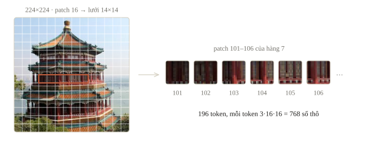
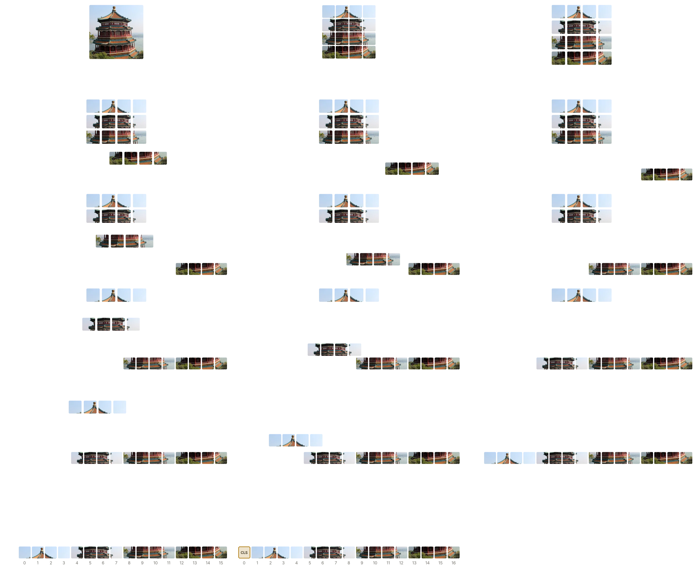
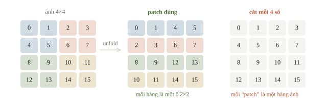
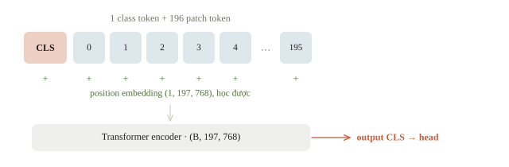
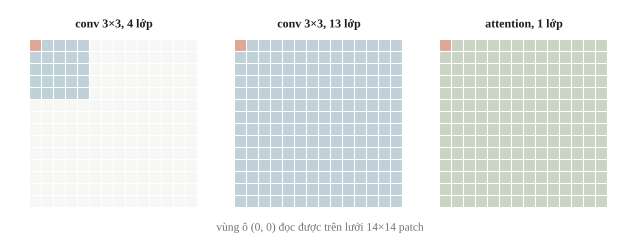
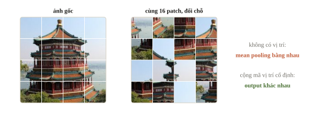
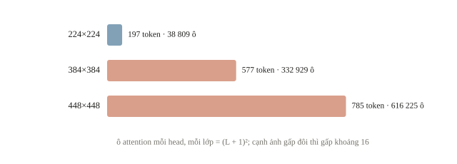
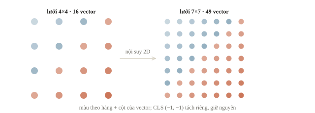

<!-- title -->
# Vision Transformer

Cho các mảnh ảnh trao đổi như token

Chương 5 · Bài 5.4

---
<!-- split -->
## Hai mảnh ảnh ở xa nhau

CNN nối vùng xa dần qua nhiều lớp convolution.

|||

Attention có thể cho hai patch trao đổi trực tiếp.

Mỗi patch cũng cần biết nó nằm ở đâu.

---
<!-- section 1 -->
# Ảnh thành patch

---
<!-- figure -->
## Ảnh thành dãy token



---

<!-- figure -->
## Từ ảnh thành chuỗi token



---
<!-- center -->
## Đếm token

$L=(H/P)(W/P)$ với ảnh chia hết cho $P$.

Mỗi patch thô có $CP^2$ số, với $C$ là số kênh.

Projection đưa mỗi patch về vector $D$ chiều.

ViT-B/16, ảnh 224: 196 token, patch thô 768 số, $D=768$.

---
<!-- quiz -->
::: quiz
Ảnh RGB $32\times 32$ được chia thành các patch $8\times 8$. Có bao nhiêu patch, và mỗi patch thô dài bao nhiêu số?
- [ ] 64 patch, mỗi patch 192 số
- [x] 16 patch, mỗi patch 192 số
- [ ] 16 patch, mỗi patch 64 số
- [ ] 4 patch, mỗi patch 768 số
Mỗi chiều có 4 patch, nên có 16 patch. Mỗi patch chứa $3\cdot 8\cdot 8 = 192$ giá trị.
:::

---
## Tensor chia đúng ô vuông

`images` có shape `(1, 1, 4, 4)` và `patch_size = 2`. `unfold` lấy từng ô; `permute` đưa hàng, cột patch lên trước kênh rồi mới trải patch.

```python
windows = images.unfold(2, patch_size, patch_size)
windows = windows.unfold(3, patch_size, patch_size)
patches = windows.permute(0, 2, 3, 1, 4, 5).reshape(1, 4, 4)
```

---
## Kết quả patchify

```python
print(patches[0].to(torch.int64).numpy())
print(tuple(patches.shape))
```

```output
[[ 0  1  4  5]
 [ 2  3  6  7]
 [ 8  9 12 13]
 [10 11 14 15]]
(1, 4, 4)
```

Có 4 patch, mỗi patch dài 4. Patch đầu gồm các phần tử `[0, 1, 4, 5]`, không phải bốn số liên tiếp theo hàng.

---
<!-- figure -->
## Đừng cắt dãy theo hàng



---
<!-- quiz -->
::: quiz
Ảnh RGB $4\times 4$, patch cỡ 2, nên `windows` có shape `(1, 3, 2, 2, 2, 2)`. Một bạn bỏ bước `permute` và gọi thẳng `windows.reshape(1, 4, 12)`. Hàng đầu của kết quả chứa gì?
- [ ] Ba kênh của patch trên trái, nên `permute` là thừa
- [ ] Ba kênh của bốn điểm ảnh ở hàng ảnh đầu tiên
- [x] Kênh R của ba patch đầu tiên
- [ ] Không có gì, vì không reshape được tensor sáu chiều
`reshape` đọc theo thứ tự trục kênh trước, nên mười hai số đầu là kênh R của patch 0, 1 và 2. Shape đúng mà nội dung bị trộn.
:::

---
<!-- split -->
## Một projection dùng chung

$\mathbf z_i=\mathbf p_iE+\mathbf b$.

|||

Conv kernel $P\times P$, stride $P$ có thể tương đương phép gom patch.

Hai cách chỉ tương đương khi thứ tự phần tử và trọng số được xếp giống nhau.

---
## Đối chiếu hai cách

`tokens` và `conv_tokens` là hai kết quả trên cùng một ảnh sau khi đã đặt trọng số tương ứng.

```python
print(torch.allclose(tokens, conv_tokens))
```

```output
True
```

`True`: Linear trên patch trải phẳng và Conv2d kernel 2, stride 2 cho cùng token khi trọng số xếp cùng thứ tự.

---
<!-- quiz -->
::: quiz
Tăng $D$ từ 3 lên 12, giữ nguyên ảnh và patch size. Đại lượng nào không đổi?
- [x] Số patch
- [ ] Số tham số của phép chiếu
- [ ] Chiều của mỗi vector token
- [ ] Shape trọng số của Conv2d tương đương
Số patch chỉ phụ thuộc kích thước ảnh và patch. Số tham số, chiều token và số kênh ra đều tăng theo $D$.
:::

---
<!-- quiz -->
::: quiz
Patch embedding của ViT-B/16 là `nn.Conv2d(3, 768, kernel_size=16, stride=16)`, chạy trên ảnh $224\times 224$. Lớp này có bao nhiêu tham số?
- [ ] $150\,528$
- [ ] $115\,756\,032$
- [ ] $589\,824$
- [x] $590\,592$
$768\cdot 3\cdot 16\cdot 16 + 768 = 590\,592$. Mọi patch dùng chung bộ lọc, nên con số không phụ thuộc 196 patch.
:::

---
<!-- section 2 -->
# Trao đổi bằng attention

---
<!-- center -->
## Một head đọc các token

$$\operatorname{softmax}(QK^\top/\sqrt{d_k})V$$

Softmax tính theo từng hàng. $d_k$ là chiều của query và key.

---
<!-- split -->
## Class token

Class token là một vector học được, ghép vào đầu chuỗi, chỉ đọc các patch qua attention.

Output của nó ở lớp cuối đi vào head phân loại.

|||

ViT-B/16, ảnh 224: 196 patch + CLS = 197 token, shape $(B,197,768)$.

Mean pooling các patch là cách khác, tốt ngang khi chỉnh learning rate.

---
<!-- figure -->
## Chuỗi vào encoder



---
<!-- quiz -->
::: quiz
Lưới $14\times 14$ patch. Sau một lớp attention, patch $(0, 0)$ đã đọc được patch $(13, 13)$ chưa? Với conv $3\times 3$ stride 1 thì cần ít nhất mấy lớp?
- [ ] Rồi, và cần 7 lớp conv
- [x] Rồi, và cần 13 lớp conv
- [ ] Chưa, và cần 7 lớp conv
- [ ] Chưa, và cần 13 lớp conv
Attention tính điểm cho mọi cặp token, nên ngay lớp đầu $(0, 0)$ đã có đường tới $(13, 13)$. Mỗi lớp conv $3\times 3$ chỉ với thêm một ô mỗi phía, nên cần 13 lớp.
:::

---
<!-- figure -->
## Một lớp attention, mười ba lớp conv



---
<!-- figure -->
## Nội dung đổi, vị trí giữ



---
<!-- split -->
## Thử hoán vị

```output
without position: True
with fixed positions: False
```

|||

Không có vị trí: đảo các mảnh, kết quả sau pooling không đổi.

Cộng mã vị trí cố định: cùng tập mảnh ở bố cục khác cho output khác.

Câu hỏi về cấu trúc, nên block ngẫu nhiên là đủ để kiểm.

---
<!-- quiz -->
::: quiz
Ta đảo thứ tự các token ảnh, và position embedding cũng đi theo từng token. Sau đó lấy mean pooling. Vì sao kết quả có thể giữ nguyên?
- [ ] Vì position embedding chưa được train nên chưa có tác dụng
- [ ] Vì mean pooling xóa hết thông tin vị trí trong token
- [x] Vì chỉ thứ tự danh sách thay đổi, mỗi patch vẫn giữ mã vị trí cũ
- [ ] Vì encoder ở chế độ `eval()` nên bỏ qua position embedding
Mỗi patch vẫn đi cùng mã vị trí của chính nó, và self-attention cùng mean pooling không phụ thuộc thứ tự liệt kê.
:::

---
<!-- center -->
## Bảng vị trí của ViT gốc

Mỗi chỉ số patch và CLS có một vector học được: shape ${(1,\ L+1,\ D)}$.

Bảng 1D không ghi sẵn hàng, cột; model học ra từ dữ liệu.

Sau huấn luyện, vị trí cùng hàng hoặc cùng cột có vector giống nhau hơn.

---
<!-- section 3 -->
# Độ phân giải, dữ liệu và ngân sách

---
<!-- center -->
## Độ phân giải có giá

Nếu tăng gấp đôi cả $H$ và $W$:

Giữ patch size, số patch tăng 4 lần, còn phần ma trận attention giữa các patch tăng 16 lần. Nếu thêm class token, tổng kích thước cần tính cả token đó.

---
<!-- figure -->
## Số ô attention theo cạnh ảnh



---
<!-- split -->
## CNN và ViT

CNN có thiên hướng cục bộ và chia sẻ trọng số.

ViT nối vùng xa ngay lớp đầu nhưng phải học quan hệ không gian.

|||

Bài báo ViT: chỉ train trên ImageNet (khoảng 1.3 triệu ảnh), không dùng regularization mạnh thì ViT kém ResNet cùng cỡ vài điểm.

Pretrain trên JFT-300M (303 triệu ảnh), ViT vượt.

---
<!-- quiz -->
::: quiz
Train từ đầu trên 3000 ảnh. Một CNN nhỏ đạt 85% trên validation. Một ViT nhỏ có số tham số tương đương đạt 100% trên train nhưng chỉ 70% trên validation. Lý do khả dĩ nhất là gì?
- [x] ViT thiếu giả định cục bộ nên overfit khi có ít ảnh
- [ ] ViT underfit, cần thêm lớp để tăng sức chứa
- [ ] Code ViT có lỗi, vì attention toàn cục phải tốt hơn
- [ ] Validation của ViT bị rò dữ liệu từ tập train
Train 100% mà validation 70% là overfit. ViT phải tự học quan hệ không gian, nên với ít ảnh nó dễ học thuộc.
:::

---
## Đổi độ phân giải checkpoint

Tách CLS, đưa lưới về $h\times w\times D$, nội suy 2D, trải lại, ghép CLS.

```python
resized = resize_position_table(table, old_grid=4, new_grid=7)
```

```output
(1, 17, 2) -> (1, 50, 2)
CLS: [-1.0, -1.0]
row of first column: [0.0, 0.5, 1.0, 1.5, 2.0, 2.5, 3.0]
```

Bảng tự đặt: vector mỗi patch là (hàng, cột) của nó. Sau nội suy vẫn fine-tune.

---
<!-- figure -->
## Nội suy bảng vị trí



---
<!-- quiz -->
::: quiz
Checkpoint ViT-B/16 train ở $224\times 224$ có bảng vị trí shape `(1, 197, 768)`. Bây giờ fine-tune ở $384\times 384$, vẫn giữ patch 16. Bảng mới cần bao nhiêu vector?
- [ ] 197
- [ ] 337
- [ ] 576
- [x] 577
$(384/16)^2 = 576$ patch, cộng CLS thành 577.
:::

---
## Khi đi thi

- Đếm token, ước lượng $L^2$ trước khi tăng độ phân giải.
- Đọc cấu hình checkpoint: patch, độ phân giải, mean/std, CLS.
- In shape lưới token; kênh ở trục cuối phải `permute`.
- Chi tiết nhỏ: giữ pixel, cắt ô thay vì resize mạnh.
- So cùng validation; thời gian mỗi ảnh nhân số ảnh test phải vừa giới hạn.
- Ít dữ liệu, cấm pretrained: CNN nhỏ trước ViT.

---
<!-- section 4 -->
# Luyện đề

---
<!-- quiz -->
::: quiz Luyện đề 1
Một đề vật lý cho mỗi mẫu một tensor shape `(64, 64, 2)`, là hai thành phần của một trường vector đo trên lưới $64\times 64$. Một đội dùng ViT patch $8\times 8$ có class token. Chuỗi vào encoder dài bao nhiêu, và mỗi patch thô dài bao nhiêu số?
- [ ] 64 token, mỗi patch 128 số
- [x] 65 token, mỗi patch 128 số
- [ ] 64 token, mỗi patch 192 số
- [ ] 65 token, mỗi patch 192 số
Lưới có 64 patch, thêm class token thành 65. Dữ liệu chỉ có hai kênh, nên mỗi patch có $2\cdot 8\cdot 8 = 128$ số.
Phỏng theo: [USA-NA-AIO 2026 · Vòng 2 · Ngày 1 · Problem 2](https://www.usaaio.org/attachments/past-problems/2026/usaaio-2026-round-2-day-1-problems.pdf#page=11)
:::

---
<!-- quiz -->
::: quiz Luyện đề 2
Ảnh $230\times 230$ được đưa thẳng vào `nn.Conv2d(3, 768, kernel_size=16, stride=16)`, không padding. Kết quả ra sao?
- [ ] Báo lỗi, vì 230 không chia hết cho 16
- [ ] Tự đệm thêm để ra lưới $15\times 15$, tức 225 token
- [x] Ra lưới $14\times 14$, còn 6 hàng và 6 cột pixel cuối không được đọc
- [ ] Ra lưới $14\times 14$, phần dư được gộp vào hàng và cột patch cuối
Mỗi chiều có $\lfloor(230 - 16)/16\rfloor + 1 = 14$ vị trí, phủ 224 pixel. 6 hàng và 6 cột cuối bị bỏ mà không báo lỗi.
Phỏng theo: [CMU 10-601 · Exam 3 Practice · Q1.2(b)](https://www.cs.cmu.edu/~mgormley/courses/10601/handout/exam3_practice_problems.pdf#page=6)
:::

---
<!-- quiz -->
::: quiz Luyện đề 3
ViT đọc ảnh như một chuỗi patch. Một đội muốn giữ mọi chi tiết, nên cho mỗi pixel của ảnh $224\times 224$ thành một token. So với patch $16\times 16$, tức 196 token, ma trận attention của mỗi head ở mỗi lớp có số ô tăng bao nhiêu lần?
- [ ] 16
- [ ] Không đổi, vì ma trận attention có kích thước $D\times D$
- [ ] 256
- [x] $65\,536$
Số token tăng 256 lần, còn ma trận attention có hai chiều token, nên số ô tăng $256^2 = 65\,536$ lần.
Phỏng theo: [NOAI 2026 Singapore · Vòng sơ loại · Câu 260](https://aisingapore.org/wp-content/uploads/2026/04/NOAI-2026-Preliminary-Round-Assessment-300-MCQs-Google-Forms.pdf#page=93)
:::

---
<!-- center -->
## Chốt ý

ViT đi từ patch đến embedding, thêm vị trí, rồi đưa token qua Transformer.

Số token quyết định chi phí; vị trí quyết định bố cục; dữ liệu quyết định ViT có thắng CNN không.

---
<!-- center -->
## Sau giờ học

Làm **10 câu kiểm tra cuối bài** trên trang bài học.

Chạy notebook; đổi patch size, đoán trước số token và số ô attention rồi kiểm lại.
