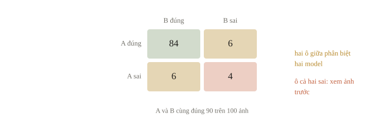
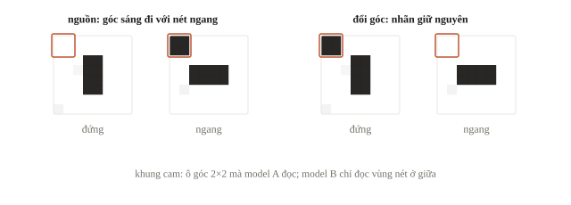
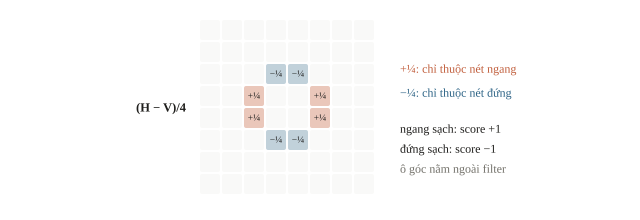
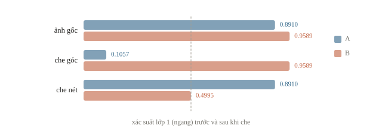
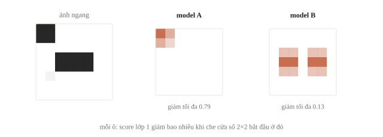
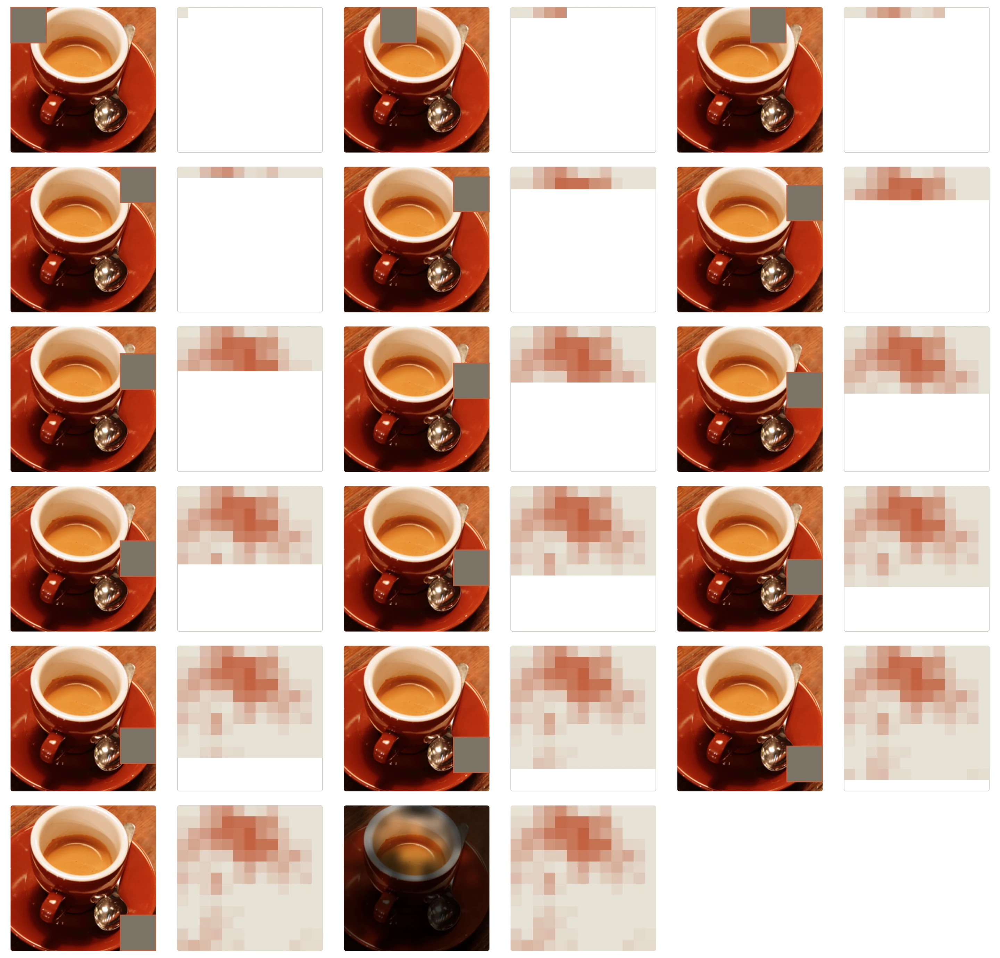
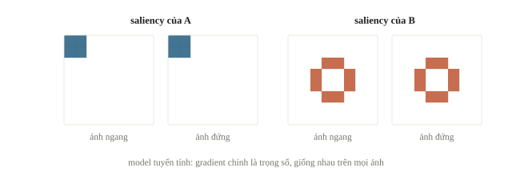
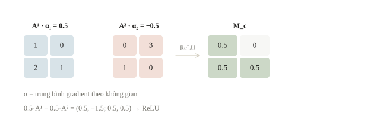
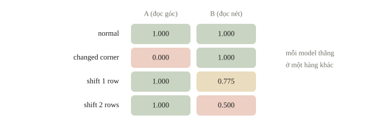
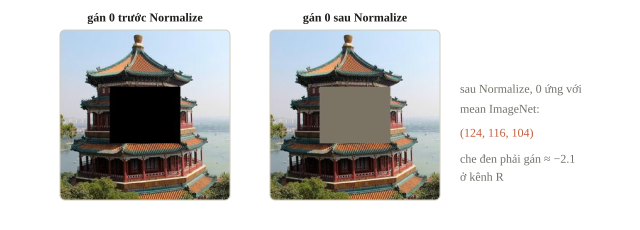

<!-- title -->
# Phân tích hành vi model

Model đọc hướng nét hay dấu góc?

Chương 5 · Bài 5.9

---
## Cùng điểm, khác hành vi

A và B đều đúng trên dữ liệu nguồn.

Camera mới làm một model thất bại.

Đúng trong điều kiện nào, nhờ thông tin nào?

---
## Mục tiêu

- So hai model trên từng mẫu và từng nhóm dữ liệu.
- Thiết kế thí nghiệm kiểm model có dùng dấu hiệu tình cờ không.
- Dùng occlusion, saliency, Grad-CAM và biết giới hạn của chúng.

---
<!-- section 1 -->
# Từ điểm tổng đến giả thuyết

---
<!-- split -->
## Bảng chéo theo ID

Lưu ID, nhãn, score, thuộc tính hợp lệ.

Đọc nhiều chỉ số theo nhóm, ghi số mẫu.

|||

Bốn ô: cả hai đúng, chỉ A đúng, chỉ B đúng, cả hai sai.

Hai ô giữa phân biệt model; ô cả hai sai: xem ảnh trước.

---
<!-- quiz -->
::: quiz
Trên cùng 100 ảnh validation, A và B đều đúng 90 ảnh. Có 6 ảnh A đúng còn B sai. Có bao nhiêu ảnh cả hai cùng sai?
- [ ] 0
- [x] 4
- [ ] 6
- [ ] 10
Cả hai đúng 84 ảnh, chỉ A đúng 6, chỉ B đúng 6, nên cả hai cùng sai $100 - 84 - 6 - 6 = 4$ ảnh.
:::

---
<!-- figure -->
## Bốn ô của bảng chéo



---
<!-- quiz -->
::: quiz
Model sai 300 ảnh validation, nhưng ta chỉ đủ thời gian xem kỹ 30 ảnh. Chọn 30 ảnh nào thì bức tranh về lỗi đáng tin nhất?
- [ ] 30 ảnh sai đầu tiên theo tên tệp, vì thứ tự tên tệp coi như ngẫu nhiên
- [ ] 30 ảnh có heatmap rõ nhất, vì dễ giải thích cho cả đội
- [ ] 30 ảnh có score sát ngưỡng 0.5, vì đó là những ảnh khó nhất
- [x] Lấy ngẫu nhiên trong từng nhóm, thêm vài ảnh sai mà score rất cao
Lấy ngẫu nhiên trong từng nhóm thì ước lượng được tỉ lệ từng loại lỗi. Ảnh sai mà model rất tự tin hay chỉ ra nhãn sai hoặc đường tắt.
:::

---
<!-- figure -->
## Một tương quan được tạo rõ



---
<!-- split -->
## Hai model minh họa

A: logistic regression đọc độ sáng ô góc.

|||

B: logistic regression đọc shape score.

Biết trước mỗi model đọc gì để kiểm phép đánh giá.

---
<!-- center -->
## Shape score của một filter

Filter $(H-V)/4$: bốn ô $+\tfrac14$, bốn ô $-\tfrac14$, còn lại 0.

Nét ngang sạch cho $+1$, nét đứng sạch cho $-1$; dấu góc không góp vào score.

---
<!-- figure -->
## Filter hướng nét



---
<!-- quiz -->
::: quiz
Trong code, nét ngang chiếm `[3:5, 2:6]`. Dịch nó xuống một hàng thành `[4:6, 2:6]`, ảnh sạch, dấu góc giữ nguyên. Shape score bằng bao nhiêu?
- [ ] $+1$
- [ ] $+0.5$
- [x] $0$
- [ ] $-1$
Hàng 4 cộng $+0.5$, hàng 5 rơi vào phần chỉ có ở template đứng nên cộng $-0.5$. Filter cố định vị trí không còn phân biệt được hướng.
:::

---
## Kiểm can thiệp giữ tín hiệu

```python
print("same labels after intervention:", np.array_equal(labels, changed_labels))
print("shape features preserved:",
      np.allclose(features(normal_images)[1], features(changed_images)[1]))
```

```output
same labels after intervention: True
shape features preserved: True
```

---
## Kết quả cùng tập mẫu

```output
normal A/B accuracy: 1.0 1.0
changed corner A/B accuracy: 0.0 1.0
A correct, B wrong: 0
B correct, A wrong: 40
```

---
<!-- quiz -->
::: quiz
Trên tập changed corner, A có accuracy 0.0 chứ không phải khoảng 0.5. Con số này nói lên điều gì?
- [x] Quyết định của A đi theo dấu góc trên mọi ảnh
- [ ] A đoán gần như ngẫu nhiên khi gặp ảnh lạ
- [ ] Nhãn của tập changed corner đã bị đảo nhầm
- [ ] A học được hướng nét, nhưng theo chiều ngược lại
Đổi góc thì mọi quyết định của A đều bị đảo. Model vẫn chắc chắn, chỉ là chắc chắn theo góc. Đoán ngẫu nhiên thì cho khoảng 0.5.
:::

---
<!-- quiz -->
::: quiz
Nếu sinh `changed_images` bằng seed nhiễu 3 thay vì seed 2 như `normal_images`, phép so trước và sau mất đi điều gì?
- [ ] Không mất gì, vì nhiễu chỉ có độ lệch chuẩn 0.02
- [ ] Nhãn của hai tập không còn khớp nhau theo từng ID
- [ ] Model B không còn dự đoán được trên ảnh mới
- [x] Mất phép so cặp, vì mỗi cặp khác nhau cả nhiễu lẫn dấu góc
Cùng seed thì mỗi ảnh đổi góc chỉ khác ảnh normal ở bốn ô góc. Đổi seed thì mỗi cặp khác thêm cả nhiễu, và phép so cặp mất ý nghĩa.
:::

---
<!-- section 2 -->
# Che vùng, giữ đại lượng so

---
<!-- figure -->
## Xác suất lớp 1 khi che



---
<!-- quiz -->
::: quiz
Che góc làm A đổi argmax từ lớp 1 sang lớp 0. Vì sao ta vẫn đọc xác suất của lớp 1, cả trước lẫn sau khi che?
- [ ] Để model không thể đổi nhãn dự đoán sau khi che
- [x] Để so cùng một đại lượng trước và sau khi che
- [ ] Vì xác suất hai lớp luôn bằng nhau sau khi che
- [ ] Vì lớp argmax mới luôn có score thấp hơn lớp cũ
Nếu đọc xác suất của lớp đang dự đoán, ta so 0.891 với 0.8943 và tưởng che không có tác động. Đọc cùng $p_1$ mới thấy nó rơi xuống 0.1057.
:::

---
## Baseline che ảnh có ảnh hưởng

Ô đen có thể là nhiễu ngoài phân phối.

Thử nhiều baseline, cửa sổ và nhóm ảnh.

Hai tín hiệu thay thế nhau: che cả tổ hợp.

Che hết nét thì ảnh không còn giữ nhãn hướng.

---
<!-- figure -->
## Trượt cửa sổ che



---

<!-- figure -->
## Occlusion trên ảnh thật



---
<!-- quiz -->
::: quiz
Ảnh $224\times 224$, cửa sổ che $16\times 16$, bước trượt 8 theo cả hai chiều, không padding. Không kể ảnh gốc, một ảnh cần bao nhiêu lượt forward để vẽ occlusion map?
- [ ] 196
- [x] 729
- [ ] 784
- [ ] 50 176
Mỗi chiều có $(224 - 16)/8 + 1 = 27$ vị trí, nên có $27^2 = 729$ lượt forward.
:::

---
<!-- section 3 -->
# Heatmap để đặt câu hỏi

---
## Saliency bằng autograd

```python
def saliency(name, image, use_probability=False):
    model, read_feature = readers[name]
    pixels = torch.tensor(image, requires_grad=True)
    score = (float(model.coef_[0, 0]) * read_feature(pixels)
             + float(model.intercept_[0]))
    score.backward()
    return pixels.grad.abs().numpy()
```

```output
A corner: 1.0 | max: 1.0688 | same on vertical: True
B corner: 0.0 | max: 0.8026 | same on vertical: True
B max grad of probability: 0.0316
```

---
<!-- figure -->
## Hai saliency map



---
<!-- quiz -->
::: quiz
Saliency của B trên ảnh ngang và trên ảnh đứng trùng nhau từng ô. Điều đó cho biết gì?
- [x] Model tuyến tính có gradient không phụ thuộc ảnh
- [ ] Hai ảnh có nội dung giống nhau ở vùng giữa
- [ ] Autograd chưa bật nên map trả về giá trị mặc định
- [ ] B đã học đúng hướng nét trên mọi ảnh có thể gặp
Logit của B là $\mathbf{w}^\top\mathbf{x} + b$, nên đạo hàm theo $\mathbf{x}$ luôn là $\mathbf{w}$, ảnh nào cũng vậy.
:::

---
<!-- split -->
## Saliency và Grad-CAM

Saliency: một forward, một backward.

Bão hòa: gradient của xác suất nhỏ đi khoảng 25 lần.

|||

Grad-CAM: trọng số kênh ở một lớp conv.

Lớp sâu có nghĩa nhưng thô: $7\times7$ cho ảnh $224\times224$.

---
<!-- center -->
## Grad-CAM

$s_c$ là score của lớp đang xét; $A^k$ là feature map kênh $k$, có kích thước $H\times W$. Lấy trung bình gradient để gán trọng số cho mỗi kênh.

$$\alpha_k=\frac1{HW}\sum_{i,j}\frac{\partial s_c}{\partial A^k_{ij}}$$

$$M_c=\operatorname{ReLU}\Bigl(\sum_k\alpha_kA^k\Bigr)$$

---
<!-- quiz -->
::: quiz
Lớp được chọn có hai kênh $2\times 2$. Kênh $A^1 = \begin{bmatrix}1&0\\2&1\end{bmatrix}$ có mọi gradient bằng 0.5. Kênh $A^2 = \begin{bmatrix}0&3\\1&0\end{bmatrix}$ có gradient $\begin{bmatrix}-1&0\\0&-1\end{bmatrix}$. Map Grad-CAM $M_c$ bằng bao nhiêu?
- [ ] $\begin{bmatrix}0.5&1.5\\1.5&0.5\end{bmatrix}$
- [ ] $\begin{bmatrix}0.5&0\\1&0.5\end{bmatrix}$
- [x] $\begin{bmatrix}0.5&0\\0.5&0.5\end{bmatrix}$
- [ ] $\begin{bmatrix}0.5&-1.5\\0.5&0.5\end{bmatrix}$
$\alpha_1 = 0.5$, $\alpha_2 = -0.5$. $0.5A^1 - 0.5A^2$ có một ô $-1.5$, và ReLU đưa ô ấy về 0.
:::

---
<!-- figure -->
## Grad-CAM trên lưới nhỏ



---
<!-- section 4 -->
# Ma trận kiểm

---
## Mỗi model thắng một hàng

```output
condition        A      B
normal          1.000  1.000
changed corner  0.000  1.000
shift 1 row     1.000  0.775
shift 2 rows    1.000  0.500
```

Dịch một hàng: shape score của ảnh ngang $\approx0$, B quyết định theo nhiễu.

---
<!-- figure -->
## Ma trận kiểm



---
<!-- quiz -->
::: quiz
Hãy đoán trước một hàng chưa có trong ma trận: dịch nét hai hàng **và** đổi dấu góc cùng lúc. Accuracy của A và B lần lượt là bao nhiêu?
- [ ] A 1.0, B 0.5
- [ ] A 0.0, B 1.0
- [ ] A 0.5, B 0.5
- [x] A 0.0, B 0.5
A chỉ đọc góc nên được 0.0. B chỉ đọc shape score, mà ô góc nằm ngoài filter, nên được 0.5 như khi chỉ dịch nét.
:::

---
<!-- center -->
## Adversarial: FGSM

$$\boldsymbol{\delta}=\epsilon\operatorname{sign}(\nabla_{\mathbf{x}}L),\qquad\lVert\boldsymbol{\delta}\rVert_\infty\le\epsilon$$

Logit tuyến tính: $z$ đổi $\epsilon\lVert\mathbf{w}\rVert_1$.

Chiếu về giới hạn đề, kiểm lại, lưu input và seed.

---
## Một kết luận có phạm vi

A phụ thuộc dấu góc trong thí nghiệm.

B sai khi nét dịch hai hàng.

Ghi điều kiện đã kiểm và chưa kiểm.

---
<!-- quiz -->
::: quiz
Pipeline đưa ảnh trong $[0, 1]$ qua `Normalize` theo mean `(0.485, 0.456, 0.406)` và std của ImageNet, rồi vào model. Code occlusion gán 0 vào vùng che **sau** bước `Normalize`. Vùng che thực chất có màu gì?
- [x] Màu trung bình của ImageNet, một màu xám hơi ấm
- [ ] Màu đen, vì giá trị 0 luôn là pixel tối nhất
- [ ] Màu trắng, vì Normalize đảo dấu giá trị pixel
- [ ] Không xác định được, vì Normalize là phép phi tuyến
Sau `Normalize`, giá trị 0 ứng với $x = \mu$, tức pixel màu trung bình của ImageNet. Muốn che đen phải gán $(0 - \mu)/\sigma$.
:::

---
<!-- figure -->
## Cùng “che bằng 0”, hai màu



---
## Khi đi thi

- Lưu prediction theo ID.
- Một giả thuyết, một can thiệp.
- Heatmap để chọn thí nghiệm.

---
<!-- section 5 -->
# Luyện đề

---
<!-- quiz -->
::: quiz Luyện đề 1
Một model phát hiện ảnh lỗi đoán ngẫu nhiên. Nó không nhìn ảnh, cứ mỗi ảnh gọi “lỗi” với xác suất 1/2. Camera X có 50% ảnh lỗi thật, camera Y có 10%. Đại lượng nào **khác nhau** giữa hai camera?
- [ ] Recall, tức tỉ lệ ảnh lỗi thật được gọi là lỗi
- [ ] False positive rate, tức tỉ lệ ảnh tốt nhưng bị gọi là lỗi
- [x] Precision, tức tỉ lệ lỗi thật trong các ảnh bị gọi là lỗi
- [ ] Tỉ lệ ảnh bị model gọi là lỗi trên toàn nhóm
Model không nhìn ảnh, nên recall, false positive rate và tỉ lệ gọi lỗi đều bằng 1/2. Precision bằng tỉ lệ lỗi của camera: 0.5 ở X, 0.1 ở Y.
Phỏng theo: [CMU 10-601 · Exam 2 Practice · Q5.3](https://www.cs.cmu.edu/~mgormley/courses/10601/handout/exam2_practice_problems.pdf#page=21)
:::

---
<!-- quiz -->
::: quiz Luyện đề 2
Một mạng một chiều gồm một filter convolution cho ra $z_1, \dots, z_d$, các giá trị khác nhau, rồi $g = \sigma(\max_j z_j)$. Ảnh có pattern ở hai vị trí: $z_3$ lớn nhất, $z_7$ lớn nhì. Saliency theo $z$ cho kết quả nào?
- [x] Chỉ $\partial g/\partial z_3$ khác 0, và bằng $g(1 - g)$
- [ ] Chỉ $\partial g/\partial z_3$ khác 0, và bằng 1
- [ ] $\partial g/\partial z_3$ và $\partial g/\partial z_7$ cùng khác 0
- [ ] $\partial g/\partial z_i = g(1 - g)$ với mọi $i$
Max chỉ truyền gradient về phần tử lớn nhất, nên saliency bỏ sót pattern ở ô 7 dù nó cũng có mặt.
Phỏng theo: [MIT 6.036 · Final, Spring 2022 · Q8(d)](https://introml.mit.edu/_static/fall22/final/review/6036_final_sp22.pdf#page=21)
:::

---
<!-- quiz -->
::: quiz Luyện đề 3
Đề phân loại hình tròn, tam giác và chữ nhật trên nền trắng. Vị trí, cỡ, góc xoay và màu của hình đều ngẫu nhiên, và chỉ có 200 ảnh có nhãn. Model đạt macro-F1 0.90 trên validation, nhưng hầu hết lỗi là ảnh hình màu đỏ bị gọi là tam giác. Thí nghiệm nào kiểm nhanh nhất giả thuyết “model dùng màu”?
- [ ] Vẽ Grad-CAM cho vài ảnh tam giác đỏ và xem vùng sáng
- [x] Đổi màu hình bằng code, giữ hình dạng, rồi so dự đoán theo ID
- [ ] Train thêm epoch rồi so lại macro-F1 trên validation
- [ ] Bỏ kênh R khỏi mọi ảnh rồi train lại model từ đầu cho chắc
Đổi màu mà giữ dạng là can thiệp giữ nhãn, không cần train lại. Heatmap thì không tách được model dùng màu hay dùng dạng.
Phỏng theo: [USA-NA-AIO 2026 · Vòng 2 · Ngày 2 · Problem 4](https://www.usaaio.org/attachments/past-problems/2026/usaaio-2026-round-2-day-2-problems.pdf#page=7)
:::

---
<!-- center -->
## Chốt ý

Quan sát theo ID, can thiệp có đối chứng, đọc score của cùng lớp.

Heatmap gợi giả thuyết; ma trận kiểm ghi phạm vi.

---
<!-- center -->
## Sau giờ học

Làm **10 câu kiểm tra cuối bài** trên trang bài học.

Chạy notebook; dịch nét lên một hàng (`rows=-1`), đoán trước accuracy của A và B rồi mới chạy.
