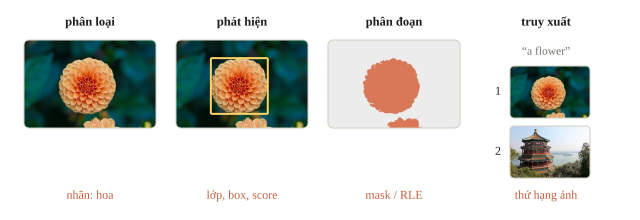
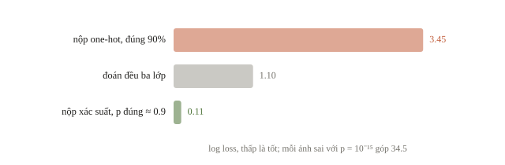
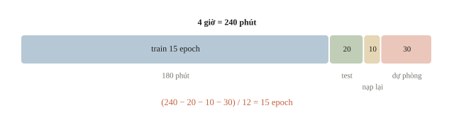
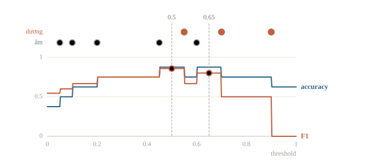
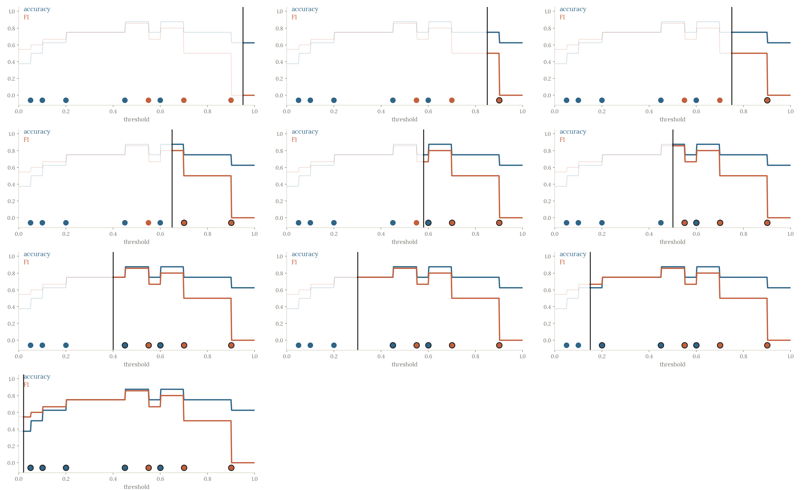
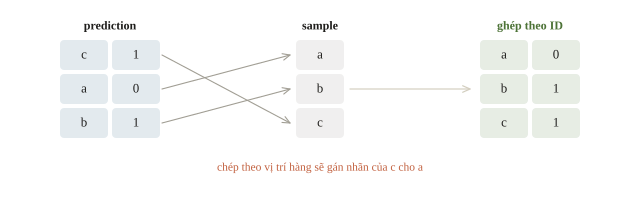
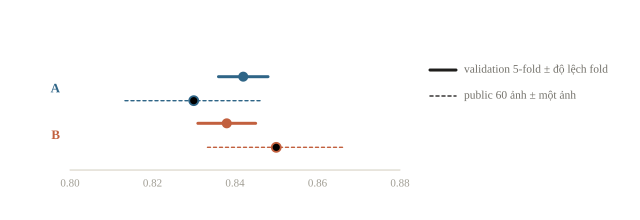

<!-- title -->
# Kiểm tra thị giác máy tính

Đi hết đường từ đề đến đầu ra

Phase 5 · Ôn khóa Thị giác máy tính

---
## Model là một phần công việc

Đề → dữ liệu → baseline → validation → lỗi → chốt.

Chọn metric và kiểu đầu ra trước khi chọn kiến trúc model.

---
<!-- section 1 -->
# Đọc hợp đồng

---
<!-- figure -->
## Cùng ảnh, bốn đầu ra



---
<!-- quiz -->
::: quiz
Đề phân loại 3 lớp chấm bằng log loss, tức trung bình $-\ln p$ của lớp đúng, và scorer kẹp $p$ vào $[10^{-15}, 1]$. Model đúng 90% ảnh validation. Nếu nộp one-hot theo argmax, tức xác suất 1 cho lớp dự đoán và 0 cho các lớp khác, thì log loss xấp xỉ bao nhiêu?
- [ ] 0.10
- [ ] 1.10
- [x] 3.45
- [ ] 0.11
10% ảnh sai, mỗi ảnh góp $-\ln 10^{-15} \approx 34.5$, nên trung bình khoảng 3.45, tệ hơn cả đoán đều ba lớp.
:::

---
<!-- figure -->
## Nộp nhãn thay cho xác suất



---
<!-- split -->
## Môi trường thực tế

Phần cứng, Internet, asset được phép.

|||

Thời gian train khác runtime.

Tên GPU chưa cho thời gian pipeline.

Thời gian đo trên CPU không quy đổi được sang T4: đo lại trên đúng loại máy chấm.

---
<!-- quiz -->
::: quiz
Máy chấm không có Internet. Đề cho dùng model công khai nếu đính kèm trọng số làm asset. Notebook gọi `resnet50(weights="IMAGENET1K_V2")` và chạy tốt trên máy cá nhân. Có rủi ro gì, và sửa thế nào?
- [ ] Không rủi ro, vì trọng số đã có trong cache của máy cá nhân
- [x] Lệnh tải sẽ lỗi, nên phải nạp trọng số từ asset và chạy thử khi tắt mạng
- [ ] Đổi sang `weights=None` để khỏi tải, giữ các bước còn lại
- [ ] Bọc lệnh tải trong `try/except` để notebook chạy tiếp
Cache của máy cá nhân không đi theo sang máy chấm. Hãy nạp trọng số từ asset bằng `load_state_dict`, rồi chạy thử khi tắt mạng.
:::

---
## Kiểm dữ liệu trước train

Ảnh nhỏ nhất, lớn nhất, từng lớp, ảnh rỗng.

Vẽ box; chồng mask; đọc top-k.

Chia theo người, video hoặc thiết bị khi phù hợp.

---
<!-- quiz -->
::: quiz
Ảnh train đến từ bốn camera, còn đề nói ảnh test chụp bằng hai camera khác. Random split cho macro-F1 0.95. Chia theo camera, mỗi fold để một camera làm validation, thì trung bình được 0.78. Số nào gần điểm test hơn?
- [x] 0.78, vì validation gặp camera chưa thấy, giống như test
- [ ] 0.95, vì random split dùng nhiều dữ liệu train hơn
- [ ] 0.95, vì camera chỉ đổi màu ảnh chứ không đổi lớp
- [ ] Trung bình hai số, khoảng 0.87, cho cân bằng
Random split để ảnh cùng camera ở cả hai phía. Chia theo camera đặt validation vào đúng tình huống của test, nên 0.78 gần điểm test hơn.
:::

---
<!-- section 2 -->
# Thí nghiệm có điều khiển

---
## Ngân sách ba phần

Pipeline hợp lệ → cải thiện có kiểm soát → chốt checkpoint và đầu ra.

Đo một epoch và một lượt inference toàn test ở vòng đầu, rồi chỉnh lịch.

---
<!-- quiz -->
::: quiz
Còn 4 giờ. Đo trên máy chấm thì một epoch trên toàn bộ train mất 12 phút, inference toàn bộ test mất 20 phút, nạp lại checkpoint và kiểm file mất 10 phút. Đội giữ thêm 30 phút dự phòng cho lỗi format. Lần train cuối chạy được nhiều nhất bao nhiêu epoch?
- [ ] 20 epoch
- [ ] 18 epoch
- [ ] 17 epoch
- [x] 15 epoch
$(240 - 20 - 10 - 30)/12 = 15$.
:::

---
<!-- figure -->
## Bốn giờ chia thế nào



---
<!-- quiz -->
::: quiz
Một lượt thử đổi cùng lúc backbone, cách chia validation, augmentation và metric báo cáo. Điểm tăng từ 0.71 lên 0.80. Ta biết được gì về nguyên nhân?
- [ ] Backbone mới là nguyên nhân chính
- [ ] Augmentation mạnh hơn là nguyên nhân chính
- [ ] Cả bốn thay đổi đều có ích như nhau
- [x] Chưa biết gì, vì hai con số còn không so được với nhau
Split và metric đã đổi, nên 0.71 và 0.80 đo hai thứ khác nhau. Phải giữ chúng cố định và đổi từng yếu tố một.
:::

---
<!-- center -->
## Threshold: cùng accuracy, khác F1

8 ảnh validation: 3 dương, 5 âm.

Ngưỡng 0.5: TP 3, FP 1, FN 0 → accuracy 7/8, F1 6/7.

Ngưỡng 0.65: TP 2, FP 0, FN 1 → accuracy 7/8, F1 4/5.

Cùng số lỗi, khác loại lỗi: metric của đề quyết định.

---
## Ba threshold trong code

```python
for threshold in [0.5, 0.65, 0.8]:
    accuracy, f1 = binary_metrics(probabilities >= threshold, labels)
    print(threshold, "accuracy/F1:", round(accuracy, 4), round(f1, 4))
```

```output
0.5 accuracy/F1: 0.875 0.8571
0.65 accuracy/F1: 0.875 0.8
0.8 accuracy/F1: 0.75 0.5
```

---
<!-- figure -->
## Quét mọi threshold



---

<!-- figure -->
## Kéo threshold



---
<!-- quiz -->
::: quiz
Vẫn tám xác suất ấy, nhưng đặt threshold 0.58. Accuracy và F1 bằng bao nhiêu?
- [ ] 0.875 và 0.8
- [ ] 0.75 và 0.8
- [x] 0.75 và 2/3
- [ ] 0.875 và 2/3
TP 2, FP 1, FN 1, TN 4, nên accuracy bằng 0.75 và F1 bằng $2/3$.
:::

---
<!-- split -->
## Runtime là ràng buộc

Điểm tăng nhưng vượt runtime chưa dùng được.

|||

Đo toàn pipeline.

Giữ checkpoint, mapping, preprocessing.

---
<!-- section 3 -->
# Chốt và chữa bài

---
## Ghép theo ID

```python
submission = sample.merge(
    predictions, on="image_id", how="left",
    validate="one_to_one")
assert submission["label"].notna().all()
print(submission.to_string(index=False))
```

```output
image_id  label
       a      0
       b      1
       c      1
```

---
<!-- figure -->
## Ghép theo ID, không theo hàng



---
<!-- quiz -->
::: quiz
Prediction có đúng ba hàng như sample, nhưng ID xếp theo thứ tự khác. Ghi file nộp thế nào?
- [x] Ghép theo ID, rồi giữ thứ tự của sample
- [ ] Chép cột nhãn sang sample theo vị trí hàng
- [ ] Sắp prediction theo score giảm dần rồi chép
- [ ] Giữ thứ tự prediction, chỉ đổi tên cột cho khớp
ID mới là khóa, thứ tự hàng thì không. Ghép theo ID, giữ thứ tự sample, rồi assert số hàng và tập ID.
:::

---
## Nạp ở tiến trình mới

Không dựa vào biến còn sống trong notebook.

Lưu cùng checkpoint: mapping lớp, preprocessing, head, hậu xử lý.

Nạp checkpoint → vài mẫu → đủ dữ liệu → schema.

---
<!-- quiz -->
::: quiz
Đội train với ảnh resize 224. Sau đó họ sửa hàm `preprocess` trong notebook thành resize 256 để thử một ý khác, rồi bỏ ý ấy nhưng quên sửa lại. Nạp checkpoint ở một tiến trình mới thì F1 validation tụt từ 0.86 xuống 0.71. Nên kiểm gì trước?
- [ ] Trọng số hỏng khi lưu, cần train lại từ đầu
- [x] Preprocessing lúc suy luận khác lúc train
- [ ] Seed khác, nên F1 dao động 0.15 là bình thường
- [ ] Validation đã đổi, cần chia lại một split mới
Checkpoint chỉ lưu trọng số, còn `preprocess` hiện tại resize 256. Model nhìn vật ở tỉ lệ khác lúc train mà không báo lỗi.
:::

---
<!-- split -->
## Chữa theo nhóm lỗi

Classification: theo lớp, theo camera.

Detection: bỏ sót, box trùng, lệch box, sai lớp.

|||

Segmentation: biên, ảnh rỗng.

Retrieval: sai đối tượng, hành động, quan hệ.

---
<!-- quiz -->
::: quiz
Detection trên validation có 300 FP. 210 trong số đó là box thứ hai nằm trên vật thể đã có box đúng, với IoU so với box đúng từ 0.6 đến 0.75. NMS hiện chỉ loại box khi IoU trên 0.8. Nên chạy thí nghiệm nào trước?
- [ ] Tăng độ phân giải ảnh đầu vào lên gấp đôi
- [ ] Train thêm epoch với đúng cấu hình hiện tại
- [ ] Tăng score threshold đến khi hết box trùng
- [x] Hạ ngưỡng IoU của NMS xuống 0.5 rồi đo lại
70% số FP là box trùng có IoU 0.6–0.75, nằm dưới ngưỡng 0.8. Hạ ngưỡng IoU của NMS nhắm đúng nhóm lỗi này.
:::

---
## Chọn việc luyện tiếp

Lỗi lớn nhất → giả thuyết kiểm được.

Ghi split, metric, runtime và kết luận.

---
<!-- quiz -->
::: quiz
Cấu hình A có macro-F1 5-fold, chia theo nguồn, bằng 0.842, các fold lệch nhau khoảng $\pm 0.006$, và public leaderboard 0.83. Cấu hình B có $0.838 \pm 0.007$ và public 0.85. Public chỉ tính trên 60 ảnh. Nên chốt cấu hình nào?
- [ ] B, vì public chấm trên chính ảnh test thật
- [ ] A, vì validation cao hơn nên chắc chắn tốt hơn
- [x] Coi như ngang nhau, nên chốt theo runtime và độ ổn định
- [ ] Nộp thêm nhiều lượt để public chọn hộ
Trên 60 ảnh, một ảnh đã lệch khoảng 0.017, nên chênh public 0.02 chỉ cỡ một ảnh. Hai cấu hình coi như ngang nhau.
:::

---
<!-- figure -->
## Chênh nhỏ hơn độ nhiễu



---
## Bẫy trước khi chốt

Train hết giờ, không còn thời gian xuất file.

Âm thầm bỏ ảnh rỗng hoặc ảnh đọc lỗi.

Đổi metric vì con số đẹp hơn.

---
<!-- quiz -->
::: quiz
Có 300 ảnh test, trong đó 3 file hỏng không đọc được. Vòng lặp inference có `try: ... except: continue`. File nộp có vấn đề gì, và sửa thế nào?
- [ ] Không có vấn đề gì, scorer tự bỏ qua ID không có dự đoán
- [ ] Xóa 3 ID khỏi sample để số hàng khớp lại
- [ ] Thử đọc bằng thư viện khác, vẫn lỗi thì bỏ hàng
- [x] Thiếu 3 ID, nên vẫn phải ghi hàng với một dự đoán dự phòng
File chỉ còn 297 hàng. Vẫn phải ghi hàng cho ID hỏng với một dự đoán dự phòng, rồi assert tập ID khớp sample.
:::

---
## Khi đi thi

- Có bài nộp hợp lệ thật sớm.
- Đọc luật: Internet, pretrained, gán nhãn tay.
- Đo epoch và inference trên máy chấm; có dự phòng.
- Mỗi lượt một thay đổi, cùng split và metric.
- Chốt theo validation và metric của đề.
- Trước hạn: khởi động lại, nạp, chạy đủ, ghép ID.

---
<!-- section 4 -->
# Luyện đề

---
<!-- quiz -->
::: quiz Luyện đề 1
Đề yêu cầu train và test trên GPU L4 24 GB. Notebook không chạy được trên L4 thì phần đó 0 điểm. Đội phát triển trên A100 80 GB với batch 256, bộ nhớ đỉnh đo được là 41 GB. Trước khi nộp nên làm gì?
- [ ] Giữ nguyên, vì A100 chạy được thì L4 cũng chạy, chỉ chậm hơn
- [x] Giảm batch và tích lũy gradient, rồi chạy lại cả notebook trên L4
- [ ] Nộp checkpoint train trên A100, notebook chỉ chạy inference
- [ ] Ghi trong báo cáo rằng notebook cần GPU 80 GB
41 GB vượt 24 GB của L4. Giảm batch, tích lũy gradient, rồi chạy lại toàn bộ trên đúng loại máy ấy.
Phỏng theo: [USA-NA-AIO 2026 · Vòng 2 · Ngày 1 · Part 1.4](https://www.usaaio.org/attachments/past-problems/2026/usaaio-2026-round-2-day-1-problems.pdf#page=8)
:::

---
<!-- quiz -->
::: quiz Luyện đề 2
Gán nhãn giả cho ảnh mà model tự tin trên 0.95 thì được 400 hình tròn, 90 chữ nhật và 30 tam giác. Train thêm trên đó, macro-F1 tụt từ 0.81 xuống 0.77. Nên thử gì trước?
- [ ] Hạ ngưỡng tin cậy xuống 0.5
- [x] Lấy số nhãn giả cân bằng giữa ba lớp
- [ ] Bỏ ảnh không nhãn, quay về model cũ
- [ ] Train thêm epoch
Ngưỡng 0.95 giữ chủ yếu nhãn giả của lớp dễ, nên tập train lệch hẳn về hình tròn. Cân bằng số nhãn giả mỗi lớp nhắm đúng nguyên nhân ấy.
Phỏng theo: [USA-NA-AIO 2026 · Vòng 2 · Ngày 2 · Problem 4](https://www.usaaio.org/attachments/past-problems/2026/usaaio-2026-round-2-day-2-problems.pdf#page=9)
:::

---
<!-- quiz -->
::: quiz Luyện đề 3
Đề quy định nhãn 0 là tròn, 1 là tam giác, 2 là chữ nhật. Đội xếp ảnh có nhãn vào các thư mục `circle/`, `triangle/`, `rectangle/`, nạp bằng `ImageFolder`, vốn đánh mã lớp theo thứ tự tên thư mục, rồi ghi thẳng `argmax` vào file nộp. Validation macro-F1 được 0.95, nhưng điểm chấm chỉ 0.31. Nguyên nhân khả dĩ nhất là gì?
- [ ] Overfit, vì chỉ có 160 ảnh để train
- [ ] Ảnh test có màu khác hẳn ảnh train
- [x] Thứ tự lớp của ImageFolder khác với mã của đề
- [ ] Macro-F1 phạt nặng các lớp hiếm trong test
`ImageFolder` xếp lớp theo bảng chữ cái, nên tam giác và chữ nhật bị đổi mã. Chỉ lớp tròn còn đúng, macro-F1 khoảng $0.95/3$.
Phỏng theo: [USA-NA-AIO 2026 · Vòng 2 · Ngày 2 · Problem 4](https://www.usaaio.org/attachments/past-problems/2026/usaaio-2026-round-2-day-2-problems.pdf#page=8)
:::

---
<!-- center -->
## Chốt ý

Baseline có thể nộp từ sớm.

Giữ cùng split và metric khi thử thay đổi; lưu cấu hình, prediction theo ID và runtime của phương án đã chốt.

---
<!-- center -->
## Sau buổi ôn

Làm **10 câu kiểm tra cuối bài** trên trang bài học.

Chữa từng câu sai theo đúng mục của buổi ôn; chạy lại ví dụ threshold và ví dụ ghép theo ID.
