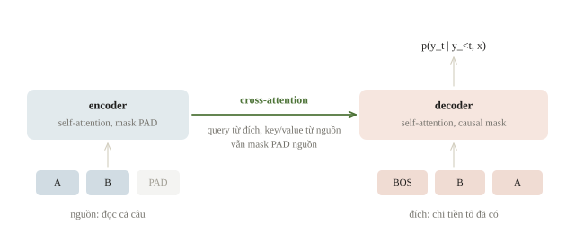
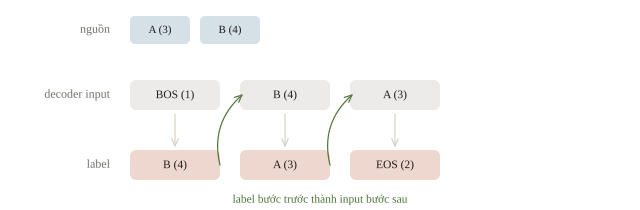
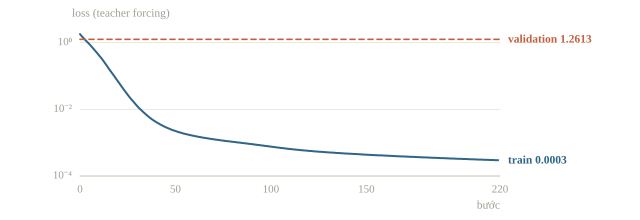
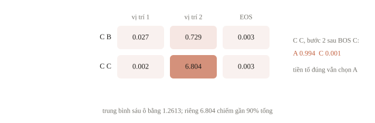
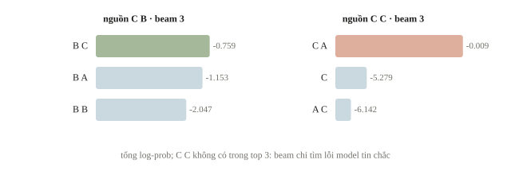
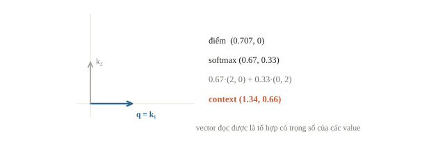
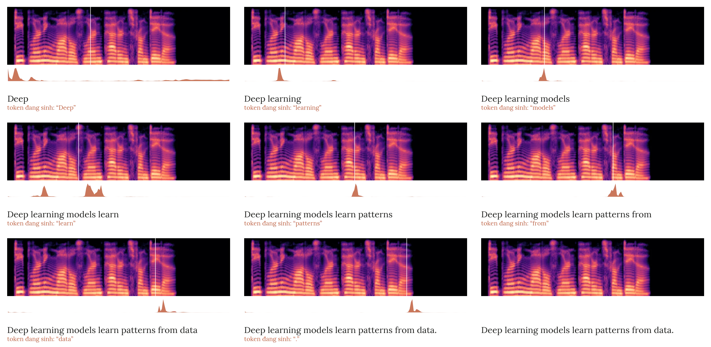
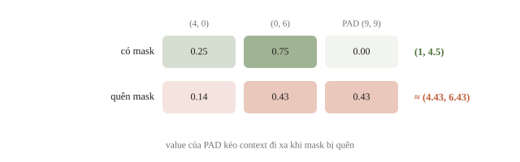
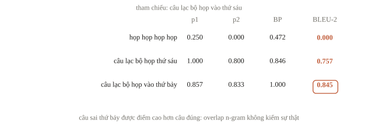
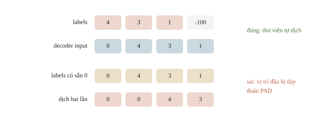

<!-- title -->
# Encoder–decoder

Đọc một nguồn, viết một chuỗi đích

Phase 6 · Bài 6.5

---
<!-- split -->
## Đầu ra không chỉ một nhãn

Dịch một câu, rút gọn bản tin, mô tả một ảnh.

Nguồn và đích có thể khác độ dài, từ vựng, loại dữ liệu.

|||

Nguồn đã có.

Đích đúng chưa có khi inference.

Model phải viết từng bước có điều kiện.

---
## Mục tiêu buổi này

- Tách encoder, decoder, cross-attention và mask từng khối.
- Căn input và label cho teacher forcing; thư viện tự dịch label.
- Đọc loss từng vị trí, so với free-running.
- Giải mã bằng beam; đọc BLEU, ROUGE đúng giới hạn.

---
<!-- section 1 -->
# Hai luồng thông tin

---
<!-- figure -->
## Encoder đọc nguồn, decoder viết đích



---
<!-- center -->
## Sinh có điều kiện

$$p(y\mid x)=\prod_t p(y_t\mid y_{<t},x)$$

$x$: nguồn đã biết; $y$: chuỗi đích cần sinh.

Encoder: hai chiều trên nguồn đã có.

Decoder: causal self-attention trên đích.

---
<!-- split -->
## Ba chỗ attention, ba mask

Encoder self-attention: nguồn với nguồn, mask PAD nguồn.

Decoder self-attention: đích với đích, causal mask.

Cross-attention: query từ đích, key và value từ nguồn, mask PAD nguồn.

|||

Điểm cross-attention một head: `(Ly, Lx)`.

Mỗi hàng là một vị trí đích; softmax theo trục nguồn.

Cross-attention không cần causal mask: nguồn đã có đủ.

---
<!-- quiz -->
::: quiz
Decoder có 7 vị trí đích, nguồn có 10 token. Ma trận trọng số cross-attention của một head, sau softmax, có shape gì, và cộng bằng 1 theo trục nào?
- [ ] `(10, 7)`, mỗi hàng là một token nguồn và cộng bằng 1
- [x] `(7, 10)`, mỗi hàng là một vị trí đích và cộng bằng 1
- [ ] `(7, 10)`, mỗi cột là một token nguồn và cộng bằng 1
- [ ] `(7, 7)`, tam giác dưới vì decoder cần causal mask
Mỗi query đích phân phối trọng số lên 10 key nguồn, nên mỗi hàng của ma trận `(7, 10)` cộng bằng 1.
:::

---
<!-- quiz -->
::: quiz
Một model dịch tự cài dịch riêng một câu nguồn 3 token thì ra một kết quả. Ghép đúng câu đó vào batch với một câu nguồn 30 token, câu ngắn được pad bên phải, thì bản dịch đổi. Nên nghi chỗ nào trước tiên?
- [x] Mask PAD của nguồn chưa được đưa vào cross-attention
- [ ] Causal mask của decoder bị đảo phần trên và phần dưới
- [ ] Batch dài hơn nên softmax chạy với độ chính xác thấp hơn
- [ ] Encoder thiếu causal mask giống như decoder vẫn dùng
Trong batch, câu ngắn có thêm 27 key PAD. Không mask chúng ở cross-attention thì mỗi query đích chia một phần trọng số cho PAD.
:::

---
<!-- section 2 -->
# Teacher forcing và shift

---
<!-- figure -->
## Target `B A EOS`



---
<!-- split -->
## Train và inference khác tiền tố

Train: token đúng ở bước trước.

Inference: token model vừa sinh.

|||

Một lỗi đầu làm tiền tố lệch, rồi lỗi có thể lan tiếp.

Đo cả teacher-forced loss và generation.

---
<!-- quiz -->
::: quiz
Một đội muốn lúc train giống hệt lúc sinh. Ở mỗi bước, decoder GRU nhận token model vừa đoán bằng argmax thay cho token đích đúng, còn loss vẫn so với label đúng. Ở đầu quá trình train, chuyện gì xảy ra?
- [ ] Học nhanh hơn teacher forcing, vì lúc train đã giống hệt lúc sinh
- [x] Học chậm và bất ổn, vì tiền tố gần như toàn token sai
- [ ] Không khác teacher forcing, vì loss vẫn so với label đúng
- [ ] Không train được, vì argmax chặn hết gradient tới tham số
Lúc đầu model đoán gần như ngẫu nhiên, nên decoder nhận tiền tố sai mà label vẫn là token đúng, và gradient các bước sau gần như nhiễu.
:::

---
<!-- section 3 -->
# Một seq2seq nhỏ chạy thật

---
<!-- split -->
## Đảo chuỗi hai ký hiệu A, B, C

9 cặp có thể có.

7 cặp train; giữ C B và C C để thử.

|||

GRU train từ đầu, chưa có attention.

Trạng thái cuối của encoder (như 3.8 đọc tại `lengths - 1`) làm trạng thái đầu của decoder.

Đảo chuỗi có oracle: mọi lỗi đều kiểm được.

---
<!-- split -->
## Một cặp có thể kiểm bằng tay

A B → B A EOS

Nguồn: `[3, 4]`

Input đích: `[1, 4, 3]`

Label: `[4, 3, 2]`

|||

BOS có ID 1, EOS có ID 2.

Tensor nguồn `(7, 2)`

Input và target `(7, 3)`

Logits `(7, 3, 6)`

---
<!-- quiz -->
::: quiz
Logits có shape `(7, 3, 6)`. Muốn đưa vào cross-entropy thì flatten thành shape gì?
- [ ] `(126,)`
- [ ] `(7, 18)`
- [ ] `(6, 21)`
- [x] `(21, 6)`
21 vị trí, mỗi vị trí 6 lớp, nên logits thành `(21, 6)`.
:::

---
<!-- split -->
## Loss có đáp án ở bước trước

```output
train loss đầu/cuối: 1.8026 0.0003
validation teacher-forced loss: 1.2613
```

|||

Train loss 0.0003: khớp 7 cặp.

Validation 1.2613: hai tổ hợp chưa thấy còn yếu.

Vẫn có tiền tố đúng: chưa biết chuỗi tự sinh.

---
<!-- figure -->
## Loss qua 220 bước



---
<!-- split -->
## Tự sinh làm lộ giới hạn

Train exact match: 7/7.

Validation exact match: 1/2.

|||

C B → B C: đúng.

C C → C A: sai.

Model nhớ cặp train chưa chắc học quy tắc đảo.

---
## Lỗi nằm ở token nào?

```output
NLL từng vị trí: [[0.027, 0.729, 0.003], [0.002, 6.804, 0.003]]
C C, bước 2 sau BOS C: {'A': 0.994, 'B': 0.0, 'C': 0.001}
```

- Trung bình sáu NLL là 1.2613; riêng C C bước 2 là 6.804, gần 90%.
- C B bước 2: xác suất đúng khoảng 0.48, model phân vân.
- C C: tiền tố đúng BOS C mà vẫn đặt 0.994 vào A.

---
<!-- figure -->
## NLL từng vị trí



---
<!-- quiz -->
::: quiz
Ở mẫu C C, model sai token thứ hai cả khi free-running lẫn khi được cho tiền tố đúng BOS C. Đây là loại lỗi gì?
- [ ] Exposure bias, vì tiền tố tự sinh lệch khỏi tiền tố lúc train
- [ ] Lỗi giải mã, vì beam search rộng hơn sẽ tìm ra chuỗi C C
- [ ] Lỗi đo, vì exact match quá khắt khe với chuỗi hai token
- [x] Lỗi tổng quát hóa, vì có tiền tố đúng mà model vẫn chọn A
Token đầu đúng nên không phải exposure bias. Model đặt 0.994 vào A ngay cả với tiền tố đúng, nên beam rộng hơn cũng không cứu được.
:::

---
<!-- section 4 -->
# Giải mã chuỗi đích

---
## Beam search trên GRU vừa train

```python
for pair in valid_pairs:
    print(" ".join(pair), "->", beam_search(pair)[:3])
```

```output
C B -> [('B C', -0.759), ('B A', -1.153), ('B B', -2.047)]
C C -> [('C A', -0.009), ('C', -5.279), ('A C', -6.142)]
```

- Beam rộng 3: giữ 3 tiền tố có tổng log-prob cao nhất.
- C C cho C A với xác suất khoảng 0.991: beam tìm đúng lỗi của model.
- `C` dừng sớm vẫn lọt top 3 của beam.

---
<!-- figure -->
## Ba ứng viên của beam



---
<!-- center -->
## Tổng log-prob thiên về câu ngắn

$$\operatorname{score}(y)=\frac{1}{|y|^{\alpha}}\sum_{t}\log p(y_t\mid y_{<t},x)$$

$\alpha=0$: tổng thô. $\alpha=1$: trung bình mỗi token.

Hugging Face: `length_penalty`, mặc định 1.0.

---
<!-- quiz -->
::: quiz
Có hai giả thuyết đã gặp EOS. `X EOS` có tổng log-prob $-1.2$, gồm 2 token. `X Y Z EOS` có $-2.0$, gồm 4 token. Xếp theo tổng thô và theo trung bình mỗi token, với $\alpha = 1$, thì chuỗi nào thắng?
- [ ] Theo tổng thô chuỗi dài thắng, theo trung bình chuỗi ngắn thắng
- [x] Theo tổng thô chuỗi ngắn thắng, theo trung bình chuỗi dài thắng
- [ ] Cả hai cách xếp đều chọn chuỗi ngắn
- [ ] Cả hai cách xếp đều chọn chuỗi dài
Tổng thô: $-1.2 > -2.0$, chuỗi ngắn thắng. Chia theo độ dài: $-0.6 < -0.5$, chuỗi dài thắng.
:::

---
## Chặn lặp khi sinh

- `no_repeat_ngram_size=n`: logit của token tạo n-gram lặp thành $-\infty$.
- `repetition_penalty`: giảm mềm logit của token đã xuất hiện.
- Cả hai đổi phân phối model; chọn cùng beam size và `max_new_tokens` trên validation.

---
<!-- quiz -->
::: quiz
Bản tóm tắt tin bóng đá bị lặp cụm “đội tuyển Việt Nam”, nên đội bật `no_repeat_ngram_size=2`, với mỗi âm tiết là một token. Nhưng bản tóm tắt đúng lại cần nhắc “Việt Nam” hai lần. Chuyện gì xảy ra?
- [ ] Không sao, vì luật này chỉ chặn hai token giống nhau đứng liền nhau
- [ ] Không sao, vì luật này chỉ trừ nhẹ điểm của token đã xuất hiện
- [x] Lần nhắc thứ hai bị chặn, nên model buộc phải viết theo cách khác
- [ ] Từ đó mọi token đã xuất hiện, kể cả “Việt”, đều bị chặn
Với $n = 2$, bigram “Việt Nam” chỉ được xuất hiện một lần trong cả output, nên lần nhắc thứ hai bị cấm.
:::

---
<!-- section 5 -->
# Đọc lại nguồn bằng attention

---
<!-- figure -->
## Cross-attention gom thông tin từ nguồn



---

<!-- figure -->
## Cross-attention của Whisper



---
<!-- split -->
## Cross-attention tính tay

Query `(1,0)`; hai key `(1,0)`, `(0,1)`.

Hai value `(2,0)`, `(0,2)`.

Chia điểm cho $\sqrt{d_k}=\sqrt2$ trước softmax.

|||

```output
attention: [[0.67 0.33]]
context: [[1.34 0.66]]
```

Query gần key 1 nên value 1 nhận 0.67.

---
<!-- quiz -->
::: quiz
Một query đích có điểm, đã chia cho $\sqrt{d_k}$, với ba key nguồn là $(0,\ \ln 3,\ \ln 3)$. Ba value là $(4, 0)$, $(0, 6)$ và $(9, 9)$, trong đó key thứ ba là PAD. Context khi có mask PAD và khi quên mask lần lượt là bao nhiêu?
- [x] $(1,\ 4.5)$ và khoảng $(4.43,\ 6.43)$
- [ ] $(1,\ 4.5)$ ở cả hai trường hợp
- [ ] Khoảng $(4.43,\ 6.43)$ và $(1,\ 4.5)$
- [ ] $(4,\ 6)$ và $(13,\ 15)$
Có mask: trọng số $(0.25,\ 0.75)$, context $(1,\ 4.5)$. Quên mask: trọng số $(1, 3, 3)/7$, value của PAD kéo context đi xa.
:::

---
<!-- figure -->
## PAD kéo context đi xa



---
<!-- section 6 -->
# Chấm chuỗi sinh ra

---
## BLEU tới bigram trên một câu

Tham chiếu: `câu lạc bộ họp vào thứ sáu`

```output
họp họp họp họp             p1=0.250 p2=0.000 BP=0.472 BLEU-2=0.000
câu lạc bộ họp thứ sáu      p1=1.000 p2=0.800 BP=0.846 BLEU-2=0.757
câu lạc bộ họp vào thứ bảy  p1=0.857 p2=0.833 BP=1.000 BLEU-2=0.845
```

$\mathrm{BP}=\min(1,e^{1-r/c})$. BLEU chuẩn dùng tới 4-gram, gộp trên cả corpus.

---
## Clipping, BP và sự thật

- Lặp `họp`: chỉ khớp 1 trên 4, không bigram nào khớp, điểm 0.
- Đúng nội dung nhưng ngắn: BP 0.846, điểm 0.757.
- Sai ngày: 0.845, cao hơn câu đúng.
- BLEU phụ thuộc tokenizer; dùng đúng phiên bản đề cho.

---
<!-- figure -->
## Ba câu, ba điểm BLEU-2



---
## Metric phải theo nhiệm vụ

- Dịch: BLEU, precision n-gram có clipping và BP.
- Tóm tắt: ROUGE-N là recall n-gram; ROUGE-L theo subsequence chung.
- Recall không phạt bản dài: cần giới hạn độ dài hoặc F1.
- Không metric nào tự kiểm ngày, số, phủ định hay vật có trong ảnh.

---
<!-- quiz -->
::: quiz
Đề tóm tắt chấm ROUGE-1 recall, không giới hạn độ dài. Một đội nộp nguyên văn bản nguồn làm “tóm tắt”, và đứng đầu bảng xếp hạng tạm. Điều này cho thấy gì?
- [ ] Bản nguồn là tóm tắt tốt nhất, vì nó chứa đủ mọi thông tin
- [ ] ROUGE đã hỏng, vì nó không chạy đúng với văn bản dài
- [x] Recall không phạt độ dài, nên metric cần giới hạn độ dài hoặc dùng F1
- [ ] Đội đó đã đọc trộm bản tham chiếu của tập test
Chép cả nguồn phủ gần hết từ của tham chiếu, nên recall gần 1 dù precision rất thấp. Cần giới hạn độ dài hoặc chấm F1.
:::

---
## FLAN-T5 small qua recipe

- Snapshot local; kiểm repo ID, revision, SHA-256 từng tệp.
- Prompt tối đa 256 token; dài hơn thì dừng, không tự chia đoạn.
- `generate` greedy, `--max-new-tokens` mặc định 48.
- In JSON: output, thời gian, số token, bộ nhớ đỉnh (trên CUDA).
- Thử beam, `length_penalty`: thêm vào `generate`, so trên validation.

---
<!-- section 7 -->
# Thư viện và khi đi thi

---
## Thư viện tự dịch label

```python
labels = torch.tensor([[4, 3, 1, -100], [5, 1, -100, -100]])
t5.prepare_decoder_input_ids_from_labels(labels=labels)
```

```output
decoder input: [[0, 4, 3, 1], [0, 5, 1, 0]]
vị trí tính loss: 5
label đã có token mở đầu: [[0, 0, 4, 3], [0, 0, 5, 1]]
```

T5: PAD (ID 0) cũng là token mở đầu, EOS có ID 1. Label có sẵn token mở đầu sẽ bị dịch hai lần.

---
<!-- figure -->
## Dịch một lần hay hai lần



---
<!-- quiz -->
::: quiz
Fine-tune T5 cho bài tóm tắt. Đội A pad label bằng `-100`, đội B pad bằng PAD, tức ID 0. Hai đội cùng dữ liệu, cùng model, cùng số bước. Train loss của B thấp hơn hẳn của A. Điều này nói lên gì?
- [x] Loss của B gồm cả những vị trí PAD dễ đoán, nên thấp mà không tốt hơn
- [ ] B tốt hơn, vì model học thêm được lúc nào cần dừng sau EOS
- [ ] Decoder input của A bị dịch sai, vì `-100` không phải token hợp lệ
- [ ] Hai loss so trực tiếp được, vì cùng dữ liệu và cùng model
Sau EOS, label của B luôn là PAD, dễ đoán, nên loss gần 0 và kéo trung bình xuống. Hai loss có mẫu số khác nhau.
:::

---
## Khi đi thi

- Metric quyết định giải mã: BLEU phạt ngắn, recall không phạt dài.
- In nguồn, input và label: EOS cuối label, PAD là `-100`.
- Chọn checkpoint bằng output tự sinh, không bằng loss.
- Dự toán thời gian sinh; đặt `max_new_tokens`.
- Đọc vài chục output: lặp, phủ định, số, ngày.

---
<!-- section 8 -->
# Luyện đề

---
<!-- quiz -->
::: quiz Luyện đề 1
Một model tóm tắt encoder–decoder đọc nguồn 4000 token và sinh tóm tắt 100 token, mọi attention đều đầy đủ. Nếu nguồn tăng lên 8000 token mà tóm tắt vẫn 100 token, thì ma trận điểm của encoder self-attention và của cross-attention lớn lên bao nhiêu lần?
- [ ] Cả hai lớn lên 2 lần
- [ ] Cả hai lớn lên 4 lần
- [x] Encoder self-attention 4 lần, cross-attention 2 lần
- [ ] Encoder self-attention 2 lần, cross-attention 4 lần
Encoder self-attention là $L_x\times L_x$, nguồn gấp đôi thì gấp 4. Cross-attention là $L_y\times L_x$, chỉ gấp 2.
Phỏng theo: [NOAI 2026 Singapore · Vòng sơ loại · Câu 230](https://aisingapore.org/wp-content/uploads/2026/04/NOAI-2026-Preliminary-Round-Assessment-300-MCQs-Google-Forms.pdf#page=83)
:::

---
<!-- quiz -->
::: quiz Luyện đề 2
Một model sinh caption gồm image encoder biến ảnh thành 196 vector patch, và một text decoder sinh caption. Một bạn đề xuất bỏ cross-attention cho nhẹ, decoder chỉ giữ causal self-attention trên các token chữ. Hậu quả chính là gì?
- [ ] Không đổi nhiều, vì self-attention trên chữ vẫn thấy được các patch ảnh
- [ ] Vẫn bám ảnh, vì thông tin ảnh đã nằm sẵn trong embedding chữ
- [x] Decoder mất đường đọc ảnh, chỉ còn là một language model trên chữ
- [ ] Model không train được, vì causal mask phải đi kèm cross-attention
Cross-attention là đường duy nhất để chữ đặt query lên patch ảnh. Bỏ nó đi, decoder chỉ còn là một mô hình ngôn ngữ.
Phỏng theo: [NOAI 2026 Singapore · Vòng sơ loại · Câu 265](https://aisingapore.org/wp-content/uploads/2026/04/NOAI-2026-Preliminary-Round-Assessment-300-MCQs-Google-Forms.pdf#page=95)
:::

---
<!-- quiz -->
::: quiz Luyện đề 3
Một model dịch dựng như GRU trong bài: encoder dồn cả câu nguồn vào một vector 24 số rồi giao cho decoder. Với câu nguồn trên 40 token, bản dịch hay bỏ sót ý ở đầu câu. Thêm cross-attention vào decoder giúp đúng ở chỗ nào?
- [x] Mỗi bước sinh đọc lại mọi vị trí nguồn, theo trọng số riêng
- [ ] Nén cả câu nguồn thành một vector cố định giàu thông tin hơn
- [ ] Cho decoder nhìn trước các token đích chưa sinh của bản dịch
- [ ] Cho decoder sinh mọi token đích song song, không chờ tiền tố
Mỗi token nguồn giữ một cặp key và value riêng, và decoder đọc lại mọi vị trí nguồn ở từng bước sinh, nên không còn nút thắt một vector.
Phỏng theo: [NOAI 2025 Singapore · Phần 1 · Câu 16](https://learn.aisingapore.org/wp-content/uploads/2025/10/NOAI-2025-MCQ-Assessment-Questions.pdf#page=3)
:::

---
<!-- center -->
## Chốt ý

Nguồn đã có; đích sinh từ tiền tố; cross-attention đọc nguồn.

Teacher forcing khác free-running; tách loss theo vị trí.

Beam tìm chuỗi tốt theo model; BLEU và ROUGE chưa kiểm sự thật.

---
<!-- center -->
## Sau giờ học

Làm **10 câu kiểm tra cuối bài** trên trang bài học.

Chạy notebook; thử beam rộng 1 và 3 trên C B, C C, rồi đối chiếu với oracle đảo chuỗi.
