<!-- title -->
# Speech recognition

Từ nhiều frame âm đến một chuỗi chữ

Chương 7 · Bài 7.3

---
<!-- split -->
## Chữ không dài bằng âm

“Em học AI hôm nay”: năm từ, nhưng ba giây ở 16 kHz là 48 000 mẫu.

Người nói kéo âm, dừng rồi nói tiếp.

|||

::: note Hai câu hỏi
Alignment được học thế nào? Transcript đúng đến đâu?
:::

---
## Mục tiêu

- Phân biệt CTC và encoder–decoder cho nhận dạng giọng nói.
- Tính CTC bằng tay và bằng quy hoạch động.
- Tính WER.
- Dùng Whisper và kiểm các lỗi hay gặp.

---
<!-- section 1 -->
# Alignment và CTC

---
<!-- figure -->
## Hai hướng ASR

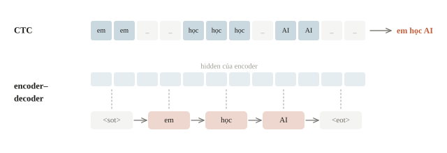

---
<!-- quiz -->
::: quiz
Đội có 2000 clip kèm transcript, nhưng không có mốc thời gian của từng ký tự. Một bạn đề xuất chia đều các frame cho các ký tự, rồi train cross-entropy theo frame. Cách này sai ở đâu?
- [ ] Cross-entropy không dùng được khi có hơn hai lớp
- [x] Tốc độ nói không đều, nên nhãn của frame bị gán lệch
- [ ] Transcript phải đổi sang phiên âm trước khi train
- [ ] Chia đều chỉ sai với những clip dài hơn 30 giây
Người nói không đều, nên chia đều gán frame vào sai nhãn. CTC không cố định một alignment, mà cộng mọi alignment hợp lệ.
:::

---
<!-- figure -->
## Nói không đều

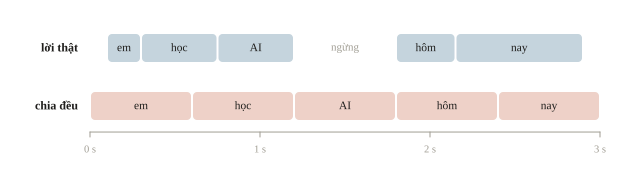

---
<!-- center -->
## Blank tách hai lần phát cùng chữ

`a a _ a` → gộp liền kề → `a _ a` → bỏ blank → **aa**.

`a a a` → **a**.

Không xóa blank trước khi gộp nhãn lặp.

---
<!-- quiz -->
::: quiz
Path `a _ a` collapse thành gì?
- [ ] `_aa`
- [ ] `a`
- [x] `aa`
- [ ] Chuỗi rỗng
Hai `a` cách nhau bởi blank nên được giữ cả hai. Bỏ blank thì còn `aa`.
:::

---
<!-- center -->
## Một transcript nhận nhiều path

$$P(y\mid X)=\sum_{\pi:\mathcal B(\pi)=y}\prod_t p_t(\pi_t).$$

$$\mathcal L=-\log P(y\mid X).$$

Greedy tìm một path; CTC loss cộng mọi alignment hợp lệ.

---
<!-- figure -->
## Tám path, ba transcript

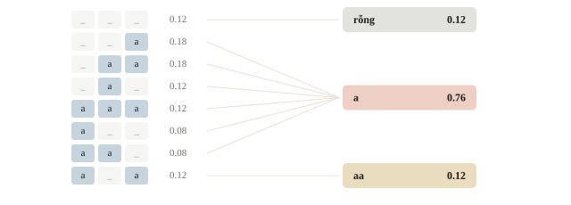

---
<!-- split -->
## Tính tay và liệt kê

`___`: $0.6\cdot0.5\cdot0.4=0.12$.

`a_a`: $0.4\cdot0.5\cdot0.6=0.12$.

Sáu path còn lại cho `a`.

|||

```output
P(rỗng) = 0.120
P(a) = 0.760
P(aa) = 0.120
loss = 0.2744
```

---
<!-- center -->
## Path tốt nhất chưa chắc cho transcript tốt nhất

Greedy: argmax từng frame rồi collapse.

Transcript tốt nhất: tổng xác suất lớn nhất trên mọi path của nó.

Beam search giữ nhiều tiền tố, cộng các path về cùng tiền tố.

---
<!-- quiz -->
::: quiz
Có hai frame, mỗi frame có $P(\_) = 0.6$ và $P(a) = 0.4$. Greedy decoding cho transcript nào, và transcript nào có xác suất lớn nhất?
- [x] Greedy cho chuỗi rỗng, còn lớn nhất là `a` với xác suất 0.64
- [ ] Greedy cho chuỗi rỗng, còn lớn nhất là chuỗi rỗng với xác suất 0.36
- [ ] Greedy cho `a`, và lớn nhất là `a` với xác suất 0.64
- [ ] Greedy cho chuỗi rỗng, còn lớn nhất là `aa` với xác suất 0.16
Greedy chọn `_` ở cả hai frame, ra chuỗi rỗng với xác suất 0.36. Transcript `a` gom ba path, được $0.24 + 0.24 + 0.16 = 0.64$.
:::

---
<!-- figure -->
## Greedy và tổng xác suất

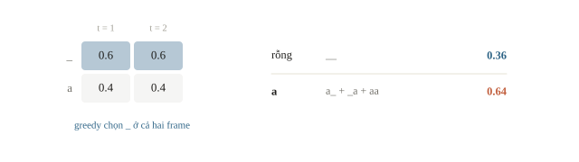

---

<!-- figure -->
## CTC trên một câu đọc thật

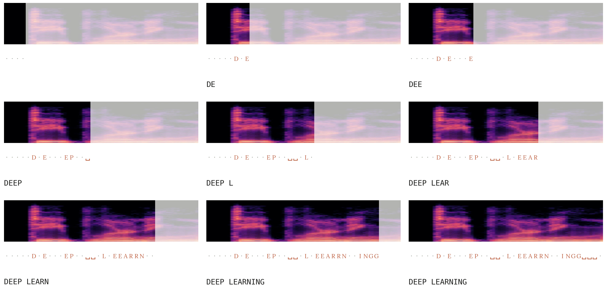

---
<!-- section 2 -->
# Dynamic programming và CTCLoss

---
<!-- center -->
## Chuỗi mở rộng và truy hồi α

$\ell'=(\_,y_1,\_,\dots,y_U,\_)$ dài $2U+1$.

$$\alpha_t(s)=\big(\alpha_{t-1}(s)+\alpha_{t-1}(s-1)+\text{nhảy}\big)\,p_t(\ell'_s)$$

Số hạng nhảy $\alpha_{t-1}(s-2)$ chỉ có khi $\ell'_s\neq\_$ và $\ell'_s\neq\ell'_{s-2}$.

$P(y\mid X)=\alpha_T(2U+1)+\alpha_T(2U)$; thời gian $O(TU)$.

---
<!-- split -->
## Bảng α cho target `a`

Ba cột: `_ a _`.

$t=2$, ô `a`: $(0.4+0.6)\cdot0.5=0.5$.

Hai ô cuối: $0.48+0.28=0.76$.

|||

```output
t=1: 0.60  0.40  0.00
t=2: 0.30  0.50  0.20
t=3: 0.12  0.48  0.28
P(a) = 0.76
```

---
<!-- figure -->
## Lưới α

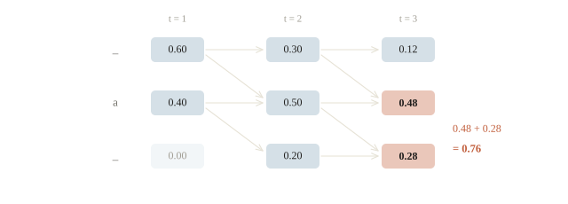

---
<!-- quiz -->
::: quiz
Một bạn viết đúng truy hồi ở trên, nhưng bằng xác suất thường, cho một clip 1000 frame, xác suất mỗi frame quanh 0.1. Loss in ra `inf`, dù target ngắn và lengths đủ. Nguyên nhân là gì, và sửa thế nào?
- [ ] T quá dài so với target nên mất path hợp lệ, cần cắt bớt frame
- [x] Tích $10^{-1000}$ tràn dưới thành 0, cần chuyển sang log-space
- [ ] Sai số làm tròn cộng dồn qua 1000 bước, cần đổi sang `float32`
- [ ] Bảng xác suất chưa chuẩn hóa, cần chia mỗi hàng cho tổng của nó
$0.1^{1000}$ nhỏ hơn số dương nhỏ nhất của `float64`, nên tích thành 0 và $-\log 0 = \infty$. Log-space biểu diễn được thoải mái.
:::

---
<!-- figure -->
## Tích nhỏ dần tới 0

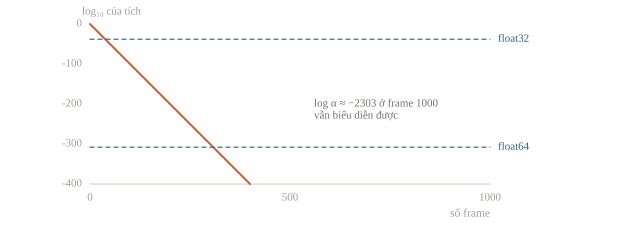

---
<!-- split -->
## Đối chiếu PyTorch

`CTCLoss` nhận log probabilities `(T,B,C)`; `reduction='sum'` để so với $-\ln0.76$.

Bảng ngẫu nhiên 12 frame, target `1 2 2 3`:

```output
DP = 10.588453, CTCLoss = 10.588453
```

|||

```output
(3, 1, 2)
CTCLoss = 0.2744
target aa, 2 frame: inf = True
```

---
<!-- center -->
## Cần ít nhất $U+r$ bước

`aa` cần `a _ a`: 3 bước.

$r$ là số cặp nhãn giống nhau đứng liền nhau trong target.

`zero_infinity` chỉ che loss, không thêm bước.

---
<!-- quiz -->
::: quiz
Khối `CTCLoss` ở trên cho target `aa` với chỉ hai frame. Vì sao loss là `inf`?
- [ ] Vì CTC không biểu diễn được hai chữ giống nhau liền nhau
- [ ] Vì target phải ghi blank giữa hai `a` mà lại thiếu
- [ ] Vì mỗi nhãn cần ít nhất hai frame, tổng cộng là bốn
- [x] Vì hai `a` liền nhau cần blank chen giữa, tối thiểu 3 bước
`a a` collapse thành `a`, chỉ `a _ a` mới thành `aa`. Cần ít nhất 3 bước, nên hai bước không có đường hợp lệ.
:::

---
<!-- figure -->
## Hai frame không đủ cho aa

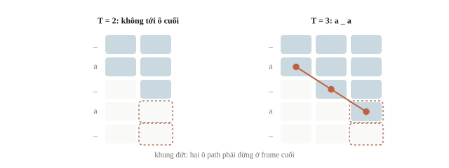

---
<!-- section 3 -->
# Encoder–decoder và Whisper

---
<!-- center -->
## Sinh chữ với ngữ cảnh

$$P(y\mid X)=\prod_u P(y_u\mid y_{<u},X).$$

Train: teacher forcing và causal mask. Suy luận: nhận lại token vừa sinh.

Cross-attention đọc encoder; không blank, không collapse.

---
<!-- split -->
## Whisper đọc từng cửa sổ 30 giây

16 kHz, log-mel 25 ms, bước 10 ms: 3000 frame.

Conv stride 2: 1500 vị trí encoder.

|||

Token khởi đầu: `<|startoftranscript|>`, `<|vi|>`, `<|transcribe|>`.

`<|translate|>`: dịch sang tiếng Anh.

Dùng processor đi kèm checkpoint.

---
<!-- split -->
## Kiến thức ngôn ngữ: giúp và hại

Decoder chọn câu có nghĩa khi âm mờ.

Clip im lặng, nhiễu: vẫn sinh chữ, có khi lặp.

|||

Qwen2-Audio, Voxtral nhận chỉ dẫn: “chép nguyên lời” khác “tóm tắt”.

Processor, template, adapter theo từng kiến trúc.

---
<!-- quiz -->
::: quiz
Với một clip tiếng Việt, Whisper trả về câu tiếng Anh trôi chảy, đúng ý người nói. WER so với reference tiếng Việt gần bằng 1. Nên kiểm gì trước?
- [ ] Beam size quá nhỏ nên decoder chọn nhầm ngôn ngữ
- [ ] Reference có dấu tiếng Việt, còn output thì không
- [x] Dãy token khởi đầu đang chọn task `<|translate|>`
- [ ] Sample rate 16 kHz quá thấp cho tiếng Việt
Câu tiếng Anh đúng ý cho thấy model đã nghe đúng nhưng làm task dịch. Hãy đặt rõ `task="transcribe"` và ngôn ngữ tiếng Việt.
:::

---
<!-- figure -->
## Một clip đi qua Whisper

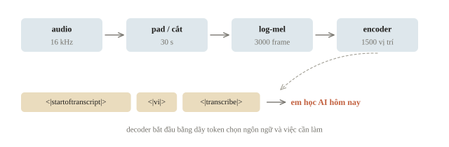

---
<!-- section 4 -->
# WER và dynamic programming

---
<!-- center -->
## Đếm sửa, xóa và chèn

$$\mathrm{WER}=\frac{S+D+I}{N_{\mathrm{ref}}}.$$

$S$ là thay, $D$ là xóa, $I$ là chèn; $N_{\mathrm{ref}}$ là số token tham chiếu.

Levenshtein distance tìm tổng lỗi nhỏ nhất.

---
<!-- split -->
## Tính tay một câu

Reference: `em học ai hôm nay`.

Prediction: `em học toán nay`.

Thay `ai` bằng `toán`; xóa `hôm`.

|||

```output
lỗi = 2, token tham chiếu = 5
WER = 0.400
```

DP hai hàng: bộ nhớ tuyến tính theo độ dài prediction.

---
<!-- figure -->
## Thay một từ, xóa một từ

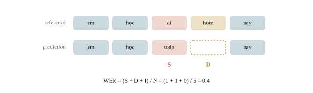

---
<!-- figure -->
## WER là một đường đi trên ma trận DP

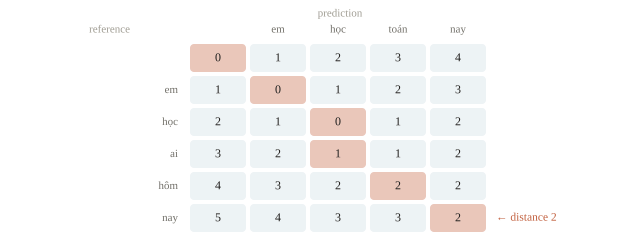

---
<!-- quiz -->
::: quiz
Reference có 4 token. Prediction giữ đúng cả 4 token ấy và chèn thêm 5 token. WER bằng bao nhiêu?
- [ ] 0
- [ ] 0.56
- [ ] 1
- [x] 1.25
5 token thừa là 5 insertion, nên WER bằng $5/4 = 1.25$. WER không bị chặn trên bởi 1.
:::

---
<!-- split -->
## Chuẩn hóa trước khi chấm

`ọ`: một ký tự (NFC) hoặc `o` cộng dấu rời (NFD).

“lập trình”: một từ, hai token.

|||

Chữ hoa, dấu câu, số, Unicode: theo scorer của đề, cho cả hai phía.

CER: sai một dấu mất một ký tự; WER mất cả từ.

---
<!-- quiz -->
::: quiz
Reference là `mai thi`, prediction là `thi đấu`. Hai đội cài cùng một DP, nhưng phá hòa khác nhau khi lần backpointer. Một đội báo 2 substitution, đội kia báo 1 deletion và 1 insertion. WER trong hai báo cáo là bao nhiêu?
- [ ] Đội đầu 1.0, đội sau 0.5 vì giữ được `thi`
- [ ] Đội đầu 0.5, đội sau 1.0 vì thay thế nhẹ hơn
- [x] Cả hai đều 1.0, vì tổng lỗi tối ưu chỉ có một
- [ ] Không xác định được, vì alignment không duy nhất
Hai alignment đều tốn 2 phép. Edit distance là giá trị nhỏ nhất nên chỉ có một, và WER bằng 1.0 ở cả hai báo cáo.
:::

---
<!-- split -->
## Gộp corpus đúng cách

Một lỗi trên câu 3 token; câu 8 token đúng.

Corpus: $1/11$.

Mean câu: $(1/3+0)/2$.

|||

```output
[1, 0] [3, 8]
corpus WER = 0.091
mean sentence WER = 0.167
```

---
<!-- figure -->
## Hai cách gộp

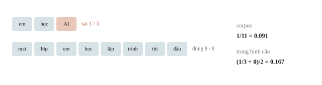

---
<!-- quiz -->
::: quiz
Validation có một câu 4 token và một câu 36 token. Model A sai 2 token ở câu ngắn, đúng hết câu dài. Model B đúng hết câu ngắn, sai 6 token ở câu dài. Corpus WER và trung bình WER từng câu chọn model nào?
- [ ] Corpus chọn B, trung bình câu chọn A
- [x] Corpus chọn A, trung bình câu chọn B
- [ ] Cả hai cách đều chọn A
- [ ] Cả hai cách đều chọn B
Corpus: A 0.05, B 0.15. Trung bình câu: A 0.25, B 0.083. Một lỗi ở câu ngắn nặng gấp chín lần một lỗi ở câu dài.
:::

---
<!-- quiz -->
::: quiz
Ba clip có tổng cộng 20 token reference và 2 lỗi. Clip thứ tư im lặng, reference rỗng, nhưng model sinh ra 4 từ “cảm ơn đã xem”. Corpus WER của cả bốn clip bằng bao nhiêu?
- [ ] Không tính được, vì chia cho 0
- [ ] 0.10
- [ ] 0.25
- [x] 0.30
Clip im lặng góp 4 insertion vào tử số, và 0 vào mẫu số: $(2 + 4)/20 = 0.30$.
:::

---
<!-- section 5 -->
# Hậu xử lý và dữ liệu thật

---
<!-- split -->
## Trôi chảy hơn chưa chắc đúng hơn

Reference: `mai thi ai`.

Transcript gốc đúng.

Sửa thành `mai thi toán` là đổi nội dung.

|||

```output
gốc: WER = 0.000
sửa: WER = 0.333
```

Giữ transcript gốc; so cặp trước và sau trên cùng validation.

---
<!-- quiz -->
::: quiz
Reference là `phòng mười lăm`. ASR ra `phòng mười năm`, rồi language model sửa thành `phòng 15`, đúng ý người nói. Scorer viết thường, tách theo khoảng trắng, và không chuẩn hóa số. WER trước và sau khi sửa là bao nhiêu?
- [x] 0.333, rồi tăng lên 0.667
- [ ] 0.333, rồi giảm về 0
- [ ] 0.333, rồi giữ nguyên 0.333
- [ ] 0.667, rồi giảm về 0.333
Trước: một substitution trên 3 token. Sau: `15` thay `mười` và `lăm` bị xóa, thành 2 lỗi. Đúng ý chưa phải đúng token.
:::

---
<!-- split -->
## Chạy Whisper trên máy

`--check`: file, model type, processor, sample rate, hash, phiên bản; chưa nạp trọng số.

`--run`: `local_files_only=True`, CPU, `task="transcribe"`.

|||

`receipt.json`: transcript, lỗi và token từng clip, cờ im lặng, thời gian, corpus WER.

Clip quá 30 s: dừng; cần chunking riêng.

Clip ngắn vẫn được pad lên 30 s.

---
<!-- quiz -->
::: quiz
Trên một clip 30 giây, Whisper chép mất 6 giây. Test có 1500 clip, mỗi clip 3 giây. Một bạn ước thời gian là $1500\cdot 6\cdot 3/30 = 900$ giây. Ước lượng này sai ở đâu?
- [ ] Không sai, vì thời gian tỉ lệ thuận với thời lượng audio
- [x] Mỗi clip được pad lên 30 giây, nên phần encoder không giảm
- [ ] Thời gian chỉ phụ thuộc số token, nên phải nhân theo số từ
- [ ] Còn thiếu thời gian resample, phần tốn nhất của pipeline
Processor pad mọi clip lên 30 giây, nên encoder làm cùng một lượng tính cho clip 3 giây. Thời gian mỗi clip giảm ít hơn 10 lần.
:::

---
<!-- figure -->
## Clip ngắn vẫn chiếm đủ 30 giây

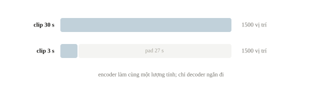

---
## Khi đi thi

- Scorer local đúng normalization của đề.
- Đo thời gian trên clip giống test.
- CTC: kiểm độ dài; loss `inf` là lỗi dữ liệu.

---
<!-- section 6 -->
# Luyện đề

---
<!-- quiz -->
::: quiz Luyện đề 1
CTC loss vẫn dao động sau 50 epoch, thỉnh thoảng ra `inf`. Nên kiểm gì trước?
- [x] Dữ liệu, gồm target và lengths, rồi tới đầu vào của loss
- [ ] Gradient và độ cong, rồi giảm learning rate
- [ ] Norm gradient, LR range test, momentum
- [ ] Tăng batch, thêm clipping, đổi sang AdamW
`inf` theo từng batch nghĩa là có mẫu không có alignment hợp lệ: target quá dài so với số bước sau encoder, lengths sai, hoặc target lẫn blank. Optimizer hay learning rate không sửa được dữ liệu.
Phỏng theo: [NOAI 2026 Singapore · Vòng sơ loại · Câu 282](https://aisingapore.org/wp-content/uploads/2026/04/NOAI-2026-Preliminary-Round-Assessment-300-MCQs-Google-Forms.pdf#page=106)
:::

---
<!-- quiz -->
::: quiz Luyện đề 2
Log-mel có 100 frame mỗi giây. Đội tăng tổng stride của encoder từ 4 lên 8 để train nhanh hơn. Một clip 2.4 giây có transcript 29 ký tự, trong đó có 2 chỗ hai ký tự giống nhau đứng liền nhau. Với stride 8, CTC còn train được trên clip này không?
- [ ] Được, vì 30 bước vẫn nhiều hơn 29 ký tự
- [x] Không, vì 30 bước ít hơn 31 bước tối thiểu
- [ ] Được, vì CTC tự chèn blank vào target khi thiếu
- [ ] Không, vì cần ít nhất 58 bước, gấp đôi số ký tự
240 frame chia 8 còn 30 bước. Mỗi cặp chữ lặp cần một blank chen giữa, nên target cần 31 bước.
Phỏng theo: [CMU 10-601 · Exam 3 Practice · Q1.1(b)](https://www.cs.cmu.edu/~mgormley/courses/10601/handout/exam3_practice_problems.pdf#page=4)
:::

---
<!-- center -->
## Chốt ba điều

CTC cộng mọi alignment có blank bằng DP; encoder–decoder sinh token theo task.

WER đếm edit operations sau normalization của scorer; corpus WER chia tổng lỗi cho tổng token.

Model thật cần checkpoint, processor, task đúng; mọi hậu xử lý chấm trước và sau.

---
<!-- center -->
## Sau giờ học

Làm **10 câu kiểm tra cuối bài** trên trang bài học.

Chạy notebook; đổi bảng xác suất, tính tay α rồi đối chiếu `ctc_forward` và `CTCLoss`.
