<!-- title -->
# Multimodal

Ghép nhiều nguồn và đo nguồn nào giúp

Phase 7 · Bài 7.4

---
<!-- split -->
## Ảnh, chữ, lời thay đổi

Ảnh cho biết phòng học.

Chữ cho biết hoạt động.

Audio báo thay đổi phút cuối.

|||

::: note Câu hỏi
Ghép ở đâu và làm sao biết nguồn mới có ích?
:::

---
## Mục tiêu buổi này

- Ghép đúng cặp theo ID và theo thời gian.
- Phân biệt early fusion, late fusion, gating.
- Đo đóng góp bằng ablation; xử lý thiếu nguồn.
- Học căn chỉnh từ cặp; đọc VLM, kiểm schema.

---
<!-- section 1 -->
# Cặp dữ liệu và early fusion

---
<!-- split -->
## Cùng một sự việc, cùng ID

Ảnh nào đi với caption nào?

Audio thuộc clip nào và khoảng thời gian nào?

|||

Join theo ID; đếm ID trùng và thiếu.

Split theo sự kiện, người hoặc file trước khi tạo bản sao.

Shape đúng chưa bảo đảm cặp đúng.

---
<!-- quiz -->
::: quiz
Ảnh và caption nằm ở hai CSV được sắp xếp khác nhau, và cả hai đều có cột `id`. Ghép thế nào cho đáng tin nhất?
- [ ] Ghép hàng thứ $i$ với hàng thứ $i$, vì hai file có cùng số dòng
- [ ] Sắp cả hai file theo `id`, rồi ghép theo thứ tự hàng
- [x] Join theo `id`, rồi đếm số ID bị trùng và bị thiếu
- [ ] Chỉ dùng ảnh, để khỏi phải kiểm quan hệ cặp
Join theo `id` nối đúng ảnh với caption của nó. Ghép theo hàng thì thiếu một caption là mọi hàng sau lệch một bậc, mà tensor vẫn đúng shape.
:::

---
<!-- figure -->
## Ghép theo hàng và join theo id

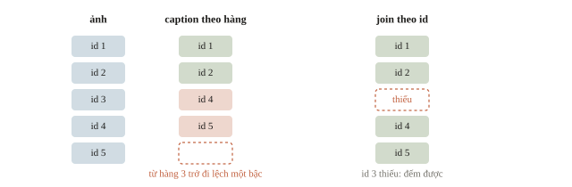

---
<!-- split -->
## Căn theo thời gian

Video 25 khung mỗi giây.

Đặc trưng âm hop 10 ms: 100 frame mỗi giây.

|||

Đổi chỉ số về giây trước:

$$t=0.01k,\qquad\text{khung}=\lfloor 25t\rfloor.$$

Lệch vài khung: lời nói đi với khuôn mặt khác.

---
<!-- quiz -->
::: quiz
Video có 25 khung mỗi giây, còn đặc trưng âm có hop 10 ms. Tiếng còi bắt đầu ở frame âm 430, đếm từ 0. Khung hình nào chứa thời điểm đó?
- [ ] Khung 17
- [x] Khung 107
- [ ] Khung 430
- [ ] Khung 1075
Frame âm 430 bắt đầu ở 4.3 giây, và $4.3\times 25 = 107.5$, nên nằm trong khung 107.
:::

---
<!-- figure -->
## Hai nhịp thời gian

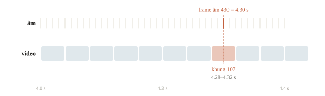

---
<!-- figure -->
## Ghép trước head hay sau head?

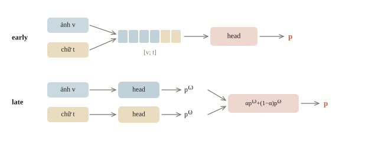

---
<!-- center -->
## Concatenation giữ các nguồn

$$\mathbf z=[\mathbf v;\mathbf t;\mathbf a],\qquad (B,32)\oplus(B,16)\to(B,48).$$

Linear head chỉ là tổng các điểm riêng:

$$\mathbf w^\top\mathbf z+b=\mathbf w_v^\top\mathbf v+\mathbf w_t^\top\mathbf t+\mathbf w_a^\top\mathbf a+b.$$

---
<!-- split -->
## Quy tắc tổng hợp XOR

Hai tín hiệu nhị phân khác nhau: lớp 1.

Tổng hai điểm riêng không đủ; cần hàm phi tuyến của cả hai.

|||

```output
linear: accuracy = 0.470
MLP: accuracy = 1.000
(400, 2)
```

100 mẫu validation: linear ngang đoán ngẫu nhiên.

---
<!-- figure -->
## Biên quyết định trên XOR

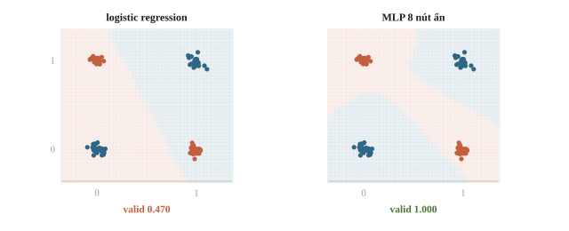

---
<!-- quiz -->
::: quiz
Với hai tín hiệu XOR ở trên, một đội giữ logistic regression, nhưng đưa vào $[x_1;\,x_2;\,x_1x_2]$ thay cho $[x_1;\,x_2]$. Kết quả thế nào?
- [x] Tách được, vì nhãn bằng $x_1 + x_2 - 2x_1x_2$
- [ ] Vẫn không tách được, vì head vẫn tuyến tính
- [ ] Tách được, nhưng phải thêm cả $x_1^2$ và $x_2^2$
- [ ] Không đổi gì, vì $x_1x_2$ suy ra được từ $x_1$, $x_2$
$x_1 + x_2 - 2x_1x_2$ cho 0, 1, 1, 0, đúng XOR, và tuyến tính theo ba đặc trưng mới.
:::

---
<!-- section 2 -->
# Late fusion và ablation

---
<!-- center -->
## Cùng lớp, cùng thang ý nghĩa

$$\mathbf p=\alpha\mathbf p^{(v)}+(1-\alpha)\mathbf p^{(t)},\qquad 0\le\alpha\le1.$$

Các cột cùng `class_to_index`; $\alpha$ và calibration chọn trên validation.

Trung bình logits khác trung bình probabilities.

Gating: $\alpha=\sigma\big(g(\mathbf v,\mathbf t)\big)$ đổi theo từng mẫu.

---
<!-- split -->
## Bảng xác suất đặt sẵn

Tám mẫu; hai nhánh sai ở những mẫu khác nhau.

Lỗi bổ sung là lúc fusion có ích nhất.

|||

```output
image: accuracy = 0.500
text: accuracy = 0.500
fusion: accuracy = 1.000
```

Dữ liệu thật: đo trên cùng validation.

---
<!-- split -->
## Tính tay một sample

Nhãn 1; ảnh cho 0.40, chữ cho 0.85.

$$p=(0.40+0.85)/2=0.625.$$

Gộp đúng mẫu này.

|||

Nếu ảnh sai 0.01 còn chữ đúng nhẹ 0.55:

$$p=0.28.$$

Nhánh tự tin sai kéo kết quả gộp sai.

---
<!-- figure -->
## Hai nguồn bù lỗi cho nhau

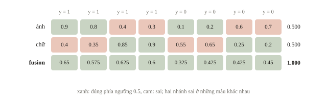

---
<!-- quiz -->
::: quiz
Trên validation, nhánh ảnh đáng tin khi ảnh đủ sáng, còn với ảnh tối thì nhánh chữ đúng hơn. Cách gộp nào biểu diễn được quy tắc này?
- [ ] Late fusion với một $\alpha$ cố định, dò trên validation
- [ ] Early fusion $[\mathbf v;\mathbf t]$ với một linear head
- [x] Gating, tức một mạng nhỏ cho ra $\alpha$ riêng cho từng mẫu
- [ ] Cộng logit hai nhánh, sau khi nhân nhánh ảnh với 2
Mức tin vào ảnh phụ thuộc chính ảnh. Gating học $\alpha$ theo từng mẫu, còn một $\alpha$ cố định cho mọi mẫu cùng mức tin.
:::

---
<!-- split -->
## Phá cặp có kiểm soát

Dịch vòng caption bốn vị trí, shape giữ nguyên.

```python
wrongly_paired_text = np.roll(
    text_probability, 4
)
wrong_fusion = (
    image_probability + wrongly_paired_text
) / 2
```

|||

```output
sai cap: accuracy = 0.500
```

Cặp dữ liệu là một phần thông tin.

Hỏi đáp ảnh: thử baseline chỉ đọc câu hỏi.

---
<!-- figure -->
## Bảng ablation

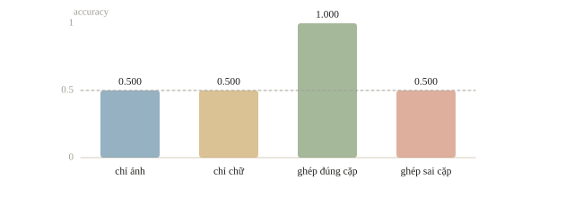

---
<!-- quiz -->
::: quiz
Model ảnh cộng caption đạt accuracy 0.84 trên 300 mẫu validation. Chỉ dùng ảnh thì được 0.83. Giữ ảnh, xáo caption giữa các mẫu, cũng được 0.83. Kết quả này nói lên gì?
- [ ] Caption là nguồn chính, còn ảnh chỉ thêm nhiễu
- [x] Caption gần như không góp thêm gì ngoài ảnh
- [ ] Xáo caption làm hỏng dữ liệu, nên số đo vô nghĩa
- [ ] Fusion đã học tốt tương tác giữa ảnh và chữ
Chỉ ảnh đã đạt 0.83, xáo caption cũng chỉ về 0.83. Caption đúng cặp chỉ thêm 3 mẫu trên 300.
:::

---
<!-- split -->
## Thiếu modality

Đặt trọng số nhánh thiếu về 0, chuẩn hóa lại tổng trọng số.

Thiếu tất cả: dùng fallback đã quy định trước.

|||

```output
[0.3  0.25]
thieu nguon: accuracy = 0.875
```

Nhánh còn lại có thể đúng hoặc sai; không chia cho số nhánh ban đầu.

---
<!-- quiz -->
::: quiz
Late fusion với trọng số đều. Một mẫu bị mất ảnh, còn nhánh chữ cho xác suất lớp 1 là 0.8. Đặt trọng số của ảnh về 0, rồi chuẩn hóa lại tổng trọng số, thì được bao nhiêu?
- [ ] 0.4
- [ ] 0.65
- [x] 0.8
- [ ] 1.6
Chỉ còn nhánh chữ nên nó nhận toàn bộ trọng số: $0.8/1 = 0.8$.
:::

---
<!-- figure -->
## Ba cách xử lý nhánh thiếu

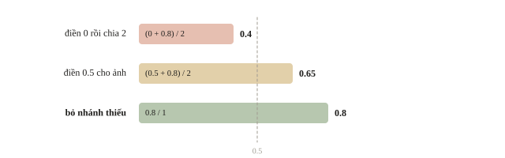

---
<!-- section 3 -->
# Biểu diễn chung

---
<!-- center -->
## Cùng chiều chưa đủ

Ảnh `(B,512)`, chữ `(B,512)`: tích vô hướng tính được.

Hai encoder train riêng có hai hệ trục riêng.

Căn chỉnh phải học từ các cặp: CLIP, projector.

---
<!-- split -->
## Học $W$ từ 40 cặp

Nội dung 8 chiều, mỗi encoder xoay hệ trục riêng.

$$\min_W\lVert X_vW-X_t\rVert^2$$

Đo recall@1 trên 20 cặp validation.

|||

```output
cosine cap dung, chua can chinh: -0.019
recall@1 chua can chinh: 0.05
recall@1 sau khi hoc W: 0.95
recall@1 khi hoc W tu cap bi xao: 0.00
```

Thông tin căn chỉnh nằm ở quan hệ cặp.

---
<!-- figure -->
## Đường chéo của ma trận cosine

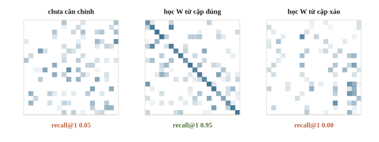

---

<!-- figure -->
## Học riêng hay học chung

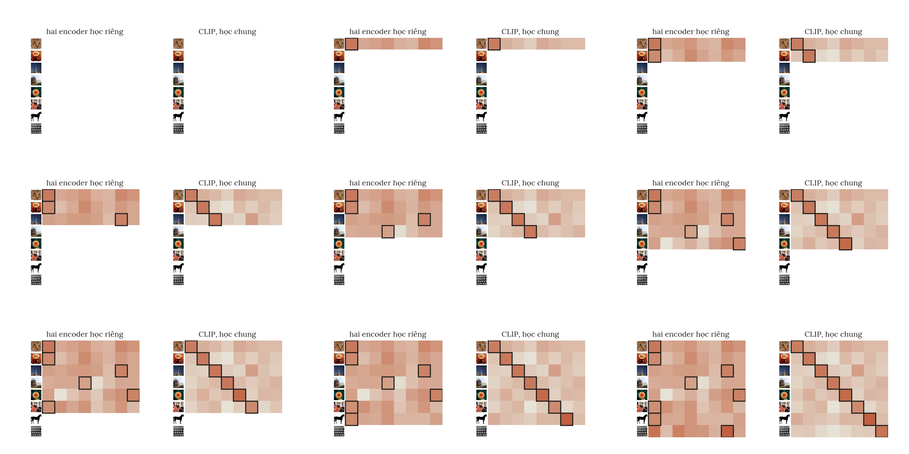

---
<!-- quiz -->
::: quiz
Một đội lấy encoder ảnh và encoder chữ train riêng, cùng 512 chiều, rồi tính cosine trực tiếp để tìm ảnh cho 1000 câu. Mỗi câu có đúng một ảnh đúng trong 1000 ảnh. Recall@1 ra 0.001. Vì sao?
- [ ] Quên chuẩn hóa vector, chuẩn hóa xong sẽ ổn
- [x] Đây là mức đoán bừa, vì hai hệ trục chưa được căn chỉnh
- [ ] 512 chiều quá ít, phải dùng encoder lớn hơn
- [ ] Phải dùng khoảng cách Euclid thay cho cosine
$1/1000$ đúng bằng mức đoán bừa. Hai encoder train riêng không có tín hiệu nào buộc ảnh và câu đúng cặp nằm gần nhau.
:::

---
<!-- quiz -->
::: quiz
Trong thí nghiệm, $W$ có $8\times 8 = 64$ số, và mỗi cặp cho 8 phương trình. Nếu chỉ có 8 cặp train thì sao?
- [ ] `lstsq` báo lỗi, vì không đủ phương trình
- [ ] Vẫn tốt như với 40 cặp, vì $W$ chỉ là một phép xoay
- [ ] Phải có ít nhất 64 cặp mới học được $W$
- [x] $W$ khớp đúng 8 cặp train, kể cả phần nhiễu
8 cặp cho 64 phương trình, vừa bằng 64 ẩn, nên $W$ khớp tuyệt đối cả nhiễu. Recall@1 chỉ còn 0.35.
:::

---
<!-- section 4 -->
# VLM và output

---
<!-- figure -->
## Cùng ảnh, câu hỏi khác

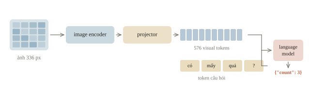

---
<!-- split -->
## Chèn token hay cross-attention

**Chèn** (LLaVA-1.5): ảnh 336 px, patch 14 cho $24^2=576$ visual tokens nối với câu hỏi.

Self-attention đọc cả chuỗi.

|||

**Cross-attention** (Flamingo): query từ chữ, key và value từ ảnh.

Chuỗi chữ không dài thêm; cần train lớp mới.

---
<!-- quiz -->
::: quiz
Câu hỏi có 40 token, còn ảnh cho 576 visual tokens. Nếu chèn visual tokens vào chuỗi, language model phải đọc một chuỗi dài bao nhiêu? Nếu dùng cross-attention từ chữ sang ảnh, ma trận điểm của một head có shape gì?
- [x] Chuỗi 616 token, ma trận `(40, 576)`
- [ ] Chuỗi 616 token, ma trận `(576, 40)`
- [ ] Chuỗi 40 token, ma trận `(616, 616)`
- [ ] Chuỗi 576 token, ma trận `(40, 40)`
Chèn vào thì chuỗi dài $40 + 576 = 616$ token. Cross-attention có mỗi token chữ là một hàng, mỗi key ảnh là một cột.
:::

---
<!-- figure -->
## Chuỗi dài ra hay ma trận chữ × ảnh

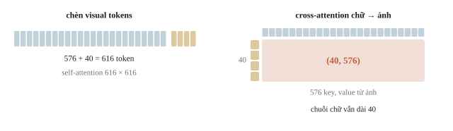

---
<!-- split -->
## Processor và template là hợp đồng

Resize và crop quyết định vùng ảnh nhìn thấy.

Template chèn ảnh, chữ và special tokens đúng vị trí.

|||

“Có mấy quả bóng?” cần số đếm.

“Bóng màu gì?” cần nhãn màu.

Checkpoint, processor và template phải đi cùng nhau.

---
<!-- split -->
## Parser kiểm định dạng

Ba chuỗi JSON đặt sẵn:

`{"count": 3}` nhận 3.

`{"count": true}` và `{"count": "3"}` bị từ chối: boolean và chuỗi không phải số nguyên theo schema.

|||

```output
3
count phai la so nguyen khong am
count phai la so nguyen khong am
```

Schema đúng chưa chứng minh nội dung ảnh đúng.

---
<!-- quiz -->
::: quiz
Parser `parse_count` ở trên nhận chuỗi nào?
- [ ] `{"count": 3.0}`
- [ ] `{'count': 3}`
- [x] `{ "count" : 3 }`
- [ ] `{"count": 3, "unit": "qua"}`
JSON cho phép khoảng trắng quanh dấu `:`. `3.0` là float, nháy đơn không phải JSON, còn khóa thừa làm sai tập khóa.
:::

---
<!-- split -->
## Bẫy cài đặt

Kiểm ID cặp, shape, thứ tự lớp, mask trước khi train.

Đổi một nhánh: đo lại calibration và trọng số.

|||

VLM: tách lỗi vùng ảnh, hiểu câu hỏi, schema.

Sửa đúng bước trước khi fine-tune.

---
<!-- quiz -->
::: quiz
Thay nhánh chữ bằng một model mới. Accuracy riêng của nhánh chữ tăng từ 0.78 lên 0.83, nhưng fusion với $\alpha = 0.6$ cũ lại giảm từ 0.86 xuống 0.84. Bước tiếp theo nên là gì?
- [ ] Quay lại model chữ cũ, vì điểm cuối là điểm của fusion
- [ ] Giữ $\alpha$ cũ, và train model chữ mới thêm vài epoch
- [ ] Chọn $\alpha$ sao cho điểm test cao nhất có thể
- [x] Dò lại $\alpha$ và calibration trên validation
$\alpha = 0.6$ được chọn cho thang xác suất của model cũ. Dò lại $\alpha$ và calibration trên validation rồi mới so.
:::

---
## Khi đi thi

- Bảng ablation: từng nhánh, các cách ghép, cùng split; ghi thời gian, bộ nhớ.
- Join theo ID, đếm thiếu, trùng; audio, video đổi frame về giây.
- Mô phỏng thiếu nguồn đúng tỉ lệ đề; fallback khi thiếu hết.
- Tính chi phí visual tokens, encode audio trước khi chạy cả tập.
- Parser schema; khóa $\alpha$, prompt, checkpoint trước test.

---
<!-- section 5 -->
# Luyện đề

---
<!-- quiz -->
::: quiz Luyện đề 1
Bài toán nào là đa phương thức thật sự?
- [x] Đoán thể loại của clip từ khung hình, âm thanh và phụ đề
- [ ] Phân loại tiếng chim bằng cách vẽ audio thành spectrogram rồi đưa vào CNN
- [ ] Phân loại cảm xúc của bình luận, kèm bản dịch máy của bình luận ấy
- [ ] Phân loại ảnh, ghép ảnh gốc với năm bản augmentation của nó
Khung hình, âm thanh và phụ đề là ba loại tín hiệu khác nhau cùng mô tả một clip. Spectrogram vẫn chỉ là audio.
Phỏng theo: [NOAI 2026 Singapore · Vòng sơ loại · Câu 257](https://aisingapore.org/wp-content/uploads/2026/04/NOAI-2026-Preliminary-Round-Assessment-300-MCQs-Google-Forms.pdf#page=92)
:::

---
<!-- quiz -->
::: quiz Luyện đề 2
Một VLM đạt accuracy 0.71 trên validation hỏi đáp ảnh. Thay mọi ảnh bằng một ảnh xám trống, giữ nguyên câu hỏi, thì được 0.66. Phần lớn câu hỏi là có/không hoặc đếm. Ta kết luận được gì?
- [ ] Model dùng ảnh tốt, vì 0.66 vẫn thấp hơn 0.71
- [ ] Ảnh xám làm hỏng processor, nên số 0.66 vô nghĩa
- [ ] Nên bỏ hẳn nhánh ảnh để inference nhanh hơn
- [x] Câu hỏi tự để lộ phần lớn đáp án, còn ảnh góp ít
Thay ảnh bằng ảnh xám mà vẫn đạt 0.66, nên phần lớn đáp án đoán được chỉ từ câu hỏi. Ảnh chỉ góp thêm 5 điểm.
Phỏng theo: [NOAI 2026 Singapore · Vòng sơ loại · Câu 264](https://aisingapore.org/wp-content/uploads/2026/04/NOAI-2026-Preliminary-Round-Assessment-300-MCQs-Google-Forms.pdf#page=94)
:::

---
<!-- quiz -->
::: quiz Luyện đề 3
Một đội có 2 triệu ảnh không chú thích và 2 triệu đoạn tin tức, hai kho không liên quan đến nhau. Đội muốn train từ đầu hai encoder ảnh và chữ trong cùng một không gian, để tìm ảnh bằng câu. Trở ngại chính là gì?
- [x] Không có cặp ghép nào, nên không có gì để căn chỉnh
- [ ] Dữ liệu quá ít so với pretraining chỉ có chữ
- [ ] Hai encoder phải có cùng số chiều ngay từ đầu
- [ ] Ảnh và chữ phải dùng chung tokenizer mới so được
Căn chỉnh học từ quan hệ cặp. Hai kho dữ liệu rời nhau không cho biết ảnh nào đi với đoạn chữ nào.
Phỏng theo: [NOAI 2026 Singapore · Vòng sơ loại · Câu 266](https://aisingapore.org/wp-content/uploads/2026/04/NOAI-2026-Preliminary-Round-Assessment-300-MCQs-Google-Forms.pdf#page=95)
:::

---
<!-- center -->
## Chốt ý

Ghép đúng cặp theo ID và thời gian trước mọi model.

Linear head chỉ cộng điểm riêng; tương tác cần MLP, đặc trưng tích, gating.

Ablation đo đóng góp thật; thêm modality không chắc tăng điểm.

Cùng chiều chưa cùng hệ trục; căn chỉnh học từ cặp.

---
<!-- center -->
## Sau giờ học

Làm **10 câu kiểm tra cuối bài** trên trang bài học.

Chạy notebook; đổi số cặp dùng để học $W$ (8, 20, 40), đoán trước recall@1 rồi kiểm lại.
