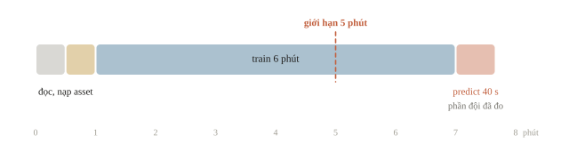
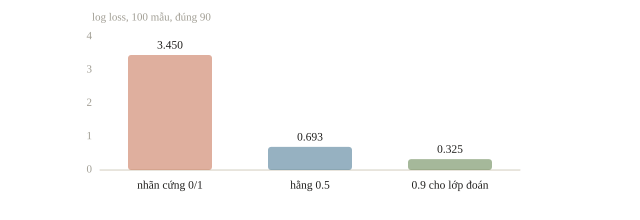
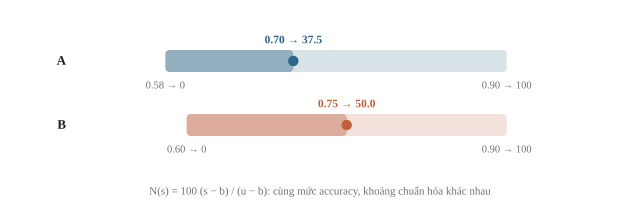
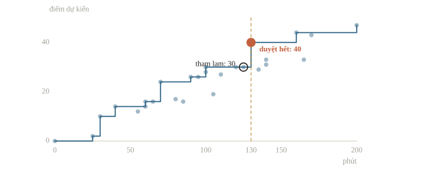
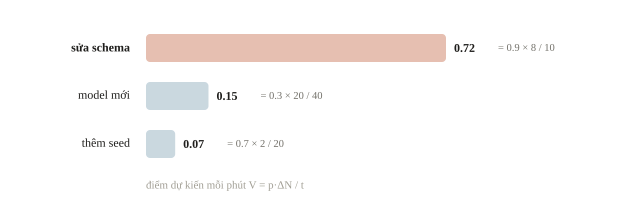
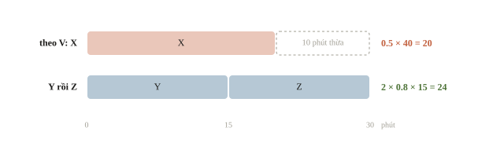
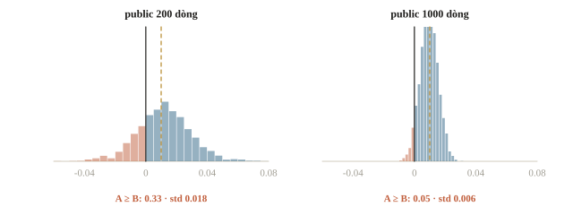
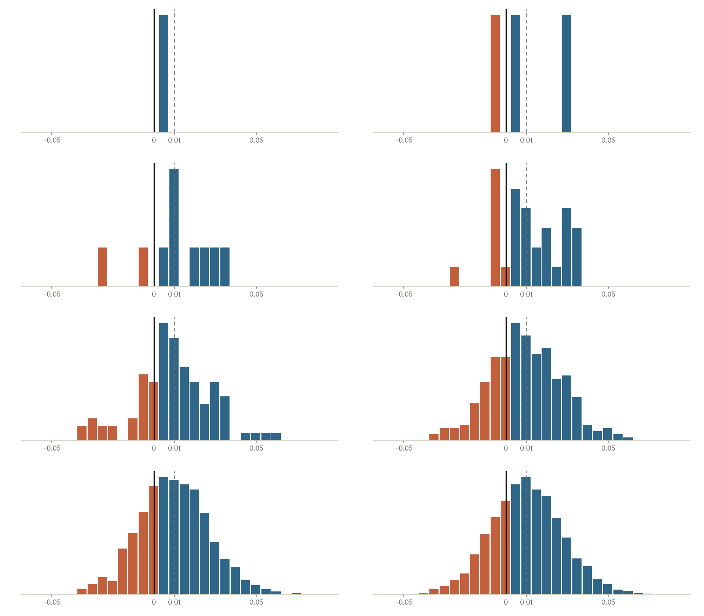

<!-- title -->
# Chiến lược thi

Chọn việc tiếp theo khi thời gian và lượt nộp có hạn

Phase 8 · Bài 8.1

---
<!-- split -->
## Còn 35 phút

Model ảnh đã khá tốt.

Bài văn bản chưa có **file hợp lệ để nộp**.

Có nên chạy thêm một seed cho ảnh?

|||

::: note Câu hỏi xuyên suốt
Một khoảng thời gian nên dành cho việc nào?

Bằng chứng nào khiến ta đổi kế hoạch?
:::

---
## Mục tiêu buổi này

- Viết hợp đồng: input, metric, runtime, tài nguyên, dạng nộp.
- Quy mức cải thiện về điểm chuẩn hóa để so giữa các bài.
- Duyệt kế hoạch; thấy khi nào tham lam bỏ lỡ bước mở đường.
- Đọc public như phép đo có nhiễu; luôn giữ một bài nộp hợp lệ.

---
<!-- section 1 -->
# Hợp đồng của bài

---
<!-- split -->
## Đọc để quyết định

| Câu hỏi | Hệ quả |
|---|---|
| Nhãn hay xác suất? | Đúng output cho metric |
| Chấm CSV hay notebook? | Đúng runtime cần đo |
| Nhóm mới hay nguồn cũ? | Đúng validation |
| Asset nào được cấp? | Dùng được lúc inference |

|||

Runtime notebook có thể gồm đọc dữ liệu, nạp asset, train và predict.

Đọc **năm, vòng, statement đúng bài**.

---
<!-- split -->
## Hai kỳ thi, hai hợp đồng

**IOAI 2026, Individual Contest**

- Hai ngày, ba bài mỗi ngày, sáu giờ mỗi ngày.
- Appendix đặt giới hạn chung; statement có thể quy định khác.

|||

**USA-NA-AIO 2026, Vòng 2**

- Nộp CSV, notebook và báo cáo các hướng đã thử.
- Có bài: notebook không chạy trên GPU L4 thì 0 điểm.

---
<!-- quiz -->
::: quiz
Đề chấm bằng cách chạy lại notebook từ đầu trên máy chấm, giới hạn 5 phút. Đội chỉ bấm giờ dòng `model.predict(X_test)`, được 40 giây. Phép đo này còn thiếu gì?
- [x] Thiếu thời gian đọc dữ liệu, nạp asset và train trước `predict`
- [ ] Chỉ thiếu bước ghi CSV, thường không đáng kể
- [ ] Không thiếu gì, vì `predict` là bước duy nhất tạo ra đáp án
- [ ] Chỉ cần nhân 40 giây với số seed dự định ensemble
Máy chấm chạy mọi cell, kể cả đọc dữ liệu, nạp asset và train lại. Notebook train 6 phút sẽ hết giờ trước khi tới `predict`.
:::

---
<!-- figure -->
## Runtime tính cả notebook



---
<!-- quiz -->
::: quiz
Metric là log loss trên 100 mẫu, và scorer cắt xác suất vào $[10^{-15}, 1 - 10^{-15}]$. Đội nộp nhãn cứng 0/1 thay cho xác suất, và đúng 90 mẫu. Log loss xấp xỉ bao nhiêu?
- [ ] 0.10, đúng bằng tỉ lệ đoán sai
- [ ] 0.105, bằng $-\ln 0.9$ vì model đúng 90%
- [ ] Không tính được, vì scorer báo lỗi với xác suất 0
- [x] 3.45, tệ hơn cả nộp hằng 0.5 cho mọi mẫu, vốn được 0.693
Mỗi mẫu sai bị tính $-\ln 10^{-15} \approx 34.5$, nên trung bình khoảng 3.45, tệ hơn cả nộp hằng 0.5.
:::

---
<!-- figure -->
## Nhãn cứng và log loss



---
<!-- section 2 -->
# Baseline và điểm chuẩn hóa

---
<!-- center -->
## Công thức chuẩn hóa

$$N(s)=100\frac{s-b}{u-b}$$

$s$: metric bài nộp; $b$: baseline; $u$: mốc tốt nhất.

Cùng đơn vị cho $s,b,u$; đạt đúng baseline cho $N=0$.

Metric càng thấp càng tốt: vẫn đúng chiều nếu $u$ là giá trị tốt nhất.

---
<!-- split -->
## Tính tay rồi đối chiếu

A: $b=0.58$, $u=0.90$, $s=0.70$.

$$100\frac{0.12}{0.32}=37.5$$

B: $b=0.60$, $u=0.90$, $s=0.75$.

$$100\frac{0.15}{0.30}=50$$

|||

```output
A 37.50
B 50.00
baseline 0.0
```

Accuracy thô không so trực tiếp được khi baseline và khoảng chuẩn hóa khác nhau.

---
<!-- figure -->
## Cùng thước 0 đến 100



---
<!-- split -->
## Mốc trên có thể chưa biết

USA-NA-AIO 2026, Vòng 2:

- $u$ là bài tốt nhất trong mọi bài nộp.
- Có bài: $u$ còn so với model chuyên gia giữ kín.
- Tệ hơn baseline: 0 điểm.

|||

Cùng một file, điểm phụ thuộc bài tốt nhất của người khác.

Lập kế hoạch bằng khoảng ước lượng của $u$; phần kiểm soát được là $s-b$.

---
<!-- quiz -->
::: quiz
Với $b = 0.50$ và $u = 0.90$, cải thiện metric từ 0.66 lên 0.70 làm $N$ tăng bao nhiêu?
- [ ] 4 điểm
- [x] 10 điểm
- [ ] 40 điểm
- [ ] 0.10 điểm
$100(0.70 - 0.66)/(0.90 - 0.50) = 10$ điểm.
:::

---
<!-- section 3 -->
# Phân bổ thời gian

---
<!-- split -->
## Một thí nghiệm trả lời một câu hỏi

Giả thuyết: bigram (cặp từ) giúp đoạn ngắn.

Giữ split, metric và preprocessing còn lại.

Đo log loss theo độ dài, ghi runtime.

|||

::: trap Phản hồi mất ý nghĩa
Đổi năm yếu tố cùng lúc thì không biết yếu tố nào giúp.

Kết quả âm vẫn loại được một hướng.
:::

---
<!-- split -->
## Ba chuỗi thí nghiệm

180 phút: 30 phút đọc đề và dựng đường nộp, **130 phút cải thiện**, 20 phút chạy lại và kiểm file.

| Việc | Mức 1 | Mức 2 cộng dồn |
|---|---|---|
| A | 30 phút, 10 điểm | 60 phút, 14 điểm |
| B | 40 phút, 14 điểm | 80 phút, 17 điểm |
| C | 25 phút, 2 điểm | 60 phút, 16 điểm |

|||

C mức 1: dựng bộ mô phỏng phản hồi, gần như chưa tăng điểm.

C mức 2: dùng bộ mô phỏng để tìm kiếm.

Mỗi việc chọn một mức: knapsack nhóm, $3^3=27$ kế hoạch.

---
<!-- split -->
## Duyệt hết so với tham lam

```output
duyệt hết ((1, 1, 2), 130, 40)
tham lam  ((2, 1, 1), 125, 30)
```

Bộ ba là mức của A, B, C; rồi phút, điểm.

|||

Tham lam lấy B, A (0.35 và 0.33 điểm mỗi phút), rồi A mức 2 (0.13) vì C mức 1 chỉ 0.08.

C mức 2 đáng 0.4 điểm mỗi phút, nhưng phải trả bước đầu.

Nhiều việc hơn: quy hoạch động theo số phút.

---
<!-- figure -->
## Mỗi chấm là một kế hoạch



---
<!-- quiz -->
::: quiz
Nếu phần kiểm cuối cần 50 phút thay vì 20, ngân sách cải thiện chỉ còn 100 phút. Với cùng bảng ấy, kế hoạch nào cho điểm dự kiến cao nhất?
- [ ] A mức 1 và B mức 1, mất 70 phút, được 24 điểm
- [ ] A mức 2 và B mức 1, mất 100 phút, được 28 điểm
- [x] B mức 1 và C mức 2, mất 100 phút, được 30 điểm
- [ ] A mức 1 và C mức 2, mất 90 phút, được 26 điểm
B mức 1 và C mức 2 dùng đúng 100 phút, được $14 + 16 = 30$ điểm. Chọn tham lam chỉ được 28.
:::

---
<!-- center -->
## Thêm rủi ro vào quyết định

$$V=\frac{p\,\Delta N}{t}$$

$p$: xác suất thành công ước lượng

$\Delta N$: điểm tăng nếu thành công; $t$: số phút

Đơn vị: **điểm dự kiến mỗi phút**.

Chỉ dùng $V$ để xếp các bước tùy chọn; lỗi hợp đồng vẫn phải sửa trước.

---
<!-- figure -->
## Sửa schema có thể đáng hơn thêm seed



---
<!-- quiz -->
::: quiz
Một thí nghiệm được ước lượng tăng 12 điểm với xác suất thành công 0.5, và cần 30 phút. $V$ bằng bao nhiêu?
- [x] 0.2 điểm dự kiến mỗi phút
- [ ] 0.4 điểm dự kiến mỗi phút
- [ ] 6 điểm dự kiến mỗi phút
- [ ] 5 điểm dự kiến mỗi phút
$V = 0.5\cdot 12/30 = 0.2$ điểm dự kiến mỗi phút.
:::

---
<!-- quiz -->
::: quiz
Còn 30 phút. Thí nghiệm X có $p = 0.5$, tăng 40 điểm, cần 20 phút, nên $V = 1.0$. Y và Z độc lập, mỗi việc có $p = 0.8$, tăng 15 điểm, cần 15 phút, nên $V = 0.8$. Chọn theo $V$ từ cao xuống được bao nhiêu điểm dự kiến, và có cách nào tốt hơn không?
- [ ] Được 20 điểm, và không có cách tốt hơn vì X có $V$ cao nhất
- [x] Được 20 điểm, nhưng làm Y và Z thì được 24 điểm
- [ ] Được 28 điểm, vì 10 phút còn lại làm được 2/3 của Y
- [ ] Được 24 điểm, vì X và Y vừa đủ 30 phút
X được 20 điểm dự kiến, và 10 phút còn lại không đủ cho việc nào. Y và Z dùng đúng 30 phút, được 24.
:::

---
<!-- figure -->
## Tỉ số cao chưa chắc dùng hết giờ



---
<!-- section 4 -->
# Đọc phản hồi public

---
<!-- split -->
## Public là một phép đo có nhiễu

Test kín 2000 dòng: A đúng 0.80, B đúng 0.81.

Hai model chỉ khác nhau ở 140 dòng.

Rút phần public ngẫu nhiên 5000 lần, đếm lần public không thấy B hơn.

|||

```output
hidden 0.8 0.81
200 A >= B: 0.33 std 0.018
1000 A >= B: 0.05 std 0.006
```

Public 200 dòng: sai hoặc hòa khoảng một phần ba số lần.

---
<!-- figure -->
## Phân bố chênh lệch public



---

<!-- figure -->
## Mỗi lần rút public một kết quả



---
<!-- split -->
## Lượt nộp là một phép đo

Một lượt nộp trả lời một câu hỏi.

“R03: đổi n-gram, giữ split S1, log loss giảm”: kiểm lại được.

“Bản mới tốt nhất”: không kiểm được.

|||

::: trap Không dò nhãn kín
Gửi nhiều dự đoán để suy ngược nhãn làm mất mục đích đánh giá và có thể vi phạm luật.
:::

---
<!-- quiz -->
::: quiz
Public có 200 dòng. Bản R07 đạt 0.815, bản R05 đạt 0.805, tức chênh nhau 2 dòng. Trên validation 5 fold, R05 hơn R07 ở cả 5 fold, trung bình hơn 0.004. Còn một lượt nộp. Nên làm gì?
- [ ] Chọn R07, vì public được chấm trên dữ liệu kín của đề
- [ ] Nộp lại R07 một lần nữa để điểm public ổn định hơn
- [x] Chọn R05, vì chênh lệch public nằm trong mức nhiễu của 200 dòng
- [ ] Lấy trung bình R05 và R07, nộp luôn bản mới chưa kiểm
Chênh 2 dòng trên 200 nhỏ hơn mức nhiễu khoảng 0.018, còn R05 thắng ở cả 5 fold. Nộp lại cùng một file không giảm được nhiễu.
:::

---
<!-- section 5 -->
# Giữ đường nộp hoạt động

---
<!-- split -->
## Quay lại 35 phút

File ngang baseline cho $N=0$, nhưng mọi cải thiện của bài văn bản đi qua nó.

Không có file: bài văn bản chắc chắn 0.

Seed thêm: khoảng 0.07 điểm dự kiến mỗi phút.

|||

1. Dựng và lưu file văn bản hợp lệ.
2. Đưa bài văn bản vượt baseline.
3. Seed chỉ khi mọi bài có bản dự phòng.

---
<!-- quiz -->
::: quiz
Còn 35 phút. Phương án 1 là chạy thêm seed cho ảnh, mất 20 phút, với $p = 0.5$, tăng 2 điểm. Phương án 2 là dành 15 phút dựng một file văn bản hợp lệ, ngang baseline với $N = 0$, rồi 20 phút làm TF-IDF với $p = 0.6$, đạt $N = 20$. Điểm dự kiến tăng thêm của hai phương án là bao nhiêu?
- [ ] Seed được 1 điểm, văn bản được 0, vì bản đầu chỉ ngang baseline
- [x] Seed được 1 điểm, văn bản được 12 điểm
- [ ] Seed được 2 điểm, văn bản được 20 điểm
- [ ] Seed được 1 điểm, văn bản được 0.34 điểm
Seed được $0.5\cdot 2 = 1$. Văn bản: bước đầu cho 0, nhưng mở đường cho bước sau được $0.6\cdot 20 = 12$.
:::

---
<!-- split -->
## Đọc lại CSV

```python
readback = pd.read_csv(StringIO(csv_text),
                       dtype={"id": str})
assert readback["id"].tolist() == expected_ids
assert readback["id"].is_unique
print(csv_text.rstrip())
print("readback", readback.shape, "OK")
```

|||

```output
id,probability
001,0.15
007,0.8
010,0.55
readback (3, 2) OK
```

ID dạng chuỗi: `001` không thành `1`.

Kiểm thêm số hữu hạn và miền xác suất.

---
<!-- quiz -->
::: quiz
CSV có đúng số hàng và đúng tên cột, nhưng thứ tự ID khác với file mẫu. Đã kết luận được bài nộp đúng chưa?
- [ ] Đúng rồi, vì đủ số hàng và đủ tên cột là đủ hợp đồng
- [ ] Đúng, nếu metric trên validation local đã đủ cao
- [ ] Đúng, vì bộ chấm luôn tự sắp lại mọi dòng theo ID
- [x] Chưa, cần biết bộ chấm ghép theo ID hay theo vị trí
Bộ chấm ghép theo vị trí thì mọi dòng lệch bị chấm với nhãn của mẫu khác. Hãy sắp theo file mẫu và assert danh sách ID.
:::

---
## Khi đi thi

- Viết hợp đồng trước model; statement từng bài thắng quy định chung.
- Mọi bài có bài nộp hợp lệ trước khi tối ưu bài nào.
- Ước lượng runtime bằng hai phép đo, chừa khoảng đệm.
- Mỗi thí nghiệm một thay đổi, một mốc dừng, một dòng nhật ký.
- Public nhỏ là phép đo có nhiễu; không dò nhãn, không gán nhãn tay.
- Khóa bản cuối đúng mốc, chạy lại từ đầu, đọc lại tệp sẽ nộp.

---
<!-- section 6 -->
# Luyện đề

---
<!-- quiz -->
::: quiz Luyện đề 1
Bài hồi quy chấm lỗi trung bình, càng thấp càng tốt. Điểm phần thi là $100\cdot\dfrac{X_{\text{base}} - X}{X_{\text{base}} - X_{\text{best}}}$, với $X_{\text{best}} = \min(X_{\text{expert}}, X_{\text{thí sinh}})$, trong đó $X_{\text{expert}}$ là lỗi của một model mà ban giám khảo giữ kín. Lỗi lớn hơn baseline thì được 0 điểm. Biết $X_{\text{base}} = 0.50$, $X_{\text{expert}} = 0.20$, bài tốt nhất của thí sinh có lỗi 0.26, còn đội đạt $X = 0.32$. Đội được bao nhiêu điểm?
- [ ] 75
- [x] 60
- [ ] 40
- [ ] 0
$X_{\text{best}} = 0.20$, nên điểm là $100\cdot(0.50 - 0.32)/(0.50 - 0.20) = 60$.
Phỏng theo: [USA-NA-AIO 2026 · Vòng 2 · Ngày 1 · Problem 2](https://www.usaaio.org/attachments/past-problems/2026/usaaio-2026-round-2-day-1-problems.pdf#page=14)
:::

---
<!-- quiz -->
::: quiz Luyện đề 2
Bài dự đoán giá nhà có 5000 căn, 20 đặc trưng dạng bảng như diện tích, số phòng ngủ, vị trí, tuổi nhà, và cần giải thích được đặc trưng nào ảnh hưởng nhiều. Đã có baseline dự đoán giá trung bình để kiểm đường nộp. Nên thử model chính nào đầu tiên?
- [ ] MLP 5 lớp ẩn, vì mạng sâu luôn hơn model cổ điển
- [ ] Linear regression, vì model đơn giản nhất luôn tốt nhất
- [x] Gradient boosted trees như LightGBM hoặc XGBoost
- [ ] kNN, vì nhà gần nhau thường có giá gần nhau
Với dữ liệu bảng cỡ vừa, gradient boosted trees thường mạnh nhất từ đầu, không cần chuẩn hóa, và có feature importance để giải thích.
Đề thi: [NOAI 2026 Singapore · Vòng sơ loại · Câu 267](https://aisingapore.org/wp-content/uploads/2026/04/NOAI-2026-Preliminary-Round-Assessment-300-MCQs-Google-Forms.pdf#page=95)
:::

---
<!-- quiz -->
::: quiz Luyện đề 3
Bài phân loại chuỗi cảm biến chấm macro-F1. Luật ghi rằng nếu phát hiện thí sinh gán nhãn test bằng tay thì phần đó được 0 điểm. Model còn phân vân ở 40 chuỗi test, với xác suất từ 0.45 đến 0.55. Một bạn vẽ 40 chuỗi ấy ra và thấy có thể tự đoán nhãn. Nên làm gì?
- [ ] Sửa tay 40 nhãn, vì đó chỉ là một phần nhỏ của cả test
- [x] Không sửa tay, mà rút quy luật từ validation rồi viết thành code
- [ ] Sửa tay, nhưng ghi rõ việc đó trong báo cáo cho minh bạch
- [ ] Nộp hai bản có và không sửa tay, giữ bản có public cao hơn
Luật cấm gán nhãn test bằng tay. Rút quy luật từ validation rồi viết thành code thì hợp lệ.
Phỏng theo: [USA-NA-AIO 2026 · Vòng 2 · Ngày 1 · Part 1.4](https://www.usaaio.org/attachments/past-problems/2026/usaaio-2026-round-2-day-1-problems.pdf#page=9)
:::

---
<!-- center -->
## Chốt ý

Hợp đồng → đường nộp → baseline → kế hoạch → bằng chứng → bài nộp.

Mỗi bước có một bằng chứng kiểm được trước khi sang bước sau.

---
<!-- center -->
## Sau giờ học

Làm **10 câu kiểm tra cuối bài** trên trang bài học.

Chạy notebook; đổi ngân sách 130 phút, đoán trước kế hoạch tốt nhất rồi kiểm bằng phép duyệt hết.
