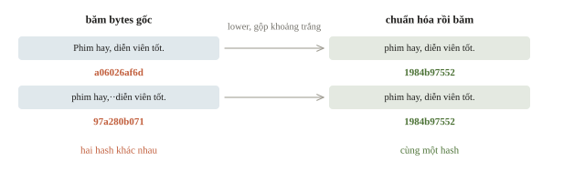
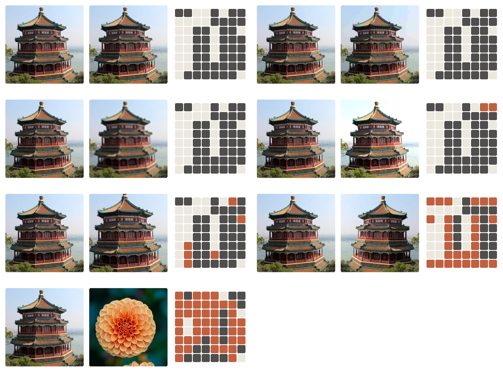
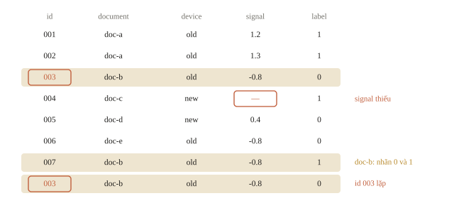
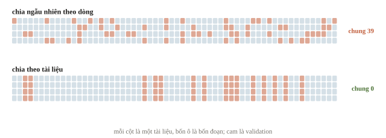
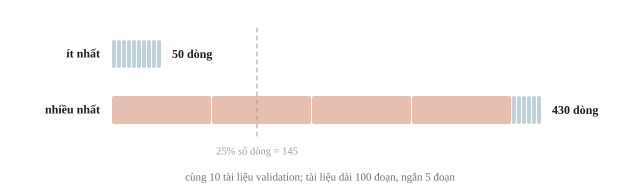
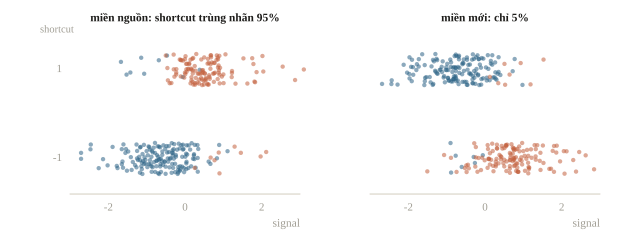
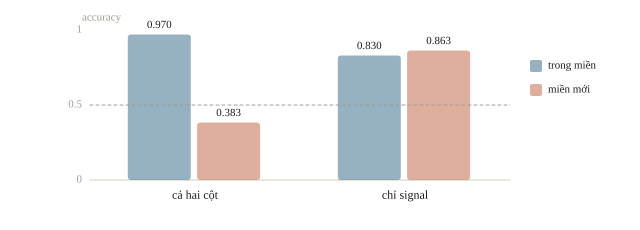
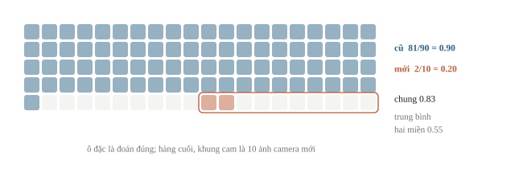
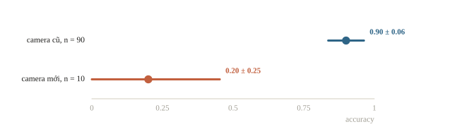

<!-- title -->
# Phân tích dữ liệu trước huấn luyện

Kiểm điểm cao đang đo tổng quát hay nhớ nguồn

Chương 8 · Bài 8.2

---
<!-- split -->
## Validation gần hoàn hảo

Validation gần hoàn hảo sau vài phút.

Thử trên tài liệu từ nguồn khác: dự đoán thất thường.

Model tốt hay đang nhớ nguồn? Câu hỏi cần chốt trước khi tăng epoch.

|||

::: note Câu hỏi xuyên suốt
Validation chứa mẫu mới theo đúng mục tiêu chưa?
:::

---
## Mục tiêu buổi này

- Đọc schema và xác định đơn vị độc lập của một mẫu.
- Kiểm thiếu, trùng và nhãn mâu thuẫn trước khi sửa.
- Chia theo nhóm hoặc thời gian khi đó là mục tiêu sử dụng.
- Phân biệt đường tắt, rò rỉ và các kiểu lệch phân phối.
- Kiểm bằng baseline, ablation và lát dữ liệu kèm số mẫu.

---
<!-- section 1 -->
# Hiểu từng hàng dữ liệu

---
<!-- split -->
## ID dòng và nguồn là hai khóa

`id`: định danh đoạn.

`document`: tài liệu gốc.

`device`: nguồn thu.

`signal`: đặc trưng số.

|||

```output
shape (8, 5)
duplicated ids ['003']
labels {0: 4, 1: 4}
```

Một `signal` bị thiếu.

Tám dòng chưa chắc là tám mẫu độc lập.

ID trả lời “dòng nào”; `document` trả lời “nguồn nào”.

---
<!-- quiz -->
::: quiz
Hai dòng có `id` khác nhau nhưng cùng `document`. Điều này nói gì về cách chia validation?
- [x] Hai dòng có thể chung nguồn, và cách chia tùy vào mục tiêu
- [ ] Hai dòng độc lập vì mỗi dòng có ID riêng, nên chia theo dòng
- [ ] Hai dòng là bản trùng, nên phải xóa bớt một dòng
- [ ] Hai dòng mang hai nhãn khác nhau, vì ID khác nhau
ID chỉ định danh dòng. Đoán tài liệu mới thì hai dòng phải cùng một phía, còn đoán đoạn mới trong tài liệu đã biết thì chia theo dòng.
:::

---
<!-- quiz -->
::: quiz
Trên dữ liệu đầy đủ, đếm ô thiếu theo thiết bị thì thấy `signal` thiếu 0% ở `old` nhưng thiếu 60% ở `new`. Bước tiếp theo nên là gì?
- [x] Xem file gốc của thiết bị mới trước khi điền
- [ ] Điền mean của cả cột, vì thiếu là ngẫu nhiên
- [ ] Bỏ cột `signal`, vì cột này thiếu quá nhiều
- [ ] Bỏ mọi dòng `new`, vì thiết bị này ghi lỗi
Ô thiếu dồn vào một nguồn, nên không còn ngẫu nhiên. Phải biết thiết bị mới ghi dữ liệu thế nào rồi mới chọn cách xử lý.
:::

---
<!-- split -->
## Trùng không chỉ là hàng giống hệt

`df.duplicated()`: trùng toàn bộ hàng.

Khác tên file, khác dấu cách, đổi định dạng: phép so hàng không thấy.

|||

- Văn bản: chuẩn hóa khoảng trắng rồi băm.
- Ảnh: băm bytes cho trùng chính xác.
- Gần trùng: so embedding để đề xuất cặp, rồi người xem lại.

---
<!-- quiz -->
::: quiz
Hai bài đánh giá chỉ khác nhau ở chữ hoa đầu câu và một dấu cách thừa. Băm bytes gốc thì ra hai mã hash khác nhau. Ta kết luận được gì?
- [ ] Hai bài chắc chắn khác nội dung, vì hash khác nhau
- [ ] Hàm băm bị lỗi, cần đổi sang một thuật toán băm khác
- [ ] Phải so embedding mới biết hai bài có trùng không
- [x] Hash chỉ so bytes, nên cần chuẩn hóa văn bản rồi băm lại
Hash khác chỉ nói bytes khác. Hạ chữ thường và gộp khoảng trắng rồi băm lại sẽ bắt được loại trùng này.
:::

---
<!-- figure -->
## Băm sau khi chuẩn hóa



---

<!-- figure -->
## Băm ảnh để tìm bản gần trùng



---
<!-- split -->
## Mâu thuẫn là ứng viên cần kiểm

```output
conflicting feature groups 1
[('doc-b', 'old', -0.8)]
exact duplicated rows 1
```

|||

Cùng đặc trưng, hai nhãn:

- Có thể nhãn nhiễu.
- Có thể thiếu một đặc trưng.
- Có thể định nghĩa mẫu khác nhau.

Không lấy dự đoán model làm nhãn đúng tự động.

---
<!-- figure -->
## Ba chỗ cần xem trong tám dòng



---
<!-- quiz -->
::: quiz
Hai mẫu có đặc trưng giống hệt nhau, nhưng nhãn lại khác nhau. Việc đầu tiên nên làm là gì?
- [ ] Sửa cả hai nhãn theo dự đoán của model
- [x] Xem nguồn và cách gán nhãn của hai mẫu
- [ ] Xóa mẫu mang nhãn ít gặp hơn
- [ ] Bỏ cả hai mẫu khỏi train và validation
Thống kê chỉ báo có mâu thuẫn, chưa nói nguyên nhân. Có thể nhãn sai, thiếu đặc trưng, hoặc hai đợt gán dùng định nghĩa khác nhau.
:::

---
<!-- section 2 -->
# Split theo câu hỏi sử dụng

---
<!-- split -->
## Dấu vết nguồn, nhãn ngẫu nhiên theo tài liệu

```python
X = np.eye(60)[groups]
y = document_labels[groups]
```

One-hot không mang quy luật sang tài liệu mới: chỉ nhớ được.

|||

```output
random overlap 39 accuracy 1.000
group overlap 0 accuracy 0.733
group predictions [1] val label counts [16, 44]
```

Tài liệu mới cách đều mọi hàng train: 1-NN hòa, trả nhãn 1.

$44/60\approx0.733$ chỉ là tỉ lệ lớp.

---
<!-- figure -->
## Tài liệu mới phải được giữ riêng



---
<!-- quiz -->
::: quiz
Ở group-split, train có 100 nhãn 1 và 80 nhãn 0. Baseline luôn đoán lớp đông nhất của train đạt accuracy bao nhiêu trên cùng validation?
- [ ] 0.500
- [ ] 0.267
- [ ] 0.556
- [x] 0.733
Lớp đông nhất của train là 1, và validation có 44 nhãn 1 trên 60 dòng, nên baseline đạt 0.733.
:::

---
<!-- center -->
## Tính tay xác suất chia đôi nguồn

Bốn đoạn, mỗi đoạn vào validation với xác suất 0.25:

$$1-0.75^4-0.25^4\approx0.680$$

Dự đoán $60\cdot0.680\approx40.8$ tài liệu bị chia đôi; thí nghiệm có 39.

Nằm trọn ở validation: $0.25^4\approx0.004$.

---
<!-- quiz -->
::: quiz
Có 40 tài liệu. 4 tài liệu dài, mỗi tài liệu 100 đoạn. 36 tài liệu ngắn, mỗi tài liệu 5 đoạn. `GroupShuffleSplit(test_size=0.25)` chọn 10 tài liệu làm validation. Số dòng của validation có thể nằm trong khoảng nào?
- [ ] Luôn đúng 145 dòng
- [x] Từ 50 đến 430 dòng
- [ ] Từ 10 đến 40 dòng
- [ ] Từ 50 đến 400 dòng
Splitter đếm tài liệu chứ không đếm dòng. Ít nhất $10\cdot 5 = 50$ dòng, nhiều nhất $400 + 30 = 430$ dòng.
:::

---
<!-- figure -->
## 10 tài liệu, số dòng rất khác



---
<!-- section 3 -->
# Đường tắt và miền mới

---
<!-- split -->
## Rò rỉ và đường tắt

**Rò rỉ (leakage):** dùng thông tin không có lúc dự đoán.

Ví dụ kết quả kiểm định ghi sau khi biết nhãn.

|||

**Đường tắt (shortcut):** tín hiệu dễ học nhưng quan hệ không bền.

Ví dụ viền camera gắn với lớp ở train.

Có mặt lúc inference; hại khi miền mới không giữ quan hệ.

Phép thử: model chỉ dùng metadata vượt xa baseline.

---
<!-- quiz -->
::: quiz
Trong train, phần lớn bài đánh giá tiêu cực kết thúc bằng dòng “Gửi từ ứng dụng X”, còn bài tích cực hiếm khi có. Dòng chữ này có sẵn lúc dự đoán. Đây là loại vấn đề gì, và khi nào nó gây hại?
- [ ] Là rò rỉ, gây hại ngay cả khi test cùng nguồn
- [ ] Là rò rỉ, chỉ gây hại khi test lấy từ nguồn khác
- [ ] Là đường tắt, vô hại vì có sẵn lúc dự đoán
- [x] Là đường tắt, gây hại khi test làm đổi quan hệ ấy
Dòng chữ có mặt lúc dự đoán nên không phải rò rỉ, mà là đường tắt. Nó gây hại khi test đến từ ứng dụng khác.
:::

---
<!-- split -->
## Ba kiểu lệch phân phối

**Covariate shift:** đặc trưng đổi, nhãn của một đầu vào giữ nguyên.

**Label shift:** tỉ lệ lớp đổi; chọn lại ngưỡng.

**Concept shift:** cùng đầu vào, nhãn đúng đã khác.

|||

Histogram khác nhau chỉ cho thấy đặc trưng đổi.

Không có nhãn thì chưa biết quan hệ với nhãn có đổi.

---
<!-- quiz -->
::: quiz
Histogram của một đặc trưng trên test không nhãn lệch hẳn so với train. Ta kết luận được gì?
- [ ] Nhãn test có nhiều lỗi ghi nhãn, do đến từ nguồn khác
- [x] Đặc trưng đã đổi, nhưng tác động lên nhãn thì chưa biết
- [ ] Quan hệ giữa đặc trưng và nhãn đã bị đảo ngược
- [ ] Model chắc chắn sẽ đạt điểm kém trên test
Histogram chỉ mô tả đặc trưng, không nói gì về nhãn test hay quan hệ giữa đặc trưng và nhãn.
:::

---
<!-- split -->
## Adversarial validation

Chỉ khi đề cho phép dùng input test.

Train: nhãn 0. Test: nhãn 1. Học classifier phân biệt.

|||

AUC $\approx0.5$: không tách được bằng các cột đã đưa vào.

AUC $\approx1$: có cột lệch mạnh; xem độ quan trọng của cột.

Chỉ so đầu vào: không thấy concept shift.

---
<!-- quiz -->
::: quiz
Một classifier phân biệt train với test đạt AUC 0.98, và cột quan trọng nhất là `id`, vốn tăng dần theo thời điểm thu dữ liệu. Nên làm gì tiếp?
- [ ] Dùng classifier này làm model chính, vì AUC rất cao
- [ ] Bỏ qua kết quả, vì `id` chỉ là số thứ tự vô nghĩa
- [x] Test đến sau train, nên chia validation theo `id`
- [ ] Yên tâm, vì AUC cao báo trước điểm cao cho model chính
AUC 0.98 nhờ `id` cho biết test nằm sau train. Hãy dùng đoạn `id` cuối của train làm validation.
:::

---
<!-- figure -->
## Hai miền tự sinh



---
<!-- figure -->
## Bỏ đường tắt: mất điểm nguồn, giữ miền mới



---
<!-- split -->
## Đọc thí nghiệm ablation

```output
both in-domain 0.970 shifted 0.383
signal-only in-domain 0.830 shifted 0.863
```

|||

Không suy ra “ít cột luôn tốt”.

Ta biết cơ chế ở đây vì tự sinh dữ liệu.

Chênh 0.14 và 0.48 đều rõ, đúng chiều trên 20 seed khác; chênh vài phần nghìn thì so với dao động giữa fold.

---
<!-- quiz -->
::: quiz
Đề nói rõ test lấy từ cùng nguồn, cùng giai đoạn với train, nên quan hệ của `shortcut` giữ nguyên. Theo output ở trên, nên chọn cấu hình nào?
- [x] Dùng cả hai cột, vì số in-domain mới là ước lượng đúng cho test
- [ ] Chỉ dùng `signal`, vì đường tắt nào cũng là rủi ro
- [ ] Chỉ dùng `signal`, vì điểm shifted của nó cao hơn
- [ ] Chọn cấu hình có trung bình in-domain và shifted cao hơn
Test cùng phân phối với train thì accuracy in-domain mới ước lượng đúng điểm test. Cột shifted trả lời một câu hỏi khác.
:::

---
<!-- section 4 -->
# Lát dữ liệu và quyết định

---
<!-- figure -->
## Accuracy theo từng camera



---
<!-- center -->
## Trung bình che một nhóm khó

Camera cũ: $81/90=0.90$.

Camera mới: $2/10=0.20$.

$$\text{Accuracy chung}=\frac{83}{100}=0.83$$

Mean ngang miền $=(0.90+0.20)/2=0.55$.

Hai phép đo có trọng số khác nhau.

Metric chính theo statement; mean ngang miền dùng để chẩn đoán.

---
<!-- center -->
## Lát nhỏ, khoảng rộng

Sai số chuẩn của accuracy $p$ trên $n$ mẫu:

$$\mathrm{SE}\approx\sqrt{p(1-p)/n}$$

$p\pm2\,\mathrm{SE}$: vùng hợp lý của accuracy thật.

Lát vài chục mẫu đủ để báo động, chưa đủ để xếp hạng.

---
<!-- quiz -->
::: quiz
Theo công thức sai số chuẩn, accuracy của camera mới, $2/10$, và của camera cũ, $81/90$, có sai số chuẩn xấp xỉ bao nhiêu?
- [ ] Camera mới 0.016, camera cũ 0.001
- [ ] Camera mới 0.03, camera cũ 0.13
- [x] Camera mới 0.13, camera cũ 0.03
- [ ] Camera mới 0.40, camera cũ 0.30
$\sqrt{0.2\cdot 0.8/10} \approx 0.13$ và $\sqrt{0.9\cdot 0.1/90} \approx 0.03$.
:::

---
<!-- figure -->
## Khoảng ± 2 sai số chuẩn



---
## Quay lại bài văn bản

- Kiểm document overlap trước khi tăng epoch.
- Giữ split phù hợp mục tiêu.
- Dùng `Pipeline` để fit preprocessing trên train của từng split.
- Nhớ rằng `Pipeline` không tự tìm ra nhóm hoặc trật tự thời gian.
- Ghi số mẫu cạnh metric nhóm.
- Lọc nhãn nghi nhiễu chỉ trong train; validation giữ nguyên.
- Phân biệt lỗi đã xác nhận với ứng viên cần xem nguồn.

---
<!-- quiz -->
::: quiz
Một đội bỏ 10% số mẫu mà model 5-fold đoán sai với độ tự tin cao, rồi chạy lại 5-fold trên phần còn lại. Điểm CV từ 0.81 lên 0.90. Đọc kết quả này thế nào?
- [x] Chưa so được, vì validation mới đã bỏ đi những mẫu khó
- [ ] Nhãn nhiễu đã được dọn, nên test sẽ tăng khoảng 0.09
- [ ] Nên lặp thêm vài vòng lọc cho tới khi CV gần 1.0
- [ ] Kết quả sai, vì không được chạy 5-fold sau khi lọc
Lần sau đã bỏ đúng những mẫu model sai, nên điểm tăng gần như chắc chắn. Phải lọc trong train của từng fold và chấm trên validation gốc.
:::

---
## Khi đi thi

- Đọc dòng thật, dtype, ID trùng, ô thiếu theo nguồn.
- Tìm khóa nhóm trước khi chia; in nhóm chung và số dòng.
- Đặt baseline lớp đông nhất và baseline metadata cạnh model.
- So test với train chỉ trong phạm vi đề cho phép.
- Ghi split, số mẫu, dao động; chênh nhỏ hơn dao động thì chưa chọn.

---
<!-- section 5 -->
# Luyện đề

---
<!-- quiz -->
::: quiz Luyện đề 1
Một đội ghép điểm đánh giá phim từ ba trang web để làm hệ gợi ý. Trang A chấm từ 1 đến 5, trang B từ 1 đến 10, trang C từ 1 đến 100. Người dùng và phim đã được khớp giữa ba trang. Trước khi học trên bảng điểm gộp, cần làm bước nào?
- [x] Đưa điểm của từng trang về cùng một thang, chẳng hạn $[0, 1]$
- [ ] Gộp nguyên điểm, vì model sẽ tự học được khác biệt thang đo
- [ ] Bỏ trang C, vì điểm của nó lớn và lấn át hai trang kia
- [ ] Chuẩn hóa z-score một lần trên cả cột điểm đã gộp
Cùng một mức hài lòng mang ba con số khác nhau ở ba trang, nên phải đưa từng trang về một thang trước khi gộp.
Phỏng theo: [CMU 10-601 · Exam 3 Practice · Q7.5](https://www.cs.cmu.edu/~mgormley/courses/10601/handout/exam3_practice_problems.pdf#page=39)
:::

---
<!-- quiz -->
::: quiz Luyện đề 2
Model tín dụng học trên dữ liệu 2023. Đến tháng 6/2024, thu nhập người nộp giảm, nhóm làm việc gig tăng từ 5% lên 15%, tuổi giảm, và accuracy từ 81% xuống 76% sau một đợt suy thoái. Nên làm gì?
- [ ] Chỉ đổi ngưỡng, không train lại
- [x] Đầu vào đã đổi, nên train lại với dữ liệu 2024
- [ ] Đây là dao động bình thường, chỉ cần theo dõi
- [ ] Bỏ thu nhập và loại việc làm
Phân phối đầu vào lệch có hệ thống, có nguyên nhân, và accuracy đã giảm. Nhóm gig gần như vắng trong dữ liệu 2023. Đổi ngưỡng không dạy được model về nhóm mới, nên phải train lại với dữ liệu gần đây.
Đề thi: [NOAI 2026 Singapore · Vòng sơ loại · Câu 311](https://aisingapore.org/wp-content/uploads/2026/04/NOAI-2026-Preliminary-Round-Assessment-300-MCQs-Google-Forms.pdf#page=123)
:::

---
<!-- quiz -->
::: quiz Luyện đề 3
Một model duyệt khoản vay đang chạy. Ba tuần liên tiếp, tỉ lệ hồ sơ được duyệt là 40%, 35% và 30%, còn tỉ lệ request bị lỗi của hệ thống giữ ở 0.1%. Nhãn thật, tức người vay có trả nợ hay không, phải 3 tháng sau mới có. Chỉ số nào báo động sớm nhất rằng model có thể đang gặp vấn đề?
- [ ] Tỉ lệ lỗi hệ thống, vì nó đo trực tiếp việc model chạy
- [ ] Accuracy so với nhãn thật, vì chỉ nó đo được chất lượng
- [ ] Không chỉ số nào, phải đợi nhãn thật sau 3 tháng
- [x] Tỉ lệ duyệt, vì phân phối dự đoán đang trôi đều
Tỉ lệ duyệt có ngay mỗi tuần, không cần nhãn. Giảm đều từ 40% xuống 30% là tín hiệu sớm nhất cần điều tra.
Đề thi: [NOAI 2026 Singapore · Vòng sơ loại · Câu 310](https://aisingapore.org/wp-content/uploads/2026/04/NOAI-2026-Preliminary-Round-Assessment-300-MCQs-Google-Forms.pdf#page=122)
:::

---
<!-- center -->
## Chốt ý

Schema → nguồn mẫu → split → baseline, ablation → lỗi theo nhóm.

Điểm giảm sau khi sửa split có thể là phép đo tiến bộ.

---
<!-- center -->
## Sau giờ học

Làm **10 câu kiểm tra cuối bài** trên trang bài học.

Chạy notebook; đổi `test_size` của `GroupShuffleSplit`, đoán trước số dòng validation rồi in ra kiểm.
