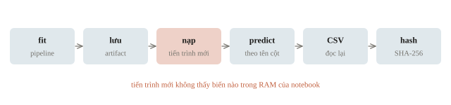
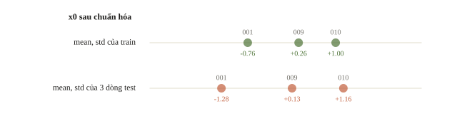
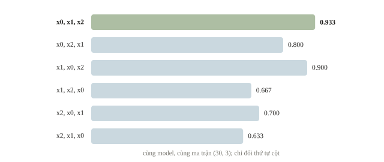
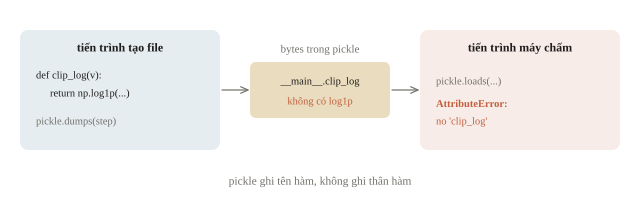
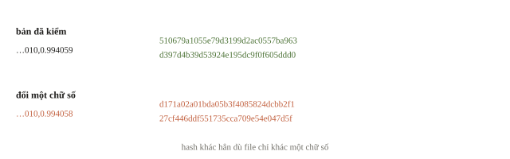
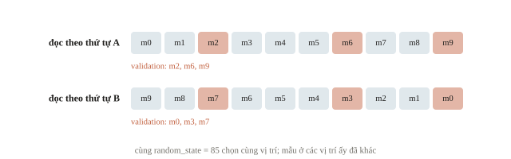
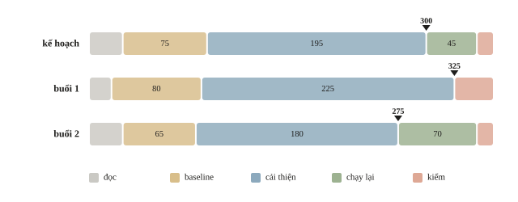
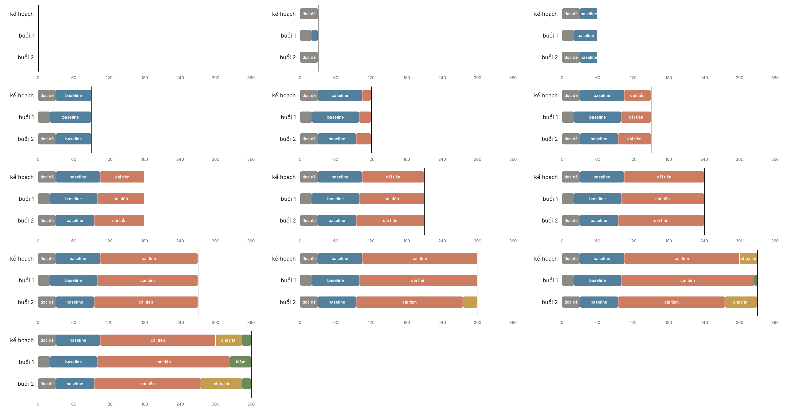
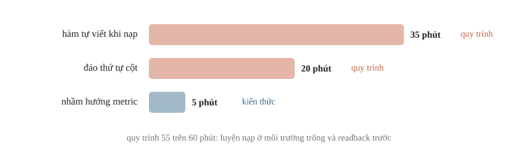

<!-- title -->
# Thi thử

Từ notebook trong RAM tới một bài làm tái tạo được

Chương 8 · Bài 8.5

---
<!-- split -->
## Model tốt, bài chưa chấm được

Một biến nằm ở cell đã xóa: chạy lại hỏng.

Một tệp nằm ngoài gói mang vào: môi trường trống thiếu file.

CSV còn cột index: schema nộp sai.

|||

Thi thử để tìm những lỗi như vậy trước kỳ thi thật.

---
## Mục tiêu

- Đặt điều kiện cho buổi thi thử: thời gian, tài nguyên, tài liệu, cách nộp.
- Chạy lại bài từ đầu; nạp model trong chương trình mới.
- Kiểm file nộp: ID, cột, miền giá trị.
- Chữa bài để chọn việc cần luyện tiếp.

---
<!-- section 1 -->
# Điều kiện có phạm vi

---
<!-- split -->
## Năm, vòng và statement

IOAI 2025: mô tả ngày 1 tiếp nối at-home.

IOAI 2026: mô tả liên hệ chủ đề hoặc phương pháp.

Đọc statement riêng cho từng bài.

|||

360 phút và GPU T4 là **cấu hình luyện của lớp**, chưa chắc là của kỳ thi.

Muốn gọi là mô phỏng đúng kỳ thi, cần nguồn cho tài nguyên và quy định.

---
<!-- split -->
## Điều kiện nằm ở từng bài

USA-NA-AIO 2026, Vòng 2 Ngày 1: train và test trên GPU L4; notebook không chạy đúng trên L4 thì 0 điểm.

|||

Vòng 2 Ngày 2, Problem 4: cấm mọi model pretrained, kể cả không dùng trọng số.

GPU, model được dùng và cách làm hợp lệ nằm trong đề của từng bài.

---
<!-- quiz -->
::: quiz
Lớp có GPU T4 và chọn phiên 360 phút. Đã coi buổi luyện là khớp đầy đủ điều kiện IOAI của một năm cụ thể được chưa?
- [ ] Được rồi, vì cùng loại GPU và cùng thời lượng là hai điều kiện chính
- [ ] Được rồi, nếu model đạt accuracy bằng baseline của kỳ thi
- [x] Chưa, vì còn tài nguyên được phép, dạng bài nộp và cách chấm
- [ ] Chưa, vì GPU T4 luôn chậm hơn GPU của mọi kỳ thi
GPU và thời lượng chỉ là hai trong nhiều điều kiện. Tài nguyên được phép, dạng nộp và cách chấm cũng phải khớp.
:::

---
<!-- center -->
## Mốc dừng phải chứa lần chạy cuối

Đọc đề 30, baseline 75, cải thiện 195, chạy lại 45, kiểm file 15 phút:

$$30+75+195+45+15=360$$

Mốc đóng thí nghiệm: $360-45-15=300$.

Lần chạy từ đầu cần 70 phút? Mốc thành $360-70-15=275$.

---
<!-- quiz -->
::: quiz
Phiên dài 360 phút. Chạy lại bản cuối từ đầu mất 70 phút, và phần kiểm file cuối cần 15 phút. Thí nghiệm phải đóng muộn nhất ở phút nào?
- [ ] Phút 300
- [x] Phút 275
- [ ] Phút 315
- [ ] Phút 290
$360 - 70 - 15 = 275$.
:::

---
<!-- split -->
## Nhật ký ghi quyết định

Tốt: phút 205, thêm bigram, split S1, log loss từ 0.412 xuống 0.405, giữ bản.

|||

Không chữa được: “đang làm bài”, “bản mới tốt nhất”.

Ghi giả thuyết trước, artifact và lý do giữ hay bỏ sau.

---
<!-- quiz -->
::: quiz
Dòng nhật ký nào giúp ích cho việc chữa buổi thi sau này?
- [ ] Phút 205: thử thêm vài thay đổi nhỏ, nhìn chung khá hơn, giữ bản mới
- [ ] Phút 205: bản mới tốt nhất, lưu thành `final_v2` rồi nghỉ ngắn
- [ ] Phút 205: đang chạy lại notebook, chờ kết quả rồi quyết định
- [x] Phút 205: thêm bigram, split S1, log loss từ 0.412 xuống 0.405, giữ bản
Dòng đúng ghi thay đổi duy nhất, split, kết quả đo và quyết định, nên sau buổi thi có thể xét lại.
:::

---
<!-- section 2 -->
# Một đường chạy kiểm được

---
<!-- figure -->
## Từ fit tới hash



---
<!-- split -->
## Pipeline nhỏ có dữ liệu thiếu

Imputer → StandardScaler → logistic regression.

150 mẫu tự sinh, 3 đặc trưng.

Seed 85, không tải dữ liệu.

|||

```output
train/val (120, 3) (30, 3)
val accuracy 0.933
```

30 mẫu: 0.933 là 28 mẫu đúng, mỗi mẫu lệch 0.033.

---
<!-- quiz -->
::: quiz
Một đội chỉ lưu trọng số của logistic regression. Median để điền thiếu, cùng mean và std để chuẩn hóa, lại được tính lại trên tập test lúc inference. Chuyện gì xảy ra?
- [x] Cùng một mẫu cho đầu vào khác nhau, nên dự đoán đổi theo tập test
- [ ] Không đổi gì, vì trọng số đã chứa mọi thông tin cần thiết
- [ ] Chỉ chậm hơn, vì mỗi lần dự đoán phải tính thêm thống kê
- [ ] Model báo lỗi ngay, vì file không có bước tiền xử lý
Median, mean và std là một phần của model đã chọn. Tính lại trên test thì cùng một mẫu cho đầu vào khác, mà không báo lỗi.
:::

---
<!-- figure -->
## Cùng mẫu, hai cách chuẩn hóa



---
<!-- split -->
## Ba ID, cùng thứ tự đặc trưng

```python
feature_columns = ["x0", "x1", "x2"]
```

|||

```output
feature shape (3, 3)
```

| ID | Xác suất lớp 1 |
|---|---:|
| 001 | 0.247731 |
| 009 | 0.771529 |
| 010 | 0.994059 |

Kiểm `classes_` trước khi lấy cột lớp 1.

---
<!-- figure -->
## Thứ tự cột đổi, shape không đổi



---
<!-- quiz -->
::: quiz
Cột của `frame` theo thứ tự `x2, x0, x1`, còn lúc fit là `cols = ["x0", "x1", "x2"]`. Mảng nào đưa vào model đúng thứ tự đã fit?
- [ ] `frame.to_numpy()`
- [ ] `frame.iloc[:, [0, 1, 2]].to_numpy()`
- [x] `frame[cols].to_numpy()`
- [ ] `frame.to_numpy()[:, ::-1]`
Chọn cột theo tên rồi mới chuyển sang mảng thì đúng thứ tự đã fit. `to_numpy()` và cắt theo vị trí đều giữ `x2, x0, x1`, còn đảo ngược thì ra `x1, x0, x2`. Cả ba đều để trọng số rơi vào đặc trưng khác mà không báo lỗi.
:::

---
<!-- split -->
## Nạp ở tiến trình mới

Artifact tự tạo → tiến trình con → predict.

Không dùng biến model trong RAM của notebook.

Chỉ nạp artifact tin cậy; `pickle` có thể thực thi mã khi nạp.

|||

```output
fresh-process shape (3,)
same probabilities True
```

Cùng môi trường hiện tại; máy chấm có thể khác.

---
<!-- split -->
## Hàm tự viết không đi theo pickle

Pickle ghi tên `clip_log`, không ghi thân hàm.

Sửa: module `.py` trong gói, hoặc hàm của thư viện như `np.log1p`.

|||

```output
name in pickle True
body in pickle False
return code 1
AttributeError: Can't get attribute 'clip_log'
```

---
<!-- quiz -->
::: quiz
Tiến trình mới nạp pickle thì báo `AttributeError: Can't get attribute 'clip_log'`. Nguyên nhân gần nhất là gì?
- [ ] File pickle bị hỏng lúc ghi, nên mất toàn bộ trọng số
- [x] Pickle chỉ lưu tên hàm, còn thân hàm nằm ở cell của notebook cũ
- [ ] Hai tiến trình dùng hai phiên bản scikit-learn khác nhau
- [ ] Tiến trình mới thiếu NumPy nên không dựng lại được hàm
Pickle chỉ ghi tên `clip_log` trong `__main__` của tiến trình cũ, nên tiến trình mới không tìm thấy hàm ấy.
:::

---
<!-- figure -->
## Pickle ghi tên, không ghi thân hàm



---
<!-- quiz -->
::: quiz
Trong môi trường hiện tại, tiến trình mới cho ra cùng dự đoán. Khi chạy trên máy chấm, điều gì vẫn cần kiểm?
- [x] Phiên bản thư viện, tệp đi kèm, đường dẫn và cách chấm của máy chấm
- [ ] Không cần kiểm thêm, vì tiến trình mới đã loại mọi khác biệt môi trường
- [ ] Chỉ cần hash trọng số, vì phiên bản thư viện không ảnh hưởng việc nạp
- [ ] Chỉ cần Python chính, không cần kiểm phiên bản NumPy hay scikit-learn
Tiến trình mới chỉ loại trạng thái trong RAM, không đổi máy. Thư viện, tệp đi kèm, đường dẫn và cách chấm vẫn có thể khác.
:::

---
<!-- split -->
## CSV được đọc lại

```output
id,probability
001,0.247731
009,0.771529
010,0.994059
readback (3, 2) OK
```

|||

Kiểm:

- Schema và thứ tự ID.
- Không trùng, không thiếu.
- Số hữu hạn, miền xác suất.
- `index=False`.

Hash nhận diện đúng bytes đã kiểm.

---
<!-- quiz -->
::: quiz
Hash SHA-256 của file CSV khớp với hash đã ghi trong nhật ký. Điều gì là chắc chắn?
- [ ] Model đạt điểm cao trên bộ chấm, vì file đã được xác nhận hợp lệ
- [ ] Mọi nhãn trong file đều đúng, vì hash được tính trên nội dung
- [ ] Máy chấm sẽ đọc file bằng cùng phiên bản package với máy nhà
- [x] File đang giữ giống hệt bản đã kiểm, nhưng chưa nói gì về chất lượng
Hash nhận diện từng byte, nên chỉ chắc chắn bản đã kiểm chính là bản sắp nộp, không nói gì về chất lượng.
:::

---
<!-- figure -->
## Một chữ số, hai hash



---
<!-- split -->
## Manifest của lần chạy

| Trường | Giá trị ở ví dụ |
|---|---|
| Seed | 85 |
| Python | 3.13.14 |
| scikit-learn | 1.7.2 |
| Thứ tự đặc trưng | x0, x1, x2 |

|||

Bài thật còn cần: phiên bản dữ liệu, split ID, config, revision model và hash file nộp.

Cùng seed trên thứ tự dữ liệu khác chưa chắc cùng split.

---
<!-- quiz -->
::: quiz
Hai lần chạy cùng `random_state=85` và cùng số dòng, nhưng file dữ liệu được đọc theo thứ tự khác nhau. Tập validation có chắc gồm cùng các mẫu không?
- [ ] Có, vì seed cố định thì tập validation luôn gồm cùng các mẫu
- [ ] Có, miễn là số dòng và tỉ lệ chia của hai lần chạy không đổi
- [x] Không, vì seed chọn vị trí dòng, còn mẫu ở vị trí đó thì đổi theo
- [ ] Không, nhưng chỉ khi hai lần chạy dùng khác phiên bản thư viện
Seed cho cùng các vị trí được chọn. Thứ tự dữ liệu đổi thì những mẫu ở các vị trí ấy cũng đổi theo.
:::

---
<!-- figure -->
## Cùng seed, khác validation



---
<!-- section 3 -->
# Chữa để chọn việc luyện tiếp

---
<!-- split -->
## Đọc nhật ký hai buổi

| Phút | Kế hoạch | Buổi 1 | Buổi 2 |
|---|---:|---:|---:|
| Đọc | 30 | 20 | 30 |
| Baseline | 75 | 80 | 65 |
| Cải thiện | 195 | 225 | 180 |
| Chạy lại | 45 | 0 | 70 |
| Kiểm file | 15 | 35 | 15 |

|||

Đóng thí nghiệm: 300, 325, 275.

Buổi 2 chạy lại hết và còn 15 phút kiểm; buổi 1 dùng 35 phút cuối để sửa file.

---
<!-- figure -->
## Ba lịch 360 phút



---

<!-- figure -->
## Ba lịch theo đồng hồ



---
<!-- quiz -->
::: quiz
Đọc bảng nhật ký của hai buổi. Dữ liệu ủng hộ điều nào?
- [ ] Buổi 1 tốt hơn, vì dành nhiều phút hơn cho cải thiện
- [x] Buổi 2 đóng thí nghiệm sớm hơn buổi 1 đúng 50 phút
- [ ] Buổi 2 kém hơn, vì phần đọc đề dài hơn buổi 1 mười phút
- [ ] Hai buổi như nhau, vì cả hai đều có tổng đúng 360 phút
Buổi 2 đóng thí nghiệm ở phút 275, buổi 1 ở phút 325, chênh 50 phút.
:::

---
<!-- split -->
## Lỗi thuộc tầng nào?

Không hiểu log loss hay thứ tự lớp: ôn khái niệm và tính tay.

Validation sai: luyện thiết kế split và thực nghiệm.

|||

Metric tốt, chạy lại hỏng: luyện pipeline, đóng gói, đọc lại file nộp.

Giữ artifact và nhật ký trước khi mở lời giải.

---
<!-- quiz -->
::: quiz
Nhật ký sau buổi thi ghi ba lần mất thời gian: nạp model ở môi trường mới thì thiếu hàm tự viết, mất 35 phút; đảo thứ tự cột khi ghép bảng, mất 20 phút; đọc nhầm hướng của metric, mất 5 phút. Nhóm nguyên nhân nào chiếm phần lớn thời gian, và nên luyện gì trước?
- [ ] Kiến thức, 5 phút, nên ôn định nghĩa metric bằng một bài tính tay
- [ ] Thực nghiệm, 20 phút, nên luyện thiết kế validation theo nhóm
- [x] Quy trình, 55 phút, nên luyện nạp ở môi trường trống và đọc lại file
- [ ] Quy trình, 55 phút, nên thử một kiến trúc lớn hơn để bù thời gian
Thiếu hàm tự viết và đảo cột đều là lỗi quy trình, tổng 55 trên 60 phút. Nhầm hướng metric chỉ mất 5 phút.
:::

---
<!-- figure -->
## Thời gian mất theo nhóm lỗi



---
## Khi đi thi

- Mốc dừng = tổng giờ − chạy lại − kiểm file.
- Chạy bản cuối trong tiến trình mới.
- Đọc lại file thật sắp nộp.

---
<!-- section 4 -->
# Luyện đề

---
<!-- quiz -->
::: quiz Luyện đề 1
Đề trắc nghiệm có 300 câu, làm trong 3 giờ. Đề ghi không trừ điểm câu sai, và không sửa được đáp án sau khi nộp. Sau 80 phút mới làm xong 100 câu. Phần còn lại cần tốc độ trung bình bao nhiêu, và nên xử lý thế nào?
- [ ] 36 giây mỗi câu, giữ nguyên nhịp ban đầu là đủ
- [x] 30 giây mỗi câu, làm hết, để những câu dài lại quay về sau
- [ ] 60 giây mỗi câu, chỉ làm một nửa số câu còn lại
- [ ] 30 giây mỗi câu, bỏ trống câu khó vì câu sai bị trừ điểm
Còn 6000 giây cho 200 câu, tức 30 giây mỗi câu. Không trừ điểm câu sai, nên làm hết, để câu dài lại sau.
Phỏng theo: [NOAI 2026 Singapore · Vòng sơ loại · Hướng dẫn làm bài](https://aisingapore.org/wp-content/uploads/2026/04/NOAI-2026-Preliminary-Round-Assessment-300-MCQs-Google-Forms.pdf#page=2)
:::

---
<!-- quiz -->
::: quiz Luyện đề 2
Sai số một mẫu là $10^3 e_{\text{nguồn}}$ cộng phần nhỏ, và ô thiếu ở tọa độ nguồn cho $e_{\text{nguồn}} = 10$. Test có 3000 mẫu, file nộp có một ô NaN. Điểm trung bình tăng bao nhiêu?
- [ ] Không đáng kể
- [ ] Khoảng 0.0033
- [x] Khoảng 3.3
- [ ] Khoảng 10 000
Mẫu có ô thiếu bị tính $10^3\cdot 10 = 10^4$. Chia cho 3000 mẫu thì điểm trung bình tăng khoảng 3.3. Một NaN đủ làm hỏng cả bảng điểm, nên phải xử lý ô thiếu trước khi nộp.
Phỏng theo: [USA-NA-AIO 2026 · Vòng 2 · Ngày 1 · Problem 2](https://www.usaaio.org/attachments/past-problems/2026/usaaio-2026-round-2-day-1-problems.pdf#page=13)
:::

---
<!-- quiz -->
::: quiz Luyện đề 3
Đề cấm model pretrained, kể cả khi không dùng trọng số. Đội đã train `resnet18(weights=None)` từ `torchvision`. Việc đúng cần làm là gì?
- [ ] Giữ nguyên, vì `weights=None` là hợp lệ
- [ ] Giữ nguyên, ghi rõ vào báo cáo
- [x] Dựng CNN bằng `nn.Conv2d`, rồi chạy lại
- [ ] Đổi sang `timm`
Đề cấm cả kiến trúc lấy sẵn từ thư viện, nên `resnet18(weights=None)` vẫn là model import. Đổi sang `timm` không đổi bản chất, vì danh sách trong đề chỉ là ví dụ. Hãy dựng CNN bằng các lớp cơ bản rồi chạy lại.
Phỏng theo: [USA-NA-AIO 2026 · Vòng 2 · Ngày 2 · Problem 4](https://www.usaaio.org/attachments/past-problems/2026/usaaio-2026-round-2-day-2-problems.pdf#page=9)
:::

---
<!-- center -->
## Chốt ý

Điều kiện rõ → chạy từ đầu → artifact đúng → chữa bằng nhật ký.

Chọn vài việc luyện có phép kiểm cụ thể từ lỗi đã xác định.

---
<!-- center -->
## Sau giờ học

Làm **10 câu kiểm tra cuối bài** trên trang bài học.

Chạy notebook; đảo thứ tự cột của `test_frame`, đoán trước xác suất có đổi không rồi chạy kiểm.
