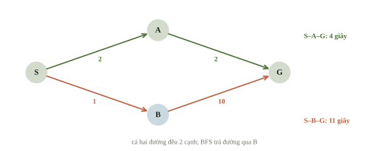
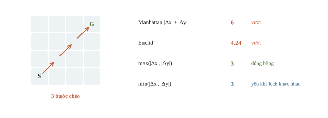
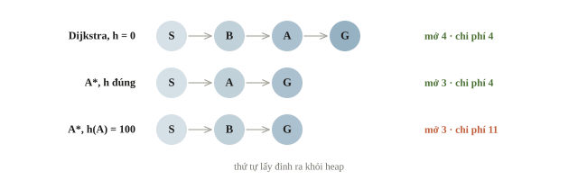
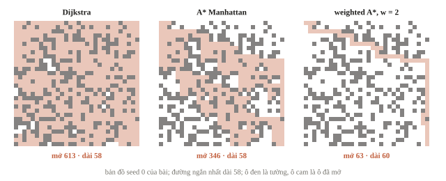
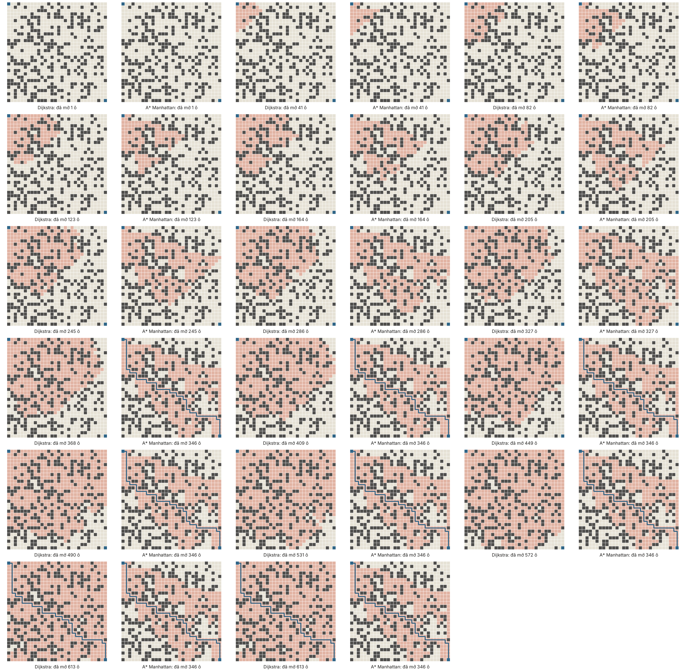
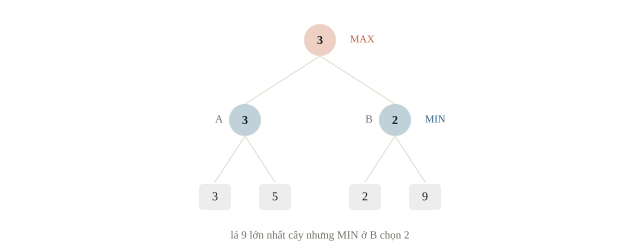
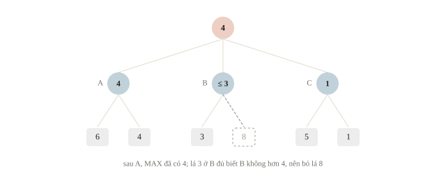
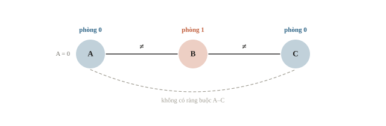
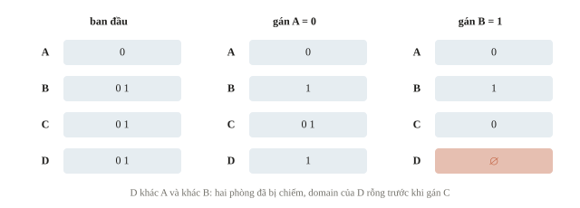
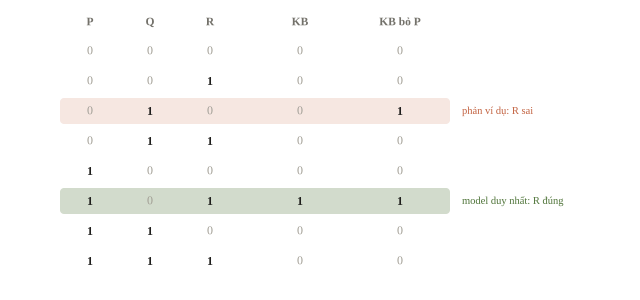

<!-- title -->
# Tìm kiếm và suy luận

Từ chi phí đường đi tới kết luận logic

Chương 9 · Bài 9.2

---
<!-- split -->
## Khi quy tắc đã biết

Robot có bản đồ đầy đủ và thời gian đi trên từng đoạn.

Có cần huấn luyện lại để tìm đường không?

|||

Ba câu hỏi tách biệt:

- Đường nào rẻ nhất?
- Đối thủ có thể làm gì?
- Kết luận nào đúng trong mọi tình huống hợp lệ?

---
## Mục tiêu

- Chọn BFS, Dijkstra hoặc A*.
- Tính A* bằng tay; biết khi nào heuristic làm mất lời giải tối ưu.
- Đọc cây minimax; hiểu alpha-beta và MCTS.
- Giải một bài CSP nhỏ và kiểm kết luận logic.

---
<!-- section 1 -->
# Trạng thái và chi phí

---
<!-- figure -->
## Ít cạnh chưa chắc ít thời gian



---
<!-- split -->
## BFS trả lời câu nào?

```python
bfs_answer = bfs_path("S", "G")
print(
    "BFS:", bfs_answer,
    "chi phí:", path_cost(bfs_answer)
)
```

```output
BFS: ['S', 'B', 'G'] chi phí: 11
```

|||

BFS tối thiểu số cạnh: hai đường đều 2 cạnh, B đứng trước nên được trả về.

Cạnh đồng giá thì số cạnh cũng quyết định chi phí.

Cạnh khác giá thì cần thuật toán tối ưu theo chi phí.

---
<!-- quiz -->
::: quiz
Robot tới cùng một ô hai lần: một lần đã nhặt chìa khóa, một lần chưa. Có nên gộp hai lần đó thành một trạng thái không?
- [ ] Nên gộp, vì tọa độ đã mô tả đủ vị trí của robot
- [ ] Nên gộp, nếu dùng A* thay vì BFS
- [x] Không gộp, nếu chìa khóa làm đổi các bước đi được về sau
- [ ] Không gộp, vì hai lịch sử khác nhau luôn là hai trạng thái
Trạng thái phải giữ đủ thông tin quyết định các bước hợp lệ về sau: có chìa thì qua được cửa, chưa có thì không.
:::

---
<!-- quiz -->
::: quiz
Đồ thị có cạnh 1 giây và cạnh 2 giây. Một bạn muốn giữ BFS. Sửa thế nào để BFS cho ra đúng đường ít giây nhất?
- [ ] Giữ BFS, chỉ cộng đúng chi phí từng cạnh khi in đường
- [x] Tách mỗi cạnh 2 giây thành hai cạnh 1 giây qua một đỉnh phụ
- [ ] Đưa các cạnh 1 giây lên trước trong danh sách kề
- [ ] Đánh dấu đã thăm lúc lấy ra khỏi hàng đợi, không phải lúc đẩy vào
Sau khi tách, mọi cạnh cùng giá, nên số cạnh bằng số giây và BFS cho đường tối ưu.
:::

---
<!-- section 2 -->
# Lời hứa của heuristic

---
<!-- center -->
## A* cộng chi phí đã đi và chi phí ước lượng

$$f(n)=g(n)+h(n).$$

$g$ là chi phí đã trả. $h$ là chi phí còn lại được ước lượng.

Cả hai đều có đơn vị giây trong bài này.

Dijkstra dùng $h=0$. Greedy best-first chỉ dùng $h$.

---
<!-- split -->
## Hai điều kiện của heuristic

Admissible:

$$0\leq h(n)\leq h^*(n),\quad h(G)=0.$$

Không ước lượng quá chi phí còn lại thật.

|||

Consistent, với mọi cạnh:

$$h(u)\leq c(u,v)+h(v).$$

Chỉ có admissibility thì phải cho phép mở lại khi tìm được $g$ nhỏ hơn.

---
<!-- center -->
## Lower bound từ bài toán nới lỏng

Lưới bốn hướng, mỗi bước ít nhất 1: bỏ tường làm bài dễ hơn, nên Manhattan không vượt chi phí thật.

Đổi luật đi (bước chéo, cổng dịch chuyển) thì phải chứng minh lại.

---
<!-- quiz -->
::: quiz
Robot đi được 8 hướng như quân vua, mỗi bước, kể cả bước chéo, tốn 1 giây, và không có tường. Heuristic nào vừa admissible vừa sát nhất?
- [ ] $|\Delta x| + |\Delta y|$, tức Manhattan
- [ ] $\sqrt{\Delta x^2 + \Delta y^2}$, tức Euclid
- [x] $\max(|\Delta x|, |\Delta y|)$
- [ ] $\min(|\Delta x|, |\Delta y|)$
Mỗi bước giảm $|\Delta x|$ và $|\Delta y|$ nhiều nhất 1, nên cần ít nhất $\max(|\Delta x|, |\Delta y|)$ bước.
:::

---
<!-- figure -->
## Ba bước chéo



---
<!-- split -->
## Tính tay một lượt A*

Sau khi mở S:

| Đỉnh | g | h | f |
|---|---|---|---|
| A | 2 | 2 | 4 |
| B | 1 | 10 | 11 |

|||

A có $f=4$ nên được lấy ra trước.

Sinh G với $g=4$, $h=0$, $f=4$.

Lấy G ra khỏi heap, đường có chi phí tối ưu là 4 giây.

---
<!-- split -->
## Đường rẻ hơn vẫn được cập nhật

```python
_, cost, node = heapq.heappop(heap)
# bỏ mục heap đã lỗi thời
if cost != best_cost[node]:
    continue
expanded.append(node)
```

|||

- Bỏ mục heap lỗi thời.
- Dừng khi lấy đích ra khỏi heap.
- Không khóa trạng thái ngay lúc đẩy vào heap.

---
<!-- figure -->
## Thứ tự mở đỉnh trong Dijkstra và A*



---
## Heuristic quá lớn làm mất tối ưu

```output
Dijkstra: cost=4, path=['S', 'A', 'G'], mở=['S', 'B', 'A', 'G']
A*: cost=4, path=['S', 'A', 'G'], mở=['S', 'A', 'G']
A* h sai: cost=11, path=['S', 'B', 'G'], mở=['S', 'B', 'G']
```

Heuristic sai gán $h(A)=100>h^*(A)=2$, nên không còn admissible.

Oracle vét cạn mọi đường đơn xác nhận chi phí tối ưu là 4.

---
<!-- quiz -->
::: quiz
Sửa bản Dijkstra, tức $h = 0$, của bài để dừng ngay khi **sinh ra** G, thay vì khi lấy G ra khỏi heap. Trên đồ thị S, A, B, G, nó trả về chi phí bao nhiêu?
- [ ] 2
- [ ] 4
- [ ] 10
- [x] 11
B ra trước, sinh G với $g = 11$, và bản sửa dừng ngay. Đường qua A chỉ tốn 4 nhưng A chưa kịp mở.
:::

---
<!-- section 3 -->
# Model và ngân sách

---
<!-- split -->
## Heuristic vượt một chút: cận vẫn còn

Nếu $h(n)\leq w\,h^*(n)$ ở mọi $n$, với $w\geq1$:

$$\text{chi phí tìm được}\leq w\,C^*.$$

|||

Model dự đoán chi phí còn lại sai cả hai phía: thấp thì mở thêm đỉnh, cao thì có thể bỏ đường tốt.

Weighted A*: $g+w\,h$ với $h$ admissible, $w>1$. Mở ít hơn, bảo đảm không quá $w\,C^*$.

---
## 20 bản đồ $30\times30$, tường 30%

| Cách tìm | Dài hơn tối ưu | Tệ nhất | Ô mở trung bình |
|---|---|---|---|
| Dijkstra | 0/20 | ×1.000 | 594.8 |
| A* Manhattan | 0/20 | ×1.000 | 276.9 |
| A* model (sai −30% đến +40%) | 9/20 | ×1.103 | 142.4 |
| Weighted A* $w=2$ | 14/20 | ×1.310 | 115.0 |

Model và $w=2$ đều nằm dưới cận của mình: 1.4 lần và 2 lần.

---
<!-- figure -->
## Ô đã mở trên một bản đồ



---

<!-- figure -->
## Dijkstra và A* mở ô



---
<!-- quiz -->
::: quiz
Weighted A* dùng Manhattan với $w = 1.5$, trả về một đường hợp lệ dài 54 bước, và chưa chạy thuật toán nào khác. Ta biết gì về độ dài tối ưu $C^*$?
- [x] $36 \leq C^* \leq 54$
- [ ] $C^* = 54$
- [ ] $C^* \leq 36$
- [ ] $54 \leq C^* \leq 81$
$54 \leq 1.5\,C^*$ nên $C^* \geq 36$, và đường 54 hợp lệ nên $C^* \leq 54$.
:::

---
<!-- quiz -->
::: quiz
Đề yêu cầu in đúng độ dài đường ngắn nhất, sai là 0 điểm, và thời gian đủ cho Dijkstra. Theo bảng 20 bản đồ, nên dùng heuristic nào?
- [x] Manhattan, vì nó mở ít đỉnh hơn Dijkstra mà vẫn tối ưu
- [ ] Model, vì nó mở ít đỉnh hơn Manhattan gần một nửa
- [ ] Weighted A* với $w = 2$, vì nó mở ít đỉnh nhất trong bảng
- [ ] Không dùng heuristic, vì heuristic nào cũng có thể sai
Manhattan là lower bound đã chứng minh, nên A* tối ưu ở cả 20 bản đồ. Model sai ở 9 bản đồ, $w = 2$ sai ở 14.
:::

---
<!-- split -->
## Hết giờ vẫn phải có đáp án

Anytime: lấy nhanh một đường bằng $w$ lớn, lưu lại; còn giờ thì giảm $w$ và tìm tiếp.

Hết giờ thì nộp đường tốt nhất đang có.

|||

Beam search (bài 6.4): mỗi độ sâu giữ $k$ trạng thái, bộ nhớ cố định, có thể mất lời giải.

Đo số trạng thái mở mỗi giây trên test lớn nhất trước khi chọn.

---
<!-- section 4 -->
# Khi có đối thủ

---
<!-- figure -->
## Lá 9 chưa bảo đảm được 9



---
<!-- center -->
## Minimax xét phản ứng tốt nhất của đối thủ

$$\max\big(\min(3,5),\min(2,9)\big)=3.$$

MAX lấy max. MIN lấy min. Lá terminal dùng utility.

Giả thiết: hai người, tất định, thông tin đầy đủ, tổng lợi ích bằng 0.

---
<!-- split -->
## Đọc kết quả đệ quy

```output
Giá trị hai nhánh: [3, 2]
Minimax: 3 chọn A: True
```

|||

Điểm ở tất cả lá phải theo cùng góc nhìn.

Chọn lá lớn nhất đòi đối thủ hợp tác. Minimax không giả định điều đó.

---
<!-- quiz -->
::: quiz
Gốc là MAX, có hai nhánh MIN. Nhánh A có lá 4 và 6, nhánh B có lá 2 và 9. Vì sao MAX không chọn B để nhắm tới 9?
- [ ] MAX nên chọn B, vì 9 là lá lớn nhất cây
- [ ] MAX nên chọn B, vì trung bình lá của B là 5.5, hơn 5
- [x] Vì ở B đối thủ sẽ chọn 2, còn A bảo đảm ít nhất 4
- [ ] Vì ở A đối thủ sẽ chọn 6, còn B chỉ bảo đảm 2
Minimax tính $\min(4, 6) = 4$ và $\min(2, 9) = 2$, rồi MAX lấy 4. Nhắm tới 9 là giả định đối thủ hợp tác.
:::

---
<!-- split -->
## Alpha-beta: bỏ lá không đổi quyết định

A cho 3: MAX đã bảo đảm 3.

Ở B, lá đầu là 2: MIN ở B trả không quá $2<3$.

Lá 9 không cần đọc.

|||

Giá trị minimax giữ nguyên.

Xét nước tốt trước thì cắt nhiều hơn.

Cây đầy đủ: tới $O(b^d)$ lá.

---
<!-- quiz -->
::: quiz
Gốc là MAX, có ba nhánh MIN, xét từ trái sang phải. A có lá 6 và 4, B có lá 3 và 8, C có lá 5 và 1. Alpha-beta không cần đọc lá nào?
- [x] Chỉ lá 8
- [ ] Lá 8 và lá 1
- [ ] Lá 4 và lá 8
- [ ] Không lá nào, vì nhánh nào cũng phải xét
A cho 4. Ở B, lá 3 đã không quá 4 nên bỏ lá 8. Ở C, lá 5 còn lớn hơn 4 nên phải đọc tiếp lá 1.
:::

---
<!-- figure -->
## Lá bị cắt



---
<!-- split -->
## Cắt độ sâu và tầng chance

Cắt độ sâu với evaluation tạo giá trị ước lượng.

Evaluation có thể là model học từ ván đấu.

|||

Có xúc xắc hoặc đối thủ ngẫu nhiên thì tầng chance lấy kỳ vọng.

Không dùng `min` thay xác suất của environment.

---
<!-- split -->
## MCTS: dồn ngân sách vào nhánh hứa hẹn

Mỗi lượt, tại mỗi nút chọn con có

$$\bar v_i+c\sqrt{\frac{\ln N}{n_i}}$$

lớn nhất; mở rộng, đánh giá, cộng ngược.

|||

Số hạng sau ưu tiên nhánh ít được thử.

Hết ngân sách: nộp nước được thăm nhiều nhất.

AlphaZero: value network thay ván ngẫu nhiên, policy network ưu tiên nước đi.

---
<!-- section 5 -->
# CSP và logic

---
<!-- figure -->
## Xếp ba nhóm vào hai phòng



---
<!-- split -->
## CSP tìm bộ gán hợp lệ

Biến: A, B, C.

Domain: $\{0,1\}$.

Constraints: $A\ne B$, $B\ne C$, $A=0$.

|||

```output
Nghiệm CSP: [{'A': 0, 'B': 1, 'C': 0}]
Khớp vét cạn: True
```

Quay lui bỏ nhánh vi phạm sớm. Oracle xét đủ 8 bộ gán.

---
<!-- split -->
## Quay lui nhanh hơn mà không đổi bài

MRV: chọn biến còn ít giá trị hợp lệ nhất.

Forward checking: gán xong thì loại giá trị xung đột khỏi domain các biến chưa gán.

|||

Domain rỗng thì bỏ nhánh ngay.

Không tự thêm ràng buộc đề không có.

---
<!-- quiz -->
::: quiz
Thêm nhóm D phải khác phòng với cả A và B, vẫn chỉ có hai phòng, và $A = 0$. Quay lui gán theo thứ tự A, B, C, D, có forward checking. Vô nghiệm được phát hiện sớm nhất vào lúc nào?
- [ ] Chỉ khi gán tới D và đã thử cả hai phòng
- [ ] Sau khi gán C, vì C và D cùng nối với B
- [x] Ngay sau khi gán B, vì domain của D đã rỗng
- [ ] Không phát hiện được, vì $D = 0$ hợp lệ khi C cũng ở phòng 0
Gán $A = 0$ rồi $B = 1$ thì domain của D đã rỗng, nên nhánh bị bỏ ngay, chưa cần gán C.
:::

---
<!-- figure -->
## Domain thu hẹp sau mỗi lần gán



---
<!-- center -->
## Một nghiệm khác kết luận bắt buộc

$P$: A ở phòng 0; $Q$: B ở phòng 0; $R$: C ở phòng 0.

$$KB=P\land(P\oplus Q)\land(Q\oplus R).$$

$KB\models R$: R đúng trong **mọi** model của KB.

$P\Rightarrow Q$ chỉ sai khi P đúng, Q sai: tương đương $\neg P\lor Q$.

---
<!-- split -->
## Kiểm model và phản ví dụ

```output
Models của KB: [(True, False, True)]
KB suy ra R: True
Bỏ P, phản ví dụ cho R: [(False, True, False)]
```

|||

Bỏ một giả thiết có thể làm kết luận mất hiệu lực.

`models=[]` thì `all(...)` vẫn trả `True`: kiểm KB có nghiệm trước khi đọc kết luận.

---
<!-- figure -->
## Tám thế giới, một model



---
<!-- quiz -->
::: quiz
Quay lui tìm được một cách xếp hợp lệ có C ở phòng 0. Đã chứng minh được C luôn ở phòng 0 chưa?
- [ ] Rồi, vì cách xếp đó thỏa mọi ràng buộc
- [ ] Rồi, vì quay lui duyệt theo một thứ tự cố định
- [ ] Chưa, phải tìm thêm một cách xếp nữa có C ở phòng 0
- [x] Chưa, phải chắc rằng không model nào có C ở phòng 1
Một cách xếp hợp lệ chỉ cho thấy C ở phòng 0 là có thể. Phải loại hết mọi model có C ở phòng 1.
:::

---
<!-- quiz -->
::: quiz
Luật nói: nếu trời mưa thì sân ướt, tức $M \Rightarrow U$. Quan sát thấy sân ướt. Với $KB = (M \Rightarrow U)\land U$, có $KB \models M$ không?
- [ ] Có, vì luật nối thẳng M với U
- [x] Không, vì model có $M$ sai và $U$ đúng vẫn thỏa KB
- [ ] Có, vì KB chỉ có đúng một model
- [ ] Không, vì KB mâu thuẫn nên không suy ra được gì
KB có model $M$ sai, $U$ đúng, vì sân có thể ướt do lý do khác. Đây là lỗi khẳng định hệ quả.
:::

---
## Khi đi thi

- Viết trạng thái, mục tiêu, đơn vị chi phí trước code.
- Chấm đúng tối ưu: lower bound chứng minh được.
- Chấm theo chất lượng: weighted A*, beam, model; biết cận.
- Luôn giữ một đáp án hợp lệ để nộp.
- Vét cạn ví dụ nhỏ để đối chiếu.

---
<!-- section 6 -->
# Luyện đề

---
<!-- quiz -->
::: quiz Luyện đề 1
Robot quay lên bắc, đích cách 6 ô thẳng về phía đông. Quay trái, quay phải hay tiến đều tốn 1, và $h = 6$ là số ô còn lại. Chọn nhận định đúng về $h$, và về kế hoạch bắt đầu bằng quay trái.
- [ ] $h$ admissible, kế hoạch tốn 7
- [ ] $h$ không admissible, kế hoạch tốn 9
- [x] $h$ admissible, kế hoạch tốn 9
- [ ] $h$ không admissible, kế hoạch tốn 8
Chi phí thật nhỏ nhất là quay phải rồi tiến 6 ô, tốn 7, không nhỏ hơn $h = 6$, nên $h$ admissible. Quay trái trước thì robot hướng về tây, cần thêm hai lần quay: $1 + 2 + 6 = 9$.
Phỏng theo: [CMU 10-601 · Exam 3 Practice · Q3.4](https://www.cs.cmu.edu/~mgormley/courses/10601/handout/exam3_practice_problems.pdf#page=15)
:::

---
<!-- quiz -->
::: quiz Luyện đề 2
Ở B có hai hành động: sang A được thưởng 50, giá trị hội tụ của A là 40; sang C được thưởng 30, giá trị của C là 100. Với $\gamma = 0.9$, hành động tốt nhất ở B sau lần cập nhật đầu và khi hội tụ là gì?
- [ ] Sang C ngay từ đầu, và C khi hội tụ
- [x] Sang A lúc đầu, rồi C khi hội tụ
- [ ] Sang A lúc đầu, và A khi hội tụ
- [ ] Sang C lúc đầu, rồi A khi hội tụ
Lúc đầu các giá trị còn 0, nên chỉ so thưởng tức thời: $50 > 30$, chọn A. Khi hội tụ, $50 + 0.9\cdot 40 = 86 < 30 + 0.9\cdot 100 = 120$, nên chọn C.
Phỏng theo: [CMU 10-601 · Exam 3 Practice · Q4.3](https://www.cs.cmu.edu/~mgormley/courses/10601/handout/exam3_practice_problems.pdf#page=19)
:::

---
<!-- center -->
## Chốt ý

Search chọn khả năng cần xét; heuristic và model chỉ đổi thứ tự xét, cận cho biết đổi được gì.

Minimax xét phản ứng của đối thủ. CSP tìm nghiệm. Logic kiểm điều phải đúng.

---
<!-- center -->
## Sau giờ học

Làm **10 câu kiểm tra cuối bài** trên trang bài học.

Chạy notebook; đổi $h(A)$ hoặc $w$, dự đoán trước đường và số đỉnh mở, rồi kiểm lại bằng output.
